# 310P AICore×AICPU 协同模式开发计划（V2，xcclpp aicpu-aicore-310p3 迁移）

> **状态：P0 全部完成（E0a/E0b/E0c 均 2026-09-10 一次通过，M0 达成）；P1 骨架待启动**
> - **V2 勘正**：迁移源 = xcclpp main `examples/tutorials/aicpu-aicore-310p3/`（**AICore×AICPU 协同**，
>   AICore 产数据 → AICPU 编排 SDMA 跨卡搬运 → 对端 AICore 消费，计算-通信重叠）。
>   V1 误选 `aicpu-310p3`（纯 AICPU 搬运、host 每笔 launch、无 AICore 协同）——该方案整体降级为 TODO-0。
> - 已定决策：**SHM API 设备发起**对接（AI_CORE_INITIATE）｜**新 08 示例**实机验收｜**八步闭环 + 多 chunk
>   流水都进一期**｜开关切换 + 探测回退｜部署三段演进（deployer+KFC 先行 → opt-in 自部署 → L0 OPP 终态）
> - **V1 沉淀且直接沿用的结论**（本文引用不重复展开）：SQE 64B 逐字节配方（hcomm 源码级证实，附录 A.1）、
>   部署链运维规则与文件系统边界实测（同卡共享/跨卡独立，A.4）、六级初始化地图（D4）、
>   L0 三堵墙与解锁条件（TODO-1）、CP 流配方（A.3）
> - 上游依赖：xcclpp main（PR #27/#28 合入）；机制知识档案 `aicpu-310p3/README.md`（fork 源的共享地基）；
>   本仓 `310p-2rank-vmm-开发计划.md`（AclVmm 池化前置，已验收）；`docs/架构概览.md`（第 3/4/6 章背景）

## 一、迁移源与目标架构

### 1.1 aicpu-aicore-310p3 是什么（main 已合入，真机实测定论）

**核心机制**：host 在两条 stream 上并发 launch 双 kernel——用户 AICore kernel（`<<<>>>` 直调，
计算）+ AICPU 编排 kernel（`aclrtLaunchKernelWithHostArgs`，CP1 内 SQE 直投）——三方经 GM 内存协同：

```mermaid
graph LR
    subgraph CARD0["卡0 (发送方)"]
        AC0["AICore kernel<br/>产 pattern + ENTIRE clean"]
        OR0["AICPU 编排 kernel<br/>role0 状态机"]
        MB0["GM 邮箱 16B/slot<br/>{dataAddr, dataLen}"]
    end
    subgraph CARD1["卡1 (接收方)"]
        AC1["AICore kernel<br/>dcci 轮询 ready → +INC"]
        OR1["AICPU 编排 kernel<br/>role1 状态机"]
        ARR["GM 到达标志<br/>(SDMA flag-SQE 写)"]
        RDY["GM ready 标志<br/>(AICPU cvac 写)"]
    end
    AC0 -- "①写邮箱+行clean" --> MB0
    MB0 -- "②AICPU dcci 轮询" --> OR0
    OR0 -- "③SQE 对(数据+到达标志)一次 doorbell" --> ARR
    ARR -- "④AICPU civac 轮询" --> OR1
    OR1 -- "⑤写 ready(cvac)" --> RDY
    RDY -- "⑥AICore dcci 轮询" --> AC1
```



**八步闭环（kernel mode 13，单 chunk）**：①卡0 AICore 产 pattern（+`ENTIRE_DATA_CACHE` clean）→
②mailbox 通知 → ③卡0 AICPU 提交 SQE 对（数据 + 8B 到达标志，一次 doorbell）→ ④卡1 AICPU 轮询到达
写 ready → ⑤卡1 AICore +INC（+ENTIRE clean）→ ⑥卡1 AICPU 提交回程 SQE 对 → ⑦卡0 AICore 见结果标志 →
⑧全量校验。

**多 chunk 流水（mode 14，`roleRsv[1]`=chunk 数）**：mailbox ring（16B/slot）+ arrival/ready/result
标志数组，逐 chunk doorbell；FIFO 保序保证"标志到即数据到"。**稳态周期 = AICore 单 chunk 计算时间
→ SDMA 通信被计算完全掩盖**（实测 310P3：PCIe 860µs/128KB chunk < AICore 计算 1245µs/chunk，
HCCS 12µs/chunk 完全掩盖，两拓扑流水稳态几乎一致即为佐证）。

**实测定论表**（迁移必须遵守的纪律，源：该目录 README 机制结论）：

| 项 | 定论 |
|---|---|
| AICore→AICPU 写可见性 | 天然一致（裸读即见），无需 invalidate |
| AICPU→AICore 写可见性 | AICore DCache 双向陷阱（读侧 stale + 写侧滞留）；**dcci（`DataCacheCleanAndInvalid` SINGLE_CACHE_LINE）为正解** |
| AICore 大块 GM 写 | **必须 `ENTIRE_DATA_CACHE` clean**（SDMA 只认 GM/一致性点） |
| 双 kernel 并发 | AICore 与 AICPU kernel 可同时常驻，无资源冲突（两条 stream） |
| 跨卡通知 | NOTIFY_RECORD **消费不等于执行**，310P3 上 notify/事件对**全弃用**——通知链一律内存方案 |
| 跨卡导出内存 | **必须 P2P policy** 分配（普通分配 import 507899） |
| AICore 计时 | dav-2002 无 cycle 计数器（`GetSystemCycle` 返回 0 且拖慢 8 倍，勿用）；等待段用 dcci 迭代数近似；AICPU 侧用 `cntvct_el0` |
| 轮询预算 | mode13 单 chunk 24000 迭代 ≈ 20s；mode14 按 chunk 数放大（共享预算不放大 → 前 chunk 偏慢耗尽后续预算误判超时）；上限 < watchdog 30s |

### 1.2 MemFabric 对接面：SHM API（AI_CORE_INITIATE）

SHM API 是 MemFabric 的设备发起语义：各 rank 贡献等量对称内存（`gva + symmetric_size * i` 纯算术
互访），GVA 可直接传入 AICore kernel。A3 上的现状（本计划要镜像到 310P 的对象）：

- `smem_shm_create`（`HYBM_TYPE_AI_CORE_INITIATE`，MTE 默认 + 可选 SDMA/RDMA op 位）；
- `SdmaTransportManager::OpenDevice` 准备设备资源：48 个 STARS stream + 16KB 共享 workspace +
  `AclnnShmemSdmaStarsQuery` 查询元数据 → 写入设备内存 `HybmDeviceMeta.sdmaWorkSpace`
  （`hybm_entity_default.cpp:1026-1040`）；
- AICore kernel 经 `src/smem/include/device/smem_shm_aicore_*.h` 设备头文件读 meta，**自己投 SQE**。

**310P 差距（本计划的存在理由）**：310P 的 AICore（dav-2002）**不能投 STARS SQE**（无该路径），
且 SHM 的 SDMA 传输准备是 A3 专属配方（`AclnnShmemSdmaStarsQuery` 在 310P 不可用，历史实测 65534）——
**SHM API 当前在 310P 不可用**。协同模式的答案是：AICore 投不了 SQE，改为**写邮箱委托 AICPU 编排
kernel 代投**——AICPU 内 SQE 直投链已全链验证（v43，hcomm 源码级证实，附录 A.1/A.2）。

### 1.3 目标架构：MemFabric 化的协同模式

```
用户 host 代码（08 示例形态）
 ├─ smem_shm_create(...)                          ← SHM 池（AclVmm 对称内存，2-rank 已验收）
 ├─ smem_shm_overlap_launch(shm, role, ...)       ← 新增 host API：装配 param + launch AICPU 编排 kernel
 ├─ userAiCoreKernel<<<1, 0, aiCoreStream>>>(...)  ← 用户 AICore kernel（memfabric 设备头文件辅助）
 └─ smem_shm_overlap_wait(shm)                     ← 新增 host API：sync 两条 stream + 结果校验钩子
```

组件与职责（全部由 MemFabric 提供，用户只写 AICore 计算逻辑）：

| 组件 | 职责 | 形态 |
|---|---|---|
| AICPU 编排 kernel | role0/role1 状态机：邮箱轮询 → SQE 对构造提交 → 标志读写（fork `xcclpp_overlap_aicpu.cpp` mode 13/14） | `src/hybm/ops/hybm_kernel/` hcc 构建，独立 so（KVER 纪律） |
| wire 契约 | host ↔ AICPU kernel 共享 POD（fork `overlap_wire.hpp` 模式，static_assert 锁布局） | 同上目录 |
| 设备头文件 | AICore 侧原语：`overlap_notify`（写邮箱+行 clean）/ `overlap_poll`（dcci 轮询）/ 常量 | `src/smem/include/device/smem_shm_aicore_overlap.h` 新增 |
| 310P 传输准备 | CP 流 + sqId + 工作区（mailbox/flag/sentinel/overflow，**普通设备内存 HUGE_FIRST**）+ `HybmDeviceMeta` 扩展 + 编排 kernel 部署加载 | `InitTransManager` 310P 分支（D4） |
| host API | overlap_launch / overlap_wait / 工作区地址查询 | `smem_shm.h`/`smem_shm.cpp` 扩展 |

**工作区布局决策（D9）**：mailbox/flag/sentinel/overflow/result 放**普通设备内存**
（`aclrtMalloc` HUGE_FIRST，xcclpp 实证 NORMAL_ONLY 落特殊段 SDMA 不可翻译）；**数据地址用池 GVA**
（仅 SDMA 侧经 SMMU 翻译）；AICPU **不解引用池 VA**（F14：VMM VA 是设备地址，CPU 侧解引用段错误——
AICPU 同理不冒险，池内容只经 SDMA 流动）。

### 1.4 与现有设备侧 kernel 基础设施的关系

现有 `HybmBatchRead/Write`（真 AICPU，hcomm 通道代理）与 `copy_extend`（AICore）的对比见 V1 计划
（结论不变：两者均不可用于 310P 协同场景）。**新增近亲对照**：`SdmaTransportManager` 在 A3 上就是
"SHM 设备路径的资源准备者"（STARS 流 + workspace + meta 写入）——本计划的 310P 传输准备是它在 310P
的对应物，只是把"AICore 自己投 SQE"换成"AICore 委托 AICPU 投"。可复用：`HybmDeviceMeta` 写入机制
（`SetHybmDeviceInfo`，大页 H2D）、设备头文件组织形态、`load_kernel.cpp` 的 BinaryLoad 框架。

### 1.5 V1 结论沿用索引

| V1 结论 | 状态 |
|---|---|
| X1 SQE 配方 + hcomm 源码逐字段证实 | **直接沿用**（fork 同源，附录 A.1） |
| X2 提交链 / X3 CP 流配方 | 直接沿用（A.2/A.3） |
| X4 IPC Case A（P2P policy） | 参考（MemFabric 内存面是 AclVmm，E0b 为准） |
| X5 完成检测定案（notify 证伪） | 沿用并强化（协同模式通知链全内存方案） |
| X6/X7 部署链 + 已知坑 | 直接沿用（A.4） |
| X9 文件系统边界（同卡共享/跨卡独立） | 直接沿用（A.4） |
| 六级初始化地图 | 沿用，挂载点从 L2-⑤ 改 L2-④（D4） |
| L0 三堵墙 / 部署三段演进 | 直接沿用（D3/TODO-1） |

## 二、目标与非目标

**目标（一期）**：
1. SHM API 在 310P 落地：`smem_shm_create`（SDMA op 位）→ 310P 协同链路就绪（传输准备 + kernel + 头文件 + host API）；
2. **08 示例**（`examples/memory_pool/01_basic/08_310p_aicore_aicpu_overlap/`）：双 die SHM 池 +
   AICore 产/算 + AICPU 编排，**八步闭环（mode13 类）与多 chunk 流水（mode14 类）双模式**实机验收，
   数据校验 mismatch=0；
3. **通信掩盖效果量化**：时间线打点证明流水稳态 ≈ AICore 单 chunk 计算时间；
4. 开关（`MF_310P_SHM_OVERLAP`，默认关）+ 探测回退（回退 = SHM 报"310P 不支持"明确错误，不静默）；
5. UT 覆盖（传输准备分支 + 回退路径）。

**非目标（一期不做，登记 TODO）**：BM API host 纯搬运路径（V1 方案，TODO-0）、跨卡 PHB（TODO-2）、
Reduce SQE（TODO-4）、CQE（TODO-5）、OPP 产品化（TODO-1）、常驻编排 kernel（watchdog 30s 不允许）。

## 三、设计决策

| # | 决策 | 内容 |
|---|------|------|
| D1 | **开关切换** | `MF_310P_SHM_OVERLAP=1` opt-in；关闭或探测失败时 `smem_shm_create`（SDMA 位）在 310P 返回明确不支持错误（控制台 ERROR 含 deviceId/失败步骤）——不静默降级到错误链路 |
| D2 | **探测回退** | 传输准备 Initialize 内冒烟（CP 流→sqId→kernel 部署加载→一笔 SQE 写读自备 scratch 校验）；冒烟不过 = 功能不可用报错。scratch 自备（此时池内存未分配，六级地图 L2 时序约束） |
| D3 | **部署三段演进** | 沿用 V1：P0 外部脚本（deployer+KFC）→ P2 起 opt-in 自部署（按卡分组配置存储锁，X9）→ L0 OPP 终态（三堵墙/解锁条件见 TODO-1） |
| D4 | **挂载点 = L2-④ `InitTransManager`** | SHM 是 AI_CORE_INITIATE，**跳过 InitDataOperator**（`hybm_entity_default.cpp:1267-1270`）——与 V1（L2-⑤）不同！310P 分支挂在 SDMA 传输准备处（对照 URMA 在 OpenDevice 加载设备 kernel 的同族先例）；CP 流/sqId/工作区/`HybmDeviceMeta` 扩展/kernel 部署加载全部在此完成 |
| D5 | **通知链定型（全内存方案）** | AICore→AICPU = GM 邮箱（vector 直写 + SINGLE_CACHE_LINE clean）；AICPU→AICore = GM flag（cvac 写 / dcci 轮询）；跨端数据+通知 = SQE 对（数据+8B 标志一次 doorbell，FIFO 保序）。**notify/事件对全弃用**（X5 + 协同实测双重证伪） |
| D6 | **cache 纪律** | AICore 大块写后 `ENTIRE_DATA_CACHE` clean；所有跨执行体读前 dcci（SINGLE_CACHE_LINE）；AICPU 写标志后 cvac + `dsb ish`（kernel 内 `cacheFlushLine/memBarrier` 原语照抄） |
| D7 | **wire 契约单一事实源** | `hybm_overlap_contract.h`：纯 POD + static_assert 锁布局（hcc/g++/bisheng 三工具链可编——AICore 侧头文件也要 include 常量） |
| D8 | **符号层** | `rtStreamGetSqid`（libruntime）等新符号全部进 `DlAclApi` 弱加载（V1 WP2 清单不变） |
| D9 | **工作区布局** | mailbox/flag/sentinel/overflow/result = 普通设备内存（HUGE_FIRST）；数据 = 池 GVA（仅 SDMA 侧）；AICPU 不解引用池 VA（F14 推导） |
| D10 | **kernel 形态** | 单 kernel 双模式（SUBMIT_MODE_CHAIN=13 类 / SUBMIT_MODE_PIPELINE=14 类，fork 语义重编号进 hybm 命名空间）；host 每 op launch（对齐 demo 三流模式：cpStream/launchStream/aiCoreStream），不做常驻 |

## 四、分阶段任务

### P0 可行性关卡（~3 天，三个实验）

**E0a 部署链复刻（~0.5 天，沿用 V1）**：fork `xcclpp_overlap_aicpu.cpp` 进 hybm_kernel hcc 构建
（`libmf_overlap_kernel.so`），复刻 deployer+KFC 链，验收 = 编排 kernel 在 CP1 内执行（result magic）。
> **✅ 已完成（2026-09-10，dev0，一次通过）**——实验目录
> `310p-capability_matrix/17_aicore_aicpu_overlap/`（kernel/contract fork + deployer/mini_kfc fork +
> probe_e0a 六判据探针 + Makefile + run_e0a.sh 一键编排）。实测：hcc 构建产物 ELF64/AArch64、
> `HybmOverlapRun` 符号导出；部署链纪律化执行（deployer load/getfunc=0 → KFC cat/chmod →
> 双验证门）；探针六判据全过——magic=0xA1C0DE01、mainRet=0/stage=5、**headBefore=0→headAfter=2
> （SQE 对全被 TSFW 消费）**、标志 SQE 8B 到达、数据 1024/1024 字一致、ssid=2 实时查询成功。
> CP 流实测 streamId=240/sqId=241。**出口条件三项（构建/部署链/CP1 内 SQE 直投闭环）全部达成。**

**E0b 关键实验：AclVmm 池 GVA 作 SQE src/dst（~1 天，沿用 V1，仍是最大技术未知点）**：
07 池上发起方 launch kernel，SQE src/dst 直接用池 GVA（own/peer HBM 窗口），逐字校验。
- 通过 → 数据面成立（SMMU ssid 可译 AclVmm 导入 VA）；
- 失败 → Plan B：段层增加 IPC Case A 导入模式（P2P policy + ImportByKey，X4 配方）。
> **✅ 已完成（2026-09-10，dev0↔dev1 双 die 32MB HBM 池，一次通过）——架构成立，Plan B 不启动**。
> 两轮变体双 PASS（`probe_e0b`，隔离诊断设计）：轮A（纯本地 src→peer 池 GVA）headAfter 0→2、
> 数据 1024/1024 一致——**导入 VA 可译**；轮B（own 池 GVA→peer 池 GVA，真实使用形态）headAfter
> 2→4、数据一致——**本端窗口 VA 亦可译**。GVA 对称基址 0x12c140000000（与 07 吻合）、ssid=2
> 实时查询、标志 SQE 8B 到达。AICPU 全程未解引用池 VA（D9 纪律，池地址仅在 SQE 字段）。

**E0c 池上协同最小复现（~1.5 天，V1-E0c 升级）**：在 07 双 die 池上复刻协同三要素——
mini AICore kernel（bisheng dav-2002：写邮箱/轮询 flag）+ 编排 kernel（mode13）+ 池 GVA 数据路径，
八步语义全链走通。验收：跨 die 数据 +INC 校验通过。此实验同时验证 D5 通知链与 D6 cache 纪律。
> **✅ 已完成（2026-09-10，dev0↔dev1，一次通过）——八步全链成立 + 两个关键新结论**。
> `probe_e0c`（bisheng 统一编译 host + AICore kernel，dav-2002 + `KERNEL_TYPE_AICORE`）实测：
> r0 终态数据 mismatch=0/1024 == pattern+0x100（r1 AICore 的 INC 经回程 SQE 覆写）、结果标志
> SENT_B 到达（pollIters≈139 万 = 八步往返可观测度量）、双侧 AICore 状态走满（0xA3/0xB3）、
> 双侧 AICPU mainRet=0 且 head 各 +2（die0 ssid=2 / die1 ssid=5，按 die 区分实证）。
> **新结论①：AICore 可直接 GM 访问 AclVmm 池 GVA**（写 pattern/读改写 INC/dcci 轮询池内标志
> 全通）——SHM 设备发起语义的基石；**新结论②：两侧 AICPU 同构 mode13 role0 成立**（"到达
> 轮询+ready 通知"上移 AICore 直接 dcci 池内标志，规避 AICPU 解引用池 VA，比 xcclpp 原版
> role0/role1 非对称更简洁）。**P0 全部完成，M0 达成。**

### P1 骨架（~1.5 周，5 个工作包）

**WP1 编排 kernel + wire 契约**（`src/hybm/ops/hybm_kernel/hybm_overlap_kernel.cc` +
`hybm_overlap_contract.h`）：fork mode13/14 状态机（`cp1LiveQuery`/`querySsidAndStamp`/`buildStarsSdmaSqe`/
`submitSqe`/`doorbellViaHal`/`pollSlot`/timeline 打点全链照抄，SQE 配方锚定附录 A.1）；CMakeLists 入链。

**WP2 DlAclApi 扩展**：V1 WP2 清单原样（`rtStreamGetSqid`/`aclrtCreateStreamWithConfig`/
`aclrtStreamGetId`/`aclrtBinaryLoad*`/`aclrtLaunchKernelWithHostArgs`/notify 族/`aclrtDeviceGetBareTgid`）。

**WP3 310P 传输准备**（`InitTransManager` 310P 分支，新文件如 `hybm_overlap_transport_prep.cpp`）：
读开关 → 建 CP 流（DEVICE_USE_ONLY）+ `rtStreamGetSqid` → 工作区分配（HUGE_FIRST：mailbox ring
16B×N / arrival / ready / result 标志数组 / sentinel / overflow）→ kernel 部署加载（按 D3 当前阶段）
→ 冒烟（D2）→ `HybmDeviceMeta` 扩展字段（cpSqId/cpStreamId/dieId/工作区偏移）写入大页
（`SetHybmDeviceInfo` 机制复用）。多池防重复：进程级单例 + 引用计数。

**WP4 设备头文件**（`src/smem/include/device/smem_shm_aicore_overlap.h`）：
`smem_shm_overlap_notify(mailboxSlot, dataAddr, words)`（vector 直写 + SINGLE_CACHE_LINE clean）、
`smem_shm_overlap_poll(flagAddr)`（dcci + volatile 读）、`smem_shm_overlap_get_workspace(shmemId)`
（读 meta 返回工作区地址）、常量（槽尺寸/超时迭代数）。

**WP5 host API**（`smem_shm.h/.cpp` 扩展）：`smem_shm_overlap_launch(shm, role, mode, dstGva, chunks)`（
装配 param：die 号/sqId/streamId/工作区地址/池 GVA → `LaunchKernelWithHostArgs` 于 launchStream）、
`smem_shm_overlap_wait(shm)`（sync launchStream）、`smem_shm_overlap_get_result(shm)`。

**P1 验收**：E0c 场景产品化重跑（不开用户 kernel，用测试 AICore kernel）；开关关闭时 SHM 行为与
现版本一致（回归）。

### P2 08 示例 + 验收（~1 周）

- 新建 `examples/memory_pool/01_basic/08_310p_aicore_aicpu_overlap/`（README + .asc + 运行脚本，
  对齐 xcclpp demo 结构与 01-07 示例规范）：双 rank 双 die SHM 池 → rank0 AICore 产 pattern →
  协同搬运 → rank1 AICore +INC → 回程 → 校验；
- **mode13 闭环**：1MB 单 chunk 八步，mismatch=0；
- **mode14 流水**：8×128KB，mismatch=0 + **时间线打点证明通信掩盖**（稳态周期 ≈ AICore 单 chunk
  计算时间，两方向时间线 JSONL 输出）；
- 部署：同卡单次部署（X9）；异常退出清理纪律照抄 07（`/dev/shm` 残留清理）。

### P3 加固（~1 周）

- UT：310P 传输准备分支（mock DlAclApi 符号缺失→回退路径）、contract 布局锁、host API 参数校验；
- 故障注入：kernel 未部署→明确报错、SQE 不消费→轮询预算超时上报（错误码带 die/sqId/chunk 序号）；
- 性能基线：闭环/流水 vs 07 的 AclMemcpy host 编排（单笔与批量两张表）+ 掩盖效果量化表；
- 文档：`docs/` 增 310P SHM 协同模式说明；`docs/架构概览.md` 第 8 章平台表 310P 行更新。

## 五、代码规范

沿用 `AGENTS.md` 全量规范（函数≤50 行、嵌套≤4 层、错误返回 ERROR 日志带关键参数——deviceId/sqId/
dieId/rankId/chunk 序号、行宽≤120）。kernel 侧（hcc）照 `xcclpp_overlap_aicpu.cpp` 风格；
AICore 侧（bisheng）照 demo kernel 风格。每个 P 完成跑改动覆盖路径 UT。

## 六、风险与对策

| 风险 | 等级 | 对策 |
|------|------|------|
| E0b：AclVmm 池 GVA 不被 SDMA ssid 翻译 | **高（唯一可推翻架构项）** | P0 前置；Plan B 段层 IPC Case A（X4） |
| AICore（dav-2002）协同 kernel 编译/行为差异 | 中 | E0c 用 demo 同款工具链（bisheng dav-2002）先行验证；无 cycle 计数器已知（dcci 迭代数近似） |
| SHM 310P 分支与 A3 配方共存 | 中 | 开关隔离（D1）；A3 路径零改动（SoC 分派）；全量 SHM UT 回归 |
| 轮询预算与 watchdog | 中 | 预算按 chunk 数放大（实测纪律）；总预算 < 30s；超时错误码带定位信息 |
| deployer+KFC POC 形态（保活/易失/非特权） | 高 | 一期验收不承诺产品可用；D3 三段演进；探测报错不静默 |
| KFC 进库代码安全评审（自部署阶段） | 中 | R8 沿用（opt-in + 全链日志 + 评审 + OPP 终态删除） |
| AICPU 误解引用池 VA | 低 | D9 设计规避（工作区普通设备内存）；contract 注释明示 |

## 七、里程碑

| 里程碑 | 内容 | 退出条件 |
|--------|------|---------|
| M0 | P0 三实验 | E0a/b/c 报告追加进本文件；E0b 结论明确（通过或 Plan B 立项） |
| M1 | P1 骨架 | E0c 场景产品化重跑 PASS + 开关关闭回归全绿 |
| M2 | P2 验收 | 08 示例闭环+流水 mismatch=0 + 掩盖效果量化表 |
| M3 | P3 加固 | UT 全绿 + 性能基线报告 + 文档合入 |

## 八、验证执行命令（占位，M1 后补实测版）

```bash
# 部署（同卡单次，X9）
./deployer 0 aicpu_kernel/libmf_overlap_kernel.json 3600 &
sleep 15 && ./mini_kfc 0 "cat /home/CustAiCpuUser/lib/libmf_overlap_kernel.so.* > \
  /usr/lib64/aicpu_kernels/0/aicpu_kernels_device/libmf_overlap_v1.so"
./mini_kfc 0 "grep -q HybmOverlapRun /usr/lib64/aicpu_kernels/0/aicpu_kernels_device/libmf_overlap_v1.so"

# 08 示例（双 rank，AICore bisheng dav-2002 预编译进示例）
export MF_310P_SHM_OVERLAP=1
# （构建与运行命令对齐 2-rank 计划第八节模式；二进制勿放 /tmp/p5_e2e——WORK_DIR 自删坑已登记）
```

## 九、TODO（backlog）

- **TODO-0**：BM API host 纯搬运路径（V1 方案：`HostDataOpAicpuSqe` 占 SDMA 槽位 + batch 攒批）——
  V1 计划的 WP1-WP4 设计仍有效，待协同模式落地后按需启动（kernel 可与本计划共用，增补 host
  提交模式即可）
- **TODO-1**：L0 OPP `.run` 产品化部署（D3 终态；三堵墙与解锁条件：user-certificate 或环境验签开关，详见 V1 沉淀分析）
- **TODO-2**：跨卡 PCIe（PHB）拓扑（AclVmm 跨卡导入 + P2P policy 配方，X4）
- **TODO-3**：H2G/G2H 的 SQE 直译（host 内存注册 SMMU 实验）
- **TODO-4**：Reduce SQE（hcomm `AddOneMemcpySqeV2` 的 `ACL_RT_MEMCPY_SDMA_AUTOMATIC_SUM` 分支源码已证生产在用）
- **TODO-5**：完成检测 CQE 化（`halCqReportRecv` 配方已源码锚定；wgm-dev4 B1 受阻记录复核）

## 附录 A：配方速查（实施时直接对照）

### A.1 SQE 64B 布局（v43 破壁版，hcomm 源码级证实——沿用 V1 全文）

> 源码证据：`AddOneMemcpySqeV2`（hcomm `aicpu_hccl_sqcqv2.cc:92-152`）、type 枚举
> （`aicpu_hccl_sqcqv2.h:29`：`RT_HW_STARS_SQE_TYPE_SDMA=9`，0x01 是 AICPU kernel-launch 类）、
> credit 常量（`ascend950/.../sqe.h:24` = 255）。

| 偏移 | 值 | 说明 | hcomm 源码出处 |
|------|-----|------|----------------|
| 0 | `0x09` | MEMCPY_ASYNC_SQE_V2 真实 type | aicpu_hccl_sqcqv2.h:29 |
| 4-5 | streamId | CP 流 rt_stream_id | `sqe->rt_stream_id` |
| 6-7 | taskId | | `sqe->task_id` |
| 8-11 | 全 0 | 0903 fresh dump 勘正 | — |
| 12-15 | credit=0xff | NEVER_TIMEOUT_KERNEL_CREDIT | sqe.h:24 |
| 16-19 | `00 de 0e 00` | opcode=NOT_ATOMIC + sro/dro/sns/dns/sssv/dssv 全 1 + overflow_en + qos | :116-132 |
| 20-21 / 24-25 | SMMU streamid | die0=0x7F45，die1=0xBF45 | :101-106 |
| 22-23 / 26-27 | ssid | 对称=实时查询值（`drvMemSmmuQuery`） | `src/dst_substreamid = ssid` |
| 28-31 | length | | `sqe->length` |
| 32-39 / 40-47 | src / dst（32+32 拆分） | | :123-127 |
| 48-51 | `00 00 20 00` | 模板原样 | overflow_en 位 :130 |
| 52-59 | overflow_addr | | :130-134 |

### A.2 提交序列与流控（沿用 V1）

读 shadow tail（先 `dc civac`）→ 环满判断（used = tail-head）→ SQE 直写 slot → `dc cvac` 逐 cacheline
刷 → doorbell（GM 写 `sqRegBase+0x8` 或 `halSqCqConfig`，CP1 内 HAL devId=**die 号**）→ 回写 shadow
tail。攒批：只推进 shadow tail，整批一次 doorbell（hcomm 生产同款，`dispatcher_aicpu.cc:926-932`）。
**SQE 对纪律**：数据 SQE + 标志 SQE（8B 哨兵搬运）成对提交、一次 doorbell——FIFO 保序保证标志到即数据到（协同模式跨端通知的基石）。

### A.3 CP 流与双 kernel launch 模式（host 侧）

三流结构（demo 实测）：
1. **cpStream**：`aclrtCreateStreamWithConfig(0, ACL_STREAM_DEVICE_USE_ONLY)` + `rtStreamGetSqid`
   ——只为取 sqId/streamId（SQ 注册进 CP1 trs 表，kernel 内 `halSqCqQuery` 可查）；
2. **launchStream**：普通流，`aclrtLaunchKernelWithHostArgs(funcHandle, 1, launchStream, nullptr, &param,
   sizeof(param))` launch AICPU 编排 kernel；
3. **aiCoreStream**：普通流，用户 AICore kernel `<<<1, 0, aiCoreStream>>>`。

param 装配要点（demo :440-500）：`devId=die 号`（host 设备号 %2）、`sqId/cpStreamId`、`submitMode`、
`overflowAddr/resultAddr`（HUGE_FIRST 设备内存）、`mailboxAddr/timelineAddr`、`role`（0=发送方 /
1=编排方）、`roleRsv[1]`=mode14 chunk 数、role0 的 `dstAddr`=对端数据区、`flagDoneAddr`=对端到达标志、
role1 的 `dstAddr`=发起方结果区。

### A.4 部署链运维规则（沿用 V1 全文，含 X9 实测）

1. deployer 并发互斥作用域 = **卡**（同卡双 die 共享设备 OS 文件系统，跨卡独立，X9 实测）；
   **部署粒度 = 每卡一次**；
2. deployer json 必须 `CUSTAICPUKernel`（mode=1 落真 ELF）；launch json 必须 `AICPUKernel` + cpuMode=0；
3. 复制时改名（PID 后缀多版本拼接 = 损坏 ELF）；改 kernel 必 bump KVER（CP1 按文件名 dlopen 缓存）；
4. 正式验证前跑验证门（`test -f` + `grep -q <symbol>`）；
5. KFC：单条短命令；**sync = 命令退出码**（0→sync=0，非零→507018），确定性失败重试不会过；
6. NOTIFY 通道已证伪（不触发 + 流内 wait 挂死），通知链一律内存方案（D5）；
7. result/ovf buffer 必须 `ACL_MEM_MALLOC_HUGE_FIRST`。

### A.5 通知链三件套与 cache 纪律（新增，aicpu-aicore 实测定论）

| 通道 | 方向 | 配方 | cache 动作 |
|------|------|------|-----------|
| GM 邮箱 | AICore→AICPU | 16B/slot `{dataAddr, words}`，vector 直写 | 写后 `SINGLE_CACHE_LINE` clean；AICPU 读侧天然一致 |
| GM flag | AICPU→AICore | `*flag = value` | AICPU 写后 cvac + `dsb ish`；AICore 读前 dcci（`DataCacheCleanAndInvalid` SINGLE_CACHE_LINE）+ volatile 读 |
| SQE 对 | 跨端数据+通知 | 数据 SQE + 8B 标志 SQE 一次 doorbell | FIFO 保序保证标志到即数据到；对端 AICPU `dc civac` 轮询标志 |
| 大块数据 | AICore 产出后 | — | AICore 写后**必须 `ENTIRE_DATA_CACHE` clean**（SDMA 只认 GM） |

### A.6 编排状态机要点（fork 时对照 kernel 源码）

- **role0（发送方）**：`cp1LiveQuery` → ssid 查询 → 轮询邮箱（预算 24000×chunks）→ SQE 对
  （src=邮箱描述符地址，dst=param.dstAddr）→ 攒批 doorbell → head 前进诊断（2s 上限，TSFW 消费证据）；
- **role1（编排方）**：轮询本地到达标志 → 写 ready（透传 magic）→ 轮询回程邮箱 → 回程 SQE 对 → doorbell；
- **mode14 流水**：mailbox ring 逐 slot、arrival/ready/result 数组逐 chunk、dst 逐 chunk 递增
  （`dstAddr + c * words * 4`）、FIFO 保序只需等 `result[N-1]`；
- timeline 打点（`cntvct_el0`，16×u64 槽，0=关闭）：[0]入口 / [1]邮箱或到达命中 / [2]SQE 提交完 /
  （role1）[2]ready 写完 [3]回程邮箱 [4]提交完——性能基线与掩盖效果量化的数据源；
- 错误码规约（fork 后保留并 hybm 化）：1300=liveQuery 失败 / 1320-1321=正向提交失败 /
  1410=数据 20s 未到 / 1420=AICore 未完成 / 1430-1431=回程提交失败 / 1350+c=chunk c 邮箱超时 /
  1390=doorbell 失败——**全部回写 result 区 + cvac + mainRet 语义化**。
