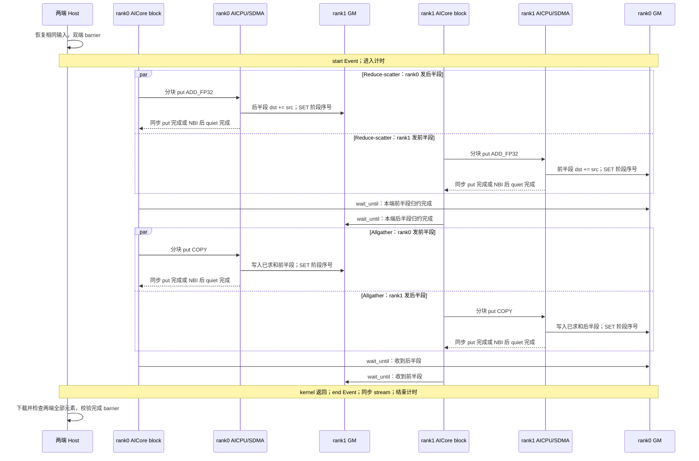

# TP=2 SHMEM 与 HCCL AllReduce 基准

[main.asc](main.asc) 提供四种 MF 模式和一个 HCCL 基线。
每组均为同一张 Atlas 300I Duo 两个 die 上的两进程、FP32、原地 SUM，逐元素检查两个 rank 的完整输出。
独立 put/get/通知接口的单 AICore 性能测试见 [shmem_api_310p](../shmem_api_310p/README.md)。

## 测试用例、接口与方案

所有用例均由 `runSize → submit` 调用。MF 进入 `mfAllReduce → reducePhase`，HCCL 调用 `HcclAllReduce`。
下表 SDMA 函数的公共前缀为 `smem_shm_sdma_`；通知等待入口为 `smem_shm_signal_wait_until`。

| 测试用例 | 数据接口 | 完成与通知接口 | 每个阶段的执行方案 |
|---|---|---|---|
| mf-sync | `put_at` | 每块同步完成，`signal_set_at`，`signal_wait_until` | 依次传输所有 chunk，单独发送 SET，再等对端通知 |
| mf-nbi | `put_nbi_at` | `quiet_at`，`signal_set_at`，`signal_wait_until` | 所有 chunk 入队后统一 quiet，再单独发送 SET 和等对端通知 |
| mf-signal | 前面的 chunk 调用 `put_at`，最后一个调用 `put_signal_at` | 同步完成，`signal_wait_until` | 最后一块传输同时带 SET，再等对端通知 |
| mf-signal-nbi | 前面的 chunk 调用 `put_nbi_at`，最后一个调用 `put_signal_nbi_at` | `quiet_at`，`signal_wait_until` | 数据及末块通知全部入队后统一 quiet，再等对端通知 |
| hccl | `HcclAllReduce(..., HCCL_DATA_TYPE_FP32, HCCL_REDUCE_SUM, ...)` | stream 同步 | 一次调用处理完整矩阵 |

MF 将矩阵按连续元素下标分成等长的前、后两半，每个 rank 的 kernel 连续执行两个阶段：

1. **Reduce-scatter**：rank 0 把后半段发送到 rank 1 的后半段，rank 1 把前半段发送到 rank 0 的前半段，
   put 的操作参数为 `SMEM_SHM_SDMA_OP_ADD_FP32`，SDMA 完成远端 `dst += src`。
   两端发送完成通知并等待对端，rank 0 持有完整求和后的前半段，rank 1 持有完整求和后的后半段。
2. **Allgather**：rank 0 把求和后的前半段复制到 rank 1，rank 1 把求和后的后半段复制到 rank 0，
   put 的操作参数为 `SMEM_SHM_SDMA_OP_COPY`。两端交换完成通知后，各自持有完整 SUM 结果。

`BLOCKS` 个 AICore block 各自负责半矩阵中的等长片段；`CHUNKS` 把每个 block 的片段继续等分。
每个 block 独立提交请求，拥有两个阶段各自的通知槽，按该 block 的完成状态继续。
AICore 负责请求提交、quiet 和通知等待，FP32 求和与拷贝由 SDMA 完成。
请求经本端 AICPU 消费并提交 SDMA 队列；数据、通知和 quiet 完成标记按队列顺序执行。
使用 NBI 的用例在每个阶段执行 quiet；使用联合通知的用例将 SET 附在最后一个 chunk 上。



图中的“数据后 SET”在 mf-sync/mf-nbi 中通过独立请求完成，在 mf-signal/mf-signal-nbi 中由末块联合请求完成。
HCCL 用例使用同样的输入与计时流程，内部算法由当前 HCCL 库选择。

## 数据规模与统计口径

| 矩阵 shape | FP32 元素数 | 每 rank 完整输入 | 每阶段每 rank 发送量 | 每 chunk 字节数 |
|---|---:|---:|---:|---|
| 256 × 256 | 65,536 | 256 KiB | 128 KiB | `128 KiB / BLOCKS / CHUNKS` |
| 512 × 512 | 262,144 | 1 MiB | 512 KiB | `512 KiB / BLOCKS / CHUNKS` |
| 1024 × 1024 | 1,048,576 | 4 MiB | 2 MiB | `2 MiB / BLOCKS / CHUNKS` |
| 2048 × 2048 | 4,194,304 | 16 MiB | 8 MiB | `8 MiB / BLOCKS / CHUNKS` |
| 4096 × 4096 | 16,777,216 | 64 MiB | 32 MiB | `32 MiB / BLOCKS / CHUNKS` |

默认每组预热 10 轮、正式采样 100 轮。每轮恢复输入并执行相同 Host barrier 后计时，结束后检查全部元素。
输入按 rank 和下标生成，每个位置的期望值为两个 rank 原始输入之和。
初始化、输入恢复、barrier、结果下载和检查均在计时外。

- **Event 时间**：同一 stream 上 start/end Event 的时间间隔。
- **Host 总时间**：记录 start Event 之前，到 stream 同步返回。
- **enqueue 时间**：提交 kernel 或 `HcclAllReduce` 调用的 Host 耗时。

`summarize.py` 先对每轮、每项指标取两个 rank 的较大值，再统计平均值、P50、P95、P99 和最大值。
P95/P99 采用排序后的向上取整位置，P50 使用中位数。以上三个时间各自统计。
对比表以 Event 平均时间计算 `HCCL / MF` 倍率，大于 1 表示该组 MF 耗时较短。

## 构建与复现

```bash
source /usr/local/Ascend/cann-9.1.0/set_env.sh
bash script/build_and_pack_run.sh --build_python OFF
DEVICE_BASE=0 BACKEND=all BLOCKS=1 CHUNKS=1 WARMUP=10 ROUNDS=100 \
 LOG_DIR=/workspace/my-logs-dir/memfabric-allreduce/b1-c1 \
 bash benchmark/shmem_310p/run.sh
```

`BACKEND=both` 运行 mf-signal 和 hccl；`BACKEND=all` 运行全部五种模式；也可传入空格分隔的模式名。
`BLOCKS` 支持 1/2/4/8，`CHUNKS` 支持 1～64 的 2 次幂。HCCL 每次处理整个矩阵。
可调整 `DEVICE_BASE`、`WARMUP`、`ROUNDS`、`TIMEOUT`、`STORE_URL`、`MF_SDMA_ORCH_DIR` 和 `HCCL_BUFFSIZE`。
默认 HCCL 缓冲区为 64 MiB，启用 PCIe，关闭 RoCE。运行前通过 `npu-smi info` 确认设备空闲。
原始逐轮记录在每个后端目录的 `rank0.log`、`rank1.log`，聚合数据在 `summary.json`。
测试脚本只管理本次启动的进程。

## 性能结果与 HCCL 汇总对比

实测日期：2026-11-23；逻辑设备 0、1，Atlas 300I Duo（Ascend310P3），
CANN 9.1.0、驱动 26.1.1，Release 构建。MF 使用 BLOCKS=1、CHUNKS=1。
正式采样计划为预热 10 轮、采样 100 轮；首个 256 × 256 用例在完成等待阶段超时。
补充诊断运行使用 0 次预热、1 次测试，将 stream 同步超时缩短到 15 秒。
HCCL 使用原始基准的 60 秒 stream 同步超时；各组原始日志均保留实际返回码。

### 各模式运行结果

| 测试用例 | 256 × 256 | 512 × 512 | 1024 × 1024 | 2048 × 2048 | 4096 × 4096 |
|---|---|---|---|---|---|
| mf-sync | 首轮超时 507046 | 未采样 | 未采样 | 未采样 | 未采样 |
| mf-nbi | 首轮超时 507046 | 未采样 | 未采样 | 未采样 | 未采样 |
| mf-signal | 首轮超时 507046 | 未采样 | 未采样 | 未采样 | 未采样 |
| mf-signal-nbi | 首轮超时 507046 | 未采样 | 未采样 | 未采样 | 未采样 |
| hccl | 受其他进程占用干扰，数据作废 | 未采样 | 未采样 | 未采样 | 未采样 |

### HCCL 基线汇总

时间单位为 μs；各 MF 列计划填写 Event 均值及 HCCL / MF 倍率。当前 HCCL 和 MF 均缺少完整有效样本，
耗时及倍率记为“—”。BLOCKS=1、CHUNKS=1，FP32 原地 SUM，TP=2。

| 矩阵 shape | 每 rank 输入 | HCCL | mf-sync | mf-nbi | mf-signal | mf-signal-nbi |
|---|---:|---:|---:|---:|---:|---:|
| 256 × 256 | 256 KiB | — | — | — | — | — |
| 512 × 512 | 1 MiB | — | — | — | — | — |
| 1024 × 1024 | 4 MiB | — | — | — | — | — |
| 2048 × 2048 | 16 MiB | — | — | — | — | — |
| 4096 × 4096 | 64 MiB | — | — | — | — | — |

### 部署与提交路径诊断

通过独立诊断程序检查 AICPU 部署。诊断时临时强制执行设备 SO 与 Host SO 的逐字节比较，
验证完成后恢复主库源码和构建产物。部署文件按进程生成独立名称。

| 检查项 | 设备 0 | 设备 1 |
|---|---|---|
| CANN 返回的部署 PID 与当前进程 PID | 一致 | 一致 |
| CUST 迁移及复制 | 成功，19,112 B | 成功，19,112 B |
| 设备 SO 与本次构建产物逐字节比较 | 全部一致 | 全部一致 |
| kernel 协议标识 / 运行状态 | 0x5d0a0009 / RUNNING | 0x5d0a0009 / RUNNING |
| SSID 查询 | 返回 0，SSID=2 | 返回 0，SSID=1 |
| 请求队列 tail / head | 1 / 1 | 1 / 1 |
| SDMA 提交尾值 / 提交返回码 | 2 / 0 | 2 / 0 |
| quiet 完成标记 | 0 | 0 |
| 15 秒后期望归约结果 | 目标半矩阵仍为原始输入 | 目标半矩阵仍为原始输入 |

部署及启动检查通过，请求已被 AICPU 消费并提交到 SDMA 队列。
同日补充的纯 CANN 本地 1 MiB 异步 D2D 测试在两个设备上均返回流同步超时 507046，
运行时日志同时记录 halSqCqQuery 返回 65534。当前定位到提交后的队列执行或完成路径，
具体失败原因仍需进一步确认。

相关实现见 [AICPU 部署及启动](../../src/hybm/csrc/entity/hybm_sdma_orchestrator.cpp)、
[请求消费及 SDMA 提交](../../src/hybm/ops/hybm_kernel/hybm_sdma_orch_kernel.cc)。
运行成功后按本节统计口径补充五种模式、五种尺寸的耗时及 HCCL 倍率。
