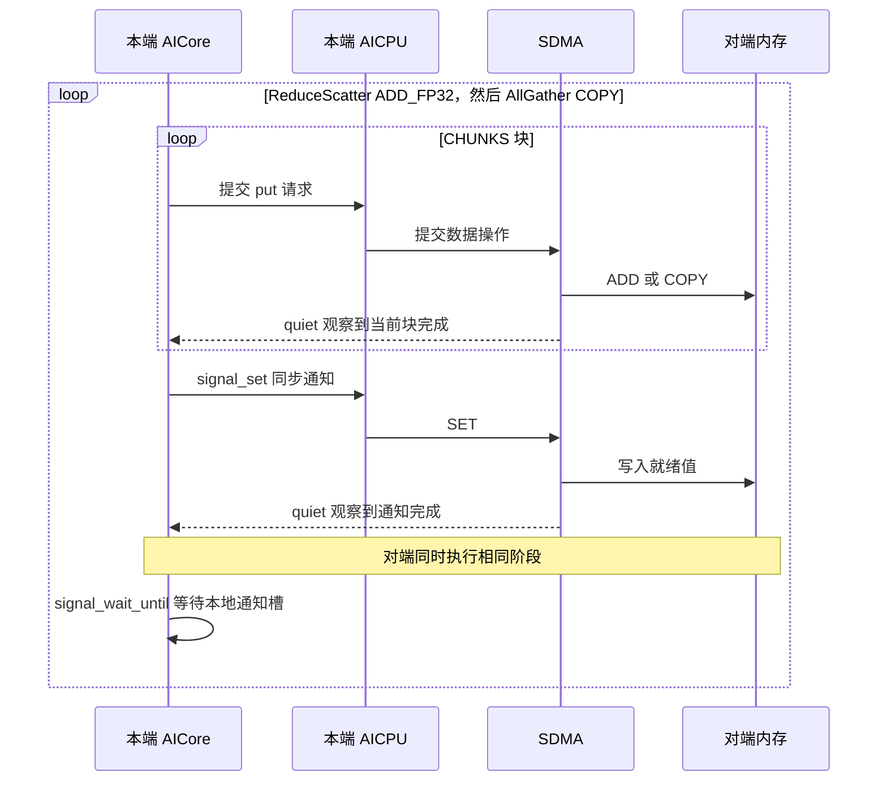
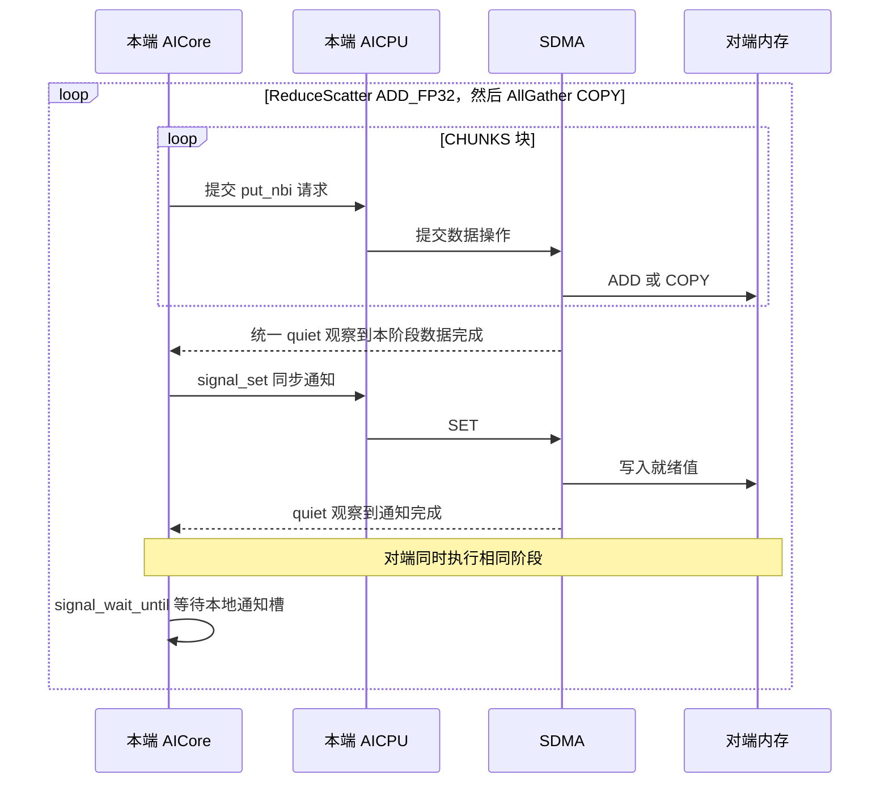
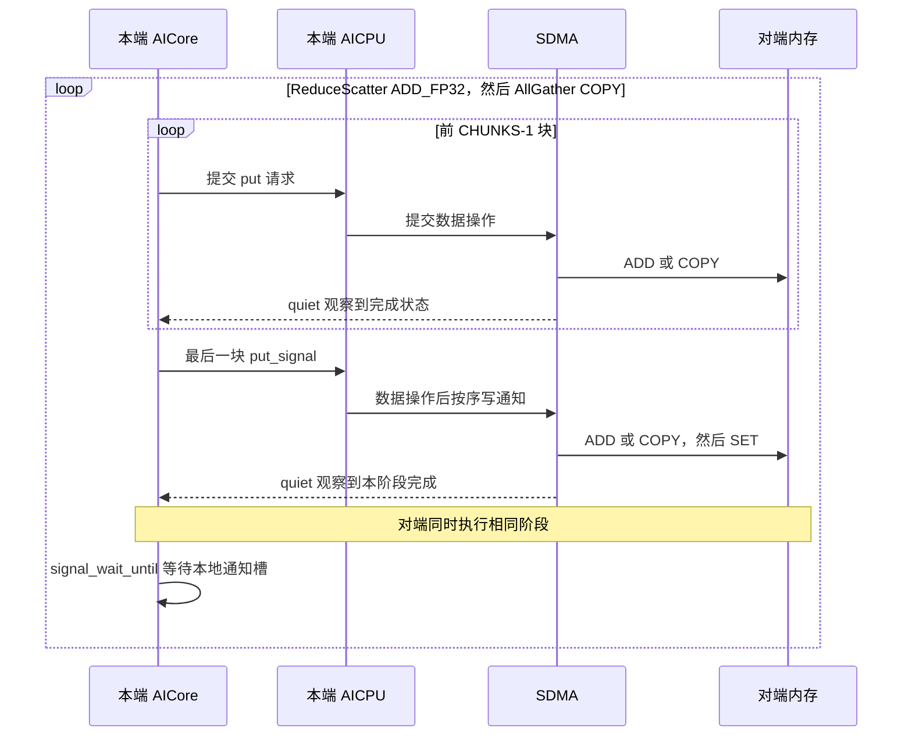
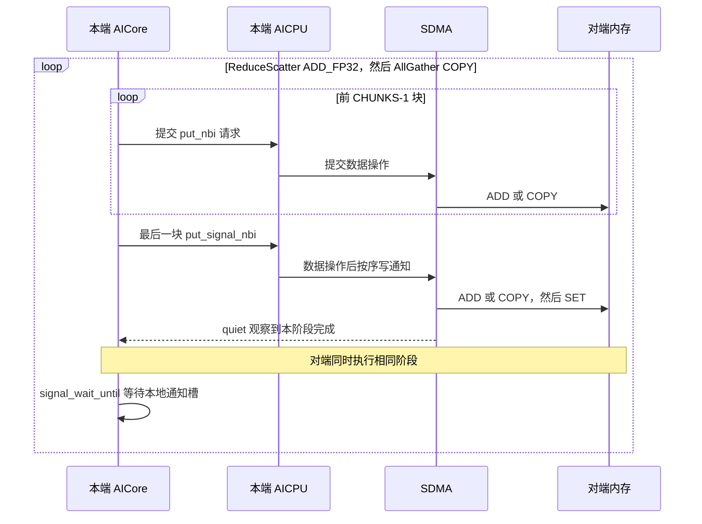
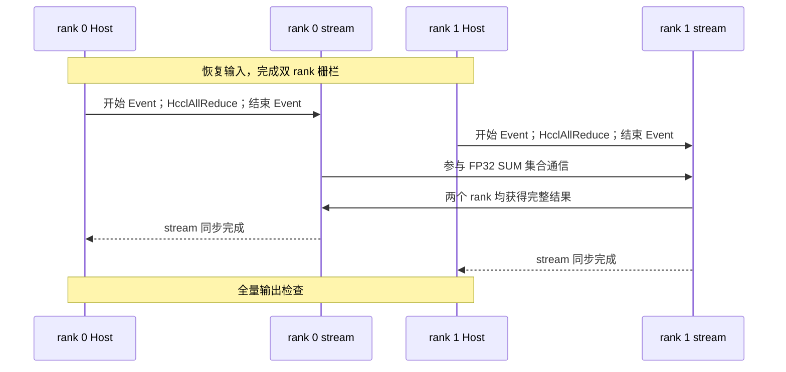

# TP=2 SHMEM 与 HCCL AllReduce：实现、测试方案与性能

## 测试对象与条件

入口为 [main.asc](main.asc) 的 `mfAllReduce`、`reducePhase` 和 `runSize`。
同一程序提供四种 MemFabric 实现与 HCCL，两个进程各绑定一个逻辑设备，执行 FP32 原地 SUM。
输入为 256、512、1024、2048、4096 方阵，分别占 0.25、1、4、16、64 MiB。

以下数据采于 2026-11-23：Atlas 300I Duo（Ascend310P3）的逻辑设备 0、1，
对应同一张卡上的两个 die；CANN 9.1.0，驱动 26.1.1，Release Host 库及配套 AICPU kernel。
四组配置分别为 `BLOCKS/CHUNKS=1/1、1/8、8/1、8/8`。
BLOCKS 是每个 rank 启动的 AICore block 数，CHUNKS 是每个 block 每阶段的分块数。
**BLOCKS/CHUNKS（B/C）只控制 MemFabric 的 AICore 数和请求分块；
HCCL 各行的 B/C 标识对应采样批次，每轮均以完整矩阵调用一次 HcclAllReduce。**
HCCL 在本测试中选中 AllReduceDoublingDirect，数据任务按完整输入及通信缓冲容量组织。
每组均独立重新测试 HCCL：缓冲区 64 MiB，启用 PCIe，关闭 RoCE。
测试在共享服务器上执行，服务器有其他常驻进程，表格记录各组采样期间的结果。

每种模式、每个尺寸先预热 10 轮，再采集 100 轮；预热及正式测试均逐元素检查完整输出。
每轮输入恢复、双 rank 栅栏与结果检查位于计时外。MF 同时检查每个 block 的两个阶段状态。
每轮对相同指标取两个 rank 的较大值，再计算均值、P50、P95、P99、最大值。
所有时间单位均为 µs，原始样本由各后端的 `rank0.log`、`rank1.log` 保存。

| 指标 | 计时范围 |
|---|---|
| Event | stream 上开始 Event 至结束 Event，包含这次 AllReduce 执行和设备端等待 |
| Host | 记录开始 Event 之前至 stream 同步返回，包含 Event 提交、算子提交和等待 |
| 提交 | MF kernel launch 或 `HcclAllReduce` 调用开始至返回 |

这三个计时范围有重叠，分别阅读。正文表格展示 Event 的全部统计及另外两项的均值，
折叠表补齐 Host 和提交耗时的全部统计。

## 构建与复现

加载 CANN 环境后，在仓库根目录构建本次测试使用的 Host 库及 AICPU kernel：

```bash
bash script/build_and_pack_run.sh
cd benchmark/shmem_310p
export LOG_ROOT=/path/to/logs
for blocks in 1 8; do
  for chunks in 1 8; do
    DEVICE_BASE=0 BACKEND="hccl mf-sync mf-nbi mf-signal mf-signal-nbi" \
      BLOCKS="$blocks" CHUNKS="$chunks" WARMUP=10 ROUNDS=100 \
      LOG_DIR="$LOG_ROOT/b$blocks-c$chunks" bash run.sh
  done
done
```

`BACKEND=both` 运行 mf-signal、hccl，`BACKEND=all` 运行全部五种模式，
也支持空格分隔的后端列表。BLOCKS 支持 1/2/4/8，CHUNKS 支持 1～64 的 2 次幂。
上表数据覆盖上述四组配置。可通过 TIMEOUT、STORE_URL、MF_SDMA_ORCH_DIR、HCCL_BUFFSIZE 指定运行参数。
`python3 summarize.py LOG_DIR` 从完整校验通过的日志生成 `summary.json`。
运行前检查所选设备的使用情况；程序保留其他进程。

## 共用的数据分工

本节描述四种 MemFabric 模式共用的 ReduceScatter + AllGather 分工。
HCCL 的完整输入交换及缓冲区分段见下文 [HCCL 的内部数据任务大小](#hccl-的内部数据任务大小)。

矩阵总字节数记为 N。每个 block 在每个阶段处理 N/(2×BLOCKS) 字节，
每条数据请求为 N/(2×BLOCKS×CHUNKS) 字节。

1. **ReduceScatter**：每个 rank 将“对端负责的半区”发送到对端相同偏移，
   使用 `SMEM_SHM_SDMA_OP_ADD_FP32` 将数据加到对端输入上。
   两个 rank 同时执行后，rank 0 保存求和后的前半区，rank 1 保存求和后的后半区。
2. **AllGather**：每个 rank 将“本端负责的、已经求和的半区”复制到对端，
   使用 `SMEM_SHM_SDMA_OP_COPY`，使双方均得到完整结果。
3. 每阶段按 block 设置独立的就绪通知槽，并等待对端同阶段的通知。
   两个阶段使用不同槽位，每轮通知值包含矩阵尺寸和轮次，避免复用旧通知。

每个 rank 共提交 2×BLOCKS×CHUNKS 条数据请求，每轮向对端发送 N 字节。
独立通知模式另外提交 2×BLOCKS 条 SET 请求；融合通知模式将通知附在各 block 每阶段最后一条数据请求上。
AICore 通过请求队列提交操作，AICPU 扫描队列并组织 SDMA 执行，quiet 等待本 block 的完成状态。
相关入口见 [设备接口](../../src/smem/include/device/smem_shm_aicore_base_sdma.h)、
[AICPU kernel](../../src/hybm/ops/hybm_kernel/hybm_sdma_orch_kernel.cc) 与
[就绪通知封装](../../examples/memory_pool/01_basic/sdma_ready.h)。

### 矩阵大小、chunk 大小与请求字节数的计算

这里的 **chunk 是一次数据 API 调用搬运的连续片段**。
CHUNKS 表示每个 block 在每个阶段提交多少个这样的片段；每个片段的大小由矩阵形状、
数据类型、BLOCKS 和 CHUNKS 共同决定。四种 MF 模式采用同样的数据划分，
差别在于提交后的等待方式及通知组织。

**第一步：将矩阵形状换算为每个 rank 的输入字节数。**

设方阵边长为 D，元素个数为 D×D。每个 FP32 元素占 4 字节，因此完整矩阵大小为：

```text
元素个数 = D × D
N = D × D × sizeof(float) = D × D × 4 字节
1 KiB = 1,024 字节
1 MiB = 1,048,576 字节
```

两个 rank 各自持有一个完整输入矩阵，原地 AllReduce 结束后各自得到同样大小的结果矩阵。

| 矩阵形状 | 每个 rank 的 FP32 元素数 | 每个 rank 的完整矩阵 N（字节） | N（MiB） | 每个 rank 每阶段发送 N/2（字节） |
|---|---:|---:|---:|---:|
| 256×256 | 65,536 | 262,144 | 0.25 | 131,072 |
| 512×512 | 262,144 | 1,048,576 | 1 | 524,288 |
| 1024×1024 | 1,048,576 | 4,194,304 | 4 | 2,097,152 |
| 2048×2048 | 4,194,304 | 16,777,216 | 16 | 8,388,608 |
| 4096×4096 | 16,777,216 | 67,108,864 | 64 | 33,554,432 |

**第二步：按双 rank 的半区分工除以 2。**

本基准固定 TP=2，将连续矩阵缓冲区分为前、后两半，每半占 N/2 字节。
设 rank 0 的输入为 [A0, A1]，rank 1 的输入为 [B0, B1]，下标 0、1 表示前、后半区：

| 阶段 | rank 0 发送的内容 | rank 1 发送的内容 | 每个 rank 本阶段发送的数据量 |
|---|---|---|---|
| ReduceScatter | 将 A1 发送到 rank 1，在 B1 上执行 ADD_FP32 | 将 B0 发送到 rank 0，在 A0 上执行 ADD_FP32 | N/2 字节 |
| AllGather | 将本端已求和的 A0+B0 复制到 rank 1 | 将本端已求和的 A1+B1 复制到 rank 0 | N/2 字节 |

分母中的 2 来自这两个 rank 对前、后半区的分工：每个 rank 在每个阶段发送一半矩阵。
ReduceScatter 结束后，rank 0 负责前半区的求和结果，rank 1 负责后半区的求和结果；
AllGather 再交换这两份结果，使双方都得到完整矩阵。
所以每阶段的数据量为 N/2，每个 rank 一轮的累计发送量为 N/2+N/2=N 字节。

**第三步：分给 BLOCKS 个 AICore block，再拆成 CHUNKS 条请求。**

每个阶段的 N/2 字节先均分给 BLOCKS 个 block，各 block 处理独立片段；
每个 block 再将自己的片段均分为 CHUNKS 个 chunk，每个 chunk 提交一条数据请求。
计算顺序与 [main.asc](main.asc) 的 `runSize`、`submit` 和 `reducePhase` 对应：

```text
matrixBytes   = D × D × 4                         # runSize 中的 bytes，即 N
half          = matrixBytes / 2                  # submit 传给 kernel 的 half
bytesPerBlock = half / BLOCKS                    # 一个 block 在一个阶段负责的数据量
chunkBytes    = bytesPerBlock / CHUNKS            # reducePhase 每次传给数据 API 的 bytes
              = N / (2 × BLOCKS × CHUNKS)
```

设 block 编号为 blockId，分块编号为 chunkId；own 和 peer 分别为本端、对端共享段的起始地址。
每个分块在两端使用相同的字节偏移：

```text
if phase == ReduceScatter:
    halfIndex = 1 - rank   # 发送对端负责的半区
else:                     # AllGather
    halfIndex = rank       # 发送本端负责的求和结果半区
offset = halfIndex × half + blockId × bytesPerBlock + chunkId × chunkBytes
src = own + offset
dst = peer + offset
bytes = chunkBytes
```

其中 blockId 取 0～BLOCKS−1，chunkId 取 0～CHUNKS−1。
ReduceScatter 将这些字节按 FP32 做 ADD，AllGather 按同样大小做 COPY。
四种 MF 模式的数据 API 都传入上述 chunkBytes；携带通知的最后一条请求采用相同的数据字节数。

**以 4096×4096、BLOCKS=8、CHUNKS=8 为例：**

```text
完整矩阵：4096 × 4096 × 4 = 67,108,864 字节 = 64 MiB
每个 rank 每阶段：67,108,864 / 2 = 33,554,432 字节 = 32 MiB
每个 block 每阶段：33,554,432 / 8 = 4,194,304 字节 = 4 MiB
每条数据请求：4,194,304 / 8 = 524,288 字节 = 512 KiB

每个 rank 每阶段：8 × 8 = 64 条数据请求
每个 rank 两个阶段：2 × 64 = 128 条数据请求
累计发送矩阵数据：128 × 524,288 = 67,108,864 字节 = 64 MiB
```

本次四组配置下，每条数据请求的矩阵数据字节数如下，括号中给出 KiB 换算值：

| 矩阵形状 | BLOCKS/CHUNKS=1/1 | BLOCKS/CHUNKS=1/8 | BLOCKS/CHUNKS=8/1 | BLOCKS/CHUNKS=8/8 |
|---|---:|---:|---:|---:|
| 256×256 | 131,072（128 KiB） | 16,384（16 KiB） | 16,384（16 KiB） | 2,048（2 KiB） |
| 512×512 | 524,288（512 KiB） | 65,536（64 KiB） | 65,536（64 KiB） | 8,192（8 KiB） |
| 1024×1024 | 2,097,152（2,048 KiB） | 262,144（256 KiB） | 262,144（256 KiB） | 32,768（32 KiB） |
| 2048×2048 | 8,388,608（8,192 KiB） | 1,048,576（1,024 KiB） | 1,048,576（1,024 KiB） | 131,072（128 KiB） |
| 4096×4096 | 33,554,432（32,768 KiB） | 4,194,304（4,096 KiB） | 4,194,304（4,096 KiB） | 524,288（512 KiB） |

1/8 和 8/1 的 chunk 字节数相同：前者由一个 block 提交 8 条数据请求，
后者由 8 个 block 各提交一条，使用的队列和提交组织不同。
这些矩阵及分块配置均能整除，且每条数据请求的长度均满足 4 字节对齐。
上述字节数统计矩阵数据；独立 SET 通知写入 8 字节通知值，
put_signal 的数据参数仍为 chunkBytes，通知值随同该数据请求组织。

下面每个 MF 时序图展示一个 rank、一个 block 的执行；对端同时执行相同流程。
数据由 Host DMA 恢复，AllReduce kernel 通过 SDMA 操作这些数据。

## mf-sync

**测试用例与接口**：`BACKEND=mf-sync`，使用 `smem_shm_sdma_put_at`、
`smem_shm_sdma_signal_set_at` 和 `smem_shm_signal_wait_until`。

**测试方案**：每块使用同步 put，等待该块数据完成后再提交下一块；阶段数据全部完成后，
额外提交同步 SET 通知，再等待对端就绪。两个阶段分别使用 ADD_FP32 和 COPY。



**测试性能结果**：

| BLOCKS/CHUNKS | 方阵 | Event 均值 | P50 | P95 | P99 | 最大 | Host 均值 | 提交均值 |
|---|---:|---:|---:|---:|---:|---:|---:|---:|
| 1/1 | 256 | 149.611 | 148.984 | 158.256 | 163.229 | 163.672 | 282.733 | 34.610 |
| 1/1 | 512 | 219.759 | 206.380 | 233.099 | 265.026 | 1267.161 | 361.766 | 39.408 |
| 1/1 | 1024 | 409.092 | 395.014 | 418.828 | 433.229 | 1436.510 | 532.481 | 37.454 |
| 1/1 | 2048 | 1170.164 | 1152.943 | 1188.020 | 1544.505 | 2178.515 | 1303.772 | 41.761 |
| 1/1 | 4096 | 4289.132 | 4195.092 | 4249.584 | 5258.750 | 12182.213 | 4435.127 | 47.579 |
| 1/8 | 256 | 321.341 | 281.106 | 430.573 | 1339.140 | 1347.110 | 445.776 | 14.276 |
| 1/8 | 512 | 401.959 | 348.086 | 492.135 | 1542.578 | 1578.386 | 534.875 | 25.550 |
| 1/8 | 1024 | 569.810 | 531.745 | 664.922 | 1594.089 | 1594.192 | 693.527 | 27.220 |
| 1/8 | 2048 | 1375.590 | 1294.688 | 1476.120 | 2364.271 | 2483.646 | 1505.094 | 24.101 |
| 1/8 | 4096 | 4438.372 | 4405.872 | 4562.240 | 5522.656 | 5564.011 | 4567.993 | 32.377 |
| 8/1 | 256 | 265.461 | 201.797 | 1251.354 | 1263.594 | 1266.354 | 391.514 | 11.899 |
| 8/1 | 512 | 302.915 | 238.894 | 1285.260 | 1291.276 | 1292.213 | 432.766 | 13.152 |
| 8/1 | 1024 | 467.648 | 403.945 | 1421.510 | 1457.318 | 1466.458 | 608.595 | 20.904 |
| 8/1 | 2048 | 1206.492 | 1162.604 | 1824.193 | 1908.776 | 1954.974 | 1348.031 | 32.558 |
| 8/1 | 4096 | 4254.832 | 4209.128 | 4510.625 | 5243.854 | 5286.198 | 4407.974 | 45.929 |
| 8/8 | 256 | 834.831 | 553.425 | 1610.677 | 1614.375 | 1621.875 | 960.875 | 15.367 |
| 8/8 | 512 | 861.573 | 568.919 | 1622.370 | 1626.484 | 1637.370 | 993.018 | 19.384 |
| 8/8 | 1024 | 979.170 | 687.005 | 1738.698 | 1749.063 | 1765.208 | 1114.310 | 17.639 |
| 8/8 | 2048 | 1652.833 | 1382.226 | 2413.386 | 2504.323 | 2545.104 | 1799.284 | 57.436 |
| 8/8 | 4096 | 4670.224 | 4416.627 | 5346.381 | 5443.333 | 6197.786 | 4868.958 | 95.694 |

**比较条件：B/C 仅控制 MF；每 rank 完整输入为 N 字节时，
MF 分两阶段提交 2×B×C 条数据请求，每条 N/(2×B×C) 字节，另有通知与完成管理。
HCCL 的 B/C 标识对应独立采样批次，在本表 64 MiB 缓冲条件下每次 API 以 N 字节执行一次跨卡归约。
这些数值比较相同输入和输出要求下的整体 AllReduce 实现耗时，请求粒度、同步组织和调度资源各按对应实现执行。**

<details>
<summary>Host 与提交耗时的完整统计（µs）</summary>

| BLOCKS/CHUNKS | 方阵 | 指标 | 均值 | P50 | P95 | P99 | 最大 |
|---|---:|---|---:|---:|---:|---:|---:|
| 1/1 | 256 | Host | 282.733 | 280.835 | 296.200 | 312.680 | 329.920 |
| 1/1 | 256 | 提交 | 34.610 | 34.465 | 36.510 | 36.960 | 38.480 |
| 1/1 | 512 | Host | 361.766 | 341.345 | 410.220 | 478.030 | 1411.170 |
| 1/1 | 512 | 提交 | 39.408 | 30.425 | 69.650 | 87.760 | 106.780 |
| 1/1 | 1024 | Host | 532.481 | 517.630 | 552.860 | 564.110 | 1552.430 |
| 1/1 | 1024 | 提交 | 37.454 | 34.115 | 49.290 | 53.650 | 60.360 |
| 1/1 | 2048 | Host | 1303.772 | 1275.165 | 1428.070 | 1681.570 | 2291.450 |
| 1/1 | 2048 | 提交 | 41.761 | 34.315 | 70.560 | 100.540 | 340.360 |
| 1/1 | 4096 | Host | 4435.127 | 4337.325 | 4394.670 | 5400.990 | 12597.250 |
| 1/1 | 4096 | 提交 | 47.579 | 45.840 | 57.550 | 67.190 | 68.320 |
| 1/8 | 256 | Host | 445.776 | 406.775 | 550.800 | 1468.690 | 1474.820 |
| 1/8 | 256 | 提交 | 14.276 | 13.970 | 15.250 | 21.690 | 27.870 |
| 1/8 | 512 | Host | 534.875 | 481.480 | 627.380 | 1677.110 | 1725.460 |
| 1/8 | 512 | 提交 | 25.550 | 24.620 | 38.800 | 48.760 | 53.620 |
| 1/8 | 1024 | Host | 693.527 | 657.845 | 782.260 | 1711.840 | 1716.940 |
| 1/8 | 1024 | 提交 | 27.220 | 24.785 | 37.560 | 39.820 | 40.420 |
| 1/8 | 2048 | Host | 1505.094 | 1426.400 | 1621.110 | 2500.860 | 2606.160 |
| 1/8 | 2048 | 提交 | 24.101 | 21.910 | 32.800 | 61.230 | 64.700 |
| 1/8 | 4096 | Host | 4567.993 | 4535.050 | 4686.140 | 5652.270 | 5684.190 |
| 1/8 | 4096 | 提交 | 32.377 | 31.690 | 45.650 | 67.250 | 69.730 |
| 8/1 | 256 | Host | 391.514 | 327.985 | 1378.570 | 1387.000 | 1394.680 |
| 8/1 | 256 | 提交 | 11.899 | 11.740 | 13.020 | 13.310 | 13.400 |
| 8/1 | 512 | Host | 432.766 | 368.395 | 1416.570 | 1426.070 | 1442.200 |
| 8/1 | 512 | 提交 | 13.152 | 12.970 | 13.910 | 16.020 | 23.360 |
| 8/1 | 1024 | Host | 608.595 | 542.465 | 1554.310 | 1604.310 | 1608.400 |
| 8/1 | 1024 | 提交 | 20.904 | 22.835 | 31.050 | 45.050 | 59.370 |
| 8/1 | 2048 | Host | 1348.031 | 1305.610 | 1950.780 | 2053.090 | 2112.940 |
| 8/1 | 2048 | 提交 | 32.558 | 30.445 | 41.050 | 51.940 | 60.920 |
| 8/1 | 4096 | Host | 4407.974 | 4366.965 | 4663.920 | 5395.290 | 5439.470 |
| 8/1 | 4096 | 提交 | 45.929 | 50.140 | 55.440 | 63.960 | 68.950 |
| 8/8 | 256 | Host | 960.875 | 677.630 | 1741.800 | 1748.890 | 1759.940 |
| 8/8 | 256 | 提交 | 15.367 | 15.180 | 17.280 | 17.800 | 18.770 |
| 8/8 | 512 | Host | 993.018 | 699.825 | 1757.120 | 1764.720 | 1793.000 |
| 8/8 | 512 | 提交 | 19.384 | 19.285 | 21.400 | 22.580 | 23.840 |
| 8/8 | 1024 | Host | 1114.310 | 823.065 | 1874.870 | 1888.500 | 1898.300 |
| 8/8 | 1024 | 提交 | 17.639 | 16.855 | 19.840 | 43.270 | 55.330 |
| 8/8 | 2048 | Host | 1799.284 | 1538.420 | 2572.920 | 2641.340 | 2721.440 |
| 8/8 | 2048 | 提交 | 57.436 | 61.815 | 85.160 | 111.150 | 147.100 |
| 8/8 | 4096 | Host | 4868.958 | 4622.355 | 5566.490 | 5638.690 | 6357.510 |
| 8/8 | 4096 | 提交 | 95.694 | 85.945 | 111.790 | 714.020 | 723.980 |

**比较条件：B/C 仅控制 MF；每 rank 完整输入为 N 字节时，
MF 分两阶段提交 2×B×C 条数据请求，每条 N/(2×B×C) 字节，另有通知与完成管理。
HCCL 的 B/C 标识对应独立采样批次，在本表 64 MiB 缓冲条件下每次 API 以 N 字节执行一次跨卡归约。
这些数值比较相同输入和输出要求下的整体 AllReduce 实现耗时，请求粒度、同步组织和调度资源各按对应实现执行。**

</details>

## mf-nbi

**测试用例与接口**：`BACKEND=mf-nbi`，使用 `smem_shm_sdma_put_nbi_at`、
`smem_shm_sdma_quiet_at`、`smem_shm_sdma_signal_set_at` 和 `smem_shm_signal_wait_until`。

**测试方案**：每阶段分块提交 NBI 请求，然后统一 quiet；数据完成后提交同步 SET 通知，
再等待对端就绪。请求环满时，NBI 调用会等待空位。两个阶段分别使用 ADD_FP32 和 COPY。



**测试性能结果**：

| BLOCKS/CHUNKS | 方阵 | Event 均值 | P50 | P95 | P99 | 最大 | Host 均值 | 提交均值 |
|---|---:|---:|---:|---:|---:|---:|---:|---:|
| 1/1 | 256 | 146.652 | 145.586 | 156.667 | 159.765 | 160.521 | 267.050 | 12.454 |
| 1/1 | 512 | 210.879 | 198.789 | 213.333 | 238.412 | 1261.094 | 336.557 | 20.800 |
| 1/1 | 1024 | 400.178 | 388.815 | 396.745 | 407.161 | 1443.021 | 529.086 | 24.230 |
| 1/1 | 2048 | 1171.919 | 1155.820 | 1205.286 | 1251.354 | 2172.812 | 1309.359 | 38.531 |
| 1/1 | 4096 | 4220.855 | 4197.084 | 4253.229 | 5118.802 | 5245.260 | 4400.135 | 73.295 |
| 1/8 | 256 | 245.846 | 205.794 | 347.187 | 1263.567 | 1321.875 | 373.058 | 14.811 |
| 1/8 | 512 | 289.858 | 241.120 | 385.469 | 1301.511 | 1454.583 | 415.306 | 18.155 |
| 1/8 | 1024 | 458.593 | 414.401 | 551.979 | 1437.943 | 1461.823 | 585.397 | 21.335 |
| 1/8 | 2048 | 1223.543 | 1174.271 | 1309.010 | 2162.058 | 2241.901 | 1350.483 | 33.185 |
| 1/8 | 4096 | 4237.838 | 4211.093 | 4332.161 | 4787.266 | 5270.703 | 4375.329 | 44.967 |
| 8/1 | 256 | 266.582 | 202.631 | 1253.099 | 1265.495 | 1265.833 | 395.265 | 13.890 |
| 8/1 | 512 | 304.389 | 240.586 | 1278.672 | 1292.630 | 1297.213 | 436.392 | 17.911 |
| 8/1 | 1024 | 470.018 | 405.859 | 1436.563 | 1455.260 | 1471.693 | 607.985 | 29.559 |
| 8/1 | 2048 | 1212.264 | 1166.953 | 1754.609 | 1908.073 | 1958.567 | 1331.918 | 31.719 |
| 8/1 | 4096 | 4245.783 | 4203.997 | 4518.360 | 5232.317 | 5236.250 | 4389.176 | 45.065 |
| 8/8 | 256 | 853.897 | 555.378 | 1633.151 | 1737.031 | 1740.807 | 985.600 | 20.114 |
| 8/8 | 512 | 879.366 | 567.513 | 1648.412 | 1752.005 | 1754.297 | 1009.911 | 21.185 |
| 8/8 | 1024 | 996.454 | 681.927 | 1734.505 | 1864.739 | 1877.917 | 1124.874 | 23.293 |
| 8/8 | 2048 | 1628.667 | 1357.800 | 2374.480 | 2394.401 | 2405.808 | 1758.710 | 30.713 |
| 8/8 | 4096 | 4398.503 | 4377.396 | 4496.328 | 4627.083 | 4869.765 | 4526.712 | 36.424 |

**比较条件：B/C 仅控制 MF；每 rank 完整输入为 N 字节时，
MF 分两阶段提交 2×B×C 条数据请求，每条 N/(2×B×C) 字节，另有通知与完成管理。
HCCL 的 B/C 标识对应独立采样批次，在本表 64 MiB 缓冲条件下每次 API 以 N 字节执行一次跨卡归约。
这些数值比较相同输入和输出要求下的整体 AllReduce 实现耗时，请求粒度、同步组织和调度资源各按对应实现执行。**

<details>
<summary>Host 与提交耗时的完整统计（µs）</summary>

| BLOCKS/CHUNKS | 方阵 | 指标 | 均值 | P50 | P95 | P99 | 最大 |
|---|---:|---|---:|---:|---:|---:|---:|
| 1/1 | 256 | Host | 267.050 | 266.095 | 278.270 | 281.900 | 283.180 |
| 1/1 | 256 | 提交 | 12.454 | 11.420 | 17.440 | 19.060 | 30.990 |
| 1/1 | 512 | Host | 336.557 | 323.705 | 343.410 | 394.810 | 1390.430 |
| 1/1 | 512 | 提交 | 20.800 | 20.680 | 27.500 | 41.310 | 49.600 |
| 1/1 | 1024 | Host | 529.086 | 518.165 | 529.950 | 533.340 | 1573.930 |
| 1/1 | 1024 | 提交 | 24.230 | 24.130 | 25.570 | 25.950 | 28.570 |
| 1/1 | 2048 | Host | 1309.359 | 1290.570 | 1352.530 | 1424.620 | 2279.900 |
| 1/1 | 2048 | 提交 | 38.531 | 32.750 | 66.150 | 77.470 | 115.370 |
| 1/1 | 4096 | Host | 4400.135 | 4374.425 | 4430.640 | 5303.810 | 5423.090 |
| 1/1 | 4096 | 提交 | 73.295 | 65.530 | 78.570 | 90.600 | 759.210 |
| 1/8 | 256 | Host | 373.058 | 332.770 | 473.300 | 1396.200 | 1503.170 |
| 1/8 | 256 | 提交 | 14.811 | 14.625 | 17.150 | 17.670 | 17.910 |
| 1/8 | 512 | Host | 415.306 | 367.015 | 515.040 | 1447.850 | 1581.250 |
| 1/8 | 512 | 提交 | 18.155 | 17.745 | 20.530 | 22.940 | 27.080 |
| 1/8 | 1024 | Host | 585.397 | 540.800 | 679.850 | 1565.000 | 1585.900 |
| 1/8 | 1024 | 提交 | 21.335 | 20.765 | 25.850 | 26.740 | 36.330 |
| 1/8 | 2048 | Host | 1350.483 | 1303.075 | 1437.580 | 2303.490 | 2373.010 |
| 1/8 | 2048 | 提交 | 33.185 | 31.070 | 43.520 | 55.950 | 65.400 |
| 1/8 | 4096 | Host | 4375.329 | 4347.990 | 4465.510 | 4932.090 | 5394.080 |
| 1/8 | 4096 | 提交 | 44.967 | 43.885 | 54.090 | 67.700 | 71.160 |
| 8/1 | 256 | Host | 395.265 | 331.030 | 1383.980 | 1396.380 | 1396.580 |
| 8/1 | 256 | 提交 | 13.890 | 13.610 | 15.040 | 15.960 | 27.780 |
| 8/1 | 512 | Host | 436.392 | 372.890 | 1415.850 | 1427.980 | 1430.670 |
| 8/1 | 512 | 提交 | 17.911 | 17.665 | 20.740 | 23.500 | 27.050 |
| 8/1 | 1024 | Host | 607.985 | 543.905 | 1573.620 | 1593.440 | 1615.650 |
| 8/1 | 1024 | 提交 | 29.559 | 27.275 | 38.970 | 46.690 | 60.230 |
| 8/1 | 2048 | Host | 1331.918 | 1284.515 | 1864.960 | 2019.550 | 2084.660 |
| 8/1 | 2048 | 提交 | 31.719 | 29.875 | 46.410 | 56.030 | 65.360 |
| 8/1 | 4096 | Host | 4389.176 | 4347.685 | 4679.340 | 5361.050 | 5369.170 |
| 8/1 | 4096 | 提交 | 45.065 | 43.575 | 56.720 | 63.180 | 64.170 |
| 8/8 | 256 | Host | 985.600 | 686.675 | 1788.400 | 1868.710 | 1875.040 |
| 8/8 | 256 | 提交 | 20.114 | 18.960 | 26.040 | 36.040 | 55.410 |
| 8/8 | 512 | Host | 1009.911 | 693.925 | 1773.290 | 1881.450 | 1884.890 |
| 8/8 | 512 | 提交 | 21.185 | 20.915 | 22.900 | 24.820 | 33.080 |
| 8/8 | 1024 | Host | 1124.874 | 811.315 | 1862.560 | 1990.320 | 2014.090 |
| 8/8 | 1024 | 提交 | 23.293 | 22.775 | 27.130 | 28.290 | 28.920 |
| 8/8 | 2048 | Host | 1758.710 | 1497.985 | 2504.020 | 2527.260 | 2529.670 |
| 8/8 | 2048 | 提交 | 30.713 | 29.980 | 35.890 | 37.580 | 40.510 |
| 8/8 | 4096 | Host | 4526.712 | 4503.875 | 4624.810 | 4769.230 | 4988.390 |
| 8/8 | 4096 | 提交 | 36.424 | 34.085 | 48.720 | 54.310 | 54.730 |

**比较条件：B/C 仅控制 MF；每 rank 完整输入为 N 字节时，
MF 分两阶段提交 2×B×C 条数据请求，每条 N/(2×B×C) 字节，另有通知与完成管理。
HCCL 的 B/C 标识对应独立采样批次，在本表 64 MiB 缓冲条件下每次 API 以 N 字节执行一次跨卡归约。
这些数值比较相同输入和输出要求下的整体 AllReduce 实现耗时，请求粒度、同步组织和调度资源各按对应实现执行。**

</details>

## mf-signal

**测试用例与接口**：`BACKEND=mf-signal`，前面的块使用 `smem_shm_sdma_put_at`，
最后一块使用 `smem_shm_sdma_put_signal_at`，接收方使用 `smem_shm_signal_wait_until`。

**测试方案**：每块同步提交，在每阶段最后一块的数据请求中携带 SET 通知，
数据操作完成后按序写入远端通知。CHUNKS=1 时，该阶段直接使用一次 put_signal。
随后等待对端通知；两个阶段分别使用 ADD_FP32 和 COPY。



**测试性能结果**：

| BLOCKS/CHUNKS | 方阵 | Event 均值 | P50 | P95 | P99 | 最大 | Host 均值 | 提交均值 |
|---|---:|---:|---:|---:|---:|---:|---:|---:|
| 1/1 | 256 | 130.674 | 129.661 | 137.161 | 146.718 | 147.006 | 254.205 | 14.349 |
| 1/1 | 512 | 190.429 | 178.307 | 189.088 | 231.954 | 1245.468 | 316.624 | 20.714 |
| 1/1 | 1024 | 371.408 | 371.537 | 378.620 | 380.286 | 380.339 | 499.606 | 25.146 |
| 1/1 | 2048 | 1142.834 | 1131.315 | 1147.552 | 1176.485 | 2195.442 | 1275.733 | 31.295 |
| 1/1 | 4096 | 4172.137 | 4157.956 | 4189.479 | 4211.693 | 5217.891 | 4311.244 | 39.870 |
| 1/8 | 256 | 296.898 | 266.433 | 277.917 | 1327.318 | 1330.859 | 425.386 | 18.984 |
| 1/8 | 512 | 370.434 | 327.071 | 340.573 | 1388.360 | 1389.870 | 501.442 | 20.772 |
| 1/8 | 1024 | 558.650 | 514.662 | 557.266 | 1571.848 | 1616.719 | 692.526 | 34.325 |
| 1/8 | 2048 | 1307.488 | 1273.164 | 1301.771 | 2344.401 | 2351.797 | 1438.118 | 42.916 |
| 1/8 | 4096 | 4359.296 | 4318.047 | 4358.151 | 5384.531 | 5394.375 | 4504.911 | 50.607 |
| 8/1 | 256 | 230.111 | 176.914 | 214.922 | 1229.662 | 1239.662 | 363.848 | 18.431 |
| 8/1 | 512 | 271.005 | 218.633 | 246.511 | 1260.417 | 1266.744 | 401.208 | 18.429 |
| 8/1 | 1024 | 446.959 | 395.091 | 456.172 | 1389.453 | 1426.093 | 578.083 | 24.462 |
| 8/1 | 2048 | 1201.523 | 1150.364 | 1695.391 | 2060.391 | 2084.427 | 1334.391 | 35.893 |
| 8/1 | 4096 | 4197.207 | 4185.586 | 4219.869 | 4292.265 | 5239.505 | 4338.577 | 45.355 |
| 8/8 | 256 | 786.215 | 512.213 | 1575.755 | 1579.584 | 1583.307 | 909.678 | 16.092 |
| 8/8 | 512 | 811.398 | 527.292 | 1591.250 | 1596.224 | 1602.735 | 935.498 | 17.273 |
| 8/8 | 1024 | 921.126 | 650.534 | 1705.469 | 1716.537 | 1718.619 | 1048.664 | 21.799 |
| 8/8 | 2048 | 1595.647 | 1326.458 | 2343.750 | 2354.244 | 2369.896 | 1721.959 | 25.181 |
| 8/8 | 4096 | 4588.331 | 4361.146 | 5221.615 | 5296.927 | 5366.979 | 4715.822 | 36.043 |

**比较条件：B/C 仅控制 MF；每 rank 完整输入为 N 字节时，
MF 分两阶段提交 2×B×C 条数据请求，每条 N/(2×B×C) 字节，另有通知与完成管理。
HCCL 的 B/C 标识对应独立采样批次，在本表 64 MiB 缓冲条件下每次 API 以 N 字节执行一次跨卡归约。
这些数值比较相同输入和输出要求下的整体 AllReduce 实现耗时，请求粒度、同步组织和调度资源各按对应实现执行。**

<details>
<summary>Host 与提交耗时的完整统计（µs）</summary>

| BLOCKS/CHUNKS | 方阵 | 指标 | 均值 | P50 | P95 | P99 | 最大 |
|---|---:|---|---:|---:|---:|---:|---:|
| 1/1 | 256 | Host | 254.205 | 253.375 | 264.510 | 271.390 | 272.800 |
| 1/1 | 256 | 提交 | 14.349 | 14.275 | 15.420 | 15.740 | 15.910 |
| 1/1 | 512 | Host | 316.624 | 304.890 | 317.390 | 357.390 | 1369.160 |
| 1/1 | 512 | 提交 | 20.714 | 19.040 | 28.600 | 38.880 | 54.180 |
| 1/1 | 1024 | Host | 499.606 | 499.050 | 509.720 | 512.810 | 513.510 |
| 1/1 | 1024 | 提交 | 25.146 | 25.640 | 28.260 | 29.820 | 32.380 |
| 1/1 | 2048 | Host | 1275.733 | 1264.825 | 1284.040 | 1303.160 | 2329.940 |
| 1/1 | 2048 | 提交 | 31.295 | 30.805 | 33.450 | 37.410 | 93.170 |
| 1/1 | 4096 | Host | 4311.244 | 4295.705 | 4334.400 | 4367.640 | 5353.060 |
| 1/1 | 4096 | 提交 | 39.870 | 38.200 | 50.130 | 63.240 | 63.540 |
| 1/8 | 256 | Host | 425.386 | 395.225 | 411.660 | 1459.360 | 1460.730 |
| 1/8 | 256 | 提交 | 18.984 | 19.275 | 21.310 | 25.190 | 26.600 |
| 1/8 | 512 | Host | 501.442 | 458.490 | 474.780 | 1516.930 | 1521.150 |
| 1/8 | 512 | 提交 | 20.772 | 19.895 | 24.980 | 27.140 | 27.680 |
| 1/8 | 1024 | Host | 692.526 | 649.185 | 698.440 | 1712.810 | 1741.650 |
| 1/8 | 1024 | 提交 | 34.325 | 31.300 | 51.900 | 52.980 | 53.110 |
| 1/8 | 2048 | Host | 1438.118 | 1404.665 | 1446.680 | 2466.770 | 2483.780 |
| 1/8 | 2048 | 提交 | 42.916 | 43.200 | 50.130 | 56.840 | 58.500 |
| 1/8 | 4096 | Host | 4504.911 | 4459.905 | 4530.430 | 5531.760 | 5558.570 |
| 1/8 | 4096 | 提交 | 50.607 | 49.180 | 63.240 | 74.280 | 75.020 |
| 8/1 | 256 | Host | 363.848 | 305.400 | 351.000 | 1389.580 | 1570.510 |
| 8/1 | 256 | 提交 | 18.431 | 17.325 | 20.710 | 35.070 | 48.430 |
| 8/1 | 512 | Host | 401.208 | 347.865 | 402.200 | 1394.770 | 1408.160 |
| 8/1 | 512 | 提交 | 18.429 | 16.865 | 26.450 | 40.740 | 46.600 |
| 8/1 | 1024 | Host | 578.083 | 524.260 | 598.640 | 1526.480 | 1552.270 |
| 8/1 | 1024 | 提交 | 24.462 | 20.730 | 39.670 | 52.180 | 57.920 |
| 8/1 | 2048 | Host | 1334.391 | 1281.500 | 1834.740 | 2210.640 | 2230.890 |
| 8/1 | 2048 | 提交 | 35.893 | 26.440 | 60.430 | 329.300 | 443.190 |
| 8/1 | 4096 | Host | 4338.577 | 4326.410 | 4380.430 | 4463.950 | 5384.190 |
| 8/1 | 4096 | 提交 | 45.355 | 44.130 | 56.530 | 62.950 | 71.610 |
| 8/8 | 256 | Host | 909.678 | 635.235 | 1699.650 | 1709.270 | 1731.850 |
| 8/8 | 256 | 提交 | 16.092 | 15.100 | 20.540 | 34.940 | 35.650 |
| 8/8 | 512 | Host | 935.498 | 651.385 | 1718.220 | 1723.780 | 1727.400 |
| 8/8 | 512 | 提交 | 17.273 | 17.195 | 18.520 | 18.790 | 20.440 |
| 8/8 | 1024 | Host | 1048.664 | 779.105 | 1836.400 | 1847.670 | 1878.460 |
| 8/8 | 1024 | 提交 | 21.799 | 21.190 | 24.640 | 30.770 | 43.430 |
| 8/8 | 2048 | Host | 1721.959 | 1455.955 | 2467.640 | 2482.720 | 2496.850 |
| 8/8 | 2048 | 提交 | 25.181 | 23.350 | 33.630 | 41.390 | 46.920 |
| 8/8 | 4096 | Host | 4715.822 | 4490.110 | 5350.960 | 5418.170 | 5496.520 |
| 8/8 | 4096 | 提交 | 36.043 | 34.730 | 43.440 | 50.440 | 53.060 |

**比较条件：B/C 仅控制 MF；每 rank 完整输入为 N 字节时，
MF 分两阶段提交 2×B×C 条数据请求，每条 N/(2×B×C) 字节，另有通知与完成管理。
HCCL 的 B/C 标识对应独立采样批次，在本表 64 MiB 缓冲条件下每次 API 以 N 字节执行一次跨卡归约。
这些数值比较相同输入和输出要求下的整体 AllReduce 实现耗时，请求粒度、同步组织和调度资源各按对应实现执行。**

</details>

## mf-signal-nbi

**测试用例与接口**：`BACKEND=mf-signal-nbi`，
前面的块使用 `smem_shm_sdma_put_nbi_at`，最后一块使用 `smem_shm_sdma_put_signal_nbi_at`，
随后调用 `smem_shm_sdma_quiet_at` 和 `smem_shm_signal_wait_until`。

**测试方案**：每阶段连续提交 NBI 请求，最后一条携带 SET 通知，再统一 quiet。
数据操作与远端通知由同一请求组织，完成后等待对端通知。
两个阶段分别使用 ADD_FP32 和 COPY。



**测试性能结果**：

| BLOCKS/CHUNKS | 方阵 | Event 均值 | P50 | P95 | P99 | 最大 | Host 均值 | 提交均值 |
|---|---:|---:|---:|---:|---:|---:|---:|---:|
| 1/1 | 256 | 134.251 | 131.289 | 142.838 | 168.724 | 276.953 | 261.770 | 20.308 |
| 1/1 | 512 | 196.083 | 179.466 | 244.714 | 323.177 | 1243.490 | 321.332 | 19.668 |
| 1/1 | 1024 | 379.763 | 371.862 | 435.521 | 509.141 | 531.771 | 504.941 | 31.207 |
| 1/1 | 2048 | 1154.008 | 1133.919 | 1250.572 | 1264.792 | 2285.807 | 1286.320 | 38.041 |
| 1/1 | 4096 | 4191.478 | 4173.372 | 4248.229 | 4342.917 | 5271.615 | 4331.129 | 49.505 |
| 1/8 | 256 | 224.128 | 189.778 | 207.917 | 1248.125 | 1265.182 | 350.516 | 18.930 |
| 1/8 | 512 | 264.758 | 221.172 | 235.521 | 1278.854 | 1286.823 | 392.970 | 19.518 |
| 1/8 | 1024 | 425.458 | 393.424 | 408.438 | 1436.667 | 1453.958 | 555.640 | 23.983 |
| 1/8 | 2048 | 1173.318 | 1148.073 | 1168.698 | 1946.276 | 1992.265 | 1307.553 | 36.124 |
| 1/8 | 4096 | 4190.636 | 4186.876 | 4223.177 | 4235.390 | 4331.745 | 4331.327 | 47.276 |
| 8/1 | 256 | 224.743 | 167.591 | 309.297 | 1221.562 | 1225.469 | 354.518 | 13.862 |
| 8/1 | 512 | 264.766 | 212.591 | 245.104 | 1253.359 | 1260.938 | 395.880 | 18.708 |
| 8/1 | 1024 | 447.928 | 393.750 | 476.120 | 1370.235 | 1412.709 | 580.133 | 23.566 |
| 8/1 | 2048 | 1189.913 | 1149.805 | 1224.192 | 2052.942 | 2053.541 | 1322.066 | 33.322 |
| 8/1 | 4096 | 4189.304 | 4185.924 | 4220.781 | 4288.203 | 4300.677 | 4338.320 | 51.453 |
| 8/8 | 256 | 767.131 | 505.026 | 1566.302 | 1571.354 | 1582.994 | 887.961 | 17.015 |
| 8/8 | 512 | 804.180 | 521.953 | 1575.834 | 1589.401 | 1596.588 | 930.835 | 20.372 |
| 8/8 | 1024 | 938.540 | 656.536 | 1729.454 | 2160.807 | 2275.417 | 1229.462 | 65.976 |
| 8/8 | 2048 | 1617.631 | 1343.945 | 2348.724 | 2573.593 | 3661.016 | 1797.663 | 70.140 |
| 8/8 | 4096 | 4500.258 | 4389.713 | 5214.089 | 5256.250 | 5284.948 | 4725.756 | 94.410 |

**比较条件：B/C 仅控制 MF；每 rank 完整输入为 N 字节时，
MF 分两阶段提交 2×B×C 条数据请求，每条 N/(2×B×C) 字节，另有通知与完成管理。
HCCL 的 B/C 标识对应独立采样批次，在本表 64 MiB 缓冲条件下每次 API 以 N 字节执行一次跨卡归约。
这些数值比较相同输入和输出要求下的整体 AllReduce 实现耗时，请求粒度、同步组织和调度资源各按对应实现执行。**

<details>
<summary>Host 与提交耗时的完整统计（µs）</summary>

| BLOCKS/CHUNKS | 方阵 | 指标 | 均值 | P50 | P95 | P99 | 最大 |
|---|---:|---|---:|---:|---:|---:|---:|
| 1/1 | 256 | Host | 261.770 | 254.110 | 283.830 | 456.900 | 509.820 |
| 1/1 | 256 | 提交 | 20.308 | 17.405 | 36.310 | 42.570 | 55.940 |
| 1/1 | 512 | Host | 321.332 | 304.430 | 374.120 | 445.390 | 1371.060 |
| 1/1 | 512 | 提交 | 19.668 | 18.815 | 24.750 | 29.470 | 34.870 |
| 1/1 | 1024 | Host | 504.941 | 499.255 | 557.710 | 633.310 | 656.010 |
| 1/1 | 1024 | 提交 | 31.207 | 29.165 | 42.000 | 60.500 | 65.050 |
| 1/1 | 2048 | Host | 1286.320 | 1264.355 | 1377.090 | 1410.580 | 2467.020 |
| 1/1 | 2048 | 提交 | 38.041 | 35.870 | 48.630 | 62.090 | 68.050 |
| 1/1 | 4096 | Host | 4331.129 | 4318.150 | 4385.980 | 4483.460 | 5396.230 |
| 1/1 | 4096 | 提交 | 49.505 | 46.615 | 69.700 | 77.240 | 85.170 |
| 1/8 | 256 | Host | 350.516 | 317.590 | 336.380 | 1383.060 | 1390.910 |
| 1/8 | 256 | 提交 | 18.930 | 17.740 | 26.870 | 30.470 | 50.320 |
| 1/8 | 512 | Host | 392.970 | 349.520 | 367.450 | 1407.290 | 1417.750 |
| 1/8 | 512 | 提交 | 19.518 | 18.745 | 23.200 | 33.210 | 40.560 |
| 1/8 | 1024 | Host | 555.640 | 523.000 | 542.640 | 1579.240 | 1583.230 |
| 1/8 | 1024 | 提交 | 23.983 | 23.970 | 25.650 | 26.180 | 26.490 |
| 1/8 | 2048 | Host | 1307.553 | 1283.370 | 1309.840 | 2081.540 | 2121.730 |
| 1/8 | 2048 | 提交 | 36.124 | 34.930 | 48.370 | 52.300 | 52.840 |
| 1/8 | 4096 | Host | 4331.327 | 4327.490 | 4369.930 | 4399.030 | 4466.570 |
| 1/8 | 4096 | 提交 | 47.276 | 43.330 | 62.120 | 63.900 | 161.820 |
| 8/1 | 256 | Host | 354.518 | 295.825 | 432.240 | 1350.310 | 1352.630 |
| 8/1 | 256 | 提交 | 13.862 | 13.595 | 15.780 | 16.280 | 24.440 |
| 8/1 | 512 | Host | 395.880 | 343.705 | 376.870 | 1393.710 | 1407.460 |
| 8/1 | 512 | 提交 | 18.708 | 18.700 | 20.140 | 21.300 | 21.900 |
| 8/1 | 1024 | Host | 580.133 | 527.265 | 621.710 | 1510.980 | 1540.380 |
| 8/1 | 1024 | 提交 | 23.566 | 21.245 | 35.030 | 37.810 | 47.660 |
| 8/1 | 2048 | Host | 1322.066 | 1277.945 | 1372.210 | 2182.600 | 2183.020 |
| 8/1 | 2048 | 提交 | 33.322 | 31.535 | 47.160 | 59.210 | 62.910 |
| 8/1 | 4096 | Host | 4338.320 | 4332.920 | 4385.890 | 4427.940 | 4433.550 |
| 8/1 | 4096 | 提交 | 51.453 | 50.585 | 63.820 | 76.980 | 91.690 |
| 8/8 | 256 | Host | 887.961 | 624.845 | 1687.890 | 1693.630 | 1702.390 |
| 8/8 | 256 | 提交 | 17.015 | 16.870 | 19.380 | 19.950 | 21.370 |
| 8/8 | 512 | Host | 930.835 | 649.250 | 1705.780 | 1727.920 | 1732.730 |
| 8/8 | 512 | 提交 | 20.372 | 19.925 | 23.230 | 26.330 | 26.580 |
| 8/8 | 1024 | Host | 1229.462 | 877.330 | 2069.860 | 2807.310 | 3779.570 |
| 8/8 | 1024 | 提交 | 65.976 | 63.200 | 117.410 | 123.950 | 138.360 |
| 8/8 | 2048 | Host | 1797.663 | 1513.090 | 2525.970 | 2958.290 | 4030.600 |
| 8/8 | 2048 | 提交 | 70.140 | 45.510 | 125.530 | 384.050 | 1028.250 |
| 8/8 | 4096 | Host | 4725.756 | 4621.755 | 5421.880 | 5506.340 | 5547.890 |
| 8/8 | 4096 | 提交 | 94.410 | 91.655 | 115.760 | 127.200 | 128.270 |

**比较条件：B/C 仅控制 MF；每 rank 完整输入为 N 字节时，
MF 分两阶段提交 2×B×C 条数据请求，每条 N/(2×B×C) 字节，另有通知与完成管理。
HCCL 的 B/C 标识对应独立采样批次，在本表 64 MiB 缓冲条件下每次 API 以 N 字节执行一次跨卡归约。
这些数值比较相同输入和输出要求下的整体 AllReduce 实现耗时，请求粒度、同步组织和调度资源各按对应实现执行。**

</details>

## hccl

**测试用例与接口**：`BACKEND=hccl`，使用
`HcclCommInitRootInfo` 建立双 rank 通信域，每轮调用
`HcclAllReduce(own, own, count, HCCL_DATA_TYPE_FP32, HCCL_REDUCE_SUM, comm, stream)`。

**测试方案**：输入、矩阵尺寸、逐元素检查及三个计时范围与 MF 对齐。
每组配置独立运行 HCCL 基线，HCCL 每次处理完整矩阵。
### HCCL 的内部数据任务大小

每个矩阵大小都使用 `count = dim × dim` 个 FP32 元素调用一次 HcclAllReduce，
完整输入字节数为 `N = count × 4`。
本次 310P3 Duo、TP=2、FP32 SUM 的动态选型为 AllReduceDoublingDirect。

HCOMM 的 `CollAllReduceExecutor::RunLoop` 按
`maxCountPerLoop = cclInputMem.size() / sizeof(float)` 计算每轮上限，
再取 `curCount = min(countLeft, maxCountPerLoop)`。
`AllReduceDoublingDirect::RunAllReduce` 在双 rank 分支中先本地备份
`curCount × sizeof(float)` 字节，再通过 RunInlineReduce 读取对端相同大小的输入并累加。
下面的“跨卡归约任务”按每个 rank、每次 HcclAllReduce 统计，本地备份另有一次同大小复制。

| 矩阵 | 每 rank 完整输入 N | HCCL 缓冲 64 MiB：跨卡归约任务 | HCCL 缓冲 1 MiB：跨卡归约任务 | MF 8/8：每 rank 数据请求 |
|---|---:|---|---|---|
| 256×256 | 256 KiB | 1 × 256 KiB | 1 × 256 KiB | 128 × 2 KiB |
| 512×512 | 1 MiB | 1 × 1 MiB | 1 × 1 MiB | 128 × 8 KiB |
| 1024×1024 | 4 MiB | 1 × 4 MiB | 4 × 1 MiB | 128 × 32 KiB |
| 2048×2048 | 16 MiB | 1 × 16 MiB | 16 × 1 MiB | 128 × 128 KiB |
| 4096×4096 | 64 MiB | 1 × 64 MiB | 64 × 1 MiB | 128 × 512 KiB |

**B/C 只改变 MF 的请求组织。原性能表统一使用 64 MiB HCCL 缓冲，
五种矩阵各执行一次对应完整输入大小的跨卡归约任务；
1 MiB 缓冲列用于验证分段规则，性能汇总仍采用原 64 MiB 缓冲数据。**

使用 demo 打开 INFO 日志，分别设置 B/C=1/1、8/8，缓冲区 64 MiB，
每种大小预热 1 轮并运行 2 轮；两端每种大小均记录 3 次模板执行，
count 分别为 65,536、262,144、1,048,576、4,194,304、16,777,216。
将缓冲区改为 1 MiB、每种大小运行 1 轮后，
后三种大小分别记录 4、16、64 次 count=262,144 的模板执行，
每次对应 1 MiB；全部输入逐元素校验通过。
256 KiB 出现在 `SelectAlgfor310P3DUO` 的选型条件中，实际分段上限由通信缓冲容量决定。

```bash
export ASCEND_GLOBAL_LOG_LEVEL=1
export ASCEND_SLOG_PRINT_TO_STDOUT=1
BACKEND=hccl BLOCKS=8 CHUNKS=8 HCCL_BUFFSIZE=64 WARMUP=1 ROUNDS=2 \
  LOG_DIR="$LOG_ROOT/hccl-b8-c8-buf64" bash run.sh
BACKEND=hccl BLOCKS=8 CHUNKS=8 HCCL_BUFFSIZE=1 WARMUP=0 ROUNDS=1 \
  LOG_DIR="$LOG_ROOT/hccl-b8-c8-buf1" bash run.sh
grep -E 'SelectAlgfor310P3DUO|AllReduceDoublingDirect.*runAsync|InlineReduceAsync para:' \
  "$LOG_ROOT"/hccl-b8-c8-buf*/hccl/rank*.log
```

源码定位：HCOMM 的
`src/legacy/ascend910/algorithm/impl/coll_executor/coll_all_reduce/coll_all_reduce_executor.cc`
中的 RunLoop、CalcLoopMaxCount，
`src/legacy/ascend910/algorithm/base/alg_template/temp_all_reduce/all_reduce_doubling_direct.cc`
中的 RunAllReduce、RunInlineReduce，以及
`src/legacy/ascend910/algorithm/impl/operator/all_reduce_operator.cc`
中的 SelectAlgfor310P3DUO。

下面的图展示本测试的 API 调用和完成顺序。



**测试性能结果**：

| BLOCKS/CHUNKS | 方阵 | Event 均值 | P50 | P95 | P99 | 最大 | Host 均值 | 提交均值 |
|---|---:|---:|---:|---:|---:|---:|---:|---:|
| 1/1 | 256 | 230.273 | 226.380 | 253.906 | 257.447 | 260.235 | 435.187 | 110.621 |
| 1/1 | 512 | 244.857 | 240.169 | 288.646 | 291.718 | 324.479 | 355.539 | 106.755 |
| 1/1 | 1024 | 481.065 | 479.349 | 512.891 | 519.114 | 519.584 | 604.857 | 127.706 |
| 1/1 | 2048 | 1302.950 | 1297.916 | 1345.781 | 1370.208 | 1376.927 | 1432.589 | 144.186 |
| 1/1 | 4096 | 4769.822 | 4761.146 | 4824.349 | 4915.416 | 5019.661 | 4949.474 | 201.297 |
| 1/8 | 256 | 198.888 | 199.219 | 212.734 | 230.287 | 242.995 | 330.782 | 86.945 |
| 1/8 | 512 | 223.797 | 224.544 | 238.282 | 262.734 | 279.401 | 341.697 | 94.905 |
| 1/8 | 1024 | 482.016 | 497.344 | 516.641 | 520.729 | 522.578 | 594.453 | 115.287 |
| 1/8 | 2048 | 1312.343 | 1311.836 | 1334.427 | 1350.860 | 1395.287 | 1434.062 | 140.977 |
| 1/8 | 4096 | 4764.386 | 4762.461 | 4792.865 | 4810.469 | 4819.636 | 4898.691 | 186.088 |
| 8/1 | 256 | 206.849 | 207.175 | 226.979 | 242.943 | 245.520 | 460.093 | 95.491 |
| 8/1 | 512 | 273.892 | 279.609 | 311.849 | 318.906 | 320.573 | 388.922 | 115.908 |
| 8/1 | 1024 | 495.557 | 494.791 | 542.214 | 552.162 | 555.494 | 621.547 | 195.382 |
| 8/1 | 2048 | 1331.567 | 1329.753 | 1363.489 | 1403.620 | 1418.021 | 1467.708 | 189.631 |
| 8/1 | 4096 | 4776.011 | 4774.506 | 4807.552 | 4825.390 | 4849.427 | 4914.389 | 204.981 |
| 8/8 | 256 | 133.461 | 133.438 | 140.130 | 142.865 | 197.604 | 287.708 | 65.679 |
| 8/8 | 512 | 186.835 | 187.487 | 193.619 | 213.099 | 216.692 | 306.370 | 69.291 |
| 8/8 | 1024 | 436.403 | 416.901 | 499.089 | 528.542 | 581.640 | 553.744 | 105.468 |
| 8/8 | 2048 | 1330.445 | 1313.490 | 1342.942 | 2094.219 | 2356.927 | 1451.886 | 164.889 |
| 8/8 | 4096 | 4759.812 | 4758.190 | 4778.359 | 4819.766 | 4822.787 | 4879.222 | 174.523 |

**比较条件：B/C 仅控制 MF；每 rank 完整输入为 N 字节时，
MF 分两阶段提交 2×B×C 条数据请求，每条 N/(2×B×C) 字节，另有通知与完成管理。
HCCL 的 B/C 标识对应独立采样批次，在本表 64 MiB 缓冲条件下每次 API 以 N 字节执行一次跨卡归约。
这些数值比较相同输入和输出要求下的整体 AllReduce 实现耗时，请求粒度、同步组织和调度资源各按对应实现执行。**

<details>
<summary>Host 与提交耗时的完整统计（µs）</summary>

| BLOCKS/CHUNKS | 方阵 | 指标 | 均值 | P50 | P95 | P99 | 最大 |
|---|---:|---|---:|---:|---:|---:|---:|
| 1/1 | 256 | Host | 435.187 | 488.385 | 527.640 | 546.950 | 549.050 |
| 1/1 | 256 | 提交 | 110.621 | 108.620 | 124.570 | 134.330 | 136.590 |
| 1/1 | 512 | Host | 355.539 | 350.420 | 397.400 | 402.780 | 433.920 |
| 1/1 | 512 | 提交 | 106.755 | 106.460 | 116.470 | 121.840 | 122.460 |
| 1/1 | 1024 | Host | 604.857 | 603.050 | 629.900 | 640.950 | 641.230 |
| 1/1 | 1024 | 提交 | 127.706 | 124.860 | 143.200 | 151.750 | 164.400 |
| 1/1 | 2048 | Host | 1432.589 | 1427.605 | 1476.260 | 1524.580 | 1532.780 |
| 1/1 | 2048 | 提交 | 144.186 | 136.445 | 203.170 | 233.020 | 238.190 |
| 1/1 | 4096 | Host | 4949.474 | 4903.645 | 5022.250 | 5401.520 | 7281.430 |
| 1/1 | 4096 | 提交 | 201.297 | 186.575 | 279.660 | 303.470 | 315.710 |
| 1/8 | 256 | Host | 330.782 | 305.440 | 500.150 | 516.790 | 535.120 |
| 1/8 | 256 | 提交 | 86.945 | 85.585 | 95.120 | 102.420 | 104.110 |
| 1/8 | 512 | Host | 341.697 | 340.270 | 363.260 | 386.920 | 393.770 |
| 1/8 | 512 | 提交 | 94.905 | 94.405 | 99.310 | 109.180 | 111.430 |
| 1/8 | 1024 | Host | 594.453 | 608.390 | 628.620 | 636.390 | 640.580 |
| 1/8 | 1024 | 提交 | 115.287 | 114.475 | 121.490 | 123.230 | 127.580 |
| 1/8 | 2048 | Host | 1434.062 | 1428.805 | 1468.190 | 1492.000 | 1545.310 |
| 1/8 | 2048 | 提交 | 140.977 | 134.350 | 174.590 | 227.630 | 258.630 |
| 1/8 | 4096 | Host | 4898.691 | 4889.305 | 4955.800 | 4975.340 | 4983.510 |
| 1/8 | 4096 | 提交 | 186.088 | 169.590 | 246.590 | 269.710 | 317.860 |
| 8/1 | 256 | Host | 460.093 | 571.525 | 598.070 | 619.520 | 629.600 |
| 8/1 | 256 | 提交 | 95.491 | 94.590 | 102.830 | 107.970 | 112.260 |
| 8/1 | 512 | Host | 388.922 | 389.915 | 425.000 | 432.300 | 492.430 |
| 8/1 | 512 | 提交 | 115.908 | 115.555 | 125.050 | 134.590 | 139.940 |
| 8/1 | 1024 | Host | 621.547 | 626.320 | 669.260 | 683.050 | 683.380 |
| 8/1 | 1024 | 提交 | 195.382 | 211.900 | 225.360 | 234.790 | 246.440 |
| 8/1 | 2048 | Host | 1467.708 | 1461.175 | 1523.700 | 1556.000 | 1573.490 |
| 8/1 | 2048 | 提交 | 189.631 | 175.275 | 242.020 | 257.400 | 292.120 |
| 8/1 | 4096 | Host | 4914.389 | 4912.330 | 4940.800 | 4987.900 | 4994.530 |
| 8/1 | 4096 | 提交 | 204.981 | 201.135 | 238.510 | 262.100 | 263.880 |
| 8/8 | 256 | Host | 287.708 | 286.930 | 294.380 | 321.530 | 569.370 |
| 8/8 | 256 | 提交 | 65.679 | 65.000 | 70.660 | 73.870 | 77.560 |
| 8/8 | 512 | Host | 306.370 | 306.850 | 316.770 | 340.730 | 352.340 |
| 8/8 | 512 | 提交 | 69.291 | 68.610 | 73.550 | 78.450 | 86.160 |
| 8/8 | 1024 | Host | 553.744 | 528.140 | 617.170 | 653.090 | 734.560 |
| 8/8 | 1024 | 提交 | 105.468 | 78.210 | 156.910 | 199.930 | 304.190 |
| 8/8 | 2048 | Host | 1451.886 | 1430.575 | 1474.990 | 2258.890 | 2491.880 |
| 8/8 | 2048 | 提交 | 164.889 | 150.090 | 185.280 | 705.340 | 794.640 |
| 8/8 | 4096 | Host | 4879.222 | 4876.620 | 4897.840 | 4936.250 | 4941.570 |
| 8/8 | 4096 | 提交 | 174.523 | 172.435 | 191.840 | 211.390 | 251.460 |

**比较条件：B/C 仅控制 MF；每 rank 完整输入为 N 字节时，
MF 分两阶段提交 2×B×C 条数据请求，每条 N/(2×B×C) 字节，另有通知与完成管理。
HCCL 的 B/C 标识对应独立采样批次，在本表 64 MiB 缓冲条件下每次 API 以 N 字节执行一次跨卡归约。
这些数值比较相同输入和输出要求下的整体 AllReduce 实现耗时，请求粒度、同步组织和调度资源各按对应实现执行。**

</details>

## 与 HCCL 的汇总对比

以下采用 Event 均值，单位 µs。括号内为 `同一采样批次、同一矩阵大小的 HCCL 均值 / MF 均值`，
大于 1 表示该 MF 模式在这组输入上耗时更短。
BLOCKS/CHUNKS 描述 MF 配置，HCCL 列来自同组独立运行的完整矩阵测试。

| BLOCKS/CHUNKS | 方阵 | 每 rank 数据量 MiB | HCCL | mf-sync（倍率） | mf-nbi（倍率） | mf-signal（倍率） | mf-signal-nbi（倍率） |
|---|---:|---:|---:|---:|---:|---:|---:|
| 1/1 | 256 | 0.25 | 230.273 | 149.611（1.54×） | 146.652（1.57×） | 130.674（1.76×） | 134.251（1.72×） |
| 1/1 | 512 | 1 | 244.857 | 219.759（1.11×） | 210.879（1.16×） | 190.429（1.29×） | 196.083（1.25×） |
| 1/1 | 1024 | 4 | 481.065 | 409.092（1.18×） | 400.178（1.20×） | 371.408（1.30×） | 379.763（1.27×） |
| 1/1 | 2048 | 16 | 1302.950 | 1170.164（1.11×） | 1171.919（1.11×） | 1142.834（1.14×） | 1154.008（1.13×） |
| 1/1 | 4096 | 64 | 4769.822 | 4289.132（1.11×） | 4220.855（1.13×） | 4172.137（1.14×） | 4191.478（1.14×） |
| 1/8 | 256 | 0.25 | 198.888 | 321.341（0.62×） | 245.846（0.81×） | 296.898（0.67×） | 224.128（0.89×） |
| 1/8 | 512 | 1 | 223.797 | 401.959（0.56×） | 289.858（0.77×） | 370.434（0.60×） | 264.758（0.85×） |
| 1/8 | 1024 | 4 | 482.016 | 569.810（0.85×） | 458.593（1.05×） | 558.650（0.86×） | 425.458（1.13×） |
| 1/8 | 2048 | 16 | 1312.343 | 1375.590（0.95×） | 1223.543（1.07×） | 1307.488（1.00×） | 1173.318（1.12×） |
| 1/8 | 4096 | 64 | 4764.386 | 4438.372（1.07×） | 4237.838（1.12×） | 4359.296（1.09×） | 4190.636（1.14×） |
| 8/1 | 256 | 0.25 | 206.849 | 265.461（0.78×） | 266.582（0.78×） | 230.111（0.90×） | 224.743（0.92×） |
| 8/1 | 512 | 1 | 273.892 | 302.915（0.90×） | 304.389（0.90×） | 271.005（1.01×） | 264.766（1.03×） |
| 8/1 | 1024 | 4 | 495.557 | 467.648（1.06×） | 470.018（1.05×） | 446.959（1.11×） | 447.928（1.11×） |
| 8/1 | 2048 | 16 | 1331.567 | 1206.492（1.10×） | 1212.264（1.10×） | 1201.523（1.11×） | 1189.913（1.12×） |
| 8/1 | 4096 | 64 | 4776.011 | 4254.832（1.12×） | 4245.783（1.12×） | 4197.207（1.14×） | 4189.304（1.14×） |
| 8/8 | 256 | 0.25 | 133.461 | 834.831（0.16×） | 853.897（0.16×） | 786.215（0.17×） | 767.131（0.17×） |
| 8/8 | 512 | 1 | 186.835 | 861.573（0.22×） | 879.366（0.21×） | 811.398（0.23×） | 804.180（0.23×） |
| 8/8 | 1024 | 4 | 436.403 | 979.170（0.45×） | 996.454（0.44×） | 921.126（0.47×） | 938.540（0.46×） |
| 8/8 | 2048 | 16 | 1330.445 | 1652.833（0.80×） | 1628.667（0.82×） | 1595.647（0.83×） | 1617.631（0.82×） |
| 8/8 | 4096 | 64 | 4759.812 | 4670.224（1.02×） | 4398.503（1.08×） | 4588.331（1.04×） | 4500.258（1.06×） |

**比较条件：B/C 仅控制 MF；每 rank 完整输入为 N 字节时，
MF 分两阶段提交 2×B×C 条数据请求，每条 N/(2×B×C) 字节，另有通知与完成管理。
HCCL 的 B/C 标识对应独立采样批次，在本表 64 MiB 缓冲条件下每次 API 以 N 字节执行一次跨卡归约。
这些数值比较相同输入和输出要求下的整体 AllReduce 实现耗时，请求粒度、同步组织和调度资源各按对应实现执行。**

**倍率包含各实现的分块、通知、临时复制与调度开销。跨 B/C 的 HCCL 行属于不同时间的重复采样；
共享服务器的采样波动和 MF 的参数变化分别阅读。同一表内各实现执行相同的完整 AllReduce 任务。**

### 其他比较条件

- Event 记录完整 AllReduce 的执行与设备等待；提交均值记录 MF kernel launch 或 HcclAllReduce 返回。
  异步调用的返回时刻与数据完成时刻分别由提交列、Event/Host 列描述。
- 四种 MF 模式处理相同半区和分块；同步接口逐条等待，NBI 接口在阶段末 quiet，
  signal 模式将通知附在阶段最后一条数据请求中。这些模式的同步与通知开销包含在整体耗时中。
- 单接口基准测量一个 rank 的一个 AICore 发起的单向 COPY、通知或等待；
  AllReduce 基准由两个 rank 同时参与 FP32 ADD 和 COPY，统计取每轮较慢 rank。
  两份 README 的耗时分别对应这些工作范围。
- gva/at 比较包含当前 kernel 中的上下文获取方式；quiet_after_nbi 记录准备请求后的剩余等待，
  signal_test_ready、signal_wait_ready 记录条件已满足时的路径。
  各接口的完成 Event 包含后续 quiet kernel，详见独立接口表下的比较条件。

独立 put、get、put_signal、signal_set、quiet 与本地通知检查的单 AICore 测试，
见 [shmem_310p_api](../shmem_310p_api/README.md)。

## 四种 MemFabric 实现的 API 与一次传输流程

四种模式均由 AICore 按 block 向请求队列提交请求，由 AICPU 编排 SDMA 执行。
它们沿两个维度组合：数据逐块同步完成或 NBI 提交后统一等待，以及通知独立提交或附在最后一块数据请求中。
具体调用见 [main.asc](main.asc) 的 `reducePhase`，
接口定义见 [smem_shm_aicore_base_sdma.h](../../src/smem/include/device/smem_shm_aicore_base_sdma.h)。

### 使用的 API 及返回行为

`ctx = smem_shm_sdma_ctx(gva)` 从共享池基础地址获取当前 rank、block、对称段大小和队列等信息。
带 `_at` 后缀的接口显式接收这个上下文；对应的 `gva` 便利封装在内部获取上下文后转发到 `_at` 接口。
本基准使用 `_at` 接口，以下说明对应基准中的非零长度传输。

| API | 行为与成功返回时的状态 |
|---|---|
| `smem_shm_sdma_put_at(ctx, src, dst, bytes, op)` | 提交数据请求并调用 quiet，成功返回时当前 block 此前提交的传输已完成 |
| `smem_shm_sdma_put_nbi_at(ctx, src, dst, bytes, op)` | 成功返回表示请求已提交；源缓冲保持有效至后续 quiet 成功，请求环满时会等待空位 |
| `smem_shm_sdma_put_signal_at(ctx, src, dst, bytes, signal, value, op)` | 在一个请求中组织数据操作与随后对远端通知槽的 SET，再调用 quiet 等待完成 |
| `smem_shm_sdma_put_signal_nbi_at(ctx, src, dst, bytes, signal, value, op)` | 提交携带 SET 通知的数据请求，数据与通知完成由后续 quiet 等待 |
| `smem_shm_sdma_quiet_at(ctx)` | 等待调用 block 向各对端队列提交的请求完成，成功后可复用这些请求的源缓冲 |
| `smem_shm_sdma_signal_set_at(ctx, signal, value)` | 独立提交一次远端 64 位 SET 通知，并调用 quiet 等待完成 |
| `smem_shm_signal_wait_until(signal, SMEM_SHM_CMP_EQ, value)` | 维护本地通知缓存行并轮询，观察到指定值后成功返回，轮询预算耗尽时返回失败 |

这里的 `src` 是本端源地址，`dst` 是对端目标地址。
`op=SMEM_SHM_SDMA_OP_ADD_FP32` 将源数据加到远端目标上，
`op=SMEM_SHM_SDMA_OP_COPY` 将源数据复制到远端目标。
携带通知的请求在数据操作完成后写入通知值；接收方观察到该值时，该请求的数据操作已完成。
数据区域的缓存维护由调用方负责；当前基准由 Host DMA 恢复输入，AllReduce kernel 通过 SDMA 操作数据。

`quiet_at` 检查本端提交请求的完成状态，`signal_wait_until` 检查对端写入本地通知槽的值。
接收方完成数据消费、发送方复用远端目标缓冲的时机由应用同步协议协调。
本基准在每轮恢复输入和完成结果检查后通过 Host 栅栏同步，两个阶段分别使用独立通知槽和本轮序号。

### 四种模式怎样组合 API

| 模式 | 前 CHUNKS−1 块 | 最后一块 | 本阶段的数据完成等待 | 本阶段的通知 |
|---|---|---|---|---|
| `mf-sync` | 同步 put_at | 同步 put_at | 每个 put_at 内部执行 quiet | 数据完成后额外调用 signal_set_at |
| `mf-nbi` | put_nbi_at | put_nbi_at | 全部分块提交后调用一次 quiet_at | 数据完成后额外调用 signal_set_at |
| `mf-signal` | 同步 put_at | 同步 put_signal_at | 每块的同步接口内部执行 quiet | 随最后一块数据请求提交 |
| `mf-signal-nbi` | put_nbi_at | put_signal_nbi_at | 全部分块提交后调用一次 quiet_at | 随最后一块数据请求提交 |

表中的数据与通知提交接口均带 `smem_shm_sdma_` 前缀。
两种独立通知模式的 `signal_set_at` 还会等待通知完成。
CHUNKS=1 时直接走“最后一块”列。四种模式在阶段结束前都调用
`smem_shm_signal_wait_until` 等待对端的同阶段通知，再进入下一阶段。

### 伪代码：一个 rank、一个 block 的一次阶段传输

以下伪代码对应 `reducePhase`。每个分块是 `(src, dst, bytes)`，
`peer_flag` 指向对端接收本 block 通知的槽，`local_flag` 指向本端接收对端通知的槽。
两个 rank 对称执行，通知槽按 block 和阶段独立分配，`sequence` 随轮次更新。
`require(ok)` 表示调用失败时记录错误状态并终止当前 block 的后续传输。

```text
function transfer_stage(mode, ctx, chunks, peer_flag, local_flag, sequence, op):
    nbi   = mode in {"mf-nbi", "mf-signal-nbi"}
    fused = mode in {"mf-signal", "mf-signal-nbi"}

    for i, (src, dst, bytes) in enumerate(chunks):
        last = (i == len(chunks) - 1)
        if fused and last:
            if nbi:
                require(smem_shm_sdma_put_signal_nbi_at(
                    ctx, src, dst, bytes, peer_flag, sequence, op))
            else:
                require(smem_shm_sdma_put_signal_at(
                    ctx, src, dst, bytes, peer_flag, sequence, op))
        else:
            if nbi:
                require(smem_shm_sdma_put_nbi_at(ctx, src, dst, bytes, op))
            else:
                require(smem_shm_sdma_put_at(ctx, src, dst, bytes, op))

    if nbi:
        require(smem_shm_sdma_quiet_at(ctx))

    if not fused:
        require(smem_shm_sdma_signal_set_at(ctx, peer_flag, sequence))

    require(smem_shm_signal_wait_until(local_flag, SMEM_SHM_CMP_EQ, sequence))

# 一轮 AllReduce 按顺序执行两个阶段：
ctx = smem_shm_sdma_ctx(gva)
transfer_stage(mode, ctx, scatter_chunks, peer_scatter_flag, local_scatter_flag,
               sequence, SMEM_SHM_SDMA_OP_ADD_FP32)
transfer_stage(mode, ctx, gather_chunks, peer_gather_flag, local_gather_flag,
               sequence, SMEM_SHM_SDMA_OP_COPY)
```

矩阵总字节数为 N，每个 block 在每阶段处理 N/(2×BLOCKS) 字节，再等分为 CHUNKS 块。
`scatter_chunks` 对应“对端负责的半区”，将该区数据发送到对端相同偏移并执行 ADD_FP32；
`gather_chunks` 对应“本端负责的、已经求和的半区”，将该区数据复制到对端相同偏移。
因此每个 rank 每轮发送 N 字节，并在两个阶段的通知同步后获得完整 AllReduce 结果。
