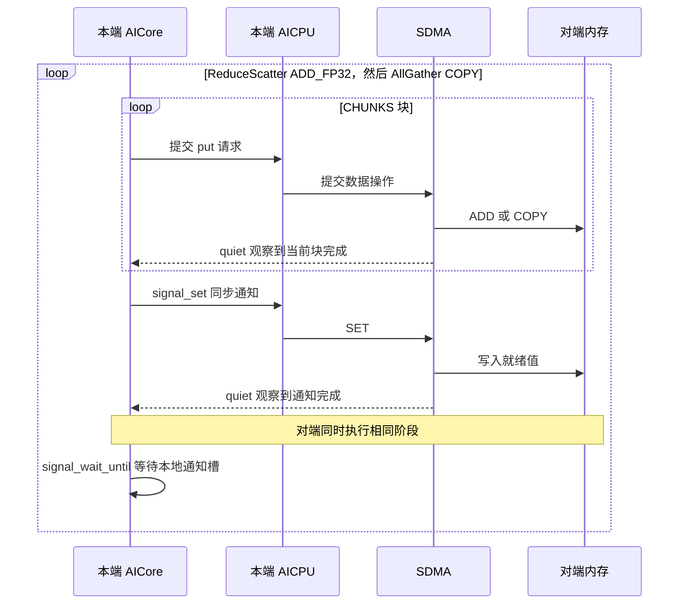
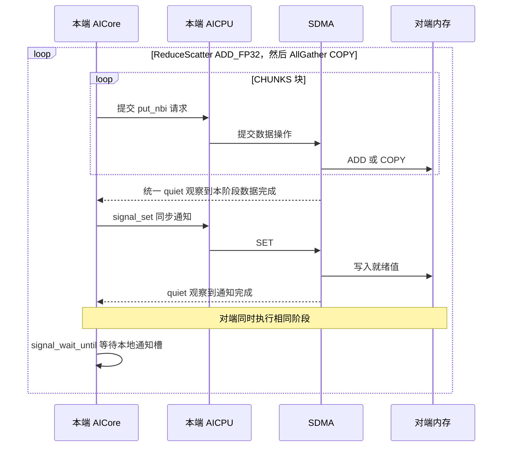
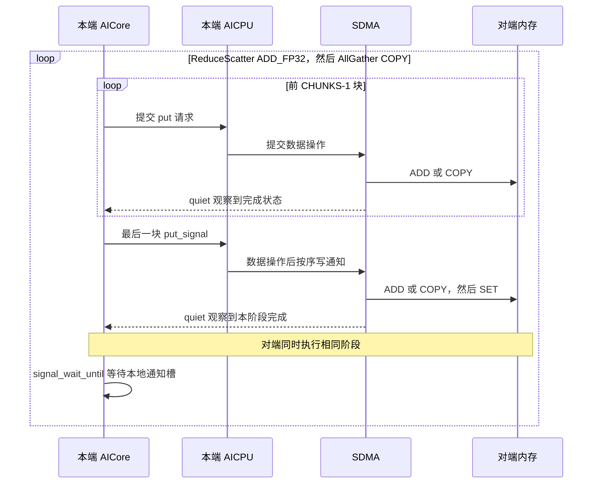
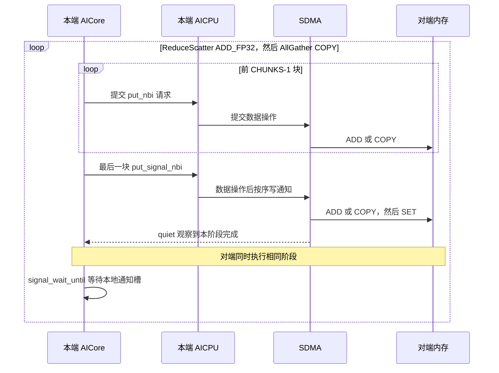
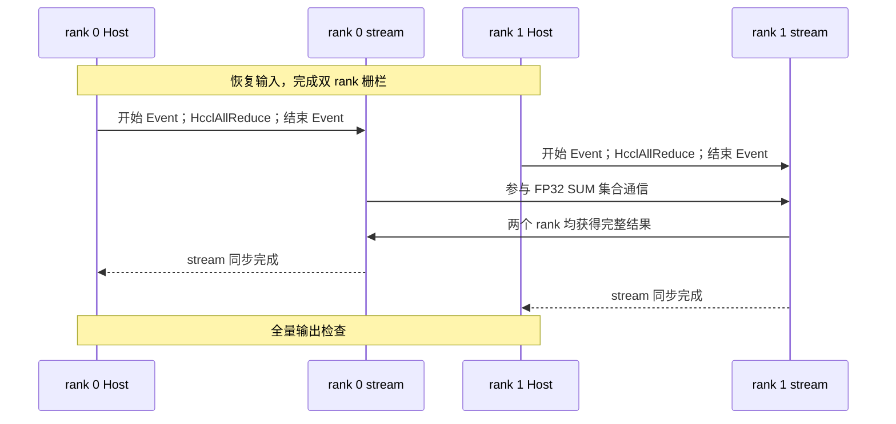

# TP=2 SHMEM 与 HCCL AllReduce：实现、测试方案与性能

固定使用逻辑设备6、7重新采样的普通性能、msprof分项及完整调用与数据执行成本，见[性能细节](PERFORMANCE_DETAILS.md)。
本页原有表格保留各自标注的采样日期和设备条件。

测试代码和数据对应关系见[性能细节](PERFORMANCE_DETAILS.md)。整输入交换源码在[full_input_exchange](full_input_exchange/main.asc)，组合场景在[其他测试目录](../shmem_310p/README.md)。

## 测试对象与条件

入口为 [main.asc](main.asc) 的 `mfAllReduce`、`reducePhase` 和 `runSize`。
基础用例提供原四种 MemFabric 实现与 HCCL，新增批次后端在下文单列；
两个进程各绑定一个逻辑设备，执行 FP32 原地 SUM。
输入为 256、512、1024、2048、4096 方阵，分别占 0.25、1、4、16、64 MiB。

原四种模式的历史性能表采于队列优化前，采样日期为 2026-11-23。
当前优化版本及两个显式批次后端见 [显式批次提交与队列优化](#显式批次提交与队列优化)。

历史采样环境：Atlas 300I Duo（Ascend310P3）的逻辑设备 0、1，
对应同一张卡上的两个 die；CANN 9.1.0，驱动 26.1.1，Release Host 库及配套 AICPU kernel。
四组配置分别为 `BLOCKS/CHUNKS=1/1、1/8、8/1、8/8`。
BLOCKS 是每个 rank 启动的 AICore block 数，CHUNKS 是每个 block 每阶段的分块数。
**BLOCKS/CHUNKS（B/C）只控制 MemFabric 的 AICore 数和请求分块；
HCCL 各行的 B/C 标识对应采样批次，每轮均以完整矩阵调用一次 HcclAllReduce。**
HCCL 在本测试中选中 AllReduceDoublingDirect，数据任务按完整输入及通信缓冲容量组织。
每组均独立重新测试 HCCL：缓冲区 64 MiB，启用 PCIe，关闭 RoCE。
测试在共享服务器上执行，服务器有其他常驻进程，表格记录各组采样期间的结果。

每种模式、每个尺寸先预热 10 轮，再采集 100 轮；预热及正式测试均逐元素检查完整输出。
每轮输入恢复、双 rank 栅栏与结果检查位于计时外。MF 同时检查每个 block 的两个阶段状态。
每轮对相同指标取两个 rank 的较大值，再计算均值、P50、P95、P99、最大值。
所有时间单位均为 µs，原始样本由各后端的 `rank0.log`、`rank1.log` 保存。

| 指标 | 计时范围 |
|---|---|
| Event | stream 上开始 Event 至结束 Event，包含这次 AllReduce 执行和设备端等待 |
| Host | 记录开始 Event 之前至 stream 同步返回，包含 Event 提交、算子提交和等待 |
| 提交 | MF kernel launch 或 `HcclAllReduce` 调用开始至返回 |

这三个计时范围有重叠，分别阅读。正文表格展示 Event 的全部统计及另外两项的均值，
折叠表补齐 Host 和提交耗时的全部统计。

## 构建与复现

加载 CANN 环境后，在仓库根目录构建本次测试使用的 Host 库及 AICPU kernel：

```bash
bash script/build_and_pack_run.sh
cd benchmark/shmem_310p_allreduce
export LOG_ROOT=/path/to/logs
for blocks in 1 8; do
  for chunks in 1 8; do
    DEVICE_BASE=6 BACKEND="hccl mf-sync mf-nbi mf-signal mf-signal-nbi" \
      BLOCKS="$blocks" CHUNKS="$chunks" WARMUP=10 ROUNDS=100 \
      LOG_DIR="$LOG_ROOT/b$blocks-c$chunks" bash run.sh
  done
done
```

`BACKEND=both` 运行 mf-signal、hccl，
也支持空格分隔的后端列表。当前 `BACKEND=all` 包含原四种模式、
mf-batch-nbi、mf-batch-signal-nbi 和 HCCL，共七种后端。BLOCKS 支持 1/2/4/8，CHUNKS 支持 1～64 的 2 次幂。
上表数据覆盖上述四组配置。可通过 TIMEOUT、STORE_URL、MF_SDMA_ORCH_DIR、HCCL_BUFFSIZE 指定运行参数。
`python3 summarize.py LOG_DIR` 从完整校验通过的日志生成 `summary.json`。
运行前检查所选设备的使用情况；程序保留其他进程。

## 共用的数据分工

本节描述四种 MemFabric 模式共用的 ReduceScatter + AllGather 分工。
HCCL 的完整输入交换及缓冲区分段见下文 [HCCL 的内部数据任务大小](#hccl-的内部数据任务大小)。

矩阵总字节数记为 N。每个 block 在每个阶段处理 N/(2×BLOCKS) 字节，
每条数据请求为 N/(2×BLOCKS×CHUNKS) 字节。

1. **ReduceScatter**：每个 rank 将“对端负责的半区”发送到对端相同偏移，
   使用 `SMEM_SHM_SDMA_OP_ADD_FP32` 将数据加到对端输入上。
   两个 rank 同时执行后，rank 0 保存求和后的前半区，rank 1 保存求和后的后半区。
2. **AllGather**：每个 rank 将“本端负责的、已经求和的半区”复制到对端，
   使用 `SMEM_SHM_SDMA_OP_COPY`，使双方均得到完整结果。
3. 每阶段按 block 设置独立的就绪通知槽，并等待对端同阶段的通知。
   两个阶段使用不同槽位，每轮通知值包含矩阵尺寸和轮次，避免复用旧通知。

每个 rank 共提交 2×BLOCKS×CHUNKS 条数据请求，每轮向对端发送 N 字节。
独立通知模式另外提交 2×BLOCKS 条 SET 请求；融合通知模式将通知附在各 block 每阶段最后一条数据请求上。
AICore 通过请求队列提交操作，AICPU 扫描队列并组织 SDMA 执行，quiet 等待本 block 的完成状态。
相关入口见 [设备接口](../../src/smem/include/device/smem_shm_aicore_base_sdma.h)、
[AICPU kernel](../../src/hybm/ops/hybm_kernel/hybm_sdma_orch_kernel.cc) 与
[就绪通知封装](../shmem_310p/sdma_ready.h)。

### 矩阵大小、chunk 大小与请求字节数的计算

这里的 **chunk 是一次数据 API 调用搬运的连续片段**。
CHUNKS 表示每个 block 在每个阶段提交多少个这样的片段；每个片段的大小由矩阵形状、
数据类型、BLOCKS 和 CHUNKS 共同决定。四种 MF 模式采用同样的数据划分，
差别在于提交后的等待方式及通知组织。

**第一步：将矩阵形状换算为每个 rank 的输入字节数。**

设方阵边长为 D，元素个数为 D×D。每个 FP32 元素占 4 字节，因此完整矩阵大小为：

```text
元素个数 = D × D
N = D × D × sizeof(float) = D × D × 4 字节
1 KiB = 1,024 字节
1 MiB = 1,048,576 字节
```

两个 rank 各自持有一个完整输入矩阵，原地 AllReduce 结束后各自得到同样大小的结果矩阵。

| 矩阵形状 | 每个 rank 的 FP32 元素数 | 每个 rank 的完整矩阵 N（字节） | N（MiB） | 每个 rank 每阶段发送 N/2（字节） |
|---|---:|---:|---:|---:|
| 256×256 | 65,536 | 262,144 | 0.25 | 131,072 |
| 512×512 | 262,144 | 1,048,576 | 1 | 524,288 |
| 1024×1024 | 1,048,576 | 4,194,304 | 4 | 2,097,152 |
| 2048×2048 | 4,194,304 | 16,777,216 | 16 | 8,388,608 |
| 4096×4096 | 16,777,216 | 67,108,864 | 64 | 33,554,432 |

**第二步：按双 rank 的半区分工除以 2。**

本基准固定 TP=2，将连续矩阵缓冲区分为前、后两半，每半占 N/2 字节。
设 rank 0 的输入为 [A0, A1]，rank 1 的输入为 [B0, B1]，下标 0、1 表示前、后半区：

| 阶段 | rank 0 发送的内容 | rank 1 发送的内容 | 每个 rank 本阶段发送的数据量 |
|---|---|---|---|
| ReduceScatter | 将 A1 发送到 rank 1，在 B1 上执行 ADD_FP32 | 将 B0 发送到 rank 0，在 A0 上执行 ADD_FP32 | N/2 字节 |
| AllGather | 将本端已求和的 A0+B0 复制到 rank 1 | 将本端已求和的 A1+B1 复制到 rank 0 | N/2 字节 |

分母中的 2 来自这两个 rank 对前、后半区的分工：每个 rank 在每个阶段发送一半矩阵。
ReduceScatter 结束后，rank 0 负责前半区的求和结果，rank 1 负责后半区的求和结果；
AllGather 再交换这两份结果，使双方都得到完整矩阵。
所以每阶段的数据量为 N/2，每个 rank 一轮的累计发送量为 N/2+N/2=N 字节。

**第三步：分给 BLOCKS 个 AICore block，再拆成 CHUNKS 条请求。**

每个阶段的 N/2 字节先均分给 BLOCKS 个 block，各 block 处理独立片段；
每个 block 再将自己的片段均分为 CHUNKS 个 chunk，每个 chunk 提交一条数据请求。
计算顺序与 [main.asc](main.asc) 的 `runSize`、`submit` 和 `reducePhase` 对应：

```text
matrixBytes   = D × D × 4                         # runSize 中的 bytes，即 N
half          = matrixBytes / 2                  # submit 传给 kernel 的 half
bytesPerBlock = half / BLOCKS                    # 一个 block 在一个阶段负责的数据量
chunkBytes    = bytesPerBlock / CHUNKS            # reducePhase 每次传给数据 API 的 bytes
              = N / (2 × BLOCKS × CHUNKS)
```

设 block 编号为 blockId，分块编号为 chunkId；own 和 peer 分别为本端、对端共享段的起始地址。
每个分块在两端使用相同的字节偏移：

```text
if phase == ReduceScatter:
    halfIndex = 1 - rank   # 发送对端负责的半区
else:                     # AllGather
    halfIndex = rank       # 发送本端负责的求和结果半区
offset = halfIndex × half + blockId × bytesPerBlock + chunkId × chunkBytes
src = own + offset
dst = peer + offset
bytes = chunkBytes
```

其中 blockId 取 0～BLOCKS−1，chunkId 取 0～CHUNKS−1。
ReduceScatter 将这些字节按 FP32 做 ADD，AllGather 按同样大小做 COPY。
四种 MF 模式的数据 API 都传入上述 chunkBytes；携带通知的最后一条请求采用相同的数据字节数。

**以 4096×4096、BLOCKS=8、CHUNKS=8 为例：**

```text
完整矩阵：4096 × 4096 × 4 = 67,108,864 字节 = 64 MiB
每个 rank 每阶段：67,108,864 / 2 = 33,554,432 字节 = 32 MiB
每个 block 每阶段：33,554,432 / 8 = 4,194,304 字节 = 4 MiB
每条数据请求：4,194,304 / 8 = 524,288 字节 = 512 KiB

每个 rank 每阶段：8 × 8 = 64 条数据请求
每个 rank 两个阶段：2 × 64 = 128 条数据请求
累计发送矩阵数据：128 × 524,288 = 67,108,864 字节 = 64 MiB
```

本次四组配置下，每条数据请求的矩阵数据字节数如下，括号中给出 KiB 换算值：

| 矩阵形状 | BLOCKS/CHUNKS=1/1 | BLOCKS/CHUNKS=1/8 | BLOCKS/CHUNKS=8/1 | BLOCKS/CHUNKS=8/8 |
|---|---:|---:|---:|---:|
| 256×256 | 131,072（128 KiB） | 16,384（16 KiB） | 16,384（16 KiB） | 2,048（2 KiB） |
| 512×512 | 524,288（512 KiB） | 65,536（64 KiB） | 65,536（64 KiB） | 8,192（8 KiB） |
| 1024×1024 | 2,097,152（2,048 KiB） | 262,144（256 KiB） | 262,144（256 KiB） | 32,768（32 KiB） |
| 2048×2048 | 8,388,608（8,192 KiB） | 1,048,576（1,024 KiB） | 1,048,576（1,024 KiB） | 131,072（128 KiB） |
| 4096×4096 | 33,554,432（32,768 KiB） | 4,194,304（4,096 KiB） | 4,194,304（4,096 KiB） | 524,288（512 KiB） |

1/8 和 8/1 的 chunk 字节数相同：前者由一个 block 提交 8 条数据请求，
后者由 8 个 block 各提交一条，使用的队列和提交组织不同。
这些矩阵及分块配置均能整除，且每条数据请求的长度均满足 4 字节对齐。
上述字节数统计矩阵数据；独立 SET 通知写入 8 字节通知值，
put_signal 的数据参数仍为 chunkBytes，通知值随同该数据请求组织。

下面每个 MF 时序图展示一个 rank、一个 block 的执行；对端同时执行相同流程。
数据由 Host DMA 恢复，AllReduce kernel 通过 SDMA 操作这些数据。

## 显式批次提交与队列优化

### 队列推进与诊断记录

SDMA 提交队列的缓存 head 显示空间不足时，先查询硬件 head，
确认仍然没有空间后再退避，限制无效等待对尾延迟的影响。
完成戳的暂存槽复用依据槽内记录的上一次实际使用者；
只有旧使用者尚未完成时才提交已有描述符并等待。
批次的中间请求共享末条完成戳，暂存槽记录由实际使用该槽的末条请求维护。

`MF_SDMA_ORCH_DEBUG_MAIL=1` 开启逐次提交的请求、地址、长度及 SQ 游标记录，
默认关闭。错误返回、退出原因及当前 epoch 消费数继续保存在工作区。

### 批次 API 与后端

| 后端 | 数据接口 | 完成与通知 |
|---|---|---|
| mf-batch-nbi | `smem_shm_sdma_put_batch_nbi_at` | 阶段末 quiet 确认整个批次完成，再独立提交 signal |
| mf-batch-signal-nbi | `smem_shm_sdma_put_signal_batch_nbi_at` | 批次末条携带远端 signal，阶段末 quiet 确认整个批次完成 |

两个接口都接收 `ctx, src, dst, chunkBytes, count`；数据及通知接口再接收 signal 地址和值，
op 继续支持 COPY、ADD_FP32、ADD_FP16。
count 为 1～64，chunkBytes 按 4 字节对齐，批次总长度不超过 UINT32_MAX。
源和目标都由 count 个连续、等长片段构成，远端目标及通知位于同一有效共享段内。

接口在发布首条请求前验证整个连续区间，并预留整个批次的软件请求槽。
成功返回表示全部软件请求已经发布；调用方通过 quiet 等待批次完成后复用源缓冲。
AICPU 只在同一显式批次内合并已经发布、源和目标连续且操作类型一致的请求，
在批次边界或操作、地址不连续处停止合并。
普通 put/get/put_signal 接口继续逐条生成完成戳，quiet 的完成保证覆盖此前提交的全部请求。

**本节的 chunk 表示一条软件数据请求。原四种模式每阶段调用 B×C 次数据 API，
批次模式每阶段调用 B 次批次 API、仍发布 B×C 条软件请求；
实际 SDMA 数据任务数由消费端观察到的连续请求和批次边界决定。**

两个后端沿用 ReduceScatter + AllGather 的半区、block 和 chunk 分工。
一个 block 在一个阶段的伪代码如下：

```text
# scatter 使用 ADD_FP32，gather 使用 COPY。
require(smem_shm_sdma_put_signal_batch_nbi_at(ctx, own + offset, peer + offset,
    chunkBytes, CHUNKS, peerFlag, sequence, op))
require(smem_shm_sdma_quiet_at(ctx))
require(smem_shm_signal_wait_until(localFlag, SMEM_SHM_CMP_EQ, sequence))
```

### 优化版本的比较方法

按矩阵大小、B/C 和后端分别运行，每组预热 10 轮、正式采样 100 轮。
每组 MF 测试前后各运行一次相同矩阵和通信缓冲配置的 HCCL，
分别报告两次 HCCL 的均值，以保留共享环境下前后采样的变化。
Event、Host、提交范围、双 rank 取较大值的方法及全量数据检查与历史基准一致。

```bash
# 在 benchmark/shmem_310p 中执行，每组使用相同的 BLOCKS、CHUNKS。
BACKEND=hccl LOG_DIR="$LOG_ROOT/hccl-before" bash run.sh
BACKEND="mf-sync mf-nbi mf-signal mf-signal-nbi mf-batch-nbi mf-batch-signal-nbi" \
  MF_SDMA_ORCH_DEBUG_MAIL=0 LOG_DIR="$LOG_ROOT/mf" bash run.sh
BACKEND=hccl LOG_DIR="$LOG_ROOT/hccl-after" bash run.sh
```

### 2026-11-24 优化版本的完整矩阵结果

以下时间单位为 µs。均值按每轮双 rank 的较大值统计；每个矩阵、后端和 B/C 组合均预热 10 轮并采样 100 轮。HCCL 前、后两列展示每组 MF 运行两侧的独立样本，保留期间的运行波动。

| B/C | 方阵 | HCCL 前 | mf-sync | mf-nbi | mf-signal | mf-signal-nbi | mf-batch-nbi | mf-batch-signal-nbi | HCCL 后 |
|---|---:|---:|---:|---:|---:|---:|---:|---:|---:|
| 1/1 | 256 | 137.317 | 145.524 | 145.785 | 131.131 | 129.617 | 146.972 | 128.722 | 138.475 |
| 1/1 | 512 | 195.220 | 195.724 | 195.161 | 177.993 | 178.243 | 196.580 | 175.677 | 196.764 |
| 1/1 | 1024 | 430.291 | 388.855 | 387.262 | 371.033 | 370.908 | 387.671 | 367.288 | 423.889 |
| 1/1 | 2048 | 1296.633 | 1148.099 | 1149.869 | 1133.283 | 1132.036 | 1148.897 | 1132.883 | 1290.946 |
| 1/1 | 4096 | 4734.327 | 4181.126 | 4177.993 | 4159.745 | 4161.807 | 4181.808 | 4162.921 | 4726.219 |
| 1/8 | 256 | 198.719 | 272.946 | 223.404 | 254.657 | 209.014 | 159.480 | 144.038 | 159.109 |
| 1/8 | 512 | 269.694 | 332.529 | 272.021 | 315.630 | 256.501 | 202.175 | 187.379 | 218.906 |
| 1/8 | 1024 | 478.777 | 515.682 | 461.295 | 503.749 | 444.575 | 391.528 | 370.632 | 434.181 |
| 1/8 | 2048 | 1297.509 | 1277.223 | 1219.930 | 1262.424 | 1198.668 | 1153.348 | 1131.398 | 1297.678 |
| 1/8 | 4096 | 4737.136 | 4307.603 | 4245.070 | 4290.382 | 4229.082 | 4182.488 | 4161.403 | 4728.481 |
| 8/1 | 256 | 161.501 | 193.032 | 194.078 | 173.089 | 171.196 | 191.406 | 172.825 | 154.565 |
| 8/1 | 512 | 214.402 | 245.746 | 247.129 | 216.236 | 215.304 | 244.611 | 216.457 | 240.037 |
| 8/1 | 1024 | 438.561 | 437.864 | 428.695 | 407.059 | 406.308 | 435.171 | 409.309 | 483.296 |
| 8/1 | 2048 | 1313.101 | 1185.253 | 1196.514 | 1172.970 | 1169.148 | 1184.321 | 1178.515 | 1304.784 |
| 8/1 | 4096 | 4777.215 | 4225.773 | 4232.482 | 4210.843 | 4204.599 | 4212.130 | 4206.420 | 4789.462 |
| 8/8 | 256 | 169.260 | 510.686 | 468.485 | 484.873 | 435.481 | 243.680 | 223.628 | 236.048 |
| 8/8 | 512 | 219.980 | 548.580 | 490.675 | 519.642 | 460.909 | 279.292 | 262.202 | 273.557 |
| 8/8 | 1024 | 432.215 | 695.118 | 647.251 | 663.945 | 609.066 | 460.042 | 439.829 | 466.244 |
| 8/8 | 2048 | 1303.878 | 1362.980 | 1366.396 | 1336.215 | 1340.066 | 1207.251 | 1178.419 | 1295.863 |
| 8/8 | 4096 | 4760.506 | 4396.841 | 4399.513 | 4367.494 | 4366.217 | 4228.373 | 4205.435 | 4734.070 |

**比较条件：B/C 仅控制 MF，HCCL 前后两组为每组 MF 前后分别采样的完整输入 AllReduce，HCCL_BUFFSIZE=64 MiB。MF 每 rank 一轮发布 2×B×C 条软件数据请求，每条 N/(2×B×C) 字节；显式批次可合并连续请求。256×256、8/8 中 HCCL 每次跨卡归约 256 KiB，MF 发布 128 条 2 KiB 软件数据请求。各模式的请求粒度、通知、完成管理和调度资源见对应实现说明。**

256×256、8/8 的 signal-NBI 均值由本版本普通接口的 **435.481 µs** 降至显式融合批次的 **223.628 µs**，减少 **48.6%**。该组 HCCL 前后为 **169.260 / 236.048 µs**，两次对照存在明显变化，比较时需同时查看。

<details>
<summary>全部 160 组 Event 统计（µs，每组 100 轮）</summary>

| B/C | 方阵 | 后端 | 均值 | P50 | P95 | P99 | 最大 |
|---|---:|---|---:|---:|---:|---:|---:|
| 1/1 | 256 | hccl-before | 137.317 | 134.401 | 190.469 | 208.151 | 224.166 |
| 1/1 | 256 | mf-sync | 145.524 | 144.414 | 155.885 | 158.828 | 159.635 |
| 1/1 | 256 | mf-nbi | 145.785 | 144.584 | 153.724 | 160.000 | 161.068 |
| 1/1 | 256 | mf-signal | 131.131 | 130.078 | 141.302 | 146.901 | 147.031 |
| 1/1 | 256 | mf-signal-nbi | 129.617 | 128.490 | 137.994 | 143.854 | 144.505 |
| 1/1 | 256 | mf-batch-nbi | 146.972 | 145.794 | 156.979 | 162.708 | 170.677 |
| 1/1 | 256 | mf-batch-signal-nbi | 128.722 | 127.812 | 137.735 | 141.302 | 143.568 |
| 1/1 | 256 | hccl-after | 138.475 | 135.235 | 191.458 | 211.380 | 211.770 |
| 1/1 | 512 | hccl-before | 195.220 | 190.755 | 221.719 | 227.058 | 227.422 |
| 1/1 | 512 | mf-sync | 195.724 | 194.752 | 203.646 | 207.578 | 216.875 |
| 1/1 | 512 | mf-nbi | 195.161 | 194.375 | 202.396 | 209.245 | 209.271 |
| 1/1 | 512 | mf-signal | 177.993 | 176.706 | 187.370 | 191.224 | 192.839 |
| 1/1 | 512 | mf-signal-nbi | 178.243 | 177.148 | 187.942 | 193.229 | 194.271 |
| 1/1 | 512 | mf-batch-nbi | 196.580 | 195.872 | 203.933 | 207.578 | 208.620 |
| 1/1 | 512 | mf-batch-signal-nbi | 175.677 | 174.753 | 184.115 | 185.079 | 187.136 |
| 1/1 | 512 | hccl-after | 196.764 | 190.195 | 223.204 | 230.886 | 279.427 |
| 1/1 | 1024 | hccl-before | 430.291 | 422.031 | 481.250 | 520.651 | 531.745 |
| 1/1 | 1024 | mf-sync | 388.855 | 387.864 | 397.422 | 414.974 | 442.709 |
| 1/1 | 1024 | mf-nbi | 387.262 | 386.263 | 395.704 | 404.114 | 404.479 |
| 1/1 | 1024 | mf-signal | 371.033 | 369.882 | 381.094 | 383.829 | 412.943 |
| 1/1 | 1024 | mf-signal-nbi | 370.908 | 369.765 | 380.963 | 385.000 | 388.698 |
| 1/1 | 1024 | mf-batch-nbi | 387.671 | 387.044 | 397.787 | 409.167 | 410.521 |
| 1/1 | 1024 | mf-batch-signal-nbi | 367.288 | 366.679 | 376.171 | 378.203 | 380.859 |
| 1/1 | 1024 | hccl-after | 423.889 | 423.815 | 434.271 | 440.000 | 442.682 |
| 1/1 | 2048 | hccl-before | 1296.633 | 1292.981 | 1323.438 | 1338.672 | 1399.245 |
| 1/1 | 2048 | mf-sync | 1148.099 | 1147.916 | 1159.557 | 1165.287 | 1166.198 |
| 1/1 | 2048 | mf-nbi | 1149.869 | 1149.141 | 1161.641 | 1169.036 | 1242.318 |
| 1/1 | 2048 | mf-signal | 1133.283 | 1133.528 | 1142.110 | 1146.224 | 1146.953 |
| 1/1 | 2048 | mf-signal-nbi | 1132.036 | 1131.328 | 1144.141 | 1149.792 | 1151.771 |
| 1/1 | 2048 | mf-batch-nbi | 1148.897 | 1148.776 | 1160.026 | 1162.474 | 1173.724 |
| 1/1 | 2048 | mf-batch-signal-nbi | 1132.883 | 1129.896 | 1154.844 | 1183.984 | 1188.229 |
| 1/1 | 2048 | hccl-after | 1290.946 | 1289.648 | 1314.505 | 1322.682 | 1327.188 |
| 1/1 | 4096 | hccl-before | 4734.327 | 4731.342 | 4763.437 | 4776.875 | 4802.552 |
| 1/1 | 4096 | mf-sync | 4181.126 | 4179.154 | 4197.370 | 4204.531 | 4227.760 |
| 1/1 | 4096 | mf-nbi | 4177.993 | 4177.644 | 4199.739 | 4215.182 | 4216.145 |
| 1/1 | 4096 | mf-signal | 4159.745 | 4159.544 | 4176.718 | 4191.745 | 4197.239 |
| 1/1 | 4096 | mf-signal-nbi | 4161.807 | 4160.925 | 4181.354 | 4197.239 | 4201.537 |
| 1/1 | 4096 | mf-batch-nbi | 4181.808 | 4180.143 | 4206.510 | 4222.344 | 4224.505 |
| 1/1 | 4096 | mf-batch-signal-nbi | 4162.921 | 4160.299 | 4181.276 | 4198.516 | 4276.146 |
| 1/1 | 4096 | hccl-after | 4726.219 | 4724.075 | 4751.510 | 4768.046 | 4789.479 |
| 1/8 | 256 | hccl-before | 198.719 | 205.312 | 266.198 | 275.469 | 287.213 |
| 1/8 | 256 | mf-sync | 272.946 | 272.995 | 284.714 | 288.985 | 291.562 |
| 1/8 | 256 | mf-nbi | 223.404 | 224.062 | 231.928 | 240.391 | 242.006 |
| 1/8 | 256 | mf-signal | 254.657 | 254.844 | 265.807 | 277.500 | 289.011 |
| 1/8 | 256 | mf-signal-nbi | 209.014 | 209.193 | 219.297 | 221.745 | 221.927 |
| 1/8 | 256 | mf-batch-nbi | 159.480 | 158.164 | 169.948 | 174.610 | 175.469 |
| 1/8 | 256 | mf-batch-signal-nbi | 144.038 | 143.268 | 152.552 | 157.266 | 158.047 |
| 1/8 | 256 | hccl-after | 159.109 | 139.349 | 208.438 | 213.620 | 221.562 |
| 1/8 | 512 | hccl-before | 269.694 | 272.877 | 284.974 | 302.005 | 315.782 |
| 1/8 | 512 | mf-sync | 332.529 | 332.474 | 340.338 | 342.683 | 343.333 |
| 1/8 | 512 | mf-nbi | 272.021 | 271.197 | 281.771 | 284.323 | 286.692 |
| 1/8 | 512 | mf-signal | 315.630 | 314.179 | 326.745 | 332.683 | 335.677 |
| 1/8 | 512 | mf-signal-nbi | 256.501 | 255.365 | 265.000 | 269.948 | 272.630 |
| 1/8 | 512 | mf-batch-nbi | 202.175 | 201.562 | 209.427 | 210.964 | 211.067 |
| 1/8 | 512 | mf-batch-signal-nbi | 187.379 | 186.536 | 197.136 | 199.506 | 211.797 |
| 1/8 | 512 | hccl-after | 218.906 | 219.857 | 231.771 | 235.313 | 241.902 |
| 1/8 | 1024 | hccl-before | 478.777 | 475.222 | 533.281 | 547.995 | 548.333 |
| 1/8 | 1024 | mf-sync | 515.682 | 514.518 | 526.303 | 534.558 | 539.948 |
| 1/8 | 1024 | mf-nbi | 461.295 | 461.575 | 473.307 | 478.541 | 479.037 |
| 1/8 | 1024 | mf-signal | 503.749 | 503.373 | 513.958 | 517.552 | 518.125 |
| 1/8 | 1024 | mf-signal-nbi | 444.575 | 444.401 | 457.265 | 459.062 | 462.084 |
| 1/8 | 1024 | mf-batch-nbi | 391.528 | 390.690 | 400.989 | 403.177 | 406.718 |
| 1/8 | 1024 | mf-batch-signal-nbi | 370.632 | 370.313 | 379.532 | 380.703 | 381.693 |
| 1/8 | 1024 | hccl-after | 434.181 | 425.612 | 489.323 | 512.708 | 554.271 |
| 1/8 | 2048 | hccl-before | 1297.509 | 1294.206 | 1323.541 | 1338.359 | 1367.916 |
| 1/8 | 2048 | mf-sync | 1277.223 | 1277.239 | 1289.219 | 1292.032 | 1300.052 |
| 1/8 | 2048 | mf-nbi | 1219.930 | 1221.368 | 1234.349 | 1239.375 | 1239.635 |
| 1/8 | 2048 | mf-signal | 1262.424 | 1261.940 | 1273.932 | 1277.682 | 1305.157 |
| 1/8 | 2048 | mf-signal-nbi | 1198.668 | 1201.132 | 1216.953 | 1231.042 | 1241.771 |
| 1/8 | 2048 | mf-batch-nbi | 1153.348 | 1153.438 | 1164.974 | 1187.630 | 1191.068 |
| 1/8 | 2048 | mf-batch-signal-nbi | 1131.398 | 1131.302 | 1141.328 | 1145.755 | 1149.141 |
| 1/8 | 2048 | hccl-after | 1297.678 | 1294.571 | 1321.068 | 1337.995 | 1386.250 |
| 1/8 | 4096 | hccl-before | 4737.136 | 4733.763 | 4760.755 | 4816.380 | 4820.105 |
| 1/8 | 4096 | mf-sync | 4307.603 | 4302.852 | 4341.172 | 4366.172 | 4386.615 |
| 1/8 | 4096 | mf-nbi | 4245.070 | 4244.818 | 4268.333 | 4275.286 | 4298.516 |
| 1/8 | 4096 | mf-signal | 4290.382 | 4285.860 | 4313.907 | 4349.766 | 4537.604 |
| 1/8 | 4096 | mf-signal-nbi | 4229.082 | 4232.630 | 4256.666 | 4276.615 | 4288.307 |
| 1/8 | 4096 | mf-batch-nbi | 4182.488 | 4181.093 | 4202.630 | 4205.990 | 4223.646 |
| 1/8 | 4096 | mf-batch-signal-nbi | 4161.403 | 4161.120 | 4177.370 | 4192.656 | 4201.432 |
| 1/8 | 4096 | hccl-after | 4728.481 | 4727.031 | 4745.052 | 4757.604 | 4771.953 |
| 8/1 | 256 | hccl-before | 161.501 | 139.192 | 214.557 | 227.683 | 317.109 |
| 8/1 | 256 | mf-sync | 193.032 | 191.745 | 203.672 | 208.646 | 211.172 |
| 8/1 | 256 | mf-nbi | 194.078 | 193.659 | 204.088 | 208.802 | 210.807 |
| 8/1 | 256 | mf-signal | 173.089 | 172.774 | 181.901 | 188.412 | 191.823 |
| 8/1 | 256 | mf-signal-nbi | 171.196 | 169.856 | 183.411 | 188.515 | 190.859 |
| 8/1 | 256 | mf-batch-nbi | 191.406 | 190.899 | 199.713 | 205.781 | 208.073 |
| 8/1 | 256 | mf-batch-signal-nbi | 172.825 | 172.461 | 184.141 | 189.271 | 191.823 |
| 8/1 | 256 | hccl-after | 154.565 | 136.510 | 243.464 | 260.105 | 260.235 |
| 8/1 | 512 | hccl-before | 214.402 | 215.964 | 231.328 | 273.568 | 281.927 |
| 8/1 | 512 | mf-sync | 245.746 | 246.511 | 254.089 | 259.714 | 263.125 |
| 8/1 | 512 | mf-nbi | 247.129 | 247.044 | 257.318 | 262.084 | 266.667 |
| 8/1 | 512 | mf-signal | 216.236 | 215.326 | 226.042 | 231.354 | 234.167 |
| 8/1 | 512 | mf-signal-nbi | 215.304 | 215.351 | 223.204 | 233.229 | 276.041 |
| 8/1 | 512 | mf-batch-nbi | 244.611 | 245.261 | 253.906 | 256.849 | 258.099 |
| 8/1 | 512 | mf-batch-signal-nbi | 216.457 | 216.796 | 224.922 | 229.531 | 229.740 |
| 8/1 | 512 | hccl-after | 240.037 | 221.849 | 297.135 | 310.937 | 335.026 |
| 8/1 | 1024 | hccl-before | 438.561 | 427.409 | 504.193 | 515.885 | 538.020 |
| 8/1 | 1024 | mf-sync | 437.864 | 429.049 | 441.927 | 448.203 | 1410.390 |
| 8/1 | 1024 | mf-nbi | 428.695 | 429.466 | 439.531 | 443.255 | 444.505 |
| 8/1 | 1024 | mf-signal | 407.059 | 406.888 | 418.854 | 424.844 | 425.912 |
| 8/1 | 1024 | mf-signal-nbi | 406.308 | 406.471 | 417.682 | 429.558 | 431.537 |
| 8/1 | 1024 | mf-batch-nbi | 435.171 | 427.669 | 439.114 | 444.271 | 1277.969 |
| 8/1 | 1024 | mf-batch-signal-nbi | 409.309 | 408.880 | 433.177 | 441.094 | 443.073 |
| 8/1 | 1024 | hccl-after | 483.296 | 482.096 | 522.448 | 540.209 | 568.802 |
| 8/1 | 2048 | hccl-before | 1313.101 | 1301.589 | 1380.651 | 1398.047 | 1412.422 |
| 8/1 | 2048 | mf-sync | 1185.253 | 1184.909 | 1204.219 | 1219.427 | 1271.641 |
| 8/1 | 2048 | mf-nbi | 1196.514 | 1192.461 | 1231.745 | 1242.109 | 1248.568 |
| 8/1 | 2048 | mf-signal | 1172.970 | 1176.562 | 1191.042 | 1195.521 | 1199.011 |
| 8/1 | 2048 | mf-signal-nbi | 1169.148 | 1168.203 | 1187.214 | 1197.708 | 1198.464 |
| 8/1 | 2048 | mf-batch-nbi | 1184.321 | 1185.443 | 1197.604 | 1203.724 | 1210.989 |
| 8/1 | 2048 | mf-batch-signal-nbi | 1178.515 | 1179.258 | 1195.105 | 1206.589 | 1219.662 |
| 8/1 | 2048 | hccl-after | 1304.784 | 1296.485 | 1348.776 | 1381.484 | 1521.771 |
| 8/1 | 4096 | hccl-before | 4777.215 | 4774.544 | 4844.323 | 4857.891 | 4858.099 |
| 8/1 | 4096 | mf-sync | 4225.773 | 4225.000 | 4251.094 | 4269.323 | 4275.781 |
| 8/1 | 4096 | mf-nbi | 4232.482 | 4229.870 | 4269.583 | 4283.047 | 4285.469 |
| 8/1 | 4096 | mf-signal | 4210.843 | 4210.208 | 4235.469 | 4252.500 | 4260.625 |
| 8/1 | 4096 | mf-signal-nbi | 4204.599 | 4207.226 | 4226.563 | 4245.781 | 4248.750 |
| 8/1 | 4096 | mf-batch-nbi | 4212.130 | 4210.521 | 4238.984 | 4256.146 | 4261.094 |
| 8/1 | 4096 | mf-batch-signal-nbi | 4206.420 | 4206.967 | 4233.021 | 4237.214 | 4237.291 |
| 8/1 | 4096 | hccl-after | 4789.462 | 4786.485 | 4818.619 | 4835.000 | 4837.161 |
| 8/8 | 256 | hccl-before | 169.260 | 190.729 | 208.828 | 212.421 | 215.417 |
| 8/8 | 256 | mf-sync | 510.686 | 523.060 | 538.828 | 542.552 | 543.750 |
| 8/8 | 256 | mf-nbi | 468.485 | 476.173 | 488.047 | 492.084 | 494.766 |
| 8/8 | 256 | mf-signal | 484.873 | 497.774 | 512.161 | 517.109 | 522.135 |
| 8/8 | 256 | mf-signal-nbi | 435.481 | 444.089 | 458.438 | 463.151 | 465.781 |
| 8/8 | 256 | mf-batch-nbi | 243.680 | 244.115 | 256.407 | 260.573 | 262.864 |
| 8/8 | 256 | mf-batch-signal-nbi | 223.628 | 223.138 | 236.276 | 241.693 | 243.099 |
| 8/8 | 256 | hccl-after | 236.048 | 243.984 | 262.552 | 267.630 | 268.542 |
| 8/8 | 512 | hccl-before | 219.980 | 220.820 | 229.896 | 250.469 | 268.907 |
| 8/8 | 512 | mf-sync | 548.580 | 547.956 | 560.260 | 563.776 | 564.062 |
| 8/8 | 512 | mf-nbi | 490.675 | 490.144 | 499.323 | 507.865 | 508.151 |
| 8/8 | 512 | mf-signal | 519.642 | 518.346 | 530.964 | 543.698 | 561.693 |
| 8/8 | 512 | mf-signal-nbi | 460.909 | 460.039 | 472.318 | 476.146 | 476.172 |
| 8/8 | 512 | mf-batch-nbi | 279.292 | 278.060 | 290.911 | 296.692 | 299.141 |
| 8/8 | 512 | mf-batch-signal-nbi | 262.202 | 261.784 | 272.890 | 279.063 | 335.938 |
| 8/8 | 512 | hccl-after | 273.557 | 273.216 | 310.079 | 319.349 | 329.114 |
| 8/8 | 1024 | hccl-before | 432.215 | 427.018 | 467.865 | 493.698 | 513.047 |
| 8/8 | 1024 | mf-sync | 695.118 | 694.584 | 710.390 | 719.010 | 730.782 |
| 8/8 | 1024 | mf-nbi | 647.251 | 647.214 | 657.552 | 664.922 | 666.849 |
| 8/8 | 1024 | mf-signal | 663.945 | 661.771 | 678.620 | 684.323 | 686.328 |
| 8/8 | 1024 | mf-signal-nbi | 609.066 | 608.568 | 622.396 | 626.562 | 655.677 |
| 8/8 | 1024 | mf-batch-nbi | 460.042 | 455.781 | 467.448 | 472.865 | 781.016 |
| 8/8 | 1024 | mf-batch-signal-nbi | 439.829 | 434.049 | 453.282 | 456.068 | 943.177 |
| 8/8 | 1024 | hccl-after | 466.244 | 466.758 | 519.896 | 551.042 | 555.834 |
| 8/8 | 2048 | hccl-before | 1303.878 | 1297.344 | 1342.942 | 1382.448 | 1440.260 |
| 8/8 | 2048 | mf-sync | 1362.980 | 1364.792 | 1375.964 | 1379.479 | 1381.224 |
| 8/8 | 2048 | mf-nbi | 1366.396 | 1366.107 | 1379.688 | 1388.880 | 1408.463 |
| 8/8 | 2048 | mf-signal | 1336.215 | 1337.800 | 1351.224 | 1354.558 | 1357.682 |
| 8/8 | 2048 | mf-signal-nbi | 1340.066 | 1341.315 | 1353.281 | 1361.823 | 1368.412 |
| 8/8 | 2048 | mf-batch-nbi | 1207.251 | 1206.849 | 1220.104 | 1242.969 | 1329.739 |
| 8/8 | 2048 | mf-batch-signal-nbi | 1178.419 | 1178.776 | 1191.120 | 1195.521 | 1198.567 |
| 8/8 | 2048 | hccl-after | 1295.863 | 1293.139 | 1323.619 | 1330.886 | 1333.281 |
| 8/8 | 4096 | hccl-before | 4760.506 | 4751.172 | 4830.599 | 4868.359 | 4888.203 |
| 8/8 | 4096 | mf-sync | 4396.841 | 4392.864 | 4414.505 | 4439.219 | 4791.719 |
| 8/8 | 4096 | mf-nbi | 4399.513 | 4398.842 | 4420.078 | 4434.662 | 4451.406 |
| 8/8 | 4096 | mf-signal | 4367.494 | 4368.333 | 4378.932 | 4390.781 | 4397.656 |
| 8/8 | 4096 | mf-signal-nbi | 4366.217 | 4363.164 | 4394.557 | 4408.047 | 4428.958 |
| 8/8 | 4096 | mf-batch-nbi | 4228.373 | 4228.216 | 4255.651 | 4266.875 | 4269.167 |
| 8/8 | 4096 | mf-batch-signal-nbi | 4205.435 | 4204.401 | 4231.510 | 4236.380 | 4240.052 |
| 8/8 | 4096 | hccl-after | 4734.070 | 4730.820 | 4767.031 | 4797.057 | 4824.141 |

**比较条件：B/C 仅控制 MF，HCCL 前后两组为每组 MF 前后分别采样的完整输入 AllReduce，HCCL_BUFFSIZE=64 MiB。MF 每 rank 一轮发布 2×B×C 条软件数据请求，每条 N/(2×B×C) 字节；显式批次可合并连续请求。256×256、8/8 中 HCCL 每次跨卡归约 256 KiB，MF 发布 128 条 2 KiB 软件数据请求。各模式的请求粒度、通知、完成管理和调度资源见对应实现说明。**

</details>

<details>
<summary>全部 160 组 Host 统计（µs，每组 100 轮）</summary>

| B/C | 方阵 | 后端 | 均值 | P50 | P95 | P99 | 最大 |
|---|---:|---|---:|---:|---:|---:|---:|
| 1/1 | 256 | hccl-before | 298.496 | 288.690 | 302.510 | 797.010 | 810.020 |
| 1/1 | 256 | mf-sync | 275.565 | 274.845 | 284.850 | 290.200 | 290.560 |
| 1/1 | 256 | mf-nbi | 274.131 | 273.155 | 284.670 | 291.320 | 291.510 |
| 1/1 | 256 | mf-signal | 262.050 | 260.730 | 273.810 | 294.130 | 298.300 |
| 1/1 | 256 | mf-signal-nbi | 263.171 | 261.455 | 273.790 | 278.250 | 289.520 |
| 1/1 | 256 | mf-batch-nbi | 278.061 | 277.020 | 289.260 | 297.630 | 303.080 |
| 1/1 | 256 | mf-batch-signal-nbi | 260.027 | 258.905 | 268.960 | 273.220 | 284.920 |
| 1/1 | 256 | hccl-after | 293.858 | 288.350 | 302.480 | 340.540 | 816.510 |
| 1/1 | 512 | hccl-before | 314.371 | 311.065 | 347.030 | 355.350 | 355.400 |
| 1/1 | 512 | mf-sync | 326.770 | 325.855 | 336.570 | 340.040 | 348.130 |
| 1/1 | 512 | mf-nbi | 326.440 | 325.355 | 335.820 | 342.080 | 346.420 |
| 1/1 | 512 | mf-signal | 313.531 | 312.120 | 322.920 | 326.320 | 327.860 |
| 1/1 | 512 | mf-signal-nbi | 313.485 | 312.035 | 323.260 | 326.700 | 327.940 |
| 1/1 | 512 | mf-batch-nbi | 331.702 | 330.230 | 342.350 | 351.870 | 356.230 |
| 1/1 | 512 | mf-batch-signal-nbi | 310.730 | 309.615 | 318.800 | 322.100 | 322.290 |
| 1/1 | 512 | hccl-after | 314.226 | 311.165 | 339.030 | 351.620 | 395.110 |
| 1/1 | 1024 | hccl-before | 549.850 | 538.830 | 616.720 | 681.930 | 684.440 |
| 1/1 | 1024 | mf-sync | 522.566 | 521.430 | 535.890 | 548.580 | 574.430 |
| 1/1 | 1024 | mf-nbi | 520.024 | 519.475 | 530.240 | 537.620 | 540.380 |
| 1/1 | 1024 | mf-signal | 506.113 | 504.570 | 518.010 | 526.350 | 618.950 |
| 1/1 | 1024 | mf-signal-nbi | 503.017 | 503.030 | 517.690 | 525.470 | 530.310 |
| 1/1 | 1024 | mf-batch-nbi | 524.527 | 523.210 | 540.120 | 550.760 | 557.360 |
| 1/1 | 1024 | mf-batch-signal-nbi | 502.873 | 501.930 | 512.950 | 521.230 | 536.630 |
| 1/1 | 1024 | hccl-after | 538.451 | 537.735 | 548.640 | 555.560 | 566.010 |
| 1/1 | 2048 | hccl-before | 1423.573 | 1418.875 | 1453.580 | 1470.960 | 1533.500 |
| 1/1 | 2048 | mf-sync | 1280.751 | 1281.500 | 1296.100 | 1300.300 | 1301.020 |
| 1/1 | 2048 | mf-nbi | 1276.009 | 1275.370 | 1295.280 | 1304.370 | 1361.940 |
| 1/1 | 2048 | mf-signal | 1258.358 | 1256.380 | 1282.670 | 1293.220 | 1297.760 |
| 1/1 | 2048 | mf-signal-nbi | 1258.065 | 1256.630 | 1281.310 | 1296.820 | 1298.430 |
| 1/1 | 2048 | mf-batch-nbi | 1281.365 | 1282.530 | 1296.580 | 1321.000 | 1321.430 |
| 1/1 | 2048 | mf-batch-signal-nbi | 1261.788 | 1258.400 | 1286.630 | 1318.880 | 1343.130 |
| 1/1 | 2048 | hccl-after | 1409.564 | 1407.440 | 1435.120 | 1447.070 | 1454.650 |
| 1/1 | 4096 | hccl-before | 4874.397 | 4871.110 | 4911.130 | 4931.120 | 4948.890 |
| 1/1 | 4096 | mf-sync | 4309.316 | 4306.775 | 4337.580 | 4346.110 | 4349.930 |
| 1/1 | 4096 | mf-nbi | 4308.008 | 4308.710 | 4332.410 | 4344.160 | 4346.740 |
| 1/1 | 4096 | mf-signal | 4292.042 | 4291.530 | 4325.130 | 4340.920 | 4345.130 |
| 1/1 | 4096 | mf-signal-nbi | 4293.812 | 4292.080 | 4321.620 | 4333.450 | 4341.740 |
| 1/1 | 4096 | mf-batch-nbi | 4316.074 | 4313.560 | 4346.620 | 4356.750 | 4360.770 |
| 1/1 | 4096 | mf-batch-signal-nbi | 4294.102 | 4291.425 | 4315.360 | 4330.820 | 4411.260 |
| 1/1 | 4096 | hccl-after | 4859.310 | 4856.000 | 4887.940 | 4926.320 | 4928.610 |
| 1/8 | 256 | hccl-before | 435.125 | 372.815 | 812.840 | 817.340 | 817.410 |
| 1/8 | 256 | mf-sync | 410.149 | 408.425 | 426.640 | 484.390 | 494.210 |
| 1/8 | 256 | mf-nbi | 354.875 | 355.850 | 368.780 | 372.630 | 373.970 |
| 1/8 | 256 | mf-signal | 388.299 | 388.585 | 402.030 | 410.810 | 425.140 |
| 1/8 | 256 | mf-signal-nbi | 337.196 | 336.645 | 355.790 | 362.780 | 374.200 |
| 1/8 | 256 | mf-batch-nbi | 291.344 | 289.665 | 300.690 | 306.190 | 339.630 |
| 1/8 | 256 | mf-batch-signal-nbi | 277.385 | 276.565 | 289.280 | 296.350 | 297.100 |
| 1/8 | 256 | hccl-after | 401.075 | 293.945 | 809.040 | 813.530 | 813.800 |
| 1/8 | 512 | hccl-before | 404.242 | 405.045 | 419.010 | 433.020 | 438.820 |
| 1/8 | 512 | mf-sync | 468.307 | 466.850 | 479.380 | 508.870 | 572.100 |
| 1/8 | 512 | mf-nbi | 406.157 | 404.505 | 415.450 | 419.460 | 439.800 |
| 1/8 | 512 | mf-signal | 451.347 | 450.040 | 460.840 | 466.300 | 474.750 |
| 1/8 | 512 | mf-signal-nbi | 388.489 | 387.560 | 398.570 | 400.310 | 402.670 |
| 1/8 | 512 | mf-batch-nbi | 336.331 | 335.215 | 345.730 | 349.470 | 351.790 |
| 1/8 | 512 | mf-batch-signal-nbi | 322.291 | 321.490 | 331.520 | 333.540 | 343.750 |
| 1/8 | 512 | hccl-after | 331.139 | 331.825 | 344.010 | 349.830 | 364.050 |
| 1/8 | 1024 | hccl-before | 612.564 | 609.825 | 673.930 | 683.150 | 688.600 |
| 1/8 | 1024 | mf-sync | 646.661 | 646.740 | 662.200 | 669.800 | 686.570 |
| 1/8 | 1024 | mf-nbi | 596.092 | 596.270 | 611.840 | 621.630 | 625.410 |
| 1/8 | 1024 | mf-signal | 639.729 | 640.010 | 653.210 | 655.430 | 659.770 |
| 1/8 | 1024 | mf-signal-nbi | 574.135 | 572.730 | 596.880 | 599.140 | 600.210 |
| 1/8 | 1024 | mf-batch-nbi | 526.944 | 525.790 | 538.370 | 545.420 | 560.170 |
| 1/8 | 1024 | mf-batch-signal-nbi | 507.073 | 506.255 | 518.300 | 522.330 | 527.080 |
| 1/8 | 1024 | hccl-after | 552.081 | 541.930 | 630.440 | 647.850 | 672.110 |
| 1/8 | 2048 | hccl-before | 1417.945 | 1413.645 | 1444.640 | 1457.390 | 1488.860 |
| 1/8 | 2048 | mf-sync | 1403.749 | 1401.800 | 1424.010 | 1434.720 | 1437.720 |
| 1/8 | 2048 | mf-nbi | 1351.791 | 1352.360 | 1371.560 | 1377.000 | 1386.180 |
| 1/8 | 2048 | mf-signal | 1390.532 | 1388.285 | 1413.290 | 1431.130 | 1435.180 |
| 1/8 | 2048 | mf-signal-nbi | 1325.070 | 1324.665 | 1355.390 | 1368.460 | 1379.800 |
| 1/8 | 2048 | mf-batch-nbi | 1281.733 | 1279.960 | 1302.280 | 1317.150 | 1318.120 |
| 1/8 | 2048 | mf-batch-signal-nbi | 1262.871 | 1263.005 | 1280.400 | 1289.310 | 1291.130 |
| 1/8 | 2048 | hccl-after | 1423.984 | 1417.390 | 1458.640 | 1482.000 | 1517.670 |
| 1/8 | 4096 | hccl-before | 4870.939 | 4865.925 | 4899.000 | 4974.970 | 4975.960 |
| 1/8 | 4096 | mf-sync | 4440.045 | 4434.690 | 4473.150 | 4496.740 | 4519.470 |
| 1/8 | 4096 | mf-nbi | 4371.630 | 4370.980 | 4395.130 | 4418.250 | 4418.890 |
| 1/8 | 4096 | mf-signal | 4424.857 | 4421.280 | 4451.700 | 4500.090 | 4666.710 |
| 1/8 | 4096 | mf-signal-nbi | 4360.551 | 4362.650 | 4395.570 | 4418.000 | 4423.050 |
| 1/8 | 4096 | mf-batch-nbi | 4315.366 | 4313.170 | 4341.250 | 4350.390 | 4352.000 |
| 1/8 | 4096 | mf-batch-signal-nbi | 4294.002 | 4292.520 | 4315.850 | 4322.940 | 4333.890 |
| 1/8 | 4096 | hccl-after | 4863.330 | 4862.395 | 4880.610 | 4902.270 | 4906.320 |
| 8/1 | 256 | hccl-before | 446.957 | 295.135 | 813.100 | 822.580 | 935.290 |
| 8/1 | 256 | mf-sync | 327.273 | 325.470 | 343.100 | 361.130 | 362.150 |
| 8/1 | 256 | mf-nbi | 324.872 | 322.950 | 345.310 | 359.610 | 380.520 |
| 8/1 | 256 | mf-signal | 310.319 | 310.005 | 321.540 | 326.240 | 330.160 |
| 8/1 | 256 | mf-signal-nbi | 305.358 | 302.920 | 319.700 | 334.400 | 375.290 |
| 8/1 | 256 | mf-batch-nbi | 324.978 | 324.300 | 335.720 | 340.890 | 341.030 |
| 8/1 | 256 | mf-batch-signal-nbi | 303.414 | 302.355 | 320.170 | 328.040 | 333.850 |
| 8/1 | 256 | hccl-after | 324.363 | 292.860 | 400.850 | 820.880 | 821.730 |
| 8/1 | 512 | hccl-before | 327.909 | 326.945 | 343.100 | 392.060 | 403.640 |
| 8/1 | 512 | mf-sync | 381.496 | 382.160 | 391.500 | 401.410 | 401.580 |
| 8/1 | 512 | mf-nbi | 377.194 | 375.265 | 395.990 | 406.070 | 407.830 |
| 8/1 | 512 | mf-signal | 350.868 | 350.920 | 366.050 | 370.020 | 372.490 |
| 8/1 | 512 | mf-signal-nbi | 353.370 | 352.705 | 363.350 | 376.670 | 420.230 |
| 8/1 | 512 | mf-batch-nbi | 381.275 | 380.910 | 400.550 | 408.800 | 425.680 |
| 8/1 | 512 | mf-batch-signal-nbi | 347.226 | 345.550 | 368.560 | 374.980 | 381.420 |
| 8/1 | 512 | hccl-after | 356.172 | 335.880 | 419.440 | 426.190 | 495.140 |
| 8/1 | 1024 | hccl-before | 555.276 | 543.585 | 618.580 | 630.620 | 655.090 |
| 8/1 | 1024 | mf-sync | 570.866 | 561.895 | 576.620 | 583.780 | 1542.300 |
| 8/1 | 1024 | mf-nbi | 561.550 | 562.075 | 577.340 | 606.080 | 613.940 |
| 8/1 | 1024 | mf-signal | 541.469 | 540.500 | 561.170 | 565.050 | 571.430 |
| 8/1 | 1024 | mf-signal-nbi | 542.657 | 542.830 | 558.780 | 571.970 | 572.820 |
| 8/1 | 1024 | mf-batch-nbi | 570.115 | 562.475 | 574.720 | 581.930 | 1413.300 |
| 8/1 | 1024 | mf-batch-signal-nbi | 547.678 | 547.605 | 578.500 | 588.960 | 596.130 |
| 8/1 | 1024 | hccl-after | 609.924 | 610.445 | 651.700 | 697.380 | 717.450 |
| 8/1 | 2048 | hccl-before | 1451.100 | 1433.160 | 1542.100 | 1566.830 | 1584.440 |
| 8/1 | 2048 | mf-sync | 1314.023 | 1310.265 | 1343.200 | 1362.930 | 1394.700 |
| 8/1 | 2048 | mf-nbi | 1332.260 | 1332.405 | 1365.070 | 1390.420 | 1419.190 |
| 8/1 | 2048 | mf-signal | 1314.507 | 1318.720 | 1336.260 | 1346.690 | 1347.600 |
| 8/1 | 2048 | mf-signal-nbi | 1307.798 | 1303.970 | 1341.280 | 1347.930 | 1360.530 |
| 8/1 | 2048 | mf-batch-nbi | 1317.417 | 1316.645 | 1340.370 | 1351.440 | 1374.600 |
| 8/1 | 2048 | mf-batch-signal-nbi | 1328.507 | 1326.075 | 1354.670 | 1370.070 | 1410.710 |
| 8/1 | 2048 | hccl-after | 1439.844 | 1429.485 | 1503.550 | 1514.960 | 1669.290 |
| 8/1 | 4096 | hccl-before | 4935.484 | 4936.170 | 5016.050 | 5029.920 | 5036.100 |
| 8/1 | 4096 | mf-sync | 4387.594 | 4383.755 | 4438.280 | 4456.660 | 4474.700 |
| 8/1 | 4096 | mf-nbi | 4391.855 | 4387.955 | 4434.290 | 4451.850 | 4456.750 |
| 8/1 | 4096 | mf-signal | 4372.471 | 4371.115 | 4406.670 | 4413.680 | 4419.510 |
| 8/1 | 4096 | mf-signal-nbi | 4350.151 | 4351.395 | 4380.890 | 4391.620 | 4404.000 |
| 8/1 | 4096 | mf-batch-nbi | 4346.022 | 4343.050 | 4385.900 | 4396.200 | 4430.720 |
| 8/1 | 4096 | mf-batch-signal-nbi | 4370.877 | 4370.000 | 4399.430 | 4415.240 | 4417.770 |
| 8/1 | 4096 | hccl-after | 4957.889 | 4952.030 | 5008.650 | 5021.920 | 5024.170 |
| 8/8 | 256 | hccl-before | 323.945 | 301.835 | 327.710 | 807.170 | 809.430 |
| 8/8 | 256 | mf-sync | 645.791 | 658.300 | 675.210 | 681.100 | 695.800 |
| 8/8 | 256 | mf-nbi | 602.176 | 610.135 | 623.060 | 626.940 | 627.760 |
| 8/8 | 256 | mf-signal | 616.834 | 630.000 | 647.160 | 648.660 | 649.770 |
| 8/8 | 256 | mf-signal-nbi | 568.429 | 578.075 | 595.260 | 599.980 | 602.150 |
| 8/8 | 256 | mf-batch-nbi | 374.193 | 375.085 | 387.660 | 392.050 | 393.250 |
| 8/8 | 256 | mf-batch-signal-nbi | 358.071 | 357.580 | 375.480 | 379.670 | 380.990 |
| 8/8 | 256 | hccl-after | 407.219 | 370.930 | 808.470 | 813.110 | 866.350 |
| 8/8 | 512 | hccl-before | 334.484 | 334.450 | 348.730 | 362.400 | 400.320 |
| 8/8 | 512 | mf-sync | 683.402 | 682.970 | 695.960 | 703.640 | 704.320 |
| 8/8 | 512 | mf-nbi | 626.921 | 627.245 | 636.840 | 639.580 | 641.490 |
| 8/8 | 512 | mf-signal | 654.230 | 652.540 | 668.760 | 676.490 | 693.780 |
| 8/8 | 512 | mf-signal-nbi | 593.631 | 593.315 | 607.160 | 624.300 | 633.050 |
| 8/8 | 512 | mf-batch-nbi | 415.514 | 413.355 | 433.260 | 465.520 | 478.480 |
| 8/8 | 512 | mf-batch-signal-nbi | 398.828 | 397.020 | 415.490 | 444.160 | 476.590 |
| 8/8 | 512 | hccl-after | 403.144 | 397.540 | 456.050 | 467.660 | 470.420 |
| 8/8 | 1024 | hccl-before | 552.883 | 546.535 | 596.720 | 633.290 | 653.220 |
| 8/8 | 1024 | mf-sync | 831.116 | 829.615 | 848.200 | 865.640 | 868.460 |
| 8/8 | 1024 | mf-nbi | 781.297 | 780.620 | 803.780 | 812.240 | 817.570 |
| 8/8 | 1024 | mf-signal | 798.487 | 797.200 | 818.340 | 836.440 | 837.580 |
| 8/8 | 1024 | mf-signal-nbi | 734.830 | 732.945 | 761.430 | 775.310 | 791.610 |
| 8/8 | 1024 | mf-batch-nbi | 596.026 | 592.245 | 605.150 | 629.470 | 918.520 |
| 8/8 | 1024 | mf-batch-signal-nbi | 575.875 | 571.975 | 585.660 | 592.730 | 1095.960 |
| 8/8 | 1024 | hccl-after | 591.859 | 598.210 | 651.760 | 678.790 | 686.500 |
| 8/8 | 2048 | hccl-before | 1449.481 | 1436.735 | 1518.970 | 1551.420 | 1606.590 |
| 8/8 | 2048 | mf-sync | 1496.611 | 1497.400 | 1514.760 | 1519.270 | 1534.170 |
| 8/8 | 2048 | mf-nbi | 1502.715 | 1502.505 | 1521.130 | 1534.300 | 1545.540 |
| 8/8 | 2048 | mf-signal | 1466.936 | 1466.735 | 1484.860 | 1495.530 | 1497.190 |
| 8/8 | 2048 | mf-signal-nbi | 1468.543 | 1467.270 | 1494.420 | 1505.520 | 1544.210 |
| 8/8 | 2048 | mf-batch-nbi | 1336.745 | 1335.550 | 1358.390 | 1376.700 | 1453.030 |
| 8/8 | 2048 | mf-batch-signal-nbi | 1310.571 | 1310.845 | 1333.710 | 1337.720 | 1342.180 |
| 8/8 | 2048 | hccl-after | 1420.182 | 1416.590 | 1450.060 | 1455.090 | 1474.600 |
| 8/8 | 4096 | hccl-before | 4917.485 | 4904.565 | 5002.040 | 5091.480 | 5105.980 |
| 8/8 | 4096 | mf-sync | 4527.698 | 4522.650 | 4549.140 | 4573.830 | 4940.520 |
| 8/8 | 4096 | mf-nbi | 4531.524 | 4530.515 | 4556.640 | 4579.030 | 4579.080 |
| 8/8 | 4096 | mf-signal | 4498.869 | 4498.115 | 4517.870 | 4529.870 | 4535.680 |
| 8/8 | 4096 | mf-signal-nbi | 4500.552 | 4496.095 | 4532.810 | 4568.350 | 4574.620 |
| 8/8 | 4096 | mf-batch-nbi | 4361.753 | 4359.875 | 4402.040 | 4416.400 | 4433.850 |
| 8/8 | 4096 | mf-batch-signal-nbi | 4336.967 | 4335.795 | 4362.880 | 4373.830 | 4379.820 |
| 8/8 | 4096 | hccl-after | 4869.957 | 4865.530 | 4907.710 | 4933.020 | 4960.460 |

**比较条件：B/C 仅控制 MF，HCCL 前后两组为每组 MF 前后分别采样的完整输入 AllReduce，HCCL_BUFFSIZE=64 MiB。MF 每 rank 一轮发布 2×B×C 条软件数据请求，每条 N/(2×B×C) 字节；显式批次可合并连续请求。256×256、8/8 中 HCCL 每次跨卡归约 256 KiB，MF 发布 128 条 2 KiB 软件数据请求。各模式的请求粒度、通知、完成管理和调度资源见对应实现说明。**

</details>

<details>
<summary>全部 160 组 提交 统计（µs，每组 100 轮）</summary>

| B/C | 方阵 | 后端 | 均值 | P50 | P95 | P99 | 最大 |
|---|---:|---|---:|---:|---:|---:|---:|
| 1/1 | 256 | hccl-before | 71.166 | 69.455 | 80.120 | 92.590 | 113.440 |
| 1/1 | 256 | mf-sync | 15.540 | 15.410 | 16.890 | 17.190 | 17.370 |
| 1/1 | 256 | mf-nbi | 12.784 | 12.670 | 13.610 | 17.660 | 18.320 |
| 1/1 | 256 | mf-signal | 15.520 | 14.950 | 18.680 | 30.160 | 32.420 |
| 1/1 | 256 | mf-signal-nbi | 16.785 | 16.065 | 18.910 | 27.710 | 41.160 |
| 1/1 | 256 | mf-batch-nbi | 17.977 | 17.135 | 22.540 | 28.260 | 40.740 |
| 1/1 | 256 | mf-batch-signal-nbi | 14.724 | 14.285 | 16.880 | 20.650 | 30.490 |
| 1/1 | 256 | hccl-after | 71.732 | 69.770 | 79.160 | 95.050 | 118.860 |
| 1/1 | 512 | hccl-before | 78.343 | 77.765 | 84.950 | 86.510 | 88.070 |
| 1/1 | 512 | mf-sync | 19.172 | 19.185 | 20.200 | 21.690 | 21.770 |
| 1/1 | 512 | mf-nbi | 14.501 | 14.415 | 15.310 | 15.670 | 17.860 |
| 1/1 | 512 | mf-signal | 18.174 | 18.035 | 19.030 | 21.080 | 25.750 |
| 1/1 | 512 | mf-signal-nbi | 19.373 | 19.305 | 20.240 | 22.410 | 23.940 |
| 1/1 | 512 | mf-batch-nbi | 20.643 | 20.355 | 22.900 | 26.070 | 28.080 |
| 1/1 | 512 | mf-batch-signal-nbi | 16.804 | 16.690 | 17.830 | 18.160 | 18.800 |
| 1/1 | 512 | hccl-after | 79.871 | 77.255 | 89.250 | 104.170 | 145.770 |
| 1/1 | 1024 | hccl-before | 100.921 | 95.710 | 127.810 | 154.220 | 227.760 |
| 1/1 | 1024 | mf-sync | 21.197 | 21.050 | 23.050 | 23.380 | 23.590 |
| 1/1 | 1024 | mf-nbi | 17.786 | 17.400 | 19.440 | 26.060 | 27.080 |
| 1/1 | 1024 | mf-signal | 21.491 | 21.235 | 23.250 | 29.190 | 31.930 |
| 1/1 | 1024 | mf-signal-nbi | 22.376 | 22.280 | 23.730 | 24.540 | 25.160 |
| 1/1 | 1024 | mf-batch-nbi | 22.953 | 22.780 | 24.730 | 29.740 | 31.620 |
| 1/1 | 1024 | mf-batch-signal-nbi | 18.202 | 18.020 | 19.800 | 22.470 | 23.160 |
| 1/1 | 1024 | hccl-after | 87.966 | 87.750 | 91.810 | 92.450 | 92.880 |
| 1/1 | 2048 | hccl-before | 122.567 | 119.370 | 145.150 | 164.850 | 210.660 |
| 1/1 | 2048 | mf-sync | 21.591 | 20.410 | 29.330 | 30.840 | 35.390 |
| 1/1 | 2048 | mf-nbi | 23.652 | 23.250 | 25.480 | 33.990 | 38.200 |
| 1/1 | 2048 | mf-signal | 27.525 | 27.245 | 33.040 | 35.360 | 43.150 |
| 1/1 | 2048 | mf-signal-nbi | 26.641 | 26.400 | 29.890 | 43.270 | 43.870 |
| 1/1 | 2048 | mf-batch-nbi | 27.168 | 26.705 | 29.380 | 41.760 | 47.190 |
| 1/1 | 2048 | mf-batch-signal-nbi | 30.535 | 26.230 | 48.730 | 60.780 | 89.650 |
| 1/1 | 2048 | hccl-after | 102.436 | 101.945 | 113.340 | 128.780 | 131.710 |
| 1/1 | 4096 | hccl-before | 172.170 | 168.195 | 205.980 | 244.290 | 260.820 |
| 1/1 | 4096 | mf-sync | 36.283 | 35.235 | 45.480 | 52.680 | 65.690 |
| 1/1 | 4096 | mf-nbi | 35.431 | 35.375 | 44.810 | 51.740 | 52.330 |
| 1/1 | 4096 | mf-signal | 33.211 | 31.765 | 47.940 | 51.340 | 52.640 |
| 1/1 | 4096 | mf-signal-nbi | 33.746 | 32.380 | 42.180 | 50.910 | 52.750 |
| 1/1 | 4096 | mf-batch-nbi | 34.495 | 32.860 | 48.540 | 53.430 | 55.600 |
| 1/1 | 4096 | mf-batch-signal-nbi | 31.994 | 30.510 | 45.130 | 50.210 | 51.350 |
| 1/1 | 4096 | hccl-after | 160.025 | 156.510 | 177.740 | 239.900 | 245.160 |
| 1/8 | 256 | hccl-before | 107.418 | 82.760 | 155.110 | 160.430 | 173.820 |
| 1/8 | 256 | mf-sync | 16.450 | 14.420 | 18.450 | 58.910 | 62.530 |
| 1/8 | 256 | mf-nbi | 18.239 | 16.925 | 25.550 | 36.500 | 43.300 |
| 1/8 | 256 | mf-signal | 15.718 | 15.460 | 16.610 | 21.750 | 28.790 |
| 1/8 | 256 | mf-signal-nbi | 23.192 | 24.905 | 26.190 | 26.950 | 27.010 |
| 1/8 | 256 | mf-batch-nbi | 16.613 | 16.585 | 19.290 | 24.930 | 34.350 |
| 1/8 | 256 | mf-batch-signal-nbi | 16.349 | 15.990 | 18.810 | 22.090 | 31.700 |
| 1/8 | 256 | hccl-after | 80.459 | 79.060 | 89.340 | 91.920 | 92.430 |
| 1/8 | 512 | hccl-before | 160.980 | 160.090 | 171.780 | 179.480 | 183.680 |
| 1/8 | 512 | mf-sync | 19.197 | 18.705 | 22.130 | 22.490 | 22.510 |
| 1/8 | 512 | mf-nbi | 17.268 | 17.130 | 18.170 | 20.270 | 20.760 |
| 1/8 | 512 | mf-signal | 19.685 | 19.575 | 21.030 | 21.540 | 24.090 |
| 1/8 | 512 | mf-signal-nbi | 20.182 | 19.945 | 21.200 | 24.920 | 27.710 |
| 1/8 | 512 | mf-batch-nbi | 16.168 | 16.090 | 16.960 | 17.580 | 23.540 |
| 1/8 | 512 | mf-batch-signal-nbi | 19.825 | 19.660 | 21.290 | 21.470 | 26.760 |
| 1/8 | 512 | hccl-after | 93.470 | 92.920 | 101.170 | 102.870 | 134.120 |
| 1/8 | 1024 | hccl-before | 162.038 | 175.815 | 187.720 | 189.130 | 196.550 |
| 1/8 | 1024 | mf-sync | 22.593 | 22.330 | 25.640 | 29.010 | 32.830 |
| 1/8 | 1024 | mf-nbi | 21.456 | 20.975 | 24.200 | 27.770 | 34.300 |
| 1/8 | 1024 | mf-signal | 21.534 | 21.070 | 23.610 | 29.120 | 36.270 |
| 1/8 | 1024 | mf-signal-nbi | 25.623 | 26.115 | 27.420 | 33.750 | 34.540 |
| 1/8 | 1024 | mf-batch-nbi | 19.014 | 18.975 | 19.870 | 20.650 | 21.530 |
| 1/8 | 1024 | mf-batch-signal-nbi | 21.363 | 21.250 | 23.190 | 23.690 | 27.220 |
| 1/8 | 1024 | hccl-after | 107.613 | 101.315 | 145.070 | 196.820 | 203.430 |
| 1/8 | 2048 | hccl-before | 111.913 | 110.965 | 120.130 | 125.630 | 153.810 |
| 1/8 | 2048 | mf-sync | 25.243 | 24.590 | 29.770 | 40.160 | 42.190 |
| 1/8 | 2048 | mf-nbi | 25.165 | 24.565 | 31.730 | 37.480 | 45.350 |
| 1/8 | 2048 | mf-signal | 25.517 | 25.015 | 29.160 | 37.900 | 40.060 |
| 1/8 | 2048 | mf-signal-nbi | 30.497 | 28.110 | 36.440 | 50.300 | 55.510 |
| 1/8 | 2048 | mf-batch-nbi | 25.559 | 24.325 | 31.860 | 41.000 | 45.280 |
| 1/8 | 2048 | mf-batch-signal-nbi | 24.888 | 24.125 | 29.130 | 36.320 | 38.470 |
| 1/8 | 2048 | hccl-after | 126.022 | 116.705 | 191.820 | 203.200 | 207.010 |
| 1/8 | 4096 | hccl-before | 138.178 | 135.210 | 153.440 | 180.260 | 193.870 |
| 1/8 | 4096 | mf-sync | 32.369 | 30.270 | 46.530 | 53.470 | 53.900 |
| 1/8 | 4096 | mf-nbi | 35.227 | 35.010 | 43.100 | 46.080 | 46.770 |
| 1/8 | 4096 | mf-signal | 36.955 | 35.680 | 48.110 | 52.130 | 54.920 |
| 1/8 | 4096 | mf-signal-nbi | 35.522 | 34.585 | 41.360 | 52.380 | 53.590 |
| 1/8 | 4096 | mf-batch-nbi | 30.811 | 29.825 | 37.160 | 46.000 | 47.940 |
| 1/8 | 4096 | mf-batch-signal-nbi | 31.844 | 30.800 | 39.870 | 45.900 | 47.970 |
| 1/8 | 4096 | hccl-after | 155.769 | 157.130 | 174.440 | 199.850 | 206.750 |
| 8/1 | 256 | hccl-before | 81.511 | 75.655 | 97.200 | 126.850 | 216.380 |
| 8/1 | 256 | mf-sync | 14.052 | 13.875 | 15.460 | 16.350 | 16.620 |
| 8/1 | 256 | mf-nbi | 19.758 | 17.640 | 25.280 | 26.590 | 27.810 |
| 8/1 | 256 | mf-signal | 17.749 | 17.705 | 20.150 | 21.610 | 27.230 |
| 8/1 | 256 | mf-signal-nbi | 16.095 | 15.465 | 22.120 | 28.940 | 33.590 |
| 8/1 | 256 | mf-batch-nbi | 13.953 | 13.595 | 16.100 | 21.130 | 30.930 |
| 8/1 | 256 | mf-batch-signal-nbi | 21.691 | 21.380 | 26.100 | 27.120 | 34.640 |
| 8/1 | 256 | hccl-after | 81.682 | 75.820 | 135.200 | 139.610 | 140.810 |
| 8/1 | 512 | hccl-before | 84.339 | 82.515 | 93.130 | 113.430 | 120.830 |
| 8/1 | 512 | mf-sync | 17.609 | 17.260 | 19.890 | 23.460 | 32.170 |
| 8/1 | 512 | mf-nbi | 28.542 | 28.755 | 31.050 | 38.100 | 40.170 |
| 8/1 | 512 | mf-signal | 22.750 | 22.665 | 24.240 | 25.050 | 27.110 |
| 8/1 | 512 | mf-signal-nbi | 20.683 | 18.530 | 37.450 | 44.550 | 54.390 |
| 8/1 | 512 | mf-batch-nbi | 15.880 | 15.605 | 17.140 | 22.190 | 26.610 |
| 8/1 | 512 | mf-batch-signal-nbi | 25.364 | 25.210 | 29.240 | 30.960 | 31.670 |
| 8/1 | 512 | hccl-after | 102.322 | 86.825 | 133.490 | 181.280 | 250.000 |
| 8/1 | 1024 | hccl-before | 104.709 | 104.625 | 120.040 | 141.070 | 212.370 |
| 8/1 | 1024 | mf-sync | 21.669 | 21.030 | 23.370 | 33.930 | 43.530 |
| 8/1 | 1024 | mf-nbi | 21.285 | 20.720 | 24.490 | 35.110 | 38.730 |
| 8/1 | 1024 | mf-signal | 28.364 | 27.970 | 32.650 | 37.730 | 41.620 |
| 8/1 | 1024 | mf-signal-nbi | 23.046 | 21.425 | 38.970 | 44.280 | 47.770 |
| 8/1 | 1024 | mf-batch-nbi | 18.970 | 18.555 | 21.140 | 24.890 | 33.340 |
| 8/1 | 1024 | mf-batch-signal-nbi | 44.246 | 45.110 | 53.380 | 55.340 | 60.130 |
| 8/1 | 1024 | hccl-after | 129.353 | 123.005 | 180.070 | 228.200 | 257.420 |
| 8/1 | 2048 | hccl-before | 160.822 | 130.480 | 264.070 | 272.350 | 288.640 |
| 8/1 | 2048 | mf-sync | 28.535 | 27.075 | 42.910 | 46.220 | 47.160 |
| 8/1 | 2048 | mf-nbi | 48.589 | 46.385 | 75.730 | 81.230 | 93.900 |
| 8/1 | 2048 | mf-signal | 45.296 | 43.650 | 58.590 | 60.710 | 61.350 |
| 8/1 | 2048 | mf-signal-nbi | 39.607 | 29.500 | 68.770 | 72.170 | 81.110 |
| 8/1 | 2048 | mf-batch-nbi | 23.369 | 21.550 | 30.770 | 40.310 | 54.660 |
| 8/1 | 2048 | mf-batch-signal-nbi | 54.975 | 54.065 | 63.300 | 68.500 | 90.850 |
| 8/1 | 2048 | hccl-after | 141.311 | 126.850 | 217.200 | 231.740 | 387.550 |
| 8/1 | 4096 | hccl-before | 240.418 | 235.000 | 335.320 | 340.850 | 345.480 |
| 8/1 | 4096 | mf-sync | 71.685 | 71.910 | 78.140 | 86.240 | 89.410 |
| 8/1 | 4096 | mf-nbi | 71.394 | 71.635 | 80.500 | 86.240 | 88.450 |
| 8/1 | 4096 | mf-signal | 75.313 | 75.505 | 80.890 | 83.920 | 87.080 |
| 8/1 | 4096 | mf-signal-nbi | 49.029 | 46.595 | 59.650 | 61.500 | 61.770 |
| 8/1 | 4096 | mf-batch-nbi | 39.638 | 39.870 | 53.800 | 57.340 | 58.100 |
| 8/1 | 4096 | mf-batch-signal-nbi | 73.866 | 76.870 | 80.530 | 83.970 | 90.360 |
| 8/1 | 4096 | hccl-after | 266.996 | 261.210 | 314.740 | 322.780 | 328.430 |
| 8/8 | 256 | hccl-before | 80.059 | 79.180 | 84.830 | 87.410 | 91.510 |
| 8/8 | 256 | mf-sync | 15.267 | 15.105 | 16.400 | 17.270 | 17.680 |
| 8/8 | 256 | mf-nbi | 13.504 | 12.780 | 17.080 | 22.970 | 31.890 |
| 8/8 | 256 | mf-signal | 13.011 | 12.880 | 13.620 | 16.250 | 18.070 |
| 8/8 | 256 | mf-signal-nbi | 21.381 | 21.010 | 25.660 | 27.790 | 28.500 |
| 8/8 | 256 | mf-batch-nbi | 13.582 | 13.555 | 14.510 | 15.270 | 16.150 |
| 8/8 | 256 | mf-batch-signal-nbi | 14.114 | 13.920 | 15.420 | 21.410 | 22.090 |
| 8/8 | 256 | hccl-after | 127.138 | 137.755 | 146.420 | 148.370 | 156.050 |
| 8/8 | 512 | hccl-before | 89.575 | 88.875 | 93.420 | 96.890 | 121.270 |
| 8/8 | 512 | mf-sync | 19.759 | 19.335 | 21.100 | 29.130 | 35.040 |
| 8/8 | 512 | mf-nbi | 15.286 | 15.010 | 16.080 | 21.740 | 23.330 |
| 8/8 | 512 | mf-signal | 14.764 | 14.760 | 15.680 | 16.060 | 18.260 |
| 8/8 | 512 | mf-signal-nbi | 23.611 | 23.370 | 27.030 | 28.540 | 28.710 |
| 8/8 | 512 | mf-batch-nbi | 16.587 | 16.270 | 18.760 | 21.330 | 26.910 |
| 8/8 | 512 | mf-batch-signal-nbi | 16.595 | 16.670 | 17.550 | 17.670 | 18.590 |
| 8/8 | 512 | hccl-after | 156.623 | 150.315 | 203.460 | 217.210 | 239.260 |
| 8/8 | 1024 | hccl-before | 107.237 | 104.660 | 117.490 | 157.210 | 171.060 |
| 8/8 | 1024 | mf-sync | 17.425 | 17.210 | 18.970 | 20.060 | 20.110 |
| 8/8 | 1024 | mf-nbi | 26.443 | 27.945 | 28.900 | 29.300 | 33.040 |
| 8/8 | 1024 | mf-signal | 20.629 | 17.665 | 28.880 | 29.080 | 29.090 |
| 8/8 | 1024 | mf-signal-nbi | 25.924 | 25.750 | 28.000 | 29.580 | 29.900 |
| 8/8 | 1024 | mf-batch-nbi | 18.665 | 18.485 | 20.160 | 21.070 | 25.910 |
| 8/8 | 1024 | mf-batch-signal-nbi | 19.977 | 19.205 | 24.600 | 32.620 | 35.850 |
| 8/8 | 1024 | hccl-after | 124.237 | 118.965 | 161.460 | 196.490 | 218.930 |
| 8/8 | 2048 | hccl-before | 144.009 | 130.495 | 215.820 | 284.390 | 306.760 |
| 8/8 | 2048 | mf-sync | 25.863 | 25.390 | 32.790 | 44.070 | 44.910 |
| 8/8 | 2048 | mf-nbi | 21.233 | 20.250 | 26.120 | 28.070 | 47.260 |
| 8/8 | 2048 | mf-signal | 25.108 | 24.270 | 28.710 | 42.460 | 43.200 |
| 8/8 | 2048 | mf-signal-nbi | 30.425 | 29.635 | 35.290 | 48.340 | 54.970 |
| 8/8 | 2048 | mf-batch-nbi | 26.944 | 26.765 | 32.200 | 39.050 | 46.650 |
| 8/8 | 2048 | mf-batch-signal-nbi | 24.077 | 23.665 | 27.450 | 34.950 | 39.240 |
| 8/8 | 2048 | hccl-after | 116.108 | 113.120 | 132.730 | 179.840 | 180.900 |
| 8/8 | 4096 | hccl-before | 210.799 | 192.970 | 304.590 | 349.980 | 395.880 |
| 8/8 | 4096 | mf-sync | 31.791 | 30.470 | 41.840 | 45.780 | 46.540 |
| 8/8 | 4096 | mf-nbi | 34.986 | 33.615 | 47.130 | 52.300 | 56.220 |
| 8/8 | 4096 | mf-signal | 30.761 | 29.655 | 37.190 | 48.640 | 50.590 |
| 8/8 | 4096 | mf-signal-nbi | 38.417 | 36.435 | 48.750 | 55.450 | 56.550 |
| 8/8 | 4096 | mf-batch-nbi | 36.577 | 33.460 | 60.130 | 68.330 | 73.030 |
| 8/8 | 4096 | mf-batch-signal-nbi | 31.017 | 30.205 | 33.530 | 49.100 | 51.800 |
| 8/8 | 4096 | hccl-after | 162.174 | 160.625 | 206.780 | 218.140 | 223.920 |

**比较条件：B/C 仅控制 MF，HCCL 前后两组为每组 MF 前后分别采样的完整输入 AllReduce，HCCL_BUFFSIZE=64 MiB。MF 每 rank 一轮发布 2×B×C 条软件数据请求，每条 N/(2×B×C) 字节；显式批次可合并连续请求。256×256、8/8 中 HCCL 每次跨卡归约 256 KiB，MF 发布 128 条 2 KiB 软件数据请求。各模式的请求粒度、通知、完成管理和调度资源见对应实现说明。**

</details>

### 连续运行与硬件任务记录

连续运行仅选择 256×256，预热 10 轮后采样 1000 轮；每组检查全部输出元素。C=64 额外覆盖单批次 64 条请求、软件请求环回绕、完成暂存槽复用以及 16 位任务序号回绕。

| B/C | 后端 | 样本 | Event 均值 | P50 | P95 | P99 | 最大 |
|---|---|---:|---:|---:|---:|---:|---:|
| 8/8 | mf-batch-nbi | 1000 | 251.232 | 251.667 | 261.849 | 265.703 | 279.583 |
| 8/8 | mf-batch-signal-nbi | 1000 | 224.118 | 223.177 | 234.531 | 239.688 | 1154.636 |
| 8/64 | mf-batch-nbi | 1000 | 558.161 | 558.659 | 572.213 | 578.307 | 580.469 |
| 8/64 | mf-batch-signal-nbi | 1000 | 524.618 | 524.870 | 538.645 | 544.714 | 1469.141 |

**比较条件：本表仅记录 MF 连续运行，固定输入 256 KiB；8/8 每轮发布 128 条 2 KiB 请求，8/64 每轮发布 1024 条 256 字节请求。每个 block、每个阶段使用一次显式批次调用；软件发布成本仍随条数增加。**

另以 B/C=1/64、8/64 对两个批次后端覆盖五种矩阵大小，每组预热 2 轮并采样 10 轮，检查完整结果；两个后端还在正式计时外验证 count=0/65、长度未对齐、总长度溢出、空通知地址和本端通知地址的拒绝行为。

性能分析器另行记录 256×256、8/8，预热 1 轮、正式 2 轮，共 3 次 AllReduce。下表统计每个设备导出的任务条数：

| 后端 | device 0 | device 1 | 记录类型 |
|---|---:|---:|---|
| hccl | 3 + 3 | 3 + 3 | 本端备份 MEMCPY_ASYNC + 跨卡 REDUCE_ASYNC_V2 |
| mf-signal-nbi | 816 | 816 | SDMA_SQE（数据、远端通知、本端完成戳） |
| mf-batch-signal-nbi | 164 | 163 | SDMA_SQE（数据、远端通知、本端完成戳） |

**记录条件：此表为独立性能分析运行，共 3 次完整输入 AllReduce，统计所有数据、通知及完成管理任务；不同运行时导出的任务类别按原名称列出。B/C 仅控制 MF，HCCL 仍以完整 256 KiB 归约。MF 普通接口保留逐条完成，批次接口在末条产生完成戳，并按实际已发布的连续区间合并数据任务，因此合并后的数量会随发布和消费时机变化。**

普通融合接口每次产生 128 个数据任务、16 个通知任务及 128 个完成任务，3 次合计 816 个。显式批次在相同软件分块下，将两个设备的总数分别减至 164、163；这同时减少完成管理和 SDMA 数据任务。HCCL 的 3 个跨卡归约对应 3 次 API 调用，每次归约完整输入，详见下文按输入尺寸的源码与 demo 验证。


## mf-sync

**测试用例与接口**：`BACKEND=mf-sync`，使用 `smem_shm_sdma_put_at`、
`smem_shm_sdma_signal_set_at` 和 `smem_shm_signal_wait_until`。

**测试方案**：每块使用同步 put，等待该块数据完成后再提交下一块；阶段数据全部完成后，
额外提交同步 SET 通知，再等待对端就绪。两个阶段分别使用 ADD_FP32 和 COPY。



**测试性能结果**：

| BLOCKS/CHUNKS | 方阵 | Event 均值 | P50 | P95 | P99 | 最大 | Host 均值 | 提交均值 |
|---|---:|---:|---:|---:|---:|---:|---:|---:|
| 1/1 | 256 | 149.611 | 148.984 | 158.256 | 163.229 | 163.672 | 282.733 | 34.610 |
| 1/1 | 512 | 219.759 | 206.380 | 233.099 | 265.026 | 1267.161 | 361.766 | 39.408 |
| 1/1 | 1024 | 409.092 | 395.014 | 418.828 | 433.229 | 1436.510 | 532.481 | 37.454 |
| 1/1 | 2048 | 1170.164 | 1152.943 | 1188.020 | 1544.505 | 2178.515 | 1303.772 | 41.761 |
| 1/1 | 4096 | 4289.132 | 4195.092 | 4249.584 | 5258.750 | 12182.213 | 4435.127 | 47.579 |
| 1/8 | 256 | 321.341 | 281.106 | 430.573 | 1339.140 | 1347.110 | 445.776 | 14.276 |
| 1/8 | 512 | 401.959 | 348.086 | 492.135 | 1542.578 | 1578.386 | 534.875 | 25.550 |
| 1/8 | 1024 | 569.810 | 531.745 | 664.922 | 1594.089 | 1594.192 | 693.527 | 27.220 |
| 1/8 | 2048 | 1375.590 | 1294.688 | 1476.120 | 2364.271 | 2483.646 | 1505.094 | 24.101 |
| 1/8 | 4096 | 4438.372 | 4405.872 | 4562.240 | 5522.656 | 5564.011 | 4567.993 | 32.377 |
| 8/1 | 256 | 265.461 | 201.797 | 1251.354 | 1263.594 | 1266.354 | 391.514 | 11.899 |
| 8/1 | 512 | 302.915 | 238.894 | 1285.260 | 1291.276 | 1292.213 | 432.766 | 13.152 |
| 8/1 | 1024 | 467.648 | 403.945 | 1421.510 | 1457.318 | 1466.458 | 608.595 | 20.904 |
| 8/1 | 2048 | 1206.492 | 1162.604 | 1824.193 | 1908.776 | 1954.974 | 1348.031 | 32.558 |
| 8/1 | 4096 | 4254.832 | 4209.128 | 4510.625 | 5243.854 | 5286.198 | 4407.974 | 45.929 |
| 8/8 | 256 | 834.831 | 553.425 | 1610.677 | 1614.375 | 1621.875 | 960.875 | 15.367 |
| 8/8 | 512 | 861.573 | 568.919 | 1622.370 | 1626.484 | 1637.370 | 993.018 | 19.384 |
| 8/8 | 1024 | 979.170 | 687.005 | 1738.698 | 1749.063 | 1765.208 | 1114.310 | 17.639 |
| 8/8 | 2048 | 1652.833 | 1382.226 | 2413.386 | 2504.323 | 2545.104 | 1799.284 | 57.436 |
| 8/8 | 4096 | 4670.224 | 4416.627 | 5346.381 | 5443.333 | 6197.786 | 4868.958 | 95.694 |

**比较条件：B/C 仅控制 MF；每 rank 完整输入为 N 字节时，
MF 分两阶段提交 2×B×C 条软件数据请求，每条 N/(2×B×C) 字节，另有通知与完成管理。
显式批次接口可将连续的软件请求合并为较少的 SDMA 数据任务。
HCCL 的 B/C 标识对应独立采样批次，在本表 64 MiB 缓冲条件下每次 API 以 N 字节执行一次跨卡归约。
这些数值比较相同输入和输出要求下的整体 AllReduce 实现耗时，请求粒度、同步组织和调度资源各按对应实现执行。**

<details>
<summary>Host 与提交耗时的完整统计（µs）</summary>

| BLOCKS/CHUNKS | 方阵 | 指标 | 均值 | P50 | P95 | P99 | 最大 |
|---|---:|---|---:|---:|---:|---:|---:|
| 1/1 | 256 | Host | 282.733 | 280.835 | 296.200 | 312.680 | 329.920 |
| 1/1 | 256 | 提交 | 34.610 | 34.465 | 36.510 | 36.960 | 38.480 |
| 1/1 | 512 | Host | 361.766 | 341.345 | 410.220 | 478.030 | 1411.170 |
| 1/1 | 512 | 提交 | 39.408 | 30.425 | 69.650 | 87.760 | 106.780 |
| 1/1 | 1024 | Host | 532.481 | 517.630 | 552.860 | 564.110 | 1552.430 |
| 1/1 | 1024 | 提交 | 37.454 | 34.115 | 49.290 | 53.650 | 60.360 |
| 1/1 | 2048 | Host | 1303.772 | 1275.165 | 1428.070 | 1681.570 | 2291.450 |
| 1/1 | 2048 | 提交 | 41.761 | 34.315 | 70.560 | 100.540 | 340.360 |
| 1/1 | 4096 | Host | 4435.127 | 4337.325 | 4394.670 | 5400.990 | 12597.250 |
| 1/1 | 4096 | 提交 | 47.579 | 45.840 | 57.550 | 67.190 | 68.320 |
| 1/8 | 256 | Host | 445.776 | 406.775 | 550.800 | 1468.690 | 1474.820 |
| 1/8 | 256 | 提交 | 14.276 | 13.970 | 15.250 | 21.690 | 27.870 |
| 1/8 | 512 | Host | 534.875 | 481.480 | 627.380 | 1677.110 | 1725.460 |
| 1/8 | 512 | 提交 | 25.550 | 24.620 | 38.800 | 48.760 | 53.620 |
| 1/8 | 1024 | Host | 693.527 | 657.845 | 782.260 | 1711.840 | 1716.940 |
| 1/8 | 1024 | 提交 | 27.220 | 24.785 | 37.560 | 39.820 | 40.420 |
| 1/8 | 2048 | Host | 1505.094 | 1426.400 | 1621.110 | 2500.860 | 2606.160 |
| 1/8 | 2048 | 提交 | 24.101 | 21.910 | 32.800 | 61.230 | 64.700 |
| 1/8 | 4096 | Host | 4567.993 | 4535.050 | 4686.140 | 5652.270 | 5684.190 |
| 1/8 | 4096 | 提交 | 32.377 | 31.690 | 45.650 | 67.250 | 69.730 |
| 8/1 | 256 | Host | 391.514 | 327.985 | 1378.570 | 1387.000 | 1394.680 |
| 8/1 | 256 | 提交 | 11.899 | 11.740 | 13.020 | 13.310 | 13.400 |
| 8/1 | 512 | Host | 432.766 | 368.395 | 1416.570 | 1426.070 | 1442.200 |
| 8/1 | 512 | 提交 | 13.152 | 12.970 | 13.910 | 16.020 | 23.360 |
| 8/1 | 1024 | Host | 608.595 | 542.465 | 1554.310 | 1604.310 | 1608.400 |
| 8/1 | 1024 | 提交 | 20.904 | 22.835 | 31.050 | 45.050 | 59.370 |
| 8/1 | 2048 | Host | 1348.031 | 1305.610 | 1950.780 | 2053.090 | 2112.940 |
| 8/1 | 2048 | 提交 | 32.558 | 30.445 | 41.050 | 51.940 | 60.920 |
| 8/1 | 4096 | Host | 4407.974 | 4366.965 | 4663.920 | 5395.290 | 5439.470 |
| 8/1 | 4096 | 提交 | 45.929 | 50.140 | 55.440 | 63.960 | 68.950 |
| 8/8 | 256 | Host | 960.875 | 677.630 | 1741.800 | 1748.890 | 1759.940 |
| 8/8 | 256 | 提交 | 15.367 | 15.180 | 17.280 | 17.800 | 18.770 |
| 8/8 | 512 | Host | 993.018 | 699.825 | 1757.120 | 1764.720 | 1793.000 |
| 8/8 | 512 | 提交 | 19.384 | 19.285 | 21.400 | 22.580 | 23.840 |
| 8/8 | 1024 | Host | 1114.310 | 823.065 | 1874.870 | 1888.500 | 1898.300 |
| 8/8 | 1024 | 提交 | 17.639 | 16.855 | 19.840 | 43.270 | 55.330 |
| 8/8 | 2048 | Host | 1799.284 | 1538.420 | 2572.920 | 2641.340 | 2721.440 |
| 8/8 | 2048 | 提交 | 57.436 | 61.815 | 85.160 | 111.150 | 147.100 |
| 8/8 | 4096 | Host | 4868.958 | 4622.355 | 5566.490 | 5638.690 | 6357.510 |
| 8/8 | 4096 | 提交 | 95.694 | 85.945 | 111.790 | 714.020 | 723.980 |

**比较条件：B/C 仅控制 MF；每 rank 完整输入为 N 字节时，
MF 分两阶段提交 2×B×C 条软件数据请求，每条 N/(2×B×C) 字节，另有通知与完成管理。
显式批次接口可将连续的软件请求合并为较少的 SDMA 数据任务。
HCCL 的 B/C 标识对应独立采样批次，在本表 64 MiB 缓冲条件下每次 API 以 N 字节执行一次跨卡归约。
这些数值比较相同输入和输出要求下的整体 AllReduce 实现耗时，请求粒度、同步组织和调度资源各按对应实现执行。**

</details>

## mf-nbi

**测试用例与接口**：`BACKEND=mf-nbi`，使用 `smem_shm_sdma_put_nbi_at`、
`smem_shm_sdma_quiet_at`、`smem_shm_sdma_signal_set_at` 和 `smem_shm_signal_wait_until`。

**测试方案**：每阶段分块提交 NBI 请求，然后统一 quiet；数据完成后提交同步 SET 通知，
再等待对端就绪。请求环满时，NBI 调用会等待空位。两个阶段分别使用 ADD_FP32 和 COPY。



**测试性能结果**：

| BLOCKS/CHUNKS | 方阵 | Event 均值 | P50 | P95 | P99 | 最大 | Host 均值 | 提交均值 |
|---|---:|---:|---:|---:|---:|---:|---:|---:|
| 1/1 | 256 | 146.652 | 145.586 | 156.667 | 159.765 | 160.521 | 267.050 | 12.454 |
| 1/1 | 512 | 210.879 | 198.789 | 213.333 | 238.412 | 1261.094 | 336.557 | 20.800 |
| 1/1 | 1024 | 400.178 | 388.815 | 396.745 | 407.161 | 1443.021 | 529.086 | 24.230 |
| 1/1 | 2048 | 1171.919 | 1155.820 | 1205.286 | 1251.354 | 2172.812 | 1309.359 | 38.531 |
| 1/1 | 4096 | 4220.855 | 4197.084 | 4253.229 | 5118.802 | 5245.260 | 4400.135 | 73.295 |
| 1/8 | 256 | 245.846 | 205.794 | 347.187 | 1263.567 | 1321.875 | 373.058 | 14.811 |
| 1/8 | 512 | 289.858 | 241.120 | 385.469 | 1301.511 | 1454.583 | 415.306 | 18.155 |
| 1/8 | 1024 | 458.593 | 414.401 | 551.979 | 1437.943 | 1461.823 | 585.397 | 21.335 |
| 1/8 | 2048 | 1223.543 | 1174.271 | 1309.010 | 2162.058 | 2241.901 | 1350.483 | 33.185 |
| 1/8 | 4096 | 4237.838 | 4211.093 | 4332.161 | 4787.266 | 5270.703 | 4375.329 | 44.967 |
| 8/1 | 256 | 266.582 | 202.631 | 1253.099 | 1265.495 | 1265.833 | 395.265 | 13.890 |
| 8/1 | 512 | 304.389 | 240.586 | 1278.672 | 1292.630 | 1297.213 | 436.392 | 17.911 |
| 8/1 | 1024 | 470.018 | 405.859 | 1436.563 | 1455.260 | 1471.693 | 607.985 | 29.559 |
| 8/1 | 2048 | 1212.264 | 1166.953 | 1754.609 | 1908.073 | 1958.567 | 1331.918 | 31.719 |
| 8/1 | 4096 | 4245.783 | 4203.997 | 4518.360 | 5232.317 | 5236.250 | 4389.176 | 45.065 |
| 8/8 | 256 | 853.897 | 555.378 | 1633.151 | 1737.031 | 1740.807 | 985.600 | 20.114 |
| 8/8 | 512 | 879.366 | 567.513 | 1648.412 | 1752.005 | 1754.297 | 1009.911 | 21.185 |
| 8/8 | 1024 | 996.454 | 681.927 | 1734.505 | 1864.739 | 1877.917 | 1124.874 | 23.293 |
| 8/8 | 2048 | 1628.667 | 1357.800 | 2374.480 | 2394.401 | 2405.808 | 1758.710 | 30.713 |
| 8/8 | 4096 | 4398.503 | 4377.396 | 4496.328 | 4627.083 | 4869.765 | 4526.712 | 36.424 |

**比较条件：B/C 仅控制 MF；每 rank 完整输入为 N 字节时，
MF 分两阶段提交 2×B×C 条软件数据请求，每条 N/(2×B×C) 字节，另有通知与完成管理。
显式批次接口可将连续的软件请求合并为较少的 SDMA 数据任务。
HCCL 的 B/C 标识对应独立采样批次，在本表 64 MiB 缓冲条件下每次 API 以 N 字节执行一次跨卡归约。
这些数值比较相同输入和输出要求下的整体 AllReduce 实现耗时，请求粒度、同步组织和调度资源各按对应实现执行。**

<details>
<summary>Host 与提交耗时的完整统计（µs）</summary>

| BLOCKS/CHUNKS | 方阵 | 指标 | 均值 | P50 | P95 | P99 | 最大 |
|---|---:|---|---:|---:|---:|---:|---:|
| 1/1 | 256 | Host | 267.050 | 266.095 | 278.270 | 281.900 | 283.180 |
| 1/1 | 256 | 提交 | 12.454 | 11.420 | 17.440 | 19.060 | 30.990 |
| 1/1 | 512 | Host | 336.557 | 323.705 | 343.410 | 394.810 | 1390.430 |
| 1/1 | 512 | 提交 | 20.800 | 20.680 | 27.500 | 41.310 | 49.600 |
| 1/1 | 1024 | Host | 529.086 | 518.165 | 529.950 | 533.340 | 1573.930 |
| 1/1 | 1024 | 提交 | 24.230 | 24.130 | 25.570 | 25.950 | 28.570 |
| 1/1 | 2048 | Host | 1309.359 | 1290.570 | 1352.530 | 1424.620 | 2279.900 |
| 1/1 | 2048 | 提交 | 38.531 | 32.750 | 66.150 | 77.470 | 115.370 |
| 1/1 | 4096 | Host | 4400.135 | 4374.425 | 4430.640 | 5303.810 | 5423.090 |
| 1/1 | 4096 | 提交 | 73.295 | 65.530 | 78.570 | 90.600 | 759.210 |
| 1/8 | 256 | Host | 373.058 | 332.770 | 473.300 | 1396.200 | 1503.170 |
| 1/8 | 256 | 提交 | 14.811 | 14.625 | 17.150 | 17.670 | 17.910 |
| 1/8 | 512 | Host | 415.306 | 367.015 | 515.040 | 1447.850 | 1581.250 |
| 1/8 | 512 | 提交 | 18.155 | 17.745 | 20.530 | 22.940 | 27.080 |
| 1/8 | 1024 | Host | 585.397 | 540.800 | 679.850 | 1565.000 | 1585.900 |
| 1/8 | 1024 | 提交 | 21.335 | 20.765 | 25.850 | 26.740 | 36.330 |
| 1/8 | 2048 | Host | 1350.483 | 1303.075 | 1437.580 | 2303.490 | 2373.010 |
| 1/8 | 2048 | 提交 | 33.185 | 31.070 | 43.520 | 55.950 | 65.400 |
| 1/8 | 4096 | Host | 4375.329 | 4347.990 | 4465.510 | 4932.090 | 5394.080 |
| 1/8 | 4096 | 提交 | 44.967 | 43.885 | 54.090 | 67.700 | 71.160 |
| 8/1 | 256 | Host | 395.265 | 331.030 | 1383.980 | 1396.380 | 1396.580 |
| 8/1 | 256 | 提交 | 13.890 | 13.610 | 15.040 | 15.960 | 27.780 |
| 8/1 | 512 | Host | 436.392 | 372.890 | 1415.850 | 1427.980 | 1430.670 |
| 8/1 | 512 | 提交 | 17.911 | 17.665 | 20.740 | 23.500 | 27.050 |
| 8/1 | 1024 | Host | 607.985 | 543.905 | 1573.620 | 1593.440 | 1615.650 |
| 8/1 | 1024 | 提交 | 29.559 | 27.275 | 38.970 | 46.690 | 60.230 |
| 8/1 | 2048 | Host | 1331.918 | 1284.515 | 1864.960 | 2019.550 | 2084.660 |
| 8/1 | 2048 | 提交 | 31.719 | 29.875 | 46.410 | 56.030 | 65.360 |
| 8/1 | 4096 | Host | 4389.176 | 4347.685 | 4679.340 | 5361.050 | 5369.170 |
| 8/1 | 4096 | 提交 | 45.065 | 43.575 | 56.720 | 63.180 | 64.170 |
| 8/8 | 256 | Host | 985.600 | 686.675 | 1788.400 | 1868.710 | 1875.040 |
| 8/8 | 256 | 提交 | 20.114 | 18.960 | 26.040 | 36.040 | 55.410 |
| 8/8 | 512 | Host | 1009.911 | 693.925 | 1773.290 | 1881.450 | 1884.890 |
| 8/8 | 512 | 提交 | 21.185 | 20.915 | 22.900 | 24.820 | 33.080 |
| 8/8 | 1024 | Host | 1124.874 | 811.315 | 1862.560 | 1990.320 | 2014.090 |
| 8/8 | 1024 | 提交 | 23.293 | 22.775 | 27.130 | 28.290 | 28.920 |
| 8/8 | 2048 | Host | 1758.710 | 1497.985 | 2504.020 | 2527.260 | 2529.670 |
| 8/8 | 2048 | 提交 | 30.713 | 29.980 | 35.890 | 37.580 | 40.510 |
| 8/8 | 4096 | Host | 4526.712 | 4503.875 | 4624.810 | 4769.230 | 4988.390 |
| 8/8 | 4096 | 提交 | 36.424 | 34.085 | 48.720 | 54.310 | 54.730 |

**比较条件：B/C 仅控制 MF；每 rank 完整输入为 N 字节时，
MF 分两阶段提交 2×B×C 条软件数据请求，每条 N/(2×B×C) 字节，另有通知与完成管理。
显式批次接口可将连续的软件请求合并为较少的 SDMA 数据任务。
HCCL 的 B/C 标识对应独立采样批次，在本表 64 MiB 缓冲条件下每次 API 以 N 字节执行一次跨卡归约。
这些数值比较相同输入和输出要求下的整体 AllReduce 实现耗时，请求粒度、同步组织和调度资源各按对应实现执行。**

</details>

## mf-signal

**测试用例与接口**：`BACKEND=mf-signal`，前面的块使用 `smem_shm_sdma_put_at`，
最后一块使用 `smem_shm_sdma_put_signal_at`，接收方使用 `smem_shm_signal_wait_until`。

**测试方案**：每块同步提交，在每阶段最后一块的数据请求中携带 SET 通知，
数据操作完成后按序写入远端通知。CHUNKS=1 时，该阶段直接使用一次 put_signal。
随后等待对端通知；两个阶段分别使用 ADD_FP32 和 COPY。



**测试性能结果**：

| BLOCKS/CHUNKS | 方阵 | Event 均值 | P50 | P95 | P99 | 最大 | Host 均值 | 提交均值 |
|---|---:|---:|---:|---:|---:|---:|---:|---:|
| 1/1 | 256 | 130.674 | 129.661 | 137.161 | 146.718 | 147.006 | 254.205 | 14.349 |
| 1/1 | 512 | 190.429 | 178.307 | 189.088 | 231.954 | 1245.468 | 316.624 | 20.714 |
| 1/1 | 1024 | 371.408 | 371.537 | 378.620 | 380.286 | 380.339 | 499.606 | 25.146 |
| 1/1 | 2048 | 1142.834 | 1131.315 | 1147.552 | 1176.485 | 2195.442 | 1275.733 | 31.295 |
| 1/1 | 4096 | 4172.137 | 4157.956 | 4189.479 | 4211.693 | 5217.891 | 4311.244 | 39.870 |
| 1/8 | 256 | 296.898 | 266.433 | 277.917 | 1327.318 | 1330.859 | 425.386 | 18.984 |
| 1/8 | 512 | 370.434 | 327.071 | 340.573 | 1388.360 | 1389.870 | 501.442 | 20.772 |
| 1/8 | 1024 | 558.650 | 514.662 | 557.266 | 1571.848 | 1616.719 | 692.526 | 34.325 |
| 1/8 | 2048 | 1307.488 | 1273.164 | 1301.771 | 2344.401 | 2351.797 | 1438.118 | 42.916 |
| 1/8 | 4096 | 4359.296 | 4318.047 | 4358.151 | 5384.531 | 5394.375 | 4504.911 | 50.607 |
| 8/1 | 256 | 230.111 | 176.914 | 214.922 | 1229.662 | 1239.662 | 363.848 | 18.431 |
| 8/1 | 512 | 271.005 | 218.633 | 246.511 | 1260.417 | 1266.744 | 401.208 | 18.429 |
| 8/1 | 1024 | 446.959 | 395.091 | 456.172 | 1389.453 | 1426.093 | 578.083 | 24.462 |
| 8/1 | 2048 | 1201.523 | 1150.364 | 1695.391 | 2060.391 | 2084.427 | 1334.391 | 35.893 |
| 8/1 | 4096 | 4197.207 | 4185.586 | 4219.869 | 4292.265 | 5239.505 | 4338.577 | 45.355 |
| 8/8 | 256 | 786.215 | 512.213 | 1575.755 | 1579.584 | 1583.307 | 909.678 | 16.092 |
| 8/8 | 512 | 811.398 | 527.292 | 1591.250 | 1596.224 | 1602.735 | 935.498 | 17.273 |
| 8/8 | 1024 | 921.126 | 650.534 | 1705.469 | 1716.537 | 1718.619 | 1048.664 | 21.799 |
| 8/8 | 2048 | 1595.647 | 1326.458 | 2343.750 | 2354.244 | 2369.896 | 1721.959 | 25.181 |
| 8/8 | 4096 | 4588.331 | 4361.146 | 5221.615 | 5296.927 | 5366.979 | 4715.822 | 36.043 |

**比较条件：B/C 仅控制 MF；每 rank 完整输入为 N 字节时，
MF 分两阶段提交 2×B×C 条软件数据请求，每条 N/(2×B×C) 字节，另有通知与完成管理。
显式批次接口可将连续的软件请求合并为较少的 SDMA 数据任务。
HCCL 的 B/C 标识对应独立采样批次，在本表 64 MiB 缓冲条件下每次 API 以 N 字节执行一次跨卡归约。
这些数值比较相同输入和输出要求下的整体 AllReduce 实现耗时，请求粒度、同步组织和调度资源各按对应实现执行。**

<details>
<summary>Host 与提交耗时的完整统计（µs）</summary>

| BLOCKS/CHUNKS | 方阵 | 指标 | 均值 | P50 | P95 | P99 | 最大 |
|---|---:|---|---:|---:|---:|---:|---:|
| 1/1 | 256 | Host | 254.205 | 253.375 | 264.510 | 271.390 | 272.800 |
| 1/1 | 256 | 提交 | 14.349 | 14.275 | 15.420 | 15.740 | 15.910 |
| 1/1 | 512 | Host | 316.624 | 304.890 | 317.390 | 357.390 | 1369.160 |
| 1/1 | 512 | 提交 | 20.714 | 19.040 | 28.600 | 38.880 | 54.180 |
| 1/1 | 1024 | Host | 499.606 | 499.050 | 509.720 | 512.810 | 513.510 |
| 1/1 | 1024 | 提交 | 25.146 | 25.640 | 28.260 | 29.820 | 32.380 |
| 1/1 | 2048 | Host | 1275.733 | 1264.825 | 1284.040 | 1303.160 | 2329.940 |
| 1/1 | 2048 | 提交 | 31.295 | 30.805 | 33.450 | 37.410 | 93.170 |
| 1/1 | 4096 | Host | 4311.244 | 4295.705 | 4334.400 | 4367.640 | 5353.060 |
| 1/1 | 4096 | 提交 | 39.870 | 38.200 | 50.130 | 63.240 | 63.540 |
| 1/8 | 256 | Host | 425.386 | 395.225 | 411.660 | 1459.360 | 1460.730 |
| 1/8 | 256 | 提交 | 18.984 | 19.275 | 21.310 | 25.190 | 26.600 |
| 1/8 | 512 | Host | 501.442 | 458.490 | 474.780 | 1516.930 | 1521.150 |
| 1/8 | 512 | 提交 | 20.772 | 19.895 | 24.980 | 27.140 | 27.680 |
| 1/8 | 1024 | Host | 692.526 | 649.185 | 698.440 | 1712.810 | 1741.650 |
| 1/8 | 1024 | 提交 | 34.325 | 31.300 | 51.900 | 52.980 | 53.110 |
| 1/8 | 2048 | Host | 1438.118 | 1404.665 | 1446.680 | 2466.770 | 2483.780 |
| 1/8 | 2048 | 提交 | 42.916 | 43.200 | 50.130 | 56.840 | 58.500 |
| 1/8 | 4096 | Host | 4504.911 | 4459.905 | 4530.430 | 5531.760 | 5558.570 |
| 1/8 | 4096 | 提交 | 50.607 | 49.180 | 63.240 | 74.280 | 75.020 |
| 8/1 | 256 | Host | 363.848 | 305.400 | 351.000 | 1389.580 | 1570.510 |
| 8/1 | 256 | 提交 | 18.431 | 17.325 | 20.710 | 35.070 | 48.430 |
| 8/1 | 512 | Host | 401.208 | 347.865 | 402.200 | 1394.770 | 1408.160 |
| 8/1 | 512 | 提交 | 18.429 | 16.865 | 26.450 | 40.740 | 46.600 |
| 8/1 | 1024 | Host | 578.083 | 524.260 | 598.640 | 1526.480 | 1552.270 |
| 8/1 | 1024 | 提交 | 24.462 | 20.730 | 39.670 | 52.180 | 57.920 |
| 8/1 | 2048 | Host | 1334.391 | 1281.500 | 1834.740 | 2210.640 | 2230.890 |
| 8/1 | 2048 | 提交 | 35.893 | 26.440 | 60.430 | 329.300 | 443.190 |
| 8/1 | 4096 | Host | 4338.577 | 4326.410 | 4380.430 | 4463.950 | 5384.190 |
| 8/1 | 4096 | 提交 | 45.355 | 44.130 | 56.530 | 62.950 | 71.610 |
| 8/8 | 256 | Host | 909.678 | 635.235 | 1699.650 | 1709.270 | 1731.850 |
| 8/8 | 256 | 提交 | 16.092 | 15.100 | 20.540 | 34.940 | 35.650 |
| 8/8 | 512 | Host | 935.498 | 651.385 | 1718.220 | 1723.780 | 1727.400 |
| 8/8 | 512 | 提交 | 17.273 | 17.195 | 18.520 | 18.790 | 20.440 |
| 8/8 | 1024 | Host | 1048.664 | 779.105 | 1836.400 | 1847.670 | 1878.460 |
| 8/8 | 1024 | 提交 | 21.799 | 21.190 | 24.640 | 30.770 | 43.430 |
| 8/8 | 2048 | Host | 1721.959 | 1455.955 | 2467.640 | 2482.720 | 2496.850 |
| 8/8 | 2048 | 提交 | 25.181 | 23.350 | 33.630 | 41.390 | 46.920 |
| 8/8 | 4096 | Host | 4715.822 | 4490.110 | 5350.960 | 5418.170 | 5496.520 |
| 8/8 | 4096 | 提交 | 36.043 | 34.730 | 43.440 | 50.440 | 53.060 |

**比较条件：B/C 仅控制 MF；每 rank 完整输入为 N 字节时，
MF 分两阶段提交 2×B×C 条软件数据请求，每条 N/(2×B×C) 字节，另有通知与完成管理。
显式批次接口可将连续的软件请求合并为较少的 SDMA 数据任务。
HCCL 的 B/C 标识对应独立采样批次，在本表 64 MiB 缓冲条件下每次 API 以 N 字节执行一次跨卡归约。
这些数值比较相同输入和输出要求下的整体 AllReduce 实现耗时，请求粒度、同步组织和调度资源各按对应实现执行。**

</details>

## mf-signal-nbi

**测试用例与接口**：`BACKEND=mf-signal-nbi`，
前面的块使用 `smem_shm_sdma_put_nbi_at`，最后一块使用 `smem_shm_sdma_put_signal_nbi_at`，
随后调用 `smem_shm_sdma_quiet_at` 和 `smem_shm_signal_wait_until`。

**测试方案**：每阶段连续提交 NBI 请求，最后一条携带 SET 通知，再统一 quiet。
数据操作与远端通知由同一请求组织，完成后等待对端通知。
两个阶段分别使用 ADD_FP32 和 COPY。



**测试性能结果**：

| BLOCKS/CHUNKS | 方阵 | Event 均值 | P50 | P95 | P99 | 最大 | Host 均值 | 提交均值 |
|---|---:|---:|---:|---:|---:|---:|---:|---:|
| 1/1 | 256 | 134.251 | 131.289 | 142.838 | 168.724 | 276.953 | 261.770 | 20.308 |
| 1/1 | 512 | 196.083 | 179.466 | 244.714 | 323.177 | 1243.490 | 321.332 | 19.668 |
| 1/1 | 1024 | 379.763 | 371.862 | 435.521 | 509.141 | 531.771 | 504.941 | 31.207 |
| 1/1 | 2048 | 1154.008 | 1133.919 | 1250.572 | 1264.792 | 2285.807 | 1286.320 | 38.041 |
| 1/1 | 4096 | 4191.478 | 4173.372 | 4248.229 | 4342.917 | 5271.615 | 4331.129 | 49.505 |
| 1/8 | 256 | 224.128 | 189.778 | 207.917 | 1248.125 | 1265.182 | 350.516 | 18.930 |
| 1/8 | 512 | 264.758 | 221.172 | 235.521 | 1278.854 | 1286.823 | 392.970 | 19.518 |
| 1/8 | 1024 | 425.458 | 393.424 | 408.438 | 1436.667 | 1453.958 | 555.640 | 23.983 |
| 1/8 | 2048 | 1173.318 | 1148.073 | 1168.698 | 1946.276 | 1992.265 | 1307.553 | 36.124 |
| 1/8 | 4096 | 4190.636 | 4186.876 | 4223.177 | 4235.390 | 4331.745 | 4331.327 | 47.276 |
| 8/1 | 256 | 224.743 | 167.591 | 309.297 | 1221.562 | 1225.469 | 354.518 | 13.862 |
| 8/1 | 512 | 264.766 | 212.591 | 245.104 | 1253.359 | 1260.938 | 395.880 | 18.708 |
| 8/1 | 1024 | 447.928 | 393.750 | 476.120 | 1370.235 | 1412.709 | 580.133 | 23.566 |
| 8/1 | 2048 | 1189.913 | 1149.805 | 1224.192 | 2052.942 | 2053.541 | 1322.066 | 33.322 |
| 8/1 | 4096 | 4189.304 | 4185.924 | 4220.781 | 4288.203 | 4300.677 | 4338.320 | 51.453 |
| 8/8 | 256 | 767.131 | 505.026 | 1566.302 | 1571.354 | 1582.994 | 887.961 | 17.015 |
| 8/8 | 512 | 804.180 | 521.953 | 1575.834 | 1589.401 | 1596.588 | 930.835 | 20.372 |
| 8/8 | 1024 | 938.540 | 656.536 | 1729.454 | 2160.807 | 2275.417 | 1229.462 | 65.976 |
| 8/8 | 2048 | 1617.631 | 1343.945 | 2348.724 | 2573.593 | 3661.016 | 1797.663 | 70.140 |
| 8/8 | 4096 | 4500.258 | 4389.713 | 5214.089 | 5256.250 | 5284.948 | 4725.756 | 94.410 |

**比较条件：B/C 仅控制 MF；每 rank 完整输入为 N 字节时，
MF 分两阶段提交 2×B×C 条软件数据请求，每条 N/(2×B×C) 字节，另有通知与完成管理。
显式批次接口可将连续的软件请求合并为较少的 SDMA 数据任务。
HCCL 的 B/C 标识对应独立采样批次，在本表 64 MiB 缓冲条件下每次 API 以 N 字节执行一次跨卡归约。
这些数值比较相同输入和输出要求下的整体 AllReduce 实现耗时，请求粒度、同步组织和调度资源各按对应实现执行。**

<details>
<summary>Host 与提交耗时的完整统计（µs）</summary>

| BLOCKS/CHUNKS | 方阵 | 指标 | 均值 | P50 | P95 | P99 | 最大 |
|---|---:|---|---:|---:|---:|---:|---:|
| 1/1 | 256 | Host | 261.770 | 254.110 | 283.830 | 456.900 | 509.820 |
| 1/1 | 256 | 提交 | 20.308 | 17.405 | 36.310 | 42.570 | 55.940 |
| 1/1 | 512 | Host | 321.332 | 304.430 | 374.120 | 445.390 | 1371.060 |
| 1/1 | 512 | 提交 | 19.668 | 18.815 | 24.750 | 29.470 | 34.870 |
| 1/1 | 1024 | Host | 504.941 | 499.255 | 557.710 | 633.310 | 656.010 |
| 1/1 | 1024 | 提交 | 31.207 | 29.165 | 42.000 | 60.500 | 65.050 |
| 1/1 | 2048 | Host | 1286.320 | 1264.355 | 1377.090 | 1410.580 | 2467.020 |
| 1/1 | 2048 | 提交 | 38.041 | 35.870 | 48.630 | 62.090 | 68.050 |
| 1/1 | 4096 | Host | 4331.129 | 4318.150 | 4385.980 | 4483.460 | 5396.230 |
| 1/1 | 4096 | 提交 | 49.505 | 46.615 | 69.700 | 77.240 | 85.170 |
| 1/8 | 256 | Host | 350.516 | 317.590 | 336.380 | 1383.060 | 1390.910 |
| 1/8 | 256 | 提交 | 18.930 | 17.740 | 26.870 | 30.470 | 50.320 |
| 1/8 | 512 | Host | 392.970 | 349.520 | 367.450 | 1407.290 | 1417.750 |
| 1/8 | 512 | 提交 | 19.518 | 18.745 | 23.200 | 33.210 | 40.560 |
| 1/8 | 1024 | Host | 555.640 | 523.000 | 542.640 | 1579.240 | 1583.230 |
| 1/8 | 1024 | 提交 | 23.983 | 23.970 | 25.650 | 26.180 | 26.490 |
| 1/8 | 2048 | Host | 1307.553 | 1283.370 | 1309.840 | 2081.540 | 2121.730 |
| 1/8 | 2048 | 提交 | 36.124 | 34.930 | 48.370 | 52.300 | 52.840 |
| 1/8 | 4096 | Host | 4331.327 | 4327.490 | 4369.930 | 4399.030 | 4466.570 |
| 1/8 | 4096 | 提交 | 47.276 | 43.330 | 62.120 | 63.900 | 161.820 |
| 8/1 | 256 | Host | 354.518 | 295.825 | 432.240 | 1350.310 | 1352.630 |
| 8/1 | 256 | 提交 | 13.862 | 13.595 | 15.780 | 16.280 | 24.440 |
| 8/1 | 512 | Host | 395.880 | 343.705 | 376.870 | 1393.710 | 1407.460 |
| 8/1 | 512 | 提交 | 18.708 | 18.700 | 20.140 | 21.300 | 21.900 |
| 8/1 | 1024 | Host | 580.133 | 527.265 | 621.710 | 1510.980 | 1540.380 |
| 8/1 | 1024 | 提交 | 23.566 | 21.245 | 35.030 | 37.810 | 47.660 |
| 8/1 | 2048 | Host | 1322.066 | 1277.945 | 1372.210 | 2182.600 | 2183.020 |
| 8/1 | 2048 | 提交 | 33.322 | 31.535 | 47.160 | 59.210 | 62.910 |
| 8/1 | 4096 | Host | 4338.320 | 4332.920 | 4385.890 | 4427.940 | 4433.550 |
| 8/1 | 4096 | 提交 | 51.453 | 50.585 | 63.820 | 76.980 | 91.690 |
| 8/8 | 256 | Host | 887.961 | 624.845 | 1687.890 | 1693.630 | 1702.390 |
| 8/8 | 256 | 提交 | 17.015 | 16.870 | 19.380 | 19.950 | 21.370 |
| 8/8 | 512 | Host | 930.835 | 649.250 | 1705.780 | 1727.920 | 1732.730 |
| 8/8 | 512 | 提交 | 20.372 | 19.925 | 23.230 | 26.330 | 26.580 |
| 8/8 | 1024 | Host | 1229.462 | 877.330 | 2069.860 | 2807.310 | 3779.570 |
| 8/8 | 1024 | 提交 | 65.976 | 63.200 | 117.410 | 123.950 | 138.360 |
| 8/8 | 2048 | Host | 1797.663 | 1513.090 | 2525.970 | 2958.290 | 4030.600 |
| 8/8 | 2048 | 提交 | 70.140 | 45.510 | 125.530 | 384.050 | 1028.250 |
| 8/8 | 4096 | Host | 4725.756 | 4621.755 | 5421.880 | 5506.340 | 5547.890 |
| 8/8 | 4096 | 提交 | 94.410 | 91.655 | 115.760 | 127.200 | 128.270 |

**比较条件：B/C 仅控制 MF；每 rank 完整输入为 N 字节时，
MF 分两阶段提交 2×B×C 条软件数据请求，每条 N/(2×B×C) 字节，另有通知与完成管理。
显式批次接口可将连续的软件请求合并为较少的 SDMA 数据任务。
HCCL 的 B/C 标识对应独立采样批次，在本表 64 MiB 缓冲条件下每次 API 以 N 字节执行一次跨卡归约。
这些数值比较相同输入和输出要求下的整体 AllReduce 实现耗时，请求粒度、同步组织和调度资源各按对应实现执行。**

</details>

## hccl

**测试用例与接口**：`BACKEND=hccl`，使用
`HcclCommInitRootInfo` 建立双 rank 通信域，每轮调用
`HcclAllReduce(own, own, count, HCCL_DATA_TYPE_FP32, HCCL_REDUCE_SUM, comm, stream)`。

**测试方案**：输入、矩阵尺寸、逐元素检查及三个计时范围与 MF 对齐。
每组配置独立运行 HCCL 基线，HCCL 每次处理完整矩阵。
### HCCL 的内部数据任务大小

每个矩阵大小都使用 `count = dim × dim` 个 FP32 元素调用一次 HcclAllReduce，
完整输入字节数为 `N = count × 4`。
本次 310P3 Duo、TP=2、FP32 SUM 的动态选型为 AllReduceDoublingDirect。

HCOMM 的 `CollAllReduceExecutor::RunLoop` 按
`maxCountPerLoop = cclInputMem.size() / sizeof(float)` 计算每轮上限，
再取 `curCount = min(countLeft, maxCountPerLoop)`。
`AllReduceDoublingDirect::RunAllReduce` 在双 rank 分支中先本地备份
`curCount × sizeof(float)` 字节，再通过 RunInlineReduce 读取对端相同大小的输入并累加。
下面的“跨卡归约任务”按每个 rank、每次 HcclAllReduce 统计，本地备份另有一次同大小复制。

| 矩阵 | 每 rank 完整输入 N | HCCL 缓冲 64 MiB：跨卡归约任务 | HCCL 缓冲 1 MiB：跨卡归约任务 | MF 8/8：每 rank 软件数据请求 |
|---|---:|---|---|---|
| 256×256 | 256 KiB | 1 × 256 KiB | 1 × 256 KiB | 128 × 2 KiB |
| 512×512 | 1 MiB | 1 × 1 MiB | 1 × 1 MiB | 128 × 8 KiB |
| 1024×1024 | 4 MiB | 1 × 4 MiB | 4 × 1 MiB | 128 × 32 KiB |
| 2048×2048 | 16 MiB | 1 × 16 MiB | 16 × 1 MiB | 128 × 128 KiB |
| 4096×4096 | 64 MiB | 1 × 64 MiB | 64 × 1 MiB | 128 × 512 KiB |

**B/C 只改变 MF 的请求组织。原性能表统一使用 64 MiB HCCL 缓冲，
五种矩阵各执行一次对应完整输入大小的跨卡归约任务；
1 MiB 缓冲列用于验证分段规则，性能汇总仍采用原 64 MiB 缓冲数据。**

使用 demo 打开 INFO 日志，分别设置 B/C=1/1、8/8，缓冲区 64 MiB，
每种大小预热 1 轮并运行 2 轮；两端每种大小均记录 3 次模板执行，
count 分别为 65,536、262,144、1,048,576、4,194,304、16,777,216。
将缓冲区改为 1 MiB、每种大小运行 1 轮后，
后三种大小分别记录 4、16、64 次 count=262,144 的模板执行，
每次对应 1 MiB；全部输入逐元素校验通过。
256 KiB 出现在 `SelectAlgfor310P3DUO` 的选型条件中，实际分段上限由通信缓冲容量决定。

```bash
export ASCEND_GLOBAL_LOG_LEVEL=1
export ASCEND_SLOG_PRINT_TO_STDOUT=1
BACKEND=hccl BLOCKS=8 CHUNKS=8 HCCL_BUFFSIZE=64 WARMUP=1 ROUNDS=2 \
  LOG_DIR="$LOG_ROOT/hccl-b8-c8-buf64" bash run.sh
BACKEND=hccl BLOCKS=8 CHUNKS=8 HCCL_BUFFSIZE=1 WARMUP=0 ROUNDS=1 \
  LOG_DIR="$LOG_ROOT/hccl-b8-c8-buf1" bash run.sh
grep -E 'SelectAlgfor310P3DUO|AllReduceDoublingDirect.*runAsync|InlineReduceAsync para:' \
  "$LOG_ROOT"/hccl-b8-c8-buf*/hccl/rank*.log
```

源码定位：HCOMM 的
`src/legacy/ascend910/algorithm/impl/coll_executor/coll_all_reduce/coll_all_reduce_executor.cc`
中的 RunLoop、CalcLoopMaxCount，
`src/legacy/ascend910/algorithm/base/alg_template/temp_all_reduce/all_reduce_doubling_direct.cc`
中的 RunAllReduce、RunInlineReduce，以及
`src/legacy/ascend910/algorithm/impl/operator/all_reduce_operator.cc`
中的 SelectAlgfor310P3DUO。

下面的图展示本测试的 API 调用和完成顺序。



**测试性能结果**：

| BLOCKS/CHUNKS | 方阵 | Event 均值 | P50 | P95 | P99 | 最大 | Host 均值 | 提交均值 |
|---|---:|---:|---:|---:|---:|---:|---:|---:|
| 1/1 | 256 | 230.273 | 226.380 | 253.906 | 257.447 | 260.235 | 435.187 | 110.621 |
| 1/1 | 512 | 244.857 | 240.169 | 288.646 | 291.718 | 324.479 | 355.539 | 106.755 |
| 1/1 | 1024 | 481.065 | 479.349 | 512.891 | 519.114 | 519.584 | 604.857 | 127.706 |
| 1/1 | 2048 | 1302.950 | 1297.916 | 1345.781 | 1370.208 | 1376.927 | 1432.589 | 144.186 |
| 1/1 | 4096 | 4769.822 | 4761.146 | 4824.349 | 4915.416 | 5019.661 | 4949.474 | 201.297 |
| 1/8 | 256 | 198.888 | 199.219 | 212.734 | 230.287 | 242.995 | 330.782 | 86.945 |
| 1/8 | 512 | 223.797 | 224.544 | 238.282 | 262.734 | 279.401 | 341.697 | 94.905 |
| 1/8 | 1024 | 482.016 | 497.344 | 516.641 | 520.729 | 522.578 | 594.453 | 115.287 |
| 1/8 | 2048 | 1312.343 | 1311.836 | 1334.427 | 1350.860 | 1395.287 | 1434.062 | 140.977 |
| 1/8 | 4096 | 4764.386 | 4762.461 | 4792.865 | 4810.469 | 4819.636 | 4898.691 | 186.088 |
| 8/1 | 256 | 206.849 | 207.175 | 226.979 | 242.943 | 245.520 | 460.093 | 95.491 |
| 8/1 | 512 | 273.892 | 279.609 | 311.849 | 318.906 | 320.573 | 388.922 | 115.908 |
| 8/1 | 1024 | 495.557 | 494.791 | 542.214 | 552.162 | 555.494 | 621.547 | 195.382 |
| 8/1 | 2048 | 1331.567 | 1329.753 | 1363.489 | 1403.620 | 1418.021 | 1467.708 | 189.631 |
| 8/1 | 4096 | 4776.011 | 4774.506 | 4807.552 | 4825.390 | 4849.427 | 4914.389 | 204.981 |
| 8/8 | 256 | 133.461 | 133.438 | 140.130 | 142.865 | 197.604 | 287.708 | 65.679 |
| 8/8 | 512 | 186.835 | 187.487 | 193.619 | 213.099 | 216.692 | 306.370 | 69.291 |
| 8/8 | 1024 | 436.403 | 416.901 | 499.089 | 528.542 | 581.640 | 553.744 | 105.468 |
| 8/8 | 2048 | 1330.445 | 1313.490 | 1342.942 | 2094.219 | 2356.927 | 1451.886 | 164.889 |
| 8/8 | 4096 | 4759.812 | 4758.190 | 4778.359 | 4819.766 | 4822.787 | 4879.222 | 174.523 |

**比较条件：B/C 仅控制 MF；每 rank 完整输入为 N 字节时，
MF 分两阶段提交 2×B×C 条软件数据请求，每条 N/(2×B×C) 字节，另有通知与完成管理。
显式批次接口可将连续的软件请求合并为较少的 SDMA 数据任务。
HCCL 的 B/C 标识对应独立采样批次，在本表 64 MiB 缓冲条件下每次 API 以 N 字节执行一次跨卡归约。
这些数值比较相同输入和输出要求下的整体 AllReduce 实现耗时，请求粒度、同步组织和调度资源各按对应实现执行。**

<details>
<summary>Host 与提交耗时的完整统计（µs）</summary>

| BLOCKS/CHUNKS | 方阵 | 指标 | 均值 | P50 | P95 | P99 | 最大 |
|---|---:|---|---:|---:|---:|---:|---:|
| 1/1 | 256 | Host | 435.187 | 488.385 | 527.640 | 546.950 | 549.050 |
| 1/1 | 256 | 提交 | 110.621 | 108.620 | 124.570 | 134.330 | 136.590 |
| 1/1 | 512 | Host | 355.539 | 350.420 | 397.400 | 402.780 | 433.920 |
| 1/1 | 512 | 提交 | 106.755 | 106.460 | 116.470 | 121.840 | 122.460 |
| 1/1 | 1024 | Host | 604.857 | 603.050 | 629.900 | 640.950 | 641.230 |
| 1/1 | 1024 | 提交 | 127.706 | 124.860 | 143.200 | 151.750 | 164.400 |
| 1/1 | 2048 | Host | 1432.589 | 1427.605 | 1476.260 | 1524.580 | 1532.780 |
| 1/1 | 2048 | 提交 | 144.186 | 136.445 | 203.170 | 233.020 | 238.190 |
| 1/1 | 4096 | Host | 4949.474 | 4903.645 | 5022.250 | 5401.520 | 7281.430 |
| 1/1 | 4096 | 提交 | 201.297 | 186.575 | 279.660 | 303.470 | 315.710 |
| 1/8 | 256 | Host | 330.782 | 305.440 | 500.150 | 516.790 | 535.120 |
| 1/8 | 256 | 提交 | 86.945 | 85.585 | 95.120 | 102.420 | 104.110 |
| 1/8 | 512 | Host | 341.697 | 340.270 | 363.260 | 386.920 | 393.770 |
| 1/8 | 512 | 提交 | 94.905 | 94.405 | 99.310 | 109.180 | 111.430 |
| 1/8 | 1024 | Host | 594.453 | 608.390 | 628.620 | 636.390 | 640.580 |
| 1/8 | 1024 | 提交 | 115.287 | 114.475 | 121.490 | 123.230 | 127.580 |
| 1/8 | 2048 | Host | 1434.062 | 1428.805 | 1468.190 | 1492.000 | 1545.310 |
| 1/8 | 2048 | 提交 | 140.977 | 134.350 | 174.590 | 227.630 | 258.630 |
| 1/8 | 4096 | Host | 4898.691 | 4889.305 | 4955.800 | 4975.340 | 4983.510 |
| 1/8 | 4096 | 提交 | 186.088 | 169.590 | 246.590 | 269.710 | 317.860 |
| 8/1 | 256 | Host | 460.093 | 571.525 | 598.070 | 619.520 | 629.600 |
| 8/1 | 256 | 提交 | 95.491 | 94.590 | 102.830 | 107.970 | 112.260 |
| 8/1 | 512 | Host | 388.922 | 389.915 | 425.000 | 432.300 | 492.430 |
| 8/1 | 512 | 提交 | 115.908 | 115.555 | 125.050 | 134.590 | 139.940 |
| 8/1 | 1024 | Host | 621.547 | 626.320 | 669.260 | 683.050 | 683.380 |
| 8/1 | 1024 | 提交 | 195.382 | 211.900 | 225.360 | 234.790 | 246.440 |
| 8/1 | 2048 | Host | 1467.708 | 1461.175 | 1523.700 | 1556.000 | 1573.490 |
| 8/1 | 2048 | 提交 | 189.631 | 175.275 | 242.020 | 257.400 | 292.120 |
| 8/1 | 4096 | Host | 4914.389 | 4912.330 | 4940.800 | 4987.900 | 4994.530 |
| 8/1 | 4096 | 提交 | 204.981 | 201.135 | 238.510 | 262.100 | 263.880 |
| 8/8 | 256 | Host | 287.708 | 286.930 | 294.380 | 321.530 | 569.370 |
| 8/8 | 256 | 提交 | 65.679 | 65.000 | 70.660 | 73.870 | 77.560 |
| 8/8 | 512 | Host | 306.370 | 306.850 | 316.770 | 340.730 | 352.340 |
| 8/8 | 512 | 提交 | 69.291 | 68.610 | 73.550 | 78.450 | 86.160 |
| 8/8 | 1024 | Host | 553.744 | 528.140 | 617.170 | 653.090 | 734.560 |
| 8/8 | 1024 | 提交 | 105.468 | 78.210 | 156.910 | 199.930 | 304.190 |
| 8/8 | 2048 | Host | 1451.886 | 1430.575 | 1474.990 | 2258.890 | 2491.880 |
| 8/8 | 2048 | 提交 | 164.889 | 150.090 | 185.280 | 705.340 | 794.640 |
| 8/8 | 4096 | Host | 4879.222 | 4876.620 | 4897.840 | 4936.250 | 4941.570 |
| 8/8 | 4096 | 提交 | 174.523 | 172.435 | 191.840 | 211.390 | 251.460 |

**比较条件：B/C 仅控制 MF；每 rank 完整输入为 N 字节时，
MF 分两阶段提交 2×B×C 条软件数据请求，每条 N/(2×B×C) 字节，另有通知与完成管理。
显式批次接口可将连续的软件请求合并为较少的 SDMA 数据任务。
HCCL 的 B/C 标识对应独立采样批次，在本表 64 MiB 缓冲条件下每次 API 以 N 字节执行一次跨卡归约。
这些数值比较相同输入和输出要求下的整体 AllReduce 实现耗时，请求粒度、同步组织和调度资源各按对应实现执行。**

</details>

## 与 HCCL 的汇总对比

以下采用 Event 均值，单位 µs。括号内为 `同一采样批次、同一矩阵大小的 HCCL 均值 / MF 均值`，
大于 1 表示该 MF 模式在这组输入上耗时更短。
BLOCKS/CHUNKS 描述 MF 配置，HCCL 列来自同组独立运行的完整矩阵测试。

| BLOCKS/CHUNKS | 方阵 | 每 rank 数据量 MiB | HCCL | mf-sync（倍率） | mf-nbi（倍率） | mf-signal（倍率） | mf-signal-nbi（倍率） |
|---|---:|---:|---:|---:|---:|---:|---:|
| 1/1 | 256 | 0.25 | 230.273 | 149.611（1.54×） | 146.652（1.57×） | 130.674（1.76×） | 134.251（1.72×） |
| 1/1 | 512 | 1 | 244.857 | 219.759（1.11×） | 210.879（1.16×） | 190.429（1.29×） | 196.083（1.25×） |
| 1/1 | 1024 | 4 | 481.065 | 409.092（1.18×） | 400.178（1.20×） | 371.408（1.30×） | 379.763（1.27×） |
| 1/1 | 2048 | 16 | 1302.950 | 1170.164（1.11×） | 1171.919（1.11×） | 1142.834（1.14×） | 1154.008（1.13×） |
| 1/1 | 4096 | 64 | 4769.822 | 4289.132（1.11×） | 4220.855（1.13×） | 4172.137（1.14×） | 4191.478（1.14×） |
| 1/8 | 256 | 0.25 | 198.888 | 321.341（0.62×） | 245.846（0.81×） | 296.898（0.67×） | 224.128（0.89×） |
| 1/8 | 512 | 1 | 223.797 | 401.959（0.56×） | 289.858（0.77×） | 370.434（0.60×） | 264.758（0.85×） |
| 1/8 | 1024 | 4 | 482.016 | 569.810（0.85×） | 458.593（1.05×） | 558.650（0.86×） | 425.458（1.13×） |
| 1/8 | 2048 | 16 | 1312.343 | 1375.590（0.95×） | 1223.543（1.07×） | 1307.488（1.00×） | 1173.318（1.12×） |
| 1/8 | 4096 | 64 | 4764.386 | 4438.372（1.07×） | 4237.838（1.12×） | 4359.296（1.09×） | 4190.636（1.14×） |
| 8/1 | 256 | 0.25 | 206.849 | 265.461（0.78×） | 266.582（0.78×） | 230.111（0.90×） | 224.743（0.92×） |
| 8/1 | 512 | 1 | 273.892 | 302.915（0.90×） | 304.389（0.90×） | 271.005（1.01×） | 264.766（1.03×） |
| 8/1 | 1024 | 4 | 495.557 | 467.648（1.06×） | 470.018（1.05×） | 446.959（1.11×） | 447.928（1.11×） |
| 8/1 | 2048 | 16 | 1331.567 | 1206.492（1.10×） | 1212.264（1.10×） | 1201.523（1.11×） | 1189.913（1.12×） |
| 8/1 | 4096 | 64 | 4776.011 | 4254.832（1.12×） | 4245.783（1.12×） | 4197.207（1.14×） | 4189.304（1.14×） |
| 8/8 | 256 | 0.25 | 133.461 | 834.831（0.16×） | 853.897（0.16×） | 786.215（0.17×） | 767.131（0.17×） |
| 8/8 | 512 | 1 | 186.835 | 861.573（0.22×） | 879.366（0.21×） | 811.398（0.23×） | 804.180（0.23×） |
| 8/8 | 1024 | 4 | 436.403 | 979.170（0.45×） | 996.454（0.44×） | 921.126（0.47×） | 938.540（0.46×） |
| 8/8 | 2048 | 16 | 1330.445 | 1652.833（0.80×） | 1628.667（0.82×） | 1595.647（0.83×） | 1617.631（0.82×） |
| 8/8 | 4096 | 64 | 4759.812 | 4670.224（1.02×） | 4398.503（1.08×） | 4588.331（1.04×） | 4500.258（1.06×） |

**比较条件：B/C 仅控制 MF；每 rank 完整输入为 N 字节时，
MF 分两阶段提交 2×B×C 条软件数据请求，每条 N/(2×B×C) 字节，另有通知与完成管理。
显式批次接口可将连续的软件请求合并为较少的 SDMA 数据任务。
HCCL 的 B/C 标识对应独立采样批次，在本表 64 MiB 缓冲条件下每次 API 以 N 字节执行一次跨卡归约。
这些数值比较相同输入和输出要求下的整体 AllReduce 实现耗时，请求粒度、同步组织和调度资源各按对应实现执行。**

**倍率包含各实现的分块、通知、临时复制与调度开销。跨 B/C 的 HCCL 行属于不同时间的重复采样；
共享服务器的采样波动和 MF 的参数变化分别阅读。同一表内各实现执行相同的完整 AllReduce 任务。**

### 其他比较条件

- Event 记录完整 AllReduce 的执行与设备等待；提交均值记录 MF kernel launch 或 HcclAllReduce 返回。
  异步调用的返回时刻与数据完成时刻分别由提交列、Event/Host 列描述。
- 四种 MF 模式处理相同半区和分块；同步接口逐条等待，NBI 接口在阶段末 quiet，
  signal 模式将通知附在阶段最后一条数据请求中。这些模式的同步与通知开销包含在整体耗时中。
- 单接口基准测量一个 rank 的一个 AICore 发起的单向 COPY、通知或等待；
  AllReduce 基准由两个 rank 同时参与 FP32 ADD 和 COPY，统计取每轮较慢 rank。
  两份 README 的耗时分别对应这些工作范围。
- gva/at 比较包含当前 kernel 中的上下文获取方式；quiet_after_nbi 记录准备请求后的剩余等待，
  signal_test_ready、signal_wait_ready 记录条件已满足时的路径。
  各接口的完成 Event 包含后续 quiet kernel，详见独立接口表下的比较条件。

独立 put、get、put_signal、signal_set、quiet 与本地通知检查的单 AICore 测试，
见 [shmem_310p_api](../shmem_310p_api/README.md)。

## 四种 MemFabric 实现的 API 与一次传输流程

四种模式均由 AICore 按 block 向请求队列提交请求，由 AICPU 编排 SDMA 执行。
它们沿两个维度组合：数据逐块同步完成或 NBI 提交后统一等待，以及通知独立提交或附在最后一块数据请求中。
具体调用见 [main.asc](main.asc) 的 `reducePhase`，
接口定义见 [smem_shm_aicore_base_sdma.h](../../src/smem/include/device/smem_shm_aicore_base_sdma.h)。

### 使用的 API 及返回行为

`ctx = smem_shm_sdma_ctx(gva)` 从共享池基础地址获取当前 rank、block、对称段大小和队列等信息。
带 `_at` 后缀的接口显式接收这个上下文；对应的 `gva` 便利封装在内部获取上下文后转发到 `_at` 接口。
本基准使用 `_at` 接口，以下说明对应基准中的非零长度传输。

| API | 行为与成功返回时的状态 |
|---|---|
| `smem_shm_sdma_put_at(ctx, src, dst, bytes, op)` | 提交数据请求并调用 quiet，成功返回时当前 block 此前提交的传输已完成 |
| `smem_shm_sdma_put_nbi_at(ctx, src, dst, bytes, op)` | 成功返回表示请求已提交；源缓冲保持有效至后续 quiet 成功，请求环满时会等待空位 |
| `smem_shm_sdma_put_signal_at(ctx, src, dst, bytes, signal, value, op)` | 在一个请求中组织数据操作与随后对远端通知槽的 SET，再调用 quiet 等待完成 |
| `smem_shm_sdma_put_signal_nbi_at(ctx, src, dst, bytes, signal, value, op)` | 提交携带 SET 通知的数据请求，数据与通知完成由后续 quiet 等待 |
| `smem_shm_sdma_quiet_at(ctx)` | 等待调用 block 向各对端队列提交的请求完成，成功后可复用这些请求的源缓冲 |
| `smem_shm_sdma_signal_set_at(ctx, signal, value)` | 独立提交一次远端 64 位 SET 通知，并调用 quiet 等待完成 |
| `smem_shm_signal_wait_until(signal, SMEM_SHM_CMP_EQ, value)` | 维护本地通知缓存行并轮询，观察到指定值后成功返回，轮询预算耗尽时返回失败 |

这里的 `src` 是本端源地址，`dst` 是对端目标地址。
`op=SMEM_SHM_SDMA_OP_ADD_FP32` 将源数据加到远端目标上，
`op=SMEM_SHM_SDMA_OP_COPY` 将源数据复制到远端目标。
携带通知的请求在数据操作完成后写入通知值；接收方观察到该值时，该请求的数据操作已完成。
数据区域的缓存维护由调用方负责；当前基准由 Host DMA 恢复输入，AllReduce kernel 通过 SDMA 操作数据。

`quiet_at` 检查本端提交请求的完成状态，`signal_wait_until` 检查对端写入本地通知槽的值。
接收方完成数据消费、发送方复用远端目标缓冲的时机由应用同步协议协调。
本基准在每轮恢复输入和完成结果检查后通过 Host 栅栏同步，两个阶段分别使用独立通知槽和本轮序号。

### 四种模式怎样组合 API

| 模式 | 前 CHUNKS−1 块 | 最后一块 | 本阶段的数据完成等待 | 本阶段的通知 |
|---|---|---|---|---|
| `mf-sync` | 同步 put_at | 同步 put_at | 每个 put_at 内部执行 quiet | 数据完成后额外调用 signal_set_at |
| `mf-nbi` | put_nbi_at | put_nbi_at | 全部分块提交后调用一次 quiet_at | 数据完成后额外调用 signal_set_at |
| `mf-signal` | 同步 put_at | 同步 put_signal_at | 每块的同步接口内部执行 quiet | 随最后一块数据请求提交 |
| `mf-signal-nbi` | put_nbi_at | put_signal_nbi_at | 全部分块提交后调用一次 quiet_at | 随最后一块数据请求提交 |

表中的数据与通知提交接口均带 `smem_shm_sdma_` 前缀。
两种独立通知模式的 `signal_set_at` 还会等待通知完成。
CHUNKS=1 时直接走“最后一块”列。四种模式在阶段结束前都调用
`smem_shm_signal_wait_until` 等待对端的同阶段通知，再进入下一阶段。

### 伪代码：一个 rank、一个 block 的一次阶段传输

以下伪代码对应 `reducePhase`。每个分块是 `(src, dst, bytes)`，
`peer_flag` 指向对端接收本 block 通知的槽，`local_flag` 指向本端接收对端通知的槽。
两个 rank 对称执行，通知槽按 block 和阶段独立分配，`sequence` 随轮次更新。
`require(ok)` 表示调用失败时记录错误状态并终止当前 block 的后续传输。

```text
function transfer_stage(mode, ctx, chunks, peer_flag, local_flag, sequence, op):
    nbi   = mode in {"mf-nbi", "mf-signal-nbi"}
    fused = mode in {"mf-signal", "mf-signal-nbi"}

    for i, (src, dst, bytes) in enumerate(chunks):
        last = (i == len(chunks) - 1)
        if fused and last:
            if nbi:
                require(smem_shm_sdma_put_signal_nbi_at(
                    ctx, src, dst, bytes, peer_flag, sequence, op))
            else:
                require(smem_shm_sdma_put_signal_at(
                    ctx, src, dst, bytes, peer_flag, sequence, op))
        else:
            if nbi:
                require(smem_shm_sdma_put_nbi_at(ctx, src, dst, bytes, op))
            else:
                require(smem_shm_sdma_put_at(ctx, src, dst, bytes, op))

    if nbi:
        require(smem_shm_sdma_quiet_at(ctx))

    if not fused:
        require(smem_shm_sdma_signal_set_at(ctx, peer_flag, sequence))

    require(smem_shm_signal_wait_until(local_flag, SMEM_SHM_CMP_EQ, sequence))

# 一轮 AllReduce 按顺序执行两个阶段：
ctx = smem_shm_sdma_ctx(gva)
transfer_stage(mode, ctx, scatter_chunks, peer_scatter_flag, local_scatter_flag,
               sequence, SMEM_SHM_SDMA_OP_ADD_FP32)
transfer_stage(mode, ctx, gather_chunks, peer_gather_flag, local_gather_flag,
               sequence, SMEM_SHM_SDMA_OP_COPY)
```

矩阵总字节数为 N，每个 block 在每阶段处理 N/(2×BLOCKS) 字节，再等分为 CHUNKS 块。
`scatter_chunks` 对应“对端负责的半区”，将该区数据发送到对端相同偏移并执行 ADD_FP32；
`gather_chunks` 对应“本端负责的、已经求和的半区”，将该区数据复制到对端相同偏移。
因此每个 rank 每轮发送 N 字节，并在两个阶段的通知同步后获得完整 AllReduce 结果。
