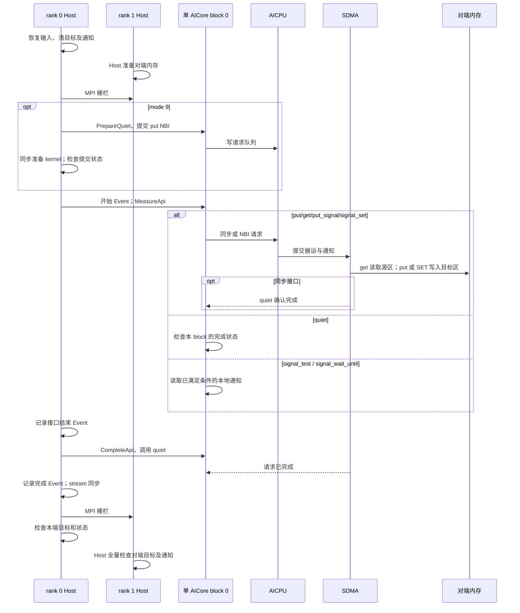

# 单 AICore SHMEM 独立接口性能测试

固定使用逻辑设备6、7重新测试原实现与优化实现的全部78组接口，普通采样、msprof采样及数据耗时计算见[性能细节](PERFORMANCE_DETAILS.md)。
本页原有表格保留各自标注的采样日期和设备条件。

## 测试范围与运行条件

[main.asc](main.asc) 分别测试 SDMA 数据搬运、通知、完成等待及本地通知检查接口。
两个 rank 分别绑定逻辑设备 0、1，**仅 rank 0 启动 1 个 AICore block**，
使用默认生产者掩码 0x00FF 和 block 0 请求队列；rank 1 在 Host 端准备、接收及检查数据。
rank 0 的准备、接口调用、等待完成 kernel 按 stream 顺序执行，每次只启动一个 block。
AICPU 处理设备请求队列，测试全程只有 rank 0 的一个 AICore 发起接口调用。

以下结果采于 2026-11-23：Atlas 300I Duo（Ascend310P3），同卡双 die，CANN 9.1.0、
驱动 26.1.1，Release Host 库及配套 AICPU kernel。共享服务器上存在其他常驻进程。
每组预热 10 轮、采样 100 轮，逐轮检查完整目标数据或通知值。
统计使用 rank 0 的计时样本，计算均值、P50、P95、P99、最大值。
汇总前同时检查两端全部场景的校验记录和轮数。
对应的 AllReduce 实现、时序图及 HCCL 基线见 [统一 AllReduce 基准](../shmem_310p_allreduce/README.md)。

## 接口、场景和数据组织

| mode | 场景 | 接口 |
|---|---|---|
| 1 | 同步 put COPY | `smem_shm_sdma_put`、`smem_shm_sdma_put_at` |
| 2 | NBI put COPY | `smem_shm_sdma_put_nbi`、`smem_shm_sdma_put_nbi_at` |
| 3 | 同步 get COPY | `smem_shm_sdma_get`、`smem_shm_sdma_get_at` |
| 4 | NBI get COPY | `smem_shm_sdma_get_nbi`、`smem_shm_sdma_get_nbi_at` |
| 5 | 数据及同步 SET 通知 | `smem_shm_sdma_put_signal`、`smem_shm_sdma_put_signal_at` |
| 6 | 数据及 NBI SET 通知 | `smem_shm_sdma_put_signal_nbi`、`smem_shm_sdma_put_signal_nbi_at` |
| 7 | 独立同步 SET 通知 | `smem_shm_sdma_signal_set`、`smem_shm_sdma_signal_set_at` |
| 8 | 独立 NBI SET 通知 | `smem_shm_sdma_signal_set_nbi`、`smem_shm_sdma_signal_set_nbi_at` |
| 9 | 提交一条 put NBI 后调用 quiet | `smem_shm_sdma_quiet`、`smem_shm_sdma_quiet_at` |
| 10 | 已完成请求上的 quiet | `smem_shm_sdma_quiet`、`smem_shm_sdma_quiet_at` |
| 11 | 本地通知已满足 EQ 时检测一次 | `smem_shm_signal_test` |
| 12 | 本地通知已满足 EQ 时等待 | `smem_shm_signal_wait_until` |

mode 1～6、9 测试 0.25、1、4、16、64 MiB，覆盖与 AllReduce 相同的五种数据量。
mode 7、8、10、11、12 各测试一个通知或等待场景，通知值为 64 位。
总计 78 组：`7×2×5 + 3×2 + 2`。
gva 表示便利封装，at 表示传入预先构造的 `smem_shm_sdma_ctx_t`，local 表示本地通知接口。
MeasureApi 入口为两类调用均生成一次上下文，gva 封装在调用时还会获取上下文。

每个 rank 建立 256 MiB 对称内存段：源区起点 0，目标区起点 64 MiB，通知位于 128 MiB。
源数据为 `i % 127 + rank * 3 + 1`，每轮由 Host 恢复源数据、清零目标区并设置通知初值。
put 写入对端目标区，get 读取对端源区到本端目标区，源与目标分离。
rank 0 的 put 写入 rank 1，get 从 rank 1 读取到 rank 0。
完成后通过 MPI 栅栏，接收端逐元素检查全部数据，另一端检查目标区仍为初始值。
SET 通知检查 rank 1 收到本轮值、rank 0 的通知槽保持初值。

mode 9 的准备 kernel 在计时前提交一条 NBI put，并检查提交状态；
quiet 可能观察到尚在执行或已经完成的请求。
mode 10 使用此前已完成请求的队列状态。
mode 11、12 在计时前由 Host 将通知设为本轮期望值，测量条件已经成立时的检查路径。
这些数据搬运场景使用 COPY；AllReduce 的 FP32 ADD 性能见统一基准。

## 计时与执行顺序

CANN 9.1 的 310P `GetSystemCycle()` 实现返回 0，因此本测试使用 ACL Event 和 Host 时钟。
计时分为以下三项，单位均为 µs：

| 指标 | 范围 |
|---|---|
| 接口 Event（event_us） | 开始 Event 至 MeasureApi 后的 Event，包含上下文读取、接口分派、接口调用和状态写回 |
| 完成 Event（completed_us） | 同一起点至额外 CompleteApi kernel 的 quiet 完成，包含两个 kernel 的执行和提交间隔 |
| Host（host_us） | 记录开始 Event 前至整个 stream 同步返回 |

NBI 的 quiet 放在第二个 kernel 中，接口 Event 记录提交阶段，完成 Event 记录等待完成后的范围。
同步接口在 MeasureApi 中等待完成。各项包含 kernel 与计时范围内的固定开销。
输入恢复、mode 9 的准备步骤、MPI 栅栏和数据检查位于上述计时外。
接收方每轮完成数据检查后再进入下一轮，保持源缓冲和目标缓冲的生命周期。



## 构建和运行

先在仓库根目录加载 CANN 环境并构建 Host 库与 AICPU kernel：

```bash
bash script/build_and_pack_run.sh
cd benchmark/shmem_310p_api
DEVICE_BASE=0 WARMUP=10 ROUNDS=100 LOG_DIR=/path/to/logs bash run.sh
```

需要 CANN bisheng、OpenMPI；自定义 MPI 安装可设置 MPI_HOME。
DEVICE_BASE 指定 rank 0 的发起设备，rank 1 使用后继设备提供内存。
rank 1 全程在 Host 端等待和检查，每轮均参与 MPI 栅栏。
TIMEOUT 默认为 1200 秒，STORE_URL 可指定配置存储地址，MF_SDMA_ORCH_DIR 可指定配套 AICPU 目录。
`bash build.sh` 单独编译。run.sh 将两端日志分别保存为 rank0.log、rank1.log，
全部通过后调用 summarize.py 生成 summary.json。
汇总程序检查 78 组场景覆盖、rank 0 的逐轮样本、两端的完整校验及运行结束标记。
rank 1 出现计时样本时会报错，保持唯一发起者的统计范围。

## 实测结果

接口 Event 在同步操作中包含完成等待，在 NBI 操作中包含请求提交。
下表的“MiB”描述数据搬运量；纯通知/等待行用“—”，SET 通知值为 8 字节。
gva、at、local 对应上文接口形式。所有时间单位为 µs。

| 场景 | 形式 | MiB | 接口 Event 均值 | P50 | P95 | P99 | 最大 | 完成 Event 均值 | Host 均值 |
|---|---|---:|---:|---:|---:|---:|---:|---:|---:|
| put | gva | 0.25 | 124.777 | 124.713 | 133.047 | 136.744 | 138.177 | 126.123 | 265.967 |
| put | gva | 1 | 167.009 | 167.982 | 177.812 | 180.416 | 184.584 | 168.341 | 302.008 |
| put | gva | 4 | 345.814 | 346.289 | 355.000 | 372.917 | 384.141 | 347.272 | 491.077 |
| put | gva | 16 | 1036.988 | 1036.823 | 1060.000 | 1066.927 | 1102.709 | 1039.817 | 1356.371 |
| put | gva | 64 | 3843.147 | 3828.242 | 3862.865 | 3869.271 | 4907.031 | 3845.242 | 4289.030 |
| put | at | 0.25 | 127.583 | 128.790 | 141.120 | 142.448 | 144.115 | 128.930 | 269.775 |
| put | at | 1 | 170.545 | 170.729 | 179.323 | 187.370 | 188.177 | 171.887 | 303.417 |
| put | at | 4 | 344.883 | 345.065 | 353.959 | 356.380 | 360.078 | 346.198 | 475.777 |
| put | at | 16 | 1042.046 | 1043.008 | 1063.385 | 1081.068 | 1149.141 | 1045.018 | 1215.412 |
| put | at | 64 | 4233.287 | 3839.011 | 3868.047 | 3925.339 | 43240.336 | 4236.849 | 5218.352 |
| put_nbi | gva | 0.25 | 101.464 | 102.643 | 110.417 | 115.729 | 116.354 | 124.838 | 269.871 |
| put_nbi | gva | 1 | 102.951 | 102.721 | 110.182 | 114.219 | 117.187 | 169.616 | 304.009 |
| put_nbi | gva | 4 | 103.498 | 103.086 | 111.536 | 113.724 | 116.537 | 344.653 | 470.480 |
| put_nbi | gva | 16 | 115.891 | 92.057 | 272.057 | 580.260 | 680.000 | 1041.068 | 1187.340 |
| put_nbi | gva | 64 | 180.506 | 118.177 | 558.125 | 727.839 | 749.792 | 3837.433 | 4033.747 |
| put_nbi | at | 0.25 | 88.354 | 99.857 | 112.005 | 115.235 | 139.349 | 131.591 | 297.778 |
| put_nbi | at | 1 | 142.671 | 148.373 | 200.938 | 206.849 | 211.823 | 178.794 | 417.708 |
| put_nbi | at | 4 | 231.987 | 278.346 | 373.932 | 383.308 | 386.589 | 543.714 | 1100.384 |
| put_nbi | at | 16 | 338.891 | 297.110 | 686.432 | 707.500 | 736.823 | 1026.690 | 1369.987 |
| put_nbi | at | 64 | 144.672 | 117.708 | 332.995 | 665.677 | 700.963 | 3847.714 | 4027.121 |
| get | gva | 0.25 | 189.557 | 128.099 | 141.718 | 156.667 | 6233.412 | 190.839 | 377.725 |
| get | gva | 1 | 166.922 | 168.919 | 177.604 | 183.073 | 183.256 | 168.240 | 301.875 |
| get | gva | 4 | 333.205 | 334.193 | 342.395 | 346.198 | 346.510 | 334.546 | 466.324 |
| get | gva | 16 | 983.917 | 978.802 | 1012.968 | 1021.953 | 1074.323 | 985.887 | 1132.685 |
| get | gva | 64 | 4309.295 | 3633.411 | 3654.661 | 3769.583 | 71088.203 | 4312.318 | 4743.884 |
| get | at | 0.25 | 125.492 | 126.693 | 136.458 | 140.026 | 157.188 | 126.783 | 264.695 |
| get | at | 1 | 168.085 | 169.271 | 178.646 | 180.651 | 180.651 | 169.778 | 303.731 |
| get | at | 4 | 325.804 | 327.838 | 336.224 | 340.104 | 344.115 | 327.518 | 467.939 |
| get | at | 16 | 993.132 | 979.323 | 1015.573 | 1024.896 | 2053.177 | 995.099 | 1143.998 |
| get | at | 64 | 3637.179 | 3637.851 | 3653.776 | 3656.276 | 3676.875 | 3639.350 | 3807.342 |
| get_nbi | gva | 0.25 | 103.241 | 103.177 | 111.406 | 114.193 | 117.760 | 127.210 | 264.269 |
| get_nbi | gva | 1 | 100.624 | 103.516 | 113.360 | 119.062 | 119.323 | 165.963 | 294.438 |
| get_nbi | gva | 4 | 97.694 | 98.515 | 110.026 | 112.864 | 113.359 | 326.952 | 459.247 |
| get_nbi | gva | 16 | 92.440 | 86.289 | 125.834 | 130.364 | 134.063 | 1486.183 | 1624.330 |
| get_nbi | gva | 64 | 113.993 | 116.719 | 136.406 | 169.010 | 173.932 | 3628.437 | 3791.034 |
| get_nbi | at | 0.25 | 100.879 | 102.578 | 111.745 | 114.531 | 115.078 | 124.686 | 263.676 |
| get_nbi | at | 1 | 102.992 | 103.646 | 112.604 | 115.782 | 116.432 | 167.805 | 296.478 |
| get_nbi | at | 4 | 102.886 | 104.154 | 113.698 | 118.958 | 120.417 | 342.856 | 476.630 |
| get_nbi | at | 16 | 93.159 | 94.076 | 105.468 | 123.438 | 131.536 | 980.721 | 1114.442 |
| get_nbi | at | 64 | 107.635 | 111.303 | 129.271 | 138.567 | 179.427 | 3924.677 | 4079.802 |
| put_signal | gva | 0.25 | 127.210 | 129.531 | 138.672 | 140.235 | 142.578 | 129.648 | 267.969 |
| put_signal | gva | 1 | 172.528 | 174.362 | 183.073 | 188.516 | 190.053 | 173.836 | 313.514 |
| put_signal | gva | 4 | 359.628 | 349.427 | 360.182 | 365.990 | 1402.370 | 360.943 | 491.351 |
| put_signal | gva | 16 | 1040.043 | 1042.474 | 1059.740 | 1072.318 | 1073.073 | 1043.814 | 1201.215 |
| put_signal | gva | 64 | 3844.466 | 3844.466 | 3866.614 | 3874.792 | 3881.667 | 3848.228 | 4306.986 |
| put_signal | at | 0.25 | 137.730 | 130.169 | 140.573 | 145.078 | 1191.198 | 139.101 | 277.979 |
| put_signal | at | 1 | 174.450 | 174.661 | 182.787 | 186.615 | 187.032 | 175.761 | 307.728 |
| put_signal | at | 4 | 340.011 | 342.956 | 364.011 | 375.495 | 376.666 | 349.756 | 607.834 |
| put_signal | at | 16 | 1043.344 | 1036.080 | 1079.063 | 1088.177 | 1095.781 | 1045.345 | 1588.141 |
| put_signal | at | 64 | 3854.030 | 3852.526 | 3874.114 | 3981.433 | 4000.286 | 3858.174 | 4040.784 |
| put_signal_nbi | gva | 0.25 | 86.545 | 101.119 | 113.333 | 117.005 | 117.083 | 137.610 | 287.109 |
| put_signal_nbi | gva | 1 | 103.182 | 102.474 | 194.141 | 214.688 | 219.974 | 182.339 | 358.722 |
| put_signal_nbi | gva | 4 | 234.441 | 271.406 | 361.562 | 378.359 | 392.448 | 380.019 | 604.435 |
| put_signal_nbi | gva | 16 | 113.900 | 94.570 | 133.177 | 577.057 | 668.568 | 1048.005 | 1203.545 |
| put_signal_nbi | gva | 64 | 131.404 | 120.794 | 184.870 | 433.047 | 592.994 | 4112.431 | 4274.265 |
| put_signal_nbi | at | 0.25 | 77.356 | 63.490 | 111.146 | 134.401 | 145.912 | 139.298 | 309.140 |
| put_signal_nbi | at | 1 | 102.327 | 103.203 | 115.756 | 173.464 | 201.484 | 174.188 | 322.834 |
| put_signal_nbi | at | 4 | 152.966 | 100.990 | 342.657 | 370.677 | 374.323 | 360.437 | 548.891 |
| put_signal_nbi | at | 16 | 171.443 | 120.781 | 536.615 | 644.844 | 700.313 | 1049.493 | 1451.863 |
| put_signal_nbi | at | 64 | 210.256 | 205.976 | 409.271 | 557.526 | 678.776 | 3832.248 | 4105.486 |
| signal_set | gva | — | 62.127 | 60.833 | 71.093 | 80.026 | 89.010 | 101.187 | 287.345 |
| signal_set | at | — | 72.733 | 61.185 | 72.422 | 83.021 | 1122.734 | 111.430 | 294.143 |
| signal_set_nbi | gva | — | 50.378 | 50.495 | 59.296 | 60.807 | 61.198 | 107.237 | 272.575 |
| signal_set_nbi | at | — | 51.806 | 50.755 | 60.026 | 62.760 | 92.943 | 112.792 | 278.913 |
| quiet_after_nbi | gva | 0.25 | 49.628 | 49.519 | 54.062 | 58.620 | 83.750 | 89.542 | 189.320 |
| quiet_after_nbi | gva | 1 | 51.439 | 50.534 | 54.167 | 86.380 | 96.511 | 86.597 | 187.664 |
| quiet_after_nbi | gva | 4 | 76.685 | 73.034 | 86.771 | 96.407 | 1159.921 | 100.533 | 228.604 |
| quiet_after_nbi | gva | 16 | 308.649 | 331.341 | 466.119 | 496.771 | 538.099 | 310.194 | 730.654 |
| quiet_after_nbi | gva | 64 | 3000.544 | 3039.140 | 3212.317 | 3224.323 | 3350.182 | 3001.859 | 3449.951 |
| quiet_after_nbi | at | 0.25 | 97.811 | 98.086 | 106.615 | 112.161 | 112.995 | 99.848 | 252.194 |
| quiet_after_nbi | at | 1 | 99.623 | 99.544 | 108.255 | 109.739 | 111.719 | 102.596 | 231.887 |
| quiet_after_nbi | at | 4 | 96.864 | 101.915 | 110.625 | 112.708 | 113.828 | 103.136 | 237.931 |
| quiet_after_nbi | at | 16 | 210.587 | 162.513 | 488.959 | 508.958 | 1884.713 | 212.954 | 701.364 |
| quiet_after_nbi | at | 64 | 3078.888 | 3026.472 | 3237.812 | 3315.391 | 10795.470 | 3080.256 | 3497.241 |
| quiet_completed | gva | — | 92.483 | 92.070 | 98.880 | 105.521 | 106.796 | 94.619 | 225.201 |
| quiet_completed | at | — | 91.231 | 91.224 | 99.922 | 103.021 | 103.567 | 93.323 | 223.515 |
| signal_test_ready | local | — | 92.357 | 92.683 | 99.583 | 105.234 | 106.485 | 94.435 | 222.745 |
| signal_wait_ready | local | — | 90.449 | 91.849 | 101.224 | 102.188 | 102.448 | 93.376 | 218.945 |

**比较条件：同步接口的“接口 Event”包含完成等待，NBI 的“接口 Event”记录提交；
比较传输完成耗时使用“完成 Event”，该范围还包含后续 quiet kernel 和提交间隔。
quiet_after_nbi 的请求在计时前提交，数值表示剩余等待；ready 场景在计时前已满足条件。
gva/at 均在 kernel 入口获取上下文，gva 封装内部还会获取上下文。
本表由 rank 0 的一个 AICore 测量单向 COPY 或通知/等待；
AllReduce 表由两个 rank 同时执行 ADD 与 COPY，并取较慢 rank，计时工作范围分别对应各自场景。**

<details>
<summary>完成 Event 和 Host 的完整统计（µs）</summary>

| 场景 | 形式 | MiB | 指标 | 均值 | P50 | P95 | P99 | 最大 |
|---|---|---:|---|---:|---:|---:|---:|---:|
| put | gva | 0.25 | 完成 Event | 126.123 | 125.976 | 134.427 | 138.177 | 139.453 |
| put | gva | 0.25 | Host | 265.967 | 264.040 | 280.030 | 293.640 | 454.540 |
| put | gva | 1 | 完成 Event | 168.341 | 169.349 | 179.270 | 181.901 | 185.886 |
| put | gva | 1 | Host | 302.008 | 299.235 | 323.560 | 342.870 | 342.900 |
| put | gva | 4 | 完成 Event | 347.272 | 347.643 | 357.318 | 375.287 | 386.588 |
| put | gva | 4 | Host | 491.077 | 479.165 | 542.720 | 658.400 | 1247.150 |
| put | gva | 16 | 完成 Event | 1039.817 | 1038.360 | 1061.511 | 1068.151 | 1103.881 |
| put | gva | 16 | Host | 1356.371 | 1179.790 | 2936.830 | 3984.830 | 4044.540 |
| put | gva | 64 | 完成 Event | 3845.242 | 3830.494 | 3864.375 | 3870.495 | 4908.229 |
| put | gva | 64 | Host | 4289.030 | 3986.770 | 4200.090 | 5066.310 | 31010.260 |
| put | at | 0.25 | 完成 Event | 128.930 | 130.065 | 142.318 | 143.906 | 145.365 |
| put | at | 0.25 | Host | 269.775 | 268.535 | 285.080 | 292.640 | 294.630 |
| put | at | 1 | 完成 Event | 171.887 | 172.019 | 180.677 | 188.724 | 189.636 |
| put | at | 1 | Host | 303.417 | 301.615 | 319.060 | 328.220 | 360.360 |
| put | at | 4 | 完成 Event | 346.198 | 346.394 | 355.313 | 357.552 | 361.328 |
| put | at | 4 | Host | 475.777 | 475.800 | 486.340 | 492.910 | 494.570 |
| put | at | 16 | 完成 Event | 1045.018 | 1045.208 | 1064.635 | 1083.307 | 1152.578 |
| put | at | 16 | Host | 1215.412 | 1204.865 | 1281.420 | 1470.640 | 1520.780 |
| put | at | 64 | 完成 Event | 4236.849 | 3844.349 | 3869.323 | 3926.745 | 43245.363 |
| put | at | 64 | Host | 5218.352 | 4031.330 | 8523.120 | 12383.120 | 44275.670 |
| put_nbi | gva | 0.25 | 完成 Event | 124.838 | 126.302 | 134.375 | 139.922 | 140.834 |
| put_nbi | gva | 0.25 | Host | 269.871 | 269.420 | 289.560 | 302.370 | 305.980 |
| put_nbi | gva | 1 | 完成 Event | 169.616 | 169.518 | 177.161 | 181.146 | 183.489 |
| put_nbi | gva | 1 | Host | 304.009 | 302.230 | 318.740 | 328.480 | 330.470 |
| put_nbi | gva | 4 | 完成 Event | 344.653 | 344.063 | 353.151 | 354.037 | 360.000 |
| put_nbi | gva | 4 | Host | 470.480 | 469.935 | 479.180 | 482.410 | 485.340 |
| put_nbi | gva | 16 | 完成 Event | 1041.068 | 1029.492 | 1057.969 | 1063.776 | 2096.406 |
| put_nbi | gva | 16 | Host | 1187.340 | 1165.635 | 1211.050 | 1597.610 | 2220.200 |
| put_nbi | gva | 64 | 完成 Event | 3837.433 | 3840.938 | 3873.308 | 3880.782 | 3902.344 |
| put_nbi | gva | 64 | Host | 4033.747 | 4015.690 | 4133.420 | 4201.550 | 4248.140 |
| put_nbi | at | 0.25 | 完成 Event | 131.591 | 128.230 | 165.990 | 173.490 | 173.516 |
| put_nbi | at | 0.25 | Host | 297.778 | 275.470 | 356.790 | 406.280 | 1362.460 |
| put_nbi | at | 1 | 完成 Event | 178.794 | 192.930 | 208.802 | 214.375 | 215.599 |
| put_nbi | at | 1 | Host | 417.708 | 421.065 | 460.140 | 475.730 | 501.360 |
| put_nbi | at | 4 | 完成 Event | 543.714 | 345.404 | 381.458 | 389.740 | 20428.541 |
| put_nbi | at | 4 | Host | 1100.384 | 580.055 | 770.530 | 20635.570 | 23854.060 |
| put_nbi | at | 16 | 完成 Event | 1026.690 | 1022.890 | 1054.713 | 1059.713 | 1065.781 |
| put_nbi | at | 16 | Host | 1369.987 | 1238.240 | 1363.900 | 1436.410 | 13464.380 |
| put_nbi | at | 64 | 完成 Event | 3847.714 | 3846.263 | 3876.432 | 3893.229 | 4261.042 |
| put_nbi | at | 64 | Host | 4027.121 | 4015.200 | 4104.230 | 4185.130 | 4427.120 |
| get | gva | 0.25 | 完成 Event | 190.839 | 129.322 | 142.864 | 158.047 | 6234.818 |
| get | gva | 0.25 | Host | 377.725 | 265.530 | 722.140 | 1260.380 | 6397.650 |
| get | gva | 1 | 完成 Event | 168.240 | 170.169 | 178.959 | 184.271 | 184.506 |
| get | gva | 1 | Host | 301.875 | 300.635 | 316.110 | 389.580 | 396.340 |
| get | gva | 4 | 完成 Event | 334.546 | 335.443 | 343.750 | 347.604 | 347.734 |
| get | gva | 4 | Host | 466.324 | 467.400 | 480.110 | 487.720 | 489.010 |
| get | gva | 16 | 完成 Event | 985.887 | 980.507 | 1014.323 | 1023.437 | 1075.911 |
| get | gva | 16 | Host | 1132.685 | 1124.335 | 1178.910 | 1236.530 | 1249.040 |
| get | gva | 64 | 完成 Event | 4312.318 | 3635.274 | 3658.385 | 3771.927 | 71089.609 |
| get | gva | 64 | Host | 4743.884 | 3863.550 | 4096.000 | 13534.960 | 75161.940 |
| get | at | 0.25 | 完成 Event | 126.783 | 127.943 | 137.838 | 141.485 | 158.412 |
| get | at | 0.25 | Host | 264.695 | 263.490 | 282.600 | 299.390 | 302.510 |
| get | at | 1 | 完成 Event | 169.778 | 170.625 | 179.870 | 182.031 | 182.058 |
| get | at | 1 | Host | 303.731 | 301.670 | 316.990 | 380.340 | 391.870 |
| get | at | 4 | 完成 Event | 327.518 | 329.231 | 337.474 | 341.302 | 345.417 |
| get | at | 4 | Host | 467.939 | 466.865 | 485.020 | 496.710 | 567.880 |
| get | at | 16 | 完成 Event | 995.099 | 980.885 | 1017.031 | 1026.536 | 2054.557 |
| get | at | 16 | Host | 1143.998 | 1128.895 | 1169.860 | 1196.810 | 2204.810 |
| get | at | 64 | 完成 Event | 3639.350 | 3641.003 | 3654.974 | 3657.578 | 3678.151 |
| get | at | 64 | Host | 3807.342 | 3804.900 | 3840.690 | 3851.970 | 3862.970 |
| get_nbi | gva | 0.25 | 完成 Event | 127.210 | 127.396 | 135.599 | 138.854 | 142.995 |
| get_nbi | gva | 0.25 | Host | 264.269 | 263.945 | 283.200 | 304.040 | 343.090 |
| get_nbi | gva | 1 | 完成 Event | 165.963 | 168.320 | 177.474 | 183.828 | 185.365 |
| get_nbi | gva | 1 | Host | 294.438 | 294.200 | 308.620 | 311.740 | 312.630 |
| get_nbi | gva | 4 | 完成 Event | 326.952 | 328.581 | 338.516 | 341.432 | 342.838 |
| get_nbi | gva | 4 | Host | 459.247 | 459.325 | 479.040 | 482.330 | 643.680 |
| get_nbi | gva | 16 | 完成 Event | 1486.183 | 974.596 | 1016.771 | 1023.229 | 51643.074 |
| get_nbi | gva | 16 | Host | 1624.330 | 1111.865 | 1161.070 | 1198.520 | 51807.040 |
| get_nbi | gva | 64 | 完成 Event | 3628.437 | 3633.034 | 3652.891 | 3695.833 | 3695.964 |
| get_nbi | gva | 64 | Host | 3791.034 | 3789.250 | 3838.410 | 3933.520 | 3945.050 |
| get_nbi | at | 0.25 | 完成 Event | 124.686 | 126.966 | 136.562 | 139.453 | 141.250 |
| get_nbi | at | 0.25 | Host | 263.676 | 263.025 | 279.320 | 283.530 | 299.860 |
| get_nbi | at | 1 | 完成 Event | 167.805 | 168.593 | 177.136 | 179.791 | 181.224 |
| get_nbi | at | 1 | Host | 296.478 | 295.420 | 308.660 | 325.460 | 325.740 |
| get_nbi | at | 4 | 完成 Event | 342.856 | 333.894 | 343.802 | 348.959 | 1404.088 |
| get_nbi | at | 4 | Host | 476.630 | 463.215 | 500.480 | 610.870 | 1524.780 |
| get_nbi | at | 16 | 完成 Event | 980.721 | 980.716 | 993.646 | 1014.766 | 1029.869 |
| get_nbi | at | 16 | Host | 1114.442 | 1111.760 | 1137.250 | 1164.260 | 1168.280 |
| get_nbi | at | 64 | 完成 Event | 3924.677 | 3629.440 | 3653.541 | 3680.260 | 33508.672 |
| get_nbi | at | 64 | Host | 4079.802 | 3783.085 | 3829.070 | 3944.530 | 33665.580 |
| put_signal | gva | 0.25 | 完成 Event | 129.648 | 130.872 | 140.000 | 141.563 | 143.933 |
| put_signal | gva | 0.25 | Host | 267.969 | 265.855 | 292.020 | 309.610 | 323.420 |
| put_signal | gva | 1 | 完成 Event | 173.836 | 175.638 | 184.479 | 189.792 | 191.198 |
| put_signal | gva | 1 | Host | 313.514 | 308.495 | 327.310 | 435.100 | 599.190 |
| put_signal | gva | 4 | 完成 Event | 360.943 | 350.834 | 361.718 | 367.188 | 1403.802 |
| put_signal | gva | 4 | Host | 491.351 | 479.950 | 499.070 | 502.930 | 1552.130 |
| put_signal | gva | 16 | 完成 Event | 1043.814 | 1043.854 | 1061.120 | 1073.464 | 1074.323 |
| put_signal | gva | 16 | Host | 1201.215 | 1192.360 | 1238.210 | 1268.970 | 1767.830 |
| put_signal | gva | 64 | 完成 Event | 3848.228 | 3847.461 | 3870.833 | 3883.255 | 3903.959 |
| put_signal | gva | 64 | Host | 4306.986 | 4050.525 | 5821.530 | 7146.400 | 8279.780 |
| put_signal | at | 0.25 | 完成 Event | 139.101 | 131.576 | 141.927 | 146.406 | 1192.708 |
| put_signal | at | 0.25 | Host | 277.979 | 266.810 | 286.940 | 294.500 | 1325.610 |
| put_signal | at | 1 | 完成 Event | 175.761 | 175.989 | 184.011 | 188.177 | 188.256 |
| put_signal | at | 1 | Host | 307.728 | 306.265 | 323.180 | 330.540 | 335.780 |
| put_signal | at | 4 | 完成 Event | 349.756 | 349.206 | 377.656 | 379.349 | 385.573 |
| put_signal | at | 4 | Host | 607.834 | 494.415 | 873.240 | 2459.330 | 2973.950 |
| put_signal | at | 16 | 完成 Event | 1045.345 | 1037.695 | 1080.391 | 1089.843 | 1097.109 |
| put_signal | at | 16 | Host | 1588.141 | 1233.360 | 3277.910 | 3732.830 | 5028.320 |
| put_signal | at | 64 | 完成 Event | 3858.174 | 3855.403 | 3887.031 | 3982.657 | 4003.177 |
| put_signal | at | 64 | Host | 4040.784 | 4029.255 | 4132.260 | 4169.740 | 4185.730 |
| put_signal_nbi | gva | 0.25 | 完成 Event | 137.610 | 130.469 | 168.828 | 230.495 | 261.718 |
| put_signal_nbi | gva | 0.25 | Host | 287.109 | 270.770 | 347.730 | 380.740 | 490.790 |
| put_signal_nbi | gva | 1 | 完成 Event | 182.339 | 178.424 | 245.391 | 266.067 | 271.745 |
| put_signal_nbi | gva | 1 | Host | 358.722 | 368.685 | 443.510 | 533.310 | 535.230 |
| put_signal_nbi | gva | 4 | 完成 Event | 380.019 | 361.237 | 422.136 | 491.771 | 1410.052 |
| put_signal_nbi | gva | 4 | Host | 604.435 | 611.055 | 755.540 | 960.830 | 1546.320 |
| put_signal_nbi | gva | 16 | 完成 Event | 1048.005 | 1036.667 | 1083.932 | 1184.661 | 1196.927 |
| put_signal_nbi | gva | 16 | Host | 1203.545 | 1178.630 | 1292.430 | 1694.630 | 1711.800 |
| put_signal_nbi | gva | 64 | 完成 Event | 4112.431 | 3855.182 | 3873.516 | 3927.734 | 29966.018 |
| put_signal_nbi | gva | 64 | Host | 4274.265 | 4008.715 | 4053.450 | 4155.350 | 30121.870 |
| put_signal_nbi | at | 0.25 | 完成 Event | 139.298 | 134.856 | 171.875 | 191.875 | 211.823 |
| put_signal_nbi | at | 0.25 | Host | 309.140 | 316.660 | 376.090 | 390.920 | 483.470 |
| put_signal_nbi | at | 1 | 完成 Event | 174.188 | 172.735 | 195.364 | 215.781 | 252.005 |
| put_signal_nbi | at | 1 | Host | 322.834 | 317.390 | 365.020 | 400.630 | 411.170 |
| put_signal_nbi | at | 4 | 完成 Event | 360.437 | 342.812 | 403.568 | 428.515 | 1402.630 |
| put_signal_nbi | at | 4 | Host | 548.891 | 514.880 | 649.640 | 988.530 | 1584.430 |
| put_signal_nbi | at | 16 | 完成 Event | 1049.493 | 1055.338 | 1072.526 | 1075.911 | 1076.901 |
| put_signal_nbi | at | 16 | Host | 1451.863 | 1230.390 | 1282.050 | 1323.560 | 23424.820 |
| put_signal_nbi | at | 64 | 完成 Event | 3832.248 | 3830.977 | 3858.854 | 3884.557 | 3913.776 |
| put_signal_nbi | at | 64 | Host | 4105.486 | 4077.805 | 4217.960 | 4301.640 | 5291.770 |
| signal_set | gva | — | 完成 Event | 101.187 | 97.669 | 117.734 | 144.011 | 154.506 |
| signal_set | gva | — | Host | 287.345 | 293.350 | 316.090 | 349.580 | 400.040 |
| signal_set | at | — | 完成 Event | 111.430 | 97.266 | 124.037 | 179.792 | 1151.510 |
| signal_set | at | — | Host | 294.143 | 293.360 | 316.050 | 345.340 | 1297.260 |
| signal_set_nbi | gva | — | 完成 Event | 107.237 | 102.213 | 139.063 | 144.870 | 147.787 |
| signal_set_nbi | gva | — | Host | 272.575 | 291.195 | 312.490 | 325.030 | 327.060 |
| signal_set_nbi | at | — | 完成 Event | 112.792 | 109.505 | 141.198 | 154.037 | 158.359 |
| signal_set_nbi | at | — | Host | 278.913 | 292.010 | 324.800 | 335.940 | 343.890 |
| quiet_after_nbi | gva | 0.25 | 完成 Event | 89.542 | 83.789 | 121.328 | 140.755 | 141.120 |
| quiet_after_nbi | gva | 0.25 | Host | 189.320 | 164.160 | 330.150 | 341.430 | 344.720 |
| quiet_after_nbi | gva | 1 | 完成 Event | 86.597 | 83.711 | 97.344 | 114.401 | 118.177 |
| quiet_after_nbi | gva | 1 | Host | 187.664 | 174.590 | 304.860 | 351.870 | 384.620 |
| quiet_after_nbi | gva | 4 | 完成 Event | 100.533 | 85.326 | 118.229 | 147.890 | 1161.380 |
| quiet_after_nbi | gva | 4 | Host | 228.604 | 205.185 | 296.430 | 412.370 | 1342.580 |
| quiet_after_nbi | gva | 16 | 完成 Event | 310.194 | 332.786 | 467.343 | 497.916 | 539.427 |
| quiet_after_nbi | gva | 16 | Host | 730.654 | 723.700 | 817.430 | 869.010 | 878.420 |
| quiet_after_nbi | gva | 64 | 完成 Event | 3001.859 | 3040.390 | 3213.724 | 3225.703 | 3351.693 |
| quiet_after_nbi | gva | 64 | Host | 3449.951 | 3421.685 | 3512.120 | 3556.920 | 5921.150 |
| quiet_after_nbi | at | 0.25 | 完成 Event | 99.848 | 100.325 | 108.880 | 114.375 | 115.026 |
| quiet_after_nbi | at | 0.25 | Host | 252.194 | 226.070 | 240.630 | 249.780 | 2814.920 |
| quiet_after_nbi | at | 1 | 完成 Event | 102.596 | 101.797 | 110.469 | 113.984 | 130.104 |
| quiet_after_nbi | at | 1 | Host | 231.887 | 231.220 | 244.410 | 267.960 | 295.240 |
| quiet_after_nbi | at | 4 | 完成 Event | 103.136 | 104.440 | 113.333 | 125.990 | 148.255 |
| quiet_after_nbi | at | 4 | Host | 237.931 | 238.435 | 263.430 | 330.210 | 360.140 |
| quiet_after_nbi | at | 16 | 完成 Event | 212.954 | 163.841 | 490.209 | 510.156 | 1885.963 |
| quiet_after_nbi | at | 16 | Host | 701.364 | 687.865 | 774.330 | 828.830 | 2013.320 |
| quiet_after_nbi | at | 64 | 完成 Event | 3080.256 | 3027.890 | 3239.297 | 3316.797 | 10796.771 |
| quiet_after_nbi | at | 64 | Host | 3497.241 | 3429.750 | 3559.760 | 3614.150 | 10953.920 |
| quiet_completed | gva | — | 完成 Event | 94.619 | 94.114 | 101.588 | 107.474 | 109.192 |
| quiet_completed | gva | — | Host | 225.201 | 218.890 | 239.060 | 402.240 | 409.360 |
| quiet_completed | at | — | 完成 Event | 93.323 | 93.321 | 101.849 | 105.000 | 105.911 |
| quiet_completed | at | — | Host | 223.515 | 219.245 | 236.960 | 371.200 | 403.630 |
| signal_test_ready | local | — | 完成 Event | 94.435 | 94.882 | 101.563 | 107.239 | 108.542 |
| signal_test_ready | local | — | Host | 222.745 | 221.440 | 233.030 | 236.180 | 391.350 |
| signal_wait_ready | local | — | 完成 Event | 93.376 | 94.010 | 103.229 | 104.375 | 104.792 |
| signal_wait_ready | local | — | Host | 218.945 | 217.920 | 231.450 | 241.410 | 255.090 |

**比较条件：同步接口的“接口 Event”包含完成等待，NBI 的“接口 Event”记录提交；
比较传输完成耗时使用“完成 Event”，该范围还包含后续 quiet kernel 和提交间隔。
quiet_after_nbi 的请求在计时前提交，数值表示剩余等待；ready 场景在计时前已满足条件。
gva/at 均在 kernel 入口获取上下文，gva 封装内部还会获取上下文。
本表由 rank 0 的一个 AICore 测量单向 COPY 或通知/等待；
AllReduce 表由两个 rank 同时执行 ADD 与 COPY，并取较慢 rank，计时工作范围分别对应各自场景。**

</details>
