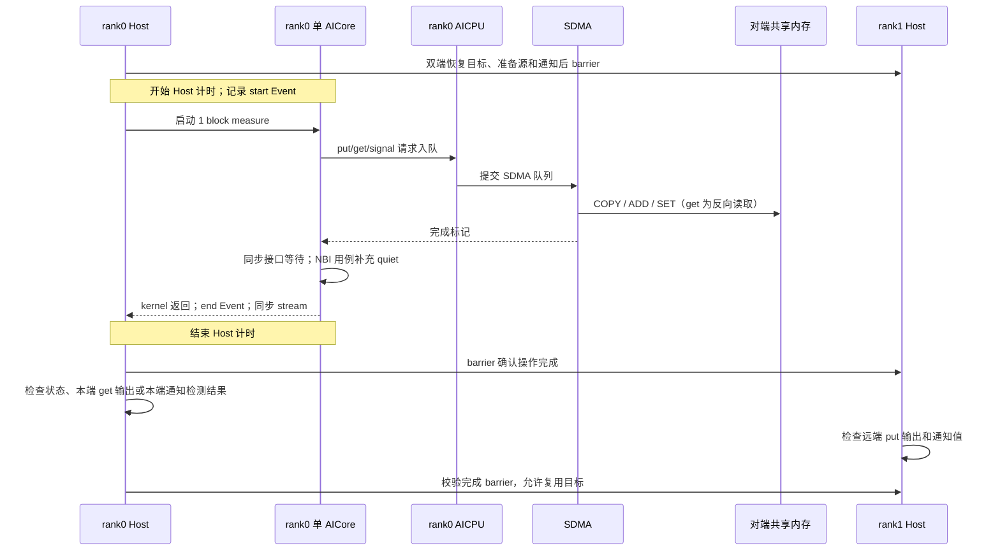

# 310P 单 AICore SHMEM 接口性能测试

两进程绑定同一张 Atlas 300I Duo 的两个 die，本次实测使用逻辑设备 0、1。
rank 0 每次仅启动一个 AICore block，rank 1 的 Host 准备源数据、接收数据并检查结果。
AICPU 持续消费请求，SDMA 执行数据传输及通知。测试期间使用的 AICore 总数为 1。

## 测试入口和接口

测试代码位于 [main.asc](main.asc)，每组调用 `runCase → sample → measure → execute`。
`API_STYLE=at` 复用在 kernel 入口取得的上下文；`API_STYLE=gva` 调用传入 GVA 的便捷接口。
下表中的 SDMA 接口均带有 `smem_shm_sdma_` 前缀，GVA 入口移除 `_at` 后缀。
`signal_test`、`signal_wait_until` 和 `ctx` 使用各自的公共入口。

| 测试用例 | 测试接口 | 操作和完成条件 |
|---|---|---|
| put | `put_at` | 本端源 → 对端目标，等待传输完成 |
| get | `get_at` | 对端源 → 本端目标，等待传输完成 |
| put-nbi | `put_nbi_at` + `quiet_at` | 提交 put，再等待本 block 的请求完成 |
| get-nbi | `get_nbi_at` + `quiet_at` | 提交 get，再等待本 block 的请求完成 |
| put-signal | `put_signal_at` | COPY 完成后向对端 64 位通知槽写入本轮序号，等待完成 |
| put-signal-nbi | `put_signal_nbi_at` + `quiet_at` | 提交数据和通知，再等待完成 |
| signal-set | `signal_set_at` | 向对端通知槽 SET 本轮序号，等待完成 |
| signal-set-nbi | `signal_set_nbi_at` + `quiet_at` | 提交 SET，再等待完成 |
| quiet-idle | `quiet_at` | 无未完成请求时等待，测量读取已完成状态的开销 |
| quiet-after-put | `quiet_at` | 在计时前的独立 kernel 中提交一次 put NBI，计时 kernel 执行 quiet |
| signal-test | `smem_shm_signal_test` | 本端通知已就绪，执行一次 EQ 比较 |
| signal-wait-ready | `smem_shm_signal_wait_until` | 本端通知已就绪，等待 EQ 成立 |
| put-add-fp32 | `put_at(..., SMEM_SHM_SDMA_OP_ADD_FP32)` | 本端 FP32 的 1.0 累加到对端的 2.0 |
| put-add-fp16 | `put_at(..., SMEM_SHM_SDMA_OP_ADD_FP16)` | 本端 FP16 的 1.0 累加到对端的 2.0 |
| ctx | `smem_shm_sdma_ctx` | 取得上下文并输出对称段大小，Host 核对结果 |

COPY、GET、联合通知、quiet-after-put 和两种累加覆盖 64 B、4 KiB、256 KiB、1 MiB、4 MiB、16 MiB、64 MiB。
独立通知使用一个独占缓存行的 8 B 通知槽，结果中的 `bytes=0` 表示本组无数据负载。
每个数据用例的目标区在每轮恢复为初值；COPY/GET 使用随下标变化的数据，逐字检查整个目标区。
累加逐个检查 FP32/FP16 的 3.0；带通知的用例同时检查远端序号。
两端 Host 完成校验后交换 barrier，下一轮才复用缓冲区。

公开接口定义见 [smem_shm_aicore_base_sdma.h](../../src/smem/include/device/smem_shm_aicore_base_sdma.h)。
此目录测试 310P SDMA 设备通信接口及通知接口；Host 建池、元数据 getter、RDMA 和其他平台接口按各自执行主体测试。

## 测试时序和计时



`event_us` 是同一 stream 两个 Event 之间的时间，包含单 block kernel 的执行和相应调度。
`host_us` 从记录 start Event 之前到 stream 同步返回，包含提交及等待。
初始化、源数据上传、目标恢复、Host barrier、结果下载和检查均在计时外。
默认每组预热 10 次，再采样 100 次；预热轮同样检查结果。
统计输出包含平均值、P50、P95、P99 和最大值。

NBI 用例的计时包含一次 NBI 调用及随后 quiet，表示完成一次请求的耗时。
quiet-after-put 的提交 kernel 在计时前返回，SDMA 可在两个 kernel 之间继续执行，因此该组测量 quiet 的剩余等待时间。
signal-test 和 signal-wait-ready 测量通知已满足条件时的本地检测路径；远端通知传输由 signal-set 用例覆盖。
ctx 用例包含输出上下文成员的写操作。所有数据均以单次 kernel 的 Event/Host 时间报告。

## 构建和运行

先加载本机 CANN 环境，在仓库根目录构建主库和 AICPU 产物：

```bash
source /usr/local/Ascend/cann-9.1.0/set_env.sh
bash script/build_and_pack_run.sh --build_python OFF
```

确认设备 0、1 空闲后运行两个入口版本，各自使用独立日志目录：

```bash
DEVICE_BASE=0 API_STYLE=at WARMUP=10 ROUNDS=100 \
 LOG_DIR=/workspace/my-logs-dir/memfabric-api/at \
 bash benchmark/shmem_api_310p/run.sh
DEVICE_BASE=0 API_STYLE=gva WARMUP=10 ROUNDS=100 \
 LOG_DIR=/workspace/my-logs-dir/memfabric-api/gva \
 bash benchmark/shmem_api_310p/run.sh
```

`DEVICE_BASE` 指定同卡连续 die 的首个逻辑设备索引，`STORE_URL` 默认本机 TCP 配置存储，
`API_FILTER` 默认 `all`，可指定表中的单个用例名，例如 `API_FILTER=get` 只测试 get 的七种尺寸。
`TIMEOUT` 默认 1800 秒，`MF_SDMA_ORCH_DIR` 可指定配套 AICPU 产物目录。
`bash build.sh` 只编译基准。脚本只管理本次启动的进程。

成功运行后，`rank0.log` 保存每轮 SAMPLE，两端日志均有逐组 PASS 和清理完成记录。
`summarize.py LOG_DIR` 依据日志中的 API_FILTER 核对两端用例集（默认全部 69 组）、逐轮样本数、完整校验及进程清理记录，再生成 `summary.json`。
任何接口或数据校验失败、超时、缺少样本均使运行或统计返回非零。
统计校验可通过 `python3 -m unittest -v test_summarize` 执行。

## 性能结果

实测日期：2026-11-23；Atlas 300I Duo（Ascend310P3）单卡双 die，逻辑设备 0、1，
CANN 9.1.0、驱动 26.1.1，Release 构建。每组预热 10 轮、正式采样 100 轮，
rank 0 使用一个 AICore block，rank 1 使用 Host 准备及检查数据。
采样期间记录设备占用；下表只采用样本完整、双端校验与清理成功、未观察到其他进程占用的运行。

### 完成采样的控制接口

时间单位为 μs。每组都有 100 个有效样本。signal-test 与 signal-wait-ready 使用同一公共接口，
在两次入口配置运行中各测量一组。quiet-idle 在本轮进程尚未提交传输请求时执行。

| 入口配置 | 用例 | Event 均值 | P50 | P95 | P99 | 最大值 | Host 均值 | Host P95 |
|---|---|---:|---:|---:|---:|---:|---:|---:|
| at | ctx | 41.97 | 41.45 | 49.48 | 51.46 | 52.79 | 196.61 | 210.06 |
| at | quiet-idle | 42.13 | 41.25 | 49.63 | 51.25 | 56.02 | 200.78 | 210.15 |
| at | signal-test | 44.35 | 43.76 | 50.78 | 58.07 | 58.20 | 197.91 | 213.35 |
| at | signal-wait-ready | 42.89 | 41.48 | 51.35 | 56.56 | 71.43 | 203.31 | 220.07 |
| gva | ctx | 41.09 | 40.34 | 49.17 | 49.84 | 49.90 | 185.68 | 198.38 |
| gva | quiet-idle | 42.02 | 40.96 | 49.92 | 51.59 | 52.84 | 187.88 | 197.76 |
| gva | signal-test | 42.19 | 41.38 | 49.97 | 50.94 | 52.16 | 189.77 | 218.52 |
| gva | signal-wait-ready | 41.73 | 40.92 | 49.82 | 50.55 | 51.07 | 187.09 | 200.34 |

### 数据与通知传输的采样状态

下表列出全部 69 个用例规格在两类入口中的状态。数据用例按负载字节数分组；0 表示控制接口。
“超时”对应首个 64 B 用例流同步返回 507046；独立 SET 使用 8 B 通知槽。
诊断运行将 stream 同步超时缩短至 15 秒，配置为 0 次预热、1 次测试，遇到失败立即结束。
“未采样”表示尚无该规格的完整有效运行。控制接口耗时见上表。

| 用例 | 负载字节数 | at 入口 | gva 入口 |
|---|---:|---|---|
| put | 64 | 首轮超时 507046 | 受其他进程占用干扰，数据作废 |
| put | 4,096 | 未采样 | 未采样 |
| put | 262,144 | 未采样 | 未采样 |
| put | 1,048,576 | 未采样 | 未采样 |
| put | 4,194,304 | 未采样 | 未采样 |
| put | 16,777,216 | 未采样 | 未采样 |
| put | 67,108,864 | 未采样 | 未采样 |
| get | 64 | 首轮超时 507046 | 首轮超时 507046 |
| get | 4,096 | 未采样 | 未采样 |
| get | 262,144 | 未采样 | 未采样 |
| get | 1,048,576 | 未采样 | 未采样 |
| get | 4,194,304 | 未采样 | 未采样 |
| get | 16,777,216 | 未采样 | 未采样 |
| get | 67,108,864 | 未采样 | 未采样 |
| put-nbi | 64 | 未采样 | 未采样 |
| put-nbi | 4,096 | 未采样 | 未采样 |
| put-nbi | 262,144 | 未采样 | 未采样 |
| put-nbi | 1,048,576 | 未采样 | 未采样 |
| put-nbi | 4,194,304 | 未采样 | 未采样 |
| put-nbi | 16,777,216 | 未采样 | 未采样 |
| put-nbi | 67,108,864 | 未采样 | 未采样 |
| get-nbi | 64 | 未采样 | 未采样 |
| get-nbi | 4,096 | 未采样 | 未采样 |
| get-nbi | 262,144 | 未采样 | 未采样 |
| get-nbi | 1,048,576 | 未采样 | 未采样 |
| get-nbi | 4,194,304 | 未采样 | 未采样 |
| get-nbi | 16,777,216 | 未采样 | 未采样 |
| get-nbi | 67,108,864 | 未采样 | 未采样 |
| put-signal | 64 | 未采样 | 未采样 |
| put-signal | 4,096 | 未采样 | 未采样 |
| put-signal | 262,144 | 未采样 | 未采样 |
| put-signal | 1,048,576 | 未采样 | 未采样 |
| put-signal | 4,194,304 | 未采样 | 未采样 |
| put-signal | 16,777,216 | 未采样 | 未采样 |
| put-signal | 67,108,864 | 未采样 | 未采样 |
| put-signal-nbi | 64 | 未采样 | 未采样 |
| put-signal-nbi | 4,096 | 未采样 | 未采样 |
| put-signal-nbi | 262,144 | 未采样 | 未采样 |
| put-signal-nbi | 1,048,576 | 未采样 | 未采样 |
| put-signal-nbi | 4,194,304 | 未采样 | 未采样 |
| put-signal-nbi | 16,777,216 | 未采样 | 未采样 |
| put-signal-nbi | 67,108,864 | 未采样 | 未采样 |
| signal-set | 0 | 首轮超时 507046 | 首轮超时 507046 |
| signal-set-nbi | 0 | 未采样 | 未采样 |
| quiet-idle | 0 | 100 次采样完成 | 100 次采样完成 |
| quiet-after-put | 64 | 未采样 | 未采样 |
| quiet-after-put | 4,096 | 未采样 | 未采样 |
| quiet-after-put | 262,144 | 未采样 | 未采样 |
| quiet-after-put | 1,048,576 | 未采样 | 未采样 |
| quiet-after-put | 4,194,304 | 未采样 | 未采样 |
| quiet-after-put | 16,777,216 | 未采样 | 未采样 |
| quiet-after-put | 67,108,864 | 未采样 | 未采样 |
| signal-test | 0 | 100 次采样完成 | 100 次采样完成 |
| signal-wait-ready | 0 | 100 次采样完成 | 100 次采样完成 |
| put-add-fp32 | 64 | 首轮超时 507046 | 首轮超时 507046 |
| put-add-fp32 | 4,096 | 未采样 | 未采样 |
| put-add-fp32 | 262,144 | 未采样 | 未采样 |
| put-add-fp32 | 1,048,576 | 未采样 | 未采样 |
| put-add-fp32 | 4,194,304 | 未采样 | 未采样 |
| put-add-fp32 | 16,777,216 | 未采样 | 未采样 |
| put-add-fp32 | 67,108,864 | 未采样 | 未采样 |
| put-add-fp16 | 64 | 未采样 | 未采样 |
| put-add-fp16 | 4,096 | 未采样 | 未采样 |
| put-add-fp16 | 262,144 | 未采样 | 未采样 |
| put-add-fp16 | 1,048,576 | 未采样 | 未采样 |
| put-add-fp16 | 4,194,304 | 未采样 | 未采样 |
| put-add-fp16 | 16,777,216 | 未采样 | 未采样 |
| put-add-fp16 | 67,108,864 | 未采样 | 未采样 |
| ctx | 0 | 100 次采样完成 | 100 次采样完成 |

传输完成后才能计算有效带宽，当前各数据传输规格的带宽值待补充。
AllReduce 对照及 AICPU 部署诊断见 [AllReduce 基准](../shmem_310p/README.md#部署与提交路径诊断)。
