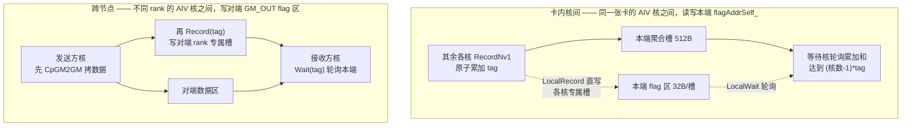
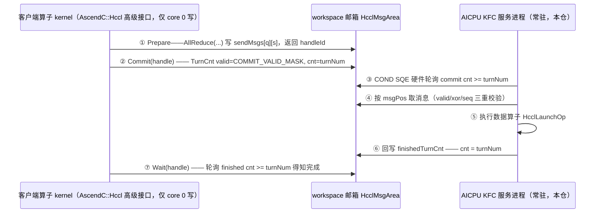
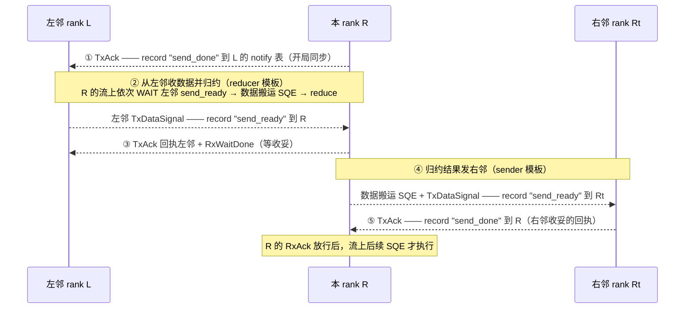

# hcomm 的 GM 标志消息同步机制（与本项目双环邮箱对照）

> **文档定位**：长寿命参考档案。回答三个问题——hcomm（HCCL 通信基础库）里有没有
> 本项目双环邮箱（GM 标志 + 内存消息语义同步）这样的机制；每层机制**谁是生产者、
> 谁是消费者、什么场景使用、支持什么卡**；与我们的做法差在哪。
> **证据基线**：本机 hcomm 仓快照（310P 设备代码位于 `src/legacy/ascend910/`）；
> 邮箱布局权威头 `hccl_msg.h` 在本机 CANN 安装目录
> `/usr/local/Ascend/cann-9.1.0/aarch64-linux/asc/include/adv_api/hccl/internal/hccl_msg.h`。
> 下文全部行号经 2026-10-29 逐条核实，引用前先复核行号漂移。
> **读者**：要给双环邮箱扩多生产者并行、或想对照官方做法验证"数据 SQE 与标志
> 同 SQ 保 FIFO"这条路线的机制开发者。
> **边界**：本文只记录 hcomm 怎么做，不改本项目行为；本项目行为契约以
> `openspec/specs/smem/310p-sdma-orch/` 为准，wire 配方见[机制档案](./机制档案.md)。

## 0. 结论速览

| # | 结论 |
|---|---|
| 1 | hcomm 有 GM 标志消息同步，且是**四层机制**（第 1 节），但全仓没有任何叫 flag 的类或文件（`FlagMgr/FlagInfo/HcclFlag`、文件名 `*flag*` 均零命中）——机制藏在 SQE 类型、算法模板和 KFC 框架里 |
| 2 | **卡型边界**：第 1 层（AIV 直写 GM）是 910B/910_93 世代 AIV 训练卡的机制，310P 不走这层（`alg_aiv_template` 全目录 310P 零命中）；310P 上 hcomm 的 GM 同步走第 2/3 层（AICPU + SDMA，V2 SQE 专列 `dispatcher_aicpu.cc:74`）——**与我们对话的其实是第 2/3 层** |
| 3 | 第 1 层同时服务**卡内核间**（同一张卡的 AIV 核之间，读写本端 `flagAddrSelf_`）与**跨节点/跨卡**（写对端 `GM_OUT` flag 区），见 2.1 的图 |
| 4 | 与本项目双环邮箱最接近的是**第 2 层 MC2/KFC 轮次计数邮箱**：与我们是**同一类设计（GM 邮箱接力的两执行体模型）**；邮箱 = 每通信域 16MB workspace、64 槽×48 队列、`TurnCnt` 是 64B 缓存行（valid 掩码 + 计数），见 2.2。**边界**：其客户端是设备侧融合算子（`AscendC::Hccl` 高级接口），host API 不走此路径（实测走 HOST 展开）；本机无法用户侧驱动该机制（三重证据见 2.2 实证段），本机上这一模式的可运行实例即本项目双环邮箱 |
| 5 | 核心顺序保证与本项目**完全同款**：数据先走、标志后到，且同走一条队列靠 FIFO 保序——官方与本项目独立走到了同一条路线，互证正确 |
| 6 | 分歧在认领模型：hcomm **不做跨生产者原子领槽**，全部静态分槽（按 rank/通知类型/队列固定编址）；GM 原子（atomic add）只用于 N:1 到达计数 |
| 7 | "等一个标志"在三层的实现代价不同：第 1 层 AICore 软件循环轮询、第 2 层**队列引擎执行 COND SQE 内嵌指令循环（硬件轮询）**、第 3 层 notify 表硬件等待——见 2.2.3 的对比表 |
| 8 | reduce 操作码两套世代互不兼容（V2 枚举 vs V1 拼接），固件只认权威枚举——与本项目 KVER=11 自造 0x71 编码固件不识别的教训同源 |

## 1. 四层机制总览：谁生产、谁消费、什么场景、什么卡

| 层 | 使用场景 | 适用卡型 | 生产者（写标志方） | 消费者（等标志方） | 标志载体 |
|---|---|---|---|---|---|
| 1. AICore 直接信号 | AIV 集合算法：卡内核间屏障 + 跨节点步步间同步 | **910B/910_93（AIV 训练卡）；310P 不走** | 发送方 AIV 核：先拷数据、后写 flag（卡内写本端聚合槽/跨节点写**对端** flag 区） | 等待方 AIV 核：轮询本端 flag 区 | 每 rank CCL buffer 头部 3MB flag 区，32B/槽 |
| 2. MC2/KFC 轮次邮箱 | 高层 API 算子把通信操作托付给常驻 AICPU 服务进程接力执行 | **各代通用（310P 专列 V2 SQE）** | 客户端算子 kernel：写消息槽 + 提交 `TurnCnt`（valid 掩码 + 轮次计数） | AICPU KFC 服务进程：硬件轮询 commit → 取消息 → 执行数据算子；客户端再等 finishedTurnCnt 回执 | workspace 邮箱（每通信域 16MB，64 槽×48 队列） |
| 3. SQE 类型标志 | host/AICPU 编排的流式通信逐链路握手（如 ring 每步 ready/done 配对） | **各代通用**（310P：notify 内部替换为 event；910B/910_93 notify 寄存器 4B、其余 8B，`dispatcher_aicpu.cc:115-118`） | 发送方编排者：在发送流上"数据 SQE 之后"追加 NOTIFY_RECORD/WRITE_VALUE SQE，由队列引擎按序落笔 | 接收方编排者下发的 NOTIFY_WAIT SQE：硬件等待，等到才放行读数据 | MMIO notify 信号量表 / WRITE_VALUE 直写 GM |
| 4. RDMA 三 flag | 服务器间 RoCE 链路收发握手 | 与卡型无关（跨服务器场景） | 对端 AICPU transport：RDMA WRITE 连数据带 flag | 本端 AICPU transport：自旋轮询 | HBM flag buffer，3×u32 |

四层的标志流向一图流（`──▶` 为写入方向，`◀──` 为轮询等待）：

```
第 1 层  卡内:  其余核 ──原子累加 tag──▶ 本端聚合槽 ◀──轮询累加和── 等待核
         跨节点: 发送方核 ──数据 + Record(tag)──▶ 对端数据区/flag 区 ◀──Wait(tag) 轮询── 接收方核

第 2 层  客户端 kernel ──消息 + TurnCnt 提交──▶ workspace ◀──COND SQE 硬件轮询── AICPU 服务进程
         AICPU 服务进程 ──执行数据算子──▶ finished TurnCnt 回写 ──▶ 客户端 kernel（等回执）

第 3 层  发送方流: [数据 SQE → NOTIFY_RECORD SQE] ──队列引擎 FIFO──▶ 标志按序落笔
         接收方流: [NOTIFY_WAIT SQE] 硬件等待 ──▶ 才放行后续读数据 SQE

第 4 层  对端 AICPU ──RDMA WRITE(数据 + flag1/2/3)──▶ 本端 HBM ◀──WaitAsyncFlag 自旋── 本端 AICPU
```

## 2. 逐层细节

### 2.1 第 1 层：AICore 直接 GM 信号——910B/910_93 的 AIV 卡，卡内核间与跨节点都用它

**适用卡型**：这层整套属 **910_93 模板**（类名 `AivCrossNode91093Base`，
`aiv_crossnode_91093_base.h:109`；`#define DEV_TYPE_910_93 4` 与 devType 判定，
`aiv_communication_base.h:255/490`）。910B/910_93 这类带 AIV vector 核的训练卡，
AICore 可经 MTE3 直写对端 GM，才有这层机制；**310P 不走这层**（`alg_aiv_template`
全目录 310P 零命中；310P 走第 2/3 层 AICPU+SDMA，V2 SQE 专列
`dispatcher_aicpu.cc:74`）。910B 与 910_93 在调度器里是两个 DevType，notify 寄存器
宽度也不同（"910B和910_93的notify寄存器大小为4字节，其他芯片为8字节"，
`dispatcher_aicpu.cc:115-118`）。

**场景**：AIV 集合算法。**卡内核间、跨节点两种场景都有**，靠"写本端还是写对端"
区分，同一套原语：



- **卡内核间**（同一张卡）：`LocalRecord/LocalWait` 读写**本端** flag 区
  `flagAddrSelf_`（`aiv_crossnode_91093_base.h:762-781`）；`RecordNv1(tag, flagAddrSelf_)`
  多核往同一聚合槽**原子累加**做核间屏障——源码注释原文："其他核去写该flag，做
  原子累加达到核间同步的目的"（`:717-726`）；`Record1vN/Wait1vN` 设备内广播通知。
- **跨节点**（不同 rank）：`Record/Wait` 写**对端** flag 区——`BatchRecordWait`
  注释即"写所有对端的flag"（`:740-744`），对端地址来自 kernel 参数 `GM_OUT[i]`
  （`aiv_communication_base.h:466`）；发送方先把数据 `CpGM2GM`（GM→UB→GM 中转，
  支持原子累加，`:658-696`）拷到对端输出区，随后写本步 tag，接收方轮询本端、
  tag 匹配才读数据；`WaitNv1(buffersOut[i])` 等 N 个对端核报到（`:728-737`）。

**生产者**：发送方/参与方 AIV 核（算法 kernel 内联原语；数据与标志都由它写，
标志在数据后）。
**消费者**：等待方 AIV 核（轮询本端 flag 区）。

原语四件套（`aiv_interface/sync_interface.h:29-98`）：

```cpp
SetSignalValue(...)    // UB→GM 直写 32B；写前 SyncFunc<S_MTE3>() 管线事件
WaitSignalValue(...)   // GM→UB 轮询循环，读后 SyncFunc<MTE2_S>()，值==期望即返回
WaitSignalGEValue(...) // 同上，值>=期望即返回（轮次语义）
AddSignalValue(...)    // SetAtomicAdd<int32_t>() + PipeBarrier<PIPE_ALL>()，GM 原子加
```

- flag 区布局：`AIV_FLAG_BUFFER_SIZE=3MB`、每标志 `FLAG_SIZE=32B`、三缓冲
  `FLAG_BUF_NUM=3`、原子聚合槽 `ATOMIC_FLAG_SIZE=512B`（`aiv_communication_base.h:155/203/204/238`）；
  CCL buffer 按 `AIV_FLAG_SIZE=4MB + AIV_DATA_SIZE=36MB` 分配（`ccl_buffer_manager.h:21-22`）。
- **槽位静态编址，无领槽**：`Record` 偏移 =
  `(blockIdxInGroup*rankSize*FLAG_BUF_NUM + notifyType*rankSize + rank_) * FLAG_SIZE`
  （`aiv_crossnode_91093_base.h:755-758`）——每个生产者（block/rank/通知类型组合）
  固定拥有自己的槽（卡内=本端槽，跨节点=对端区里自己的专属槽），写前不申请、不竞争。
- 可见性纪律：每次 GM 标志访问用管线事件（S_MTE3 / MTE2_S）兜住，原子加前后
  `PipeBarrier<PIPE_ALL>`；ping-pong（tag%2 偏移）与三缓冲 bank 避免读写自干扰。
- 勿混淆：AscendC 的 `SetFlag<event>/WaitFlag<event>` 是核内管线事件，不是 GM 标志。

### 2.2 第 2 层：MC2/KFC 轮次计数邮箱——与本项目双环邮箱同构的设计

**适用卡型**：KFC 框架层，各代通用；310P1/310P3 走 V2 SQE 专列
（`dispatcher_aicpu.cc:74`）。KFC 通道在 310P 上真实可用（本项目 epoch kernel 即经
KFCKernel 通道常驻运行）；但 **host-API 集合通信不走本层**（见下方实证段）。

**本机实证（2026-10-29，dev0+dev1 同卡双芯 2-rank 单次 AllReduce，PASS，用例
[310p_hccl_allreduce](../../../test/integration/310p_hccl_allreduce/README.md)）**：
host-API 路径为 **HOST 展开**——通信域初始化时装载 TBE 向量归约模块并注册整族
AICPU kernel（`launch_aicpu.cc → ccl_kernel.json → RegisterCpuKernel`，含
`RunAicpuRpcSrvLaunchV2_<op>` 每算子入口，**仅注册**）；op 调用时 host 直接把
`MEMCPY_ASYNC / NOTIFY_RECORD(写对端) / EVENT_WAIT` 与 AICore 归约核
（`dynamic_add_int32_v51`，`tbe_vector_reduce.cc:259`）排入 op 流、队列引擎按序
执行——**全程零 AICPU kernel 任务**（任务普查实测；`HCCL_OP_EXPANSION_MODE=AI_CPU`
无效根因已定位：env 解析正常（`aicpuUnfold[1]`），但 310P3 **不在 AICPU 展开设备
支持矩阵**——hcomm `CommConfig::SetConfigOpExpansionMode` 注释原文"目前只有A3和
300I支持Aicpu展开"、代码仅放行 `910_93||910B`；且本版 AllReduce 的
`OpParam.aicpuUnfoldMode` 无 host 侧赋值点（唯一赋值在 alltoall 预处理且带 910_93
门槛），恒走 host；支持设备还需双环+图模式+单机，`IsSupportUnifiedMarch`
coll_alg_utils.cc:49）。**本节所述 KFC 邮箱
机制（RpcSrv/AicpuKfc 服务 + COND SQE）服务的是设备侧高级接口路径**（kernel 内
`AscendC::Hccl` 融合通信：客户端 kernel 的 core 0 写邮箱，host 不可能当邮箱客户端）
——注册族即该路径的就绪证据，其客户端为预编译产物，host-API 测试覆盖不到。
本机不可用户侧驱动该机制的**三重证据**：① 装机 libhccl 无 AICPU 执行的 AllReduce
算法（开源仓新世代的 `AicpuAllReducePipeLineUBX` 未随 9.1.0 发布）；② ADV API
实现头缺失（`adv_api/hccl.h` 引用的 `impl/adv_api/detail/...` 与 AscendC 库约定的
`lib/hccl/hccl.h` 均不在安装中——连华为自带的 mc2_templates 源码本机也编不了）；
③ 全部近期设备日志/plog 中 0 次出现 RpcSrv/AicpuKfc/HcclKernelEntrance（从未有
负载跑过该服务端）。**本机上这一机制模式的可运行实例，就是本项目双环邮箱**
（08 示例 / 310p_sdma_stability 长稳压测，同为"kernel 写请求邮箱 + AICPU 消费"）。实测
纪律：① `HcclCommInitAll` 前须先 `aclrtSetDevice`（否则 HCCL_E_RUNTIME=15）；
② 提交会阻塞等对端参与，rank 须各自线程并发出（单线程顺序下发 ~2 分钟后
HCCL_E_TIMEOUT=9）。

**场景**：与本项目双环邮箱**同构**——设备上两个执行体用 GM 邮箱接力，host 不进
数据面。hcomm 侧的客户端是**融合算子 kernel**（host 只负责拉起算子）：算子 kernel
不自己搬数据，而是调 `AscendC::Hccl` 高级接口把"要执行什么通信操作"写成消息投进
workspace 邮箱，由**常驻 AICPU 服务进程（KFC）**接力执行。

#### 2.2.1 邮箱长什么样：内存布局（权威定义）

布局权威头 `hccl_msg.h`（本机 CANN 9.1.0 安装目录
`/usr/local/Ascend/cann-9.1.0/aarch64-linux/asc/include/adv_api/hccl/internal/hccl_msg.h`，
`namespace HcclApi`）：

```
HcclMsgArea —— workspace 里为每个通信域预留的 16MB（头文件注释原文：
               "the 16MB space reserved by workspace in struct HcclCombinOpParam
                and belongs to each comm group"，:133；64B 缓存行对齐）
├─ commMsg ─ union（单/多队列两种形态，服务端按 totalQueueNum 二选一）
│   ├─ singleMsg : SingleQueueMsg
│   │   ├─ sendMsgs[HCCL_MSG_CNT=64]        发送消息槽数组
│   │   ├─ recvMsgs[HCCL_MSG_CNT=64]        接收消息槽数组
│   │   │        头文件注释：读写两套消息体，"避免 AICore 与 AICPU 同时读写
│   │   │        sendcnt/recvcnt"（:130-131）
│   │   ├─ reserved0[8KB]                   ABI 兼容
│   │   ├─ commitTurnCnt[64]    TurnCnt[]   提交计数（客户端写，服务端轮询/复位）
│   │   ├─ finishedTurnCnt[64]  TurnCnt[]   完成计数（服务端写，客户端轮询）
│   │   ├─ reserved1[1MB]                   ABI 兼容
│   │   └─ paramExtMsgList[64]              扩展参数区 HcclMsgExt（仅 AlltoAllV 用，
│   │                                       8256B/条、最多 256 rank，:102-118）
│   └─ multiMsg : MultiQueueMsg
│       ├─ sendMsgs[MAX_QUE_NUM=48][64]     消息槽数组（多队列形态）
│       ├─ commitTurnCnt[48][64]            每队列每槽一份
│       └─ finishedTurnCnt[48][64]
├─ controlMsg : ControlHcclMsg             restart/restarting/restartCnt/resetSeq（:158-164）
└─ apiStats : ApiStates                     按 CMD 类型的 commitStats/waitStats/
                                           msgStats/snapshots 统计（:166-172）
```

**`TurnCnt` 不是裸计数，是 64B 缓存行结构**（:135-139，字段注释为权威头原文）：

```cpp
struct TurnCnt {
    uint64_t valid;       // COMMIT_VALID_MASK, writen by client when Commit, checked by server
    uint64_t cnt;         // commit cnt, writen by client, reset by server
    uint64_t reserved[6]; // 补齐 64B 缓存行
};
```

即一次"提交"写两个字段：`valid=COMMIT_VALID_MASK(987654321)` 表示本次提交有效，
`cnt` 置为本轮轮次值；服务端软件校验 valid，硬件（COND SQE）只盯 cnt。配套常量：
`HCCL_MSG_VALID_MASK=0x5CDF123A`（消息有效掩码）、`FINALIZE_FINISH_CNT=1234567899999999999`
（服务端收尾哨兵值，hcomm `aicpu_kfc_rpc_serverv2.cc:456` 正是用它）（:27-29）。

单条消息 `HcclMsg`（:86-100，字段注释为权威头原文）：

| 字段 | 含义 |
|---|---|
| `commType` | 通信原语类型 AllReduce/AllGather…/Finalize/InterHcclGroupSync |
| `opType` | reduce 操作类型 sum/prod/max/min |
| `sendBuffer/recvBuffer` | 源/目的 buffer 地址 |
| `dataCnt` | 参与操作的数据个数 |
| `strideCount` | 通信计算融合切分多轮时的数据块步长（不连续内存描述） |
| `addMsg.v0Msg` | V0 附加信息：`hcclDataType`、`p2pSrcDestRankId`、`valid`、`repeatCnt`（本消息派发的任务数）、`everyTurnRsp/everyTurnWait`、`commDepGroupID/commDepHandleID`（跨通信域依赖）、`selfHandleID`、`seqNum`、`version`、`xorCheck`（:43-58） |
| `addMsg.v1Msg` | V1 附加信息：`ccOpTilingData`（tiling 信息）+ 精简版同上（:60-69） |

**`sendMsgs[q][s]` 两个下标是什么**：
- **q = 队列号**（0..MAX_QUE_NUM-1 = 48）：消息面按队列分片，服务端每个
  AICPU block 认领一段队列（`GetLocalQueueRange`，`aicpu_kfc_rpc_serverv2.cc:65`）；
  单队列形态退化为 `sendMsgs[s]`。
- **s = 消息槽号**（0..HCCL_MSG_CNT-1 = 64）：服务端每队列持一个 `msgPos` 游标，
  消费一槽后 `(msgPos+1) % HCCL_MSG_CNT` 环回（`aicpu_kfc_process.cc:1151`）。
- **队列规模不是写死的**：tiling 配置头 `hccl_tiling_msg.h`（与 `hccl_msg.h` 同
  目录）的 `Mc2InitTilingInner` 带 `queueNum/commBlockNum/devType`（:22-32），
  随 tiling 下发告知邮箱队列规模，服务端按 `GetLocalQueueRange` 认领分片。
- 客户端（生产侧，写消息/提交 TurnCnt 的设备 kernel）**源码不在本机任何仓**：
  本机 `cann/hccl` 开源仓（`/home/w00930648/hccl`，gitcode.com/cann/hccl，新一代
  至 Ascend950）确实带设备侧模板（`src/ops/*/template/{ccu,aiv,aicpu}`），但那是
  **替代**邮箱机制的新路线——CCU 引擎 kernel、AIV kernel、AICPU 直接指令模板
  （`ins_temp_*`），全仓 `hccl_msg`/`commitTurnCnt`/`sendMsgs` 零命中；安装目录
  host 侧库（`libhccl*.so`）二进制无 `commitTurnCnt` 字符串，opp `mc2_templates`
  同样不含。310P 世代的 KFC 客户端仅以预编译设备 kernel 随 CANN 分发。语义以
  权威头字段注释为准（"writen by client when Commit, checked by server"）。
  这也印证该机制属 legacy——hcomm 仓 AGENTS.md 声明 `legacy/` 不承接新特性，
  新一代开源栈已改走 CCU 引擎与直接指令模板。

**计数模式 vs 队列模式的官方取舍**（权威头 :130-132 注释原文）："Current
HcclMsgArea use count mode. Two msg bodies are used, one for read and one for
write…If using msg queue mode, then the state change can be in one msg, because
it will not be written simultaneously."——hcomm 选了**计数模式**（消息体只读不
改写、状态变化全在旁边的 TurnCnt 计数里，代价是要 send/recv 两套消息体）；本项目
双环邮箱选的是**队列模式**（游标+槽复用、单消息体）。两条路线在同一个设计点上
分叉，可作我们评审时的官方对照。

#### 2.2.2 kernel 侧怎么用：这是 API（`AscendC::Hccl` 设备侧高级接口）

kernel **不直接摸邮箱**——sendMsgs/TurnCnt 是内部线格式（布局头放在 adv_api 的
`internal/` 目录即此意）。kernel 调 `AscendC::Hccl` 类（设备侧 HCCL 高级接口，
`__aicore__ inline`，声明在本机安装目录 `adv_api/hccl/hccl.h`，服务端为 AICPU），
头文件用法注释（:35-42）五步：

1. `Init(context, initTiling)` —— 初始化；`initTiling` 即 `Mc2InitTilingInner`
   （queueNum/commBlockNum/devType，2.2.1 的队列配置）
2. `handleId = AllReduce(sendBuf, recvBuf, count, dataType, op, repeat)` ——
   Prepare 类接口：**写 sendMsgs 槽**（commType/opType/sendBuffer/recvBuffer/
   dataCnt/repeatCnt/selfHandleID…），返回句柄（0..63，即 hccl_msg.h 的
   `HCCL_MAX_HANDLE_ID`）；模板参数 `commit=true` 可把第 3 步合并进本次调用
   （:56 "true: simultaneously notify server to execute"）
3. `Commit(handleId)` —— **提交**：写 `TurnCnt.valid=COMMIT_VALID_MASK` +
   `cnt=turnNum`，服务端到此才看得见（"notify the execution of the
   corresponding comm task"）；调用次数须等于 repeat（:289-295）
4. `Wait(handleId)` —— 阻塞等完成（轮询 finishedTurnCnt，:297-307），或
   `Query(handleId)` 非阻塞查已完成次数（上限 repeat）
5. `Finalize()` —— 通知不再有任务，服务端收尾退出（对应 `FINALIZE_FINISH_CNT`
   哨兵）

**生产者纪律（头文件 note 原文）**："Only the core 0 can write fields for
hcclMsgArea"（:69-71）——多核 kernel 下**只有 0 号核写邮箱**，官方用单写者规避
多生产者竞争。repeat>1 时后续任务的 buffer 地址由服务端按步长公式自动推进
（:63-67，对应 `strideCount` 字段）；接口另有 `QueueBarrier(queueID)` /
`GetQueueNum()` / `BatchWrite(..., queueID)` 等队列相关入口（:222/336/402）；
:43 注明在 Atlas A2 训练/推理系列与 910_93 上调用须指定 AICube/AIVector 核。

**证据边界**：本机仅有该接口的**声明头与官方注释**（`adv_api/hccl/hccl.h`）；其引用
的实现体 `impl/adv_api/detail/hccl/impl/hccl_impl_def.h` 不在安装中（include/impl
目录不存在，全安装 find 无 `hccl_impl*`）。故"Commit 写 valid+cnt"是权威头字段
注释（hccl_msg.h:136-137，注释点名 "when Commit"）与服务端源码行为的互证，
非实现体直读。

API 调用 ↔ 邮箱动作对照与一轮时序：



**"提交到本轮 turn"是什么意思**：客户端把该槽 `TurnCnt.cnt` **写成全局单调的
轮次值**（不是 +1 自增）。turnNum = (repeatCnt-1)*rankSize + (step+1)
（`mc2_handler.cc:41`），第 r 轮第 i 步对应唯一值；每槽一个独立计数器，等待方用
`>=` 比较——"计数即轮次"，无需读游标做模运算，同一槽多轮复用也安全。回写同理：
服务端把 `finishedTurnCnt[s].cnt` 写成同一个 turnNum，客户端等 `>=` 即知完成。
期望值来源：预填 0,1,2,… 的等差数组（`mc2_handler.cc:19`），服务端构造等待 SQE 时
从 `valueAddr` 直接读出（`dispatcher_aicpu.cc:128`）。

**回绕自洽**：权威头注明 cnt "reset by server"——服务端复位 cnt 的动作，就是
COND SQE 在末轮追加的那条 store 0（`aicpu_hccl_sqcq.cc:211-219`）：等最后一轮的
同时把计数清零，下一大轮从 0 重新数起。槽位回绕靠 msgPos 模运算，轮次回绕靠
末轮清零，两套机制各管一层。

#### 2.2.3 "硬件轮询"是什么：谁在轮、调用什么

**轮询的执行者不是 AICPU 软件，而是队列引擎（下发 SQE 的那台搬运/调度引擎）**。
hcomm 把一个"条件类型 SQE"（COND SQE）放进流里，SQE 内嵌一段小指令程序
（ISA），队列引擎取出后循环执行"load 计数 → 比较 → 不满足则回跳重读"，直到
计数达标才放行该流后续 SQE——AICPU 与 AIV 都不参与等待，没有软件空转。

调用链（本仓侧全部已核实）：

```
Mc2HandlerPub::Mc2WaitValue                mc2_handler.cc:23-47（算 turnNum）
  → HcclDispatcherWaitValue
    → DispatcherAiCpu::WaitValue            dispatcher_aicpu.cc:126-148
        ├─ turnNum = *(u32*)valueAddr        从预填等差数组读期望值
        ├─ stream.GetNextSqeBufferAddr()     从 SQ 环取一个 64B 槽
        └─ AddOneWaitStartSqe(...)           aicpu_hccl_sqcq.cc:182-231
             内嵌 ISA：load 轮值→r3, load 发送计数→r2,
             r2<r3 则 BLTU 回跳重读; 末轮追加 store 0 清零（=服务端复位 cnt）
    →（SQE 随流下发，队列引擎执行）
```

它**不是**任何 hrt host 接口——host 的 `hrtNotifyWaitWithTimeOut`（`dispatcher.cc:304-309`）
是第 3 层 notify 的路径，两回事。"等一个标志"在三层里由三种执行者实现：

| 层 | 等待执行者 | 形态 | 代价 |
|---|---|---|---|
| 第 1 层 AIV | AICore **软件循环** `while(true){DataCopy;SyncFunc}` | kernel 内轮询 | 占用计算核 |
| 第 2 层 COND SQE | **队列引擎执行内嵌 ISA 循环** | SQE 硬件轮询 | 不占核不占 AICPU，流自动推进 |
| 第 3 层 notify | notify 表**硬件事件等待** | MMIO 信号量 | 最省；310P 上被替换为 event 模拟 |

**与我方双环邮箱的对应**（同构、角色互补）：

| hcomm KFC | 本项目双环邮箱 |
|---|---|
| 客户端算子 kernel（发起方） | 调 signal 的 AICore（发起方） |
| 常驻 AICPU KFC 服务进程（执行方） | AICPU epoch 消费 kernel（执行方） |
| sendMsgs 消息 + TurnCnt 提交 | 请求环邮件 + `RS_REQ_TAIL` 生产游标 |
| finishedTurnCnt 完成回执 | 到达环邮件 `RS_ARR_MAIL`（回执） |
| 计数模式：槽复用 + turn 计数，读写两套消息体 | 队列模式：多槽环形 + 双游标，单消息体 |
| 等待侧 COND SQE 硬件轮询 | 我方 AICPU kernel 软件轮询（epoch 主循环） |

**生产者**：客户端算子 kernel——写 `sendMsgs[q][s]` 消息，提交该槽 `TurnCnt`
（valid=COMMIT_VALID_MASK、cnt=turnNum）。
**消费者**：AICPU KFC 服务进程——每（句柄，重复轮）三连：`HcclLaunchCcoreWait`
（COND SQE 硬件轮询 commitTurnCnt.cnt 到本轮）→ 取消息执行数据算子
（`HcclLaunchOp`）→ `HcclLaunchCcorePost`（回写 finishedTurnCnt 回执）
（`comm_kfc_aicpu_server.cc:121-123`）；客户端轮询 finishedTurnCnt 得知完成。注意
这是**请求与回执两对生产/消费**：消息正向（客户端→服务端），回执反向（服务端→客户端）。

其余细节：

- **KFC 服务循环消费**：消费时三重校验——valid 掩码（非 `HCCL_MSG_VALID_MASK`
  视为空，消费后复位 `~MASK`，`aicpu_kfc_rpc_serverv2.cc:370/396`）、xorCheck
  校验（`:379-384`）、seqNum 期望值（小于期望直接丢弃，
  `ProcessExpectPrepareMsg :268-283`）；读写边界 `dsb ld/st`
  （`:319/:326/:361` 等）。
- 初始化时全部槽复位（valid=~MASK、cnt=0，`:467-475`）。
- hcomm 仓内 UT 桩（`test/ut/aicpu_kfc/stub/llt_aicpu_kfc_stub_mc2.h:171-250`）
  逐字段镜像了本布局，与权威头一致，可作交叉印证。

### 2.3 第 3 层：SQE 类型标志——传输层逐链路握手

**适用卡型**：各代通用（310P：notify 内部替换为 event；910B/910_93 notify 寄存器
4B、其余 8B，`dispatcher_aicpu.cc:115-118`）。

**场景**：host/AICPU 编排的流式通信（典型 ring 算法）。**每条链路（`TransportP2p`）
每方向两个 notify，语义是"数据就绪/发送完成"配对**，每个通信步用它们握手——
发送方"数据 SQE 之后"追加 record 标志 SQE，接收方 wait 标志 SQE 硬件等待，
等到才放行读数据。

每条链路的握手原语（`transport_p2p.cc`）：

| 原语 | 语义（写谁/等谁） | 位置 |
|---|---|---|
| `TxDataSignal` | record 到**对端** notify 表："send_ready"（我的数据就绪/要来了） | :884-896 |
| `RxDataSignal` | wait **本端** notify 表："send_ready"（等对端数据就绪） | :898-905 |
| `TxAck` | record 到对端："send_done"（完成/同步回执，ring 注释"给前一节点发送同步"） | :907-912 |
| `RxAck` | wait 本端："send_done"（等对端回执） | :914-921 |
| `Post(idx)` / `Wait(idx, timeout)` | 按 notify 序号的通用收发，Wait 带超时 | :951-966 / :968-984 |
| `TxWaitDone` / `RxWaitDone` | 发/收完成等待（基类；头文件注释"共同出现保证 sendrecv 语义完成"） | `transport_base_pub.h:104-107` |

以 ring 归约普通 rank 一步为例（`reduce_ring.cc:121-156` 的真实调用序）：



为什么"等到的一定是已落地的数据"——同一条 SQ 环 FIFO 是物理保证：

```
发送方流（SQ 环，入队序 = 执行序）:  [ 数据搬运 SQE ][ NOTIFY_RECORD SQE ] …
                                            │先               │后——数据必已落笔
                                            ▼                ▼
                                      数据落到对端内存    notify 表置位
                                                               │
接收方流（SQ 环 FIFO）:               [ NOTIFY_WAIT SQE ][ 读数据 SQE ] …
                                           ▲硬件等待放行——读到的必是已到数据
```

**生产者**：发送方的编排者——host 调度器 `DispatcherPub::SignalRecord/SignalWait`
（走 runtime `hrtNotifyRecord` / `hrtNotifyWaitWithTimeOut`，`dispatcher.cc:258-262/:304-309`）
或 AICPU 服务进程 `DispatcherAiCpu::SignalRecord`（构造 SQE，`dispatcher_aicpu.cc:173`）；
物理落笔者是队列引擎按序执行 SQE（写 MMIO notify 表或 GM）。AICPU 下发的 p2p
record 前还有 cache-write 占位 SQE 保数据可见（`dispatcher_aicpu.cc:199-200` 注释）。
**消费者**：接收方编排者下发的 NOTIFY_WAIT SQE（硬件等待）。

三种落笔通道（同一套语义，路径随编排者与链路类型变化）：

| 编排者/链路 | 通道 |
|---|---|
| host 调度器 | runtime notify 接口（`hrtNotifyRecord`/`hrtNotifyWaitWithTimeOut`） |
| AICPU 服务进程 | NOTIFY SQE 入对端流（p2p record 前加 cache-write 占位） |
| 跨服务器 HCCS 链路 | record 退化为 **SDMA 搬一片预填 1 的 buffer** 到对端 notify 地址（`useSdmaToSignalRecord_`，`transport_p2p.cc:182-188`；buffer 预备 `:246-272`）——本项目"SDMA inline 标志"模式的官方版，且链路异常可被 STARS 检出触发重执行 |

其余细节：

- 310P 用 V2 类型表（`aicpu_hccl_sqcqv2.h:19-31`）：`EVENT_RECORD/WAIT=4/5`、
  `NOTIFY_RECORD/WAIT=6/7`、`WRITE_VALUE=8`、`SDMA=9`。310P1/310P3 在调度器里有
  专列分支选 V2 构造器（`dispatcher_aicpu.cc:74/319/330`）；V2 的 notify 结构注释
  "内部替换为 event 的 notify"（`sqcqv2.h:50`），EVENT_RESET 任务由 WRITE_VALUE
  SQE 承载（`:28` 注释）。
- 硬件 notify 表是内存映射寄存器不是 DRAM（`STARS_NOTIFY_BASE_ADDR=0x100000`，
  `aicpu_hccl_sqcq.h:109`）；每远端 rank 一套 stream+notify 四元组
  （`ipcPre/PostRecord/WaitNotify`，`aicpu_kfc_utils.cc:227-239`）。
- SQ 环：`SqeRingBuffer` + `GetNextSqeBufferAddr`（`stream_pub.h:42/115`），
  数据 SQE 与标志 SQE 同环追加——FIFO 保序的物理基础。
- **无"flag 操作码"**：标志是 SQE *类型*（WRITE_VALUE/COND/NOTIFY），不是 SDMA
  数据操作码。reduce 操作码权威枚举：`NOT_ATOMIC=0 / INT_16=1 / FLOAT_32=2 /
  FLOAT_16=3`（`aicpu_hccl_sqcqv2.cc:15-20`）；V1（910B 世代）另一套拼接式编码
  （数据类型 FP16=0x60/FP32=0x70，`aicpu_hccl_sqcq.h:235-236`），两套互不兼容。

### 2.4 第 4 层：RDMA 三 flag——服务器间 RoCE 握手

**场景**：服务器间 RoCE 链路：对端先写就绪 flag、RDMA WRITE 数据、再写"数据
已写"flag，尾部同步 flag 收尾。
**生产者**：对端 AICPU transport 线程（RDMA WRITE 连数据带 flag）。
**消费者**：本端 AICPU transport 线程（`WaitAsyncFlag` 自旋，
`framework/device/framework/aicpu_hccl_process.cc:596`）。
3 个 u32 flag（`POST_SEND_FLAG_COUNT=3`，`FLAG_OFFSET=1/FLAG_INTERVAL=2`，
`aicpu_kfc_def.h:53-55`）。服务器间专用，与卡型无关，310P 单机场景用不到。

## 3. 与本项目双环邮箱对照

先答我方三件事（证据：wire 契约 `src/hybm/ops/hybm_kernel/hybm_sdma_contract.h`，
KVER=28 快照；布局单一事实源 `src/smem/include/device/smem_shm_sdma_layout.h`）：

**场景**：用户 AICore 算子在设备上直接发起跨 rank 搬运/归约（signal/wait/quiet
设备侧自驱），host 只建池与起停 epoch kernel，不进数据面（contract.h:18-19）。
**请求环（AICore→AICPU）**：生产者 = 本端调 signal 的 AICore（写请求邮件 +
`RS_REQ_TAIL` 生产游标，layout.h:49-51）；消费者 = 本端 AICPU epoch kernel
（按 `RS_REQ_HEAD` 消费游标取件、构造 SDMA SQE，`hybm_sdma_orch_kernel.cc:38`）。
**到达环（AICPU→AICore）**：生产者 = 数据接收方的 AICPU kernel（SQE 完成后往
该端 `RS_ARR_MAIL` 写到达邮件）；消费者 = 接收方调 wait 的 AICore
（`RS_ARR_HEAD` 游标推进、按 imm 匹配）。

与 hcomm 第 2 层同构（同场景映射表见 2.2.3）：hcomm 是客户端（AICore 算子）请求、
常驻 AICPU 服务执行；我方请求环同向（AICore→AICPU），到达环反向（AICPU→AICore），
构成双向闭环。

| 本项目双环邮箱 | hcomm 对应物（层） | 备注 |
|---|---|---|
| 请求环 `RS_REQ_RING` 64 槽，邮件 `HybmSdmaReqMail` 32B（contract.h:37-42，layout.h:49-50） | `sendMsgs[48 队列][64 槽]`（第 2 层） | 同为 GM 槽数组，方向同为"发起方→执行方" |
| 生产游标 `RS_REQ_TAIL`（AICore 写）/消费游标 `RS_REQ_HEAD`（AICPU 写），独占缓存行（layout.h:51-52） | 每队列 `msgPos` 游标环回 + `TurnCnt` 计数提交（第 2 层） | 都是单消费者按序推进；hcomm 生产进度由 TurnCnt.cnt 表达、COND SQE 硬件轮询，TurnCnt 同样独占 64B 缓存行 |
| 到达环 `RS_ARR_MAIL` 1024 深度 + 消费游标 `RS_ARR_HEAD`（AICore 写，layout.h:57-58） | `finishedTurnCnt` 完成计数 + 客户端轮询（第 2 层） | 回执方向一致；hcomm 用"值>=turn"比较，单调值本身就是状态，无需独立消费游标 |
| imm 标签路由 `[63:48]magic/[47:40]opcode/[39:0]tag`（contract.h:44-62） | tag 值标志（值==tag 判定）+ 等差 turnNums 数组（第 1/2 层） | 同为"值即语义"，免额外元数据握手 |
| epoch 分轮消费（epochBudgetS 15s + host 心跳报时，contract.h:76/104-112） | turnNum 逻辑轮次（按通信步单调） | 时间轮 vs 逻辑轮；hcomm 轮次与通信步一一对应 |
| 数据 SQE 与标志同 SQ 保 FIFO（orch_kernel.cc:190 满环活查询注释自注"hcomm LaunchTask 同款"） | 数据 SQE→record 标志 SQE 同环（第 3 层）/ Wait→数据→Post（第 2 层） | **完全一致，互证正确** |
| reduce 构造 FP32=0x02/FP16=0x03 SQE（contract.h:51-52，注释直引 hcomm 权威源） | `SdmaReduceOpcode` 枚举（第 3 层，sqcqv2.cc:15-20） | 同一权威源 |
| 完成戳 `RS_QUIET` 64 槽（SQE 写，layout.h:53-54） | `finishedTurnCnt` 回写（第 2 层） | quiet（静默/全部落地）语义两边都有 |
| 暂存区 `RS_STAGE_SLOTS=512`（到达戳数据源本端暂存，layout.h:65） | —（AICPU 内存天然一致，无需暂存） | 我方为 AICore DCache 双向陷阱的对策（机制档案定论 2） |
| 队列模式：槽复用、单消息体、游标独占行 | 计数模式：TurnCnt(valid+cnt) 表状态、读写两套消息体（hccl_msg.h:130-132 注释） | 同一设计点的两条官方路线，见 2.2.1 |

## 4. 关键差异与取舍

| # | 维度 | hcomm | 本项目 | 取舍理由 |
|---|---|---|---|---|
| 1 | 槽位认领 | 静态分槽（rank/通知类型/队列固定编址），零原子零竞争 | 单生产者单消费者双环 + 独占行游标 | 生产者模型不同：hcomm 的生产者集合（rank/平面/队列）静态已知；本项目单流水线内环+游标最简 |
| 2 | 多生产者扩展 | 加槽/加队列（多 SQ 分片），从不在共享槽上做原子领槽 | 同路线（imm 路由 + 多 SQ 分片） | GM 原子只在 N:1 汇聚值得付（hcomm 的 AddSignalValue 到达计数） |
| 3 | 回绕 | 末轮清零（=服务端复位 cnt，权威头注明 "reset by server"）+ ping-pong/三缓冲 | 环形复用（模运算） | 两侧都以单调值为语义锚（turn/seq）；清零实现更简，环形复用吞吐更稳 |
| 4 | 可见性 | AICore 管线事件 + AICPU dsb/dmb，无 cache 维护 | dcci 纪律（机制档案定论 2/3） | 同一问题两套解：hcomm 靠一致性与屏障，我方显式维护缓存行 |
| 5 | 硬件 notify | 与 GM 标志并存（传输层 notify、算法层 GM） | 全内存方案（定论 5：310P3 notify/事件对全弃用） | hcomm 自己在 310P V2 上也把 notify 内部替换成 event——佐证我方弃用决策 |
| 6 | 等待执行者 | 三档齐备：核软件轮询 / COND SQE 硬件轮询 / notify 硬件事件 | AICPU epoch 主循环软件轮询 | COND SQE 是我方可借鉴档位——见第 5 节启示 6 |

## 5. 对本项目的启示

1. **"数据 SQE 与标志同 SQ FIFO"路线定案**：官方与数据 SQE 同环的 record SQE、
   服务端 Wait→数据→Post 三连，与我方完全同构——这条核心保证无需再动摇。
2. **多生产者并行的官方答案**：静态分槽（按 rank 固定槽/多 SQ 分片），不是共享环上
   原子领槽；GM 原子只做 N:1 到达计数（AddSignalValue + sum==期望值）——与我方
   imm 路由的定位一致，扩展时照此加槽/加队列即可。
3. **防陈旧/损坏消息三重校验**（valid 掩码 + seqNum 期望值 + xorCheck）值得借鉴：
   我方排 507014 丢件时自建的逐单日志（contract.h:113-132）是同思路的诊断面；
   若未来要把"消费侧拒收"做成契约，可参考这套组合。
4. **操作码教训普适**：V1/V2 两套编码互不兼容、固件只认权威枚举——我方 KVER=11
   自造 0x71/0x61 固件静默丢弃事故（已修正为 0x02/0x03，contract.h:48-49 注释
   留档）与此同源；跨平台移植务必重查目标固件的权威枚举。
5. **值即语义（tag/turn/等差数组）**：用比较值代替清零握手，等待侧 `>=` 判定天然
   免疫乱序到达——与我方 seq/imm 设计同宗，可继续沿用。
6. **COND SQE 是可借鉴的等待档位**：若某天 epoch kernel 的软件轮询成为瓶颈
   （例如消费侧需要同时盯多个计数、或想把 AICPU 核让给业务），可评估把"到达
   等待"换成 COND SQE 硬件轮询——配方与 310P V2 兼容性已在本仓证实
   （`aicpu_hccl_sqcq.cc:182-261`，310P 专列可用）；属优化项，当前不必动。

## 6. 引用位置清单

hcomm 仓路径 `/home/w00930648/hcomm/`（未注明者均在 `src/legacy/ascend910/` 内）；
权威头路径 `/usr/local/Ascend/cann-9.1.0/aarch64-linux/asc/include/adv_api/hccl/`；
行号均为 2026-10-29 快照：

| 主题 | 位置 |
|---|---|
| **邮箱布局权威头（常量/结构全套）** | `/usr/local/Ascend/cann-9.1.0/aarch64-linux/asc/include/adv_api/hccl/internal/hccl_msg.h:27-181`（HCCL_MSG_CNT=64 :127、MAX_QUE_NUM=48 :151、TurnCnt :135-139、SingleQueueMsg :141-149、MultiQueueMsg :152-156、HcclMsgArea :174-181、16MB/每通信域注释 :133、计数vs队列模式注释 :130-132） |
| MC2 tiling 配置（queueNum/commBlockNum/devType） | /usr/local/Ascend/cann-9.1.0/aarch64-linux/asc/include/adv_api/hccl/internal/hccl_tiling_msg.h:19-51 |
| 设备侧高级接口声明（Hccl 类五步用法/core 0 纪律/Commit/Wait） | /usr/local/Ascend/cann-9.1.0/aarch64-linux/asc/include/adv_api/hccl/hccl.h:30-47/56-74/222/336/402/289-307 |
| 新一代替代路线（仓内无邮箱符号的证据） | /home/w00930648/hccl（cann/hccl 开源仓）src/ops/*/template/{ccu,aiv,aicpu} |
| 邮箱布局 UT 桩镜像（交叉印证） | /home/w00930648/hcomm/test/ut/aicpu_kfc/stub/llt_aicpu_kfc_stub_mc2.h:171-250 |
| AICore GM 信号原语 | algorithm/base/alg_aiv_template/aiv_interface/sync_interface.h:29-98 |
| 第 1 层卡型判定（910_93） | algorithm/base/alg_aiv_template/aiv_communication_base.h:255/490 |
| flag 区常量 | algorithm/base/alg_aiv_template/aiv_communication_base.h:155/203-204/238-241 |
| 对端输出区地址（GM_OUT） | algorithm/base/alg_aiv_template/aiv_communication_base.h:466 |
| GM→GM 数据中转（CpGM2GM） | algorithm/base/alg_aiv_template/aiv_crossnode_91093_base.h:658-696 |
| 卡内核间屏障形态（注释"核间同步"） | algorithm/base/alg_aiv_template/aiv_crossnode_91093_base.h:707-726 |
| 跨节点编队形态（注释"写所有对端的flag"） | algorithm/base/alg_aiv_template/aiv_crossnode_91093_base.h:728-744 |
| LocalRecord/LocalWait（卡内，本端 flag 区） | algorithm/base/alg_aiv_template/aiv_crossnode_91093_base.h:762-781 |
| 槽位公式 / N:1 原子计数 | algorithm/base/alg_aiv_template/aiv_crossnode_91093_base.h:755-758/795-806/831-841 |
| CCL buffer 尺寸 | algorithm/impl/resource_manager/ccl_buffer_manager.h:21-22 |
| turnNum 公式与 wait/write | algorithm/base/mc2_handler/mc2_handler.cc:19/41/46/60 |
| Mc2Handler 结构 | algorithm/pub_inc/op_context.h:49 |
| COND SQE 内嵌 ISA / 写值 SQE | platform/task/rtsq_interact/aicpu_hccl_sqcq.cc:182-261 |
| 硬件轮询下发链（WaitValue/WriteValue） | platform/task/dispatcher_aicpu.cc:126-171 |
| notify 寄存器宽度按卡型（910B/910_93=4B） | platform/task/dispatcher_aicpu.cc:115-118 |
| 服务端 Wait→数据→Post 编排 | framework/device/aicpu_kfc/decoupler/comm_kfc_aicpu_server.cc:121-123 |
| 邮箱消费/校验/复位 | framework/device/aicpu_kfc/framework/aicpu_kfc_rpc_serverv2.cc:145-169/268-283/319-396/467-475 |
| msgPos 游标环回 | framework/device/aicpu_kfc/framework/aicpu_kfc_process.cc:1151 |
| 队列分片 | framework/device/aicpu_kfc/framework/aicpu_kfc_rpc_serverv2.cc:65 |
| 链路握手原语（ready/done 配对、Post/Wait） | platform/resource/transport/host/transport_p2p.cc:884-984 |
| 发/收完成等待（sendrecv 语义） | platform/resource/transport/transport_base_pub.h:104-107 |
| ring 算法真实握手调用序 | algorithm/base/alg_template/temp_reduce/reduce_ring.cc:81-156 |
| V2 SQE 类型表 / notify 内部替换为 event | pub_inc/aicpu/aicpu_hccl_sqcqv2.h:19-31/28/50 |
| reduce 操作码权威枚举 | platform/task/rtsq_interact/aicpu_hccl_sqcqv2.cc:15-20 |
| V1 拼接编码（910B） | pub_inc/aicpu/aicpu_hccl_sqcq.h:235-236 |
| notify 表基址（内存映射寄存器） | pub_inc/aicpu/aicpu_hccl_sqcq.h:109 |
| host 侧 notify 收发（带超时等待） | platform/task/dispatcher.cc:258-262/304-309 |
| AICPU 侧 notify 收发（含 p2p cache 占位） | platform/task/dispatcher_aicpu.cc:173/199-200 |
| 310P 专列分支 | platform/task/dispatcher_aicpu.cc:74/319/330 |
| 跨服务器 notify 走 SDMA | platform/resource/transport/host/transport_p2p.cc:182-188/246-272 |
| SQ 环原语 | pub_inc/stream_pub.h:42/115 |
| RDMA 三 flag | framework/device/aicpu_kfc/common/aicpu_kfc_def.h:53-55；framework/device/framework/aicpu_hccl_process.cc:596 |

## 术语注释表

| 术语 | 含义 |
|---|---|
| SQ / SQE | 提交队列 / 提交队列描述符（投给队列引擎的 64B 指令） |
| COND SQE | 条件类型 SQE，内嵌一段小指令程序，由**队列引擎**在 GM 上循环轮询/写值（硬件轮询） |
| notify | 硬件信号量（内存映射寄存器表），RECORD 记录、WAIT 等待 |
| send_ready / send_done | 链路握手两个 notify 语义：前者"我的数据就绪/要来了"，后者"完成/同步回执" |
| turn / 轮次 | hcomm 的单调轮次计数，等价于按通信步递增的轮次号 |
| TurnCnt | 64B 缓存行结构：valid（提交有效掩码）+ cnt（轮次计数）——hcomm 邮箱的提交/完成单位 |
| 队列号 q / 槽号 s | 邮箱 `sendMsgs[q][s]` 的两个下标：队列分片号（MAX_QUE_NUM=48，按 AICPU block 认领）/ 队列内消息槽位（HCCL_MSG_CNT=64，msgPos 游标环回） |
| KFC | kernel framework core，hcomm 的设备侧框架进程（AICPU 上常驻） |
| AIV | AICore vector 核（910B/910_93 训练卡） |
| 双环邮箱 | 本项目 SDMA mail 机制：请求环（AICore→AICPU）+ 到达环（AICPU→AICore），单生产者单消费者，游标独占缓存行 |
| imm | 立即数标签，本项目请求邮件第 4 字：magic/opcode/用户标签编码 |
