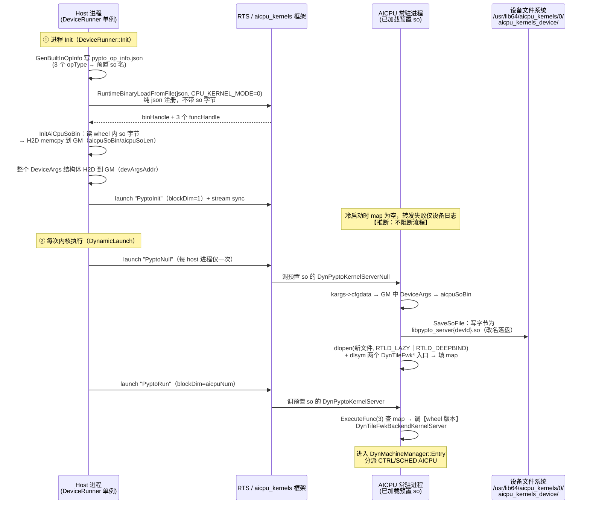
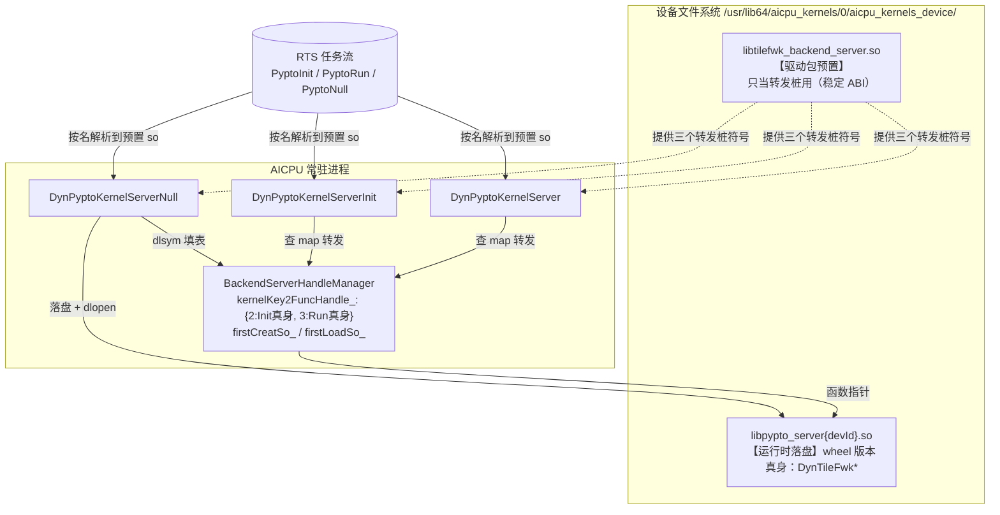

# PyPTO AICPU so 部署机制解析（参考档案）

> **文档定位**：长寿命参考档案。剖析 pypto 仓库如何把 AICPU server so 部署到设备并保持
> 版本一致，作为 memfabric 部署链（见[部署档案](./部署档案.md)）的对照与借鉴材料。
>
> **证据基线**：pypto 仓库 `/home/w00930648/pypto`，分支 `trunk_for_a1`，基线 `bf5df560e`。
> 所有 file:line 坐标均出自该基线；`nm -D` 输出与 wheel 内路径为本机实测。
> 标注 **【推断】** 的条目为代码阅读结论，未实机验证。

## 1. 问题定义：AICPU 上执行 op 的鸡生蛋

AICPU 上执行任何 op 的前提是：承载该 op 实现的 so **已经在设备文件系统上**、可被
设备侧 aicpu_kernels 框架按名 dlopen。于是产生鸡生蛋问题——

- pypto 要跑的是一个**随软件包版本更新的 server so**（`libtilefwk_backend_server.so`，
  含调度器/控制流执行器，与 host 侧 runtime 同源构建，必须版本匹配）；
- 而把 so 字节送上设备的通道，本身又要借道 AICPU op。

memfabric 对同一问题的解法是 deployer（`CUSTAICPUKernel` mode=1 迁移）+ mini_kfc
（设备内 shell `cat` 到 CP1 搜索路径）+ 验证门。pypto 的解法是**三件套**：
**json 按名注册 + GM 中转 + trampoline 转发**，全程无 shell、无外部工具。

## 2. 解法总览：三件套

```
① json 按名注册      host 生成 pypto_op_info.json 注册 3 个内置 opType，
                     全部指向 kernelSo 名 "libtilefwk_backend_server.so"
                     —— 设备上必须已有一份同 so（驱动包预置，见 §7）
② GM 中转            host 把 wheel 内 aarch64 server so 的字节 H2D memcpy 到设备 GM
                     （不是文件系统！），指针存进 DeviceArgs.aicpuSoBin
③ trampoline 转发    PyptoNull op 在 AICPU 上执行：从 GM 取出字节落盘为
                     libpypto_server{devId}.so 并 dlopen+dlsym 缓存函数指针；
                     此后 PyptoInit/PyptoRun 两个 trampoline op 经进程内 map
                     转发到这份"wheel 版本"的 so
```

一句话：**设备上预置的 so 只提供稳定不变的转发桩，真正干活的 so 每次 host 进程
首个 launch 前经 GM 推过去落盘激活，从而把驱动内置版本与 pypto 软件包版本解耦。**

## 3. 构建期：一份 so，三类符号

`tile_fwk_server` target（`framework/src/machine/device/CMakeLists.txt:43`）用
`file(GLOB_RECURSE *.cpp)`（同文件 :39）收编 `machine/device/` 全部源码——
**包含转发桩源码 `machine_interface/pypto_aicpu_interface.cpp` 和真身
`dynamic/device_sche.cpp`**——经 CANN hcc 工具链
`aarch64-target-linux-gnu-g++` 交叉编译（:31-32），产物改名
`libtilefwk_backend_server.so`（:86 `OUTPUT_NAME tilefwk_backend_server`），
安装进 wheel 的 `lib/`（顶层 `CMakeLists.txt:110`）。本机实测 wheel 内路径：

```
/usr/local/Ascend/cann-9.1.0/python/site-packages/pypto/lib/libtilefwk_backend_server.so
```

一份 so 同时导出三类符号（`nm -D` 实测）：

| 类别 | 符号 | 位置 | 职责 |
|---|---|---|---|
| 转发桩 | `DynPyptoKernelServerInit` / `DynPyptoKernelServer` / `DynPyptoKernelServerNull` | `machine_interface/pypto_aicpu_interface.cpp:29/53/65` | json 注册的 op 入口；Null 负责部署，Init/Run 负责查 map 转发 |
| 真身 | `DynTileFwkBackendKernelServerInit` / `DynTileFwkBackendKernelServer` | `dynamic/device_sche.cpp:45` | server 本体；Entry 按 runMode 分派 CTRL/SCHED AICPU |
| 状态 | `BackendServerHandleManager`（含 `kernelKey2FuncHandle_` map） | `machine_interface/pypto_aicpu_interface.h:30` | 进程内 so 句柄与函数指针缓存 |

## 4. 部署时序全景



## 5. 分步细节

### 5.1 Step 1：json 注册三个内置 opType

`DeviceRunner::Init`（`framework/src/machine/runtime/runner/device_runner.cpp:629`，
进程级单例）先调 `LoadAicpuOp::GenBuiltInOpInfo`（`load_aicpu_op.cpp:47-73`）在日志目录
`built_in/` 下生成 `pypto_op_info.json`，注册内容：

| opType | functionName | kernelSo | opKernelLib |
|---|---|---|---|
| PyptoInit | DynPyptoKernelServerInit | libtilefwk_backend_server.so | KFCKernel |
| PyptoRun | DynPyptoKernelServer | libtilefwk_backend_server.so | KFCKernel |
| PyptoNull | DynPyptoKernelServerNull | libtilefwk_backend_server.so | AICPUKernel |

（json 字段名见 `machine_utils.cpp:19-30`：`opInfo.functionName/kernelSo/opKernelLib`。）

随后 `GetBuiltInOpBinHandle`（`load_aicpu_op.cpp:142-176`）执行
`RuntimeBinaryLoadFromFile(json, CPU_KERNEL_MODE=0)` —— **mode=0 即纯 json 注册，
经该通道不上传任何 so 字节**——再用 `RuntimeFuncGetByName` 取回 3 个 funcHandle。
这一步的关键语义：三个 opType 都按名指向 `libtilefwk_backend_server.so`，
意味着**设备侧必须已存在一份同名 so 可被解析**（谁来放？见 §7）。

### 5.2 Step 2：so 字节 H2D 到 GM（不是文件系统）

`InitDeviceArgs` → `InitAiCpuSoBin`（`device_runner.cpp:390-408`）：

1. `GetCurrentSharedLibPath()`（`interface/utils/file_utils.cpp:390`，dladdr 自身）得到
   wheel 的 `pypto/lib/` 目录，拼出 aarch64 server so 路径，`ReadBytesFromFile` 读字节；
2. `CopyDataToDevice`（`device_runner.cpp:76-89`）= `DevMemoryPool::AllocDevAddr` 分配设备
   内存 + `RuntimeMemcpy(HOST_TO_DEVICE)` —— **一次普通 H2D memcpy，so 字节落在设备 GM**；
3. 设备指针与长度存入 `DeviceArgs.aicpuSoBin / aicpuSoLen`
   （`interface/machine/device/tilefwk/aicpu_common.h:160-161`）。

随后 `Init` 把整个 `DeviceArgs` 结构体也 H2D 到 GM（`device_runner.cpp:647`）得到
`devArgsAddr`，塞进后续每个 kernel 的 `kArgs.cfgdata` —— 这就是 AICPU 侧定位 so 字节的
**唯一线索链**：`kArgs.cfgdata → DeviceArgs → aicpuSoBin(GM 指针)`。

### 5.3 Step 3：PyptoNull 在 AICPU 上落盘 + dlopen

`DynamicLaunch`（`device_runner.cpp:565-573`）在每次内核执行前先发
`LaunchPyptoNullOp`（`load_aicpu_op.cpp:196-207`，`isPyptoNullLaunched_` 保证每 host
进程只发一次，blockDim=1，schedStream）。设备侧执行预置 so 中的
`DynPyptoKernelServerNull`（`pypto_aicpu_interface.cpp:29-51`）：

```
kargs->cfgdata ──► DeviceArgs*（GM）──► aicpuSoBin（GM 里的 so 字节）
      │
      ├─► SaveSoFile(data, len, deviceId)          [h:32-67]
      │     写【设备文件系统】/usr/lib64/aicpu_kernels/0/aicpu_kernels_device/
      │           libpypto_server{deviceId}.so      ← 注意改名 + 按 device 隔离
      │     firstCreatSo_ 保证 per-AICPU-进程只写一次
      │
      └─► SetTileFwkKernelMap()                     [h:71-80]
            └─► LoadTileFwkKernelFunc(...)          [h:103-137]
                  dlopen("libpypto_server{devId}.so", RTLD_LAZY | RTLD_DEEPBIND)
                  dlsym("DynTileFwkBackendKernelServerInit" / "DynTileFwkBackendKernelServer")
                  ──► kernelKey2FuncHandle_[2 / 3]   ← 进程内函数指针缓存
```

两个细节值得注意：

- **改名落盘**：不覆盖预置的 `libtilefwk_backend_server.so`——预置那份的转发桩
  **正是当前正在执行的代码**，覆写自家正在跑的 so 是自毁行为；
- **`RTLD_DEEPBIND`**：新 so 内部符号优先自解析，避免与进程中已加载的同名旧 so
  符号互串（同一进程里同时存在两份同源不同版的 so）。

### 5.4 Step 4：trampoline 转发到 wheel 版本

此后所有真正的 server 调用走两个转发桩：

- `PyptoRun`（每次内核执行，blockDim=aicpuNum）：`LaunchDynamicAiCpu`
  （`device_runner.cpp:358-361`）→ 预置 so 的 `DynPyptoKernelServer` →
  `ExecuteFunc(args, 3)`（`pypto_aicpu_interface.cpp:53-63`）查 map → **wheel 版本的**
  `DynTileFwkBackendKernelServer` → `DynMachineManager::Entry` 按 runMode 分派
  CTRL/SCHED AICPU；
- `PyptoInit`（`DeviceRunner::Init` 末尾，`device_runner.cpp:410-448`）：同理转发到
  `DynTileFwkBackendKernelServerInit`。

### 5.5 Step 5：幂等与生命周期

| 状态位 | 作用域 | 语义 |
|---|---|---|
| `isPyptoNullLaunched_` | host 进程 | 每 host 进程只发一次 PyptoNull |
| `firstCreatSo_` / `firstLoadSo_` | AICPU 进程 | aicpu 常驻进程存活期内只落盘/dlopen 一次，后续 PyptoNull 为幂等 no-op |

**AICPU 侧 server 是常驻进程**（跨 host 进程存活）——这是本设计成立的前提：否则
map 每次 launch 都是空的，`PyptoRun` 永远找不到函数。推论：AICPU 进程重启（如设备
reset）后，下一个 host 进程的 PyptoNull 会自动重新落盘激活，**不存在 memfabric
deployer 清理链删文件那类保活/生命周期错配问题**（部署档案第 2 节铁律）。

附带一个时序细节【推断】：`Init` 末尾的 `PyptoInit` 发出时，若 AICPU 进程是冷启动
（map 未填、so 未部署），`ExecuteFunc` 返回 -1、kernel 返回 1，仅设备日志报错；
KFC/CPU kernel 的返回码通常不阻断 stream sync，流程继续。真正生效的初始化随首次
PyptoNull 部署后的后续调用完成。

## 6. 设备侧终态



## 7. 设计动机分析

**为什么能绕开鸡生蛋？** 前提是**驱动包预置了一份含转发桩的 so**。证据链：

- json 注册的三个 opType 全部指向 so 名 `libtilefwk_backend_server.so`，且经
  `CPU_KERNEL_MODE=0` 纯 json 通道注册（该通道不上传 so 字节）→ 设备侧只能按名
  从本地找；
- pypto 仓库内**没有任何**向设备预部署该 so 的代码；
- FAQ（`docs/zh/tutorials/appendix/faq.md`）明示 **"PyPTO 驱动包支持 25.2.0 以上版本"**，
  且老驱动上报
  `ae_kernel_lib_aicpu_kfc.cpp ... Get KFC DynTileFwkKernelServerInit api success, but func is nullptr`
  —— 老驱动缺的正是这份预置 so。

**为什么要 GM 中转 + 落盘，而不是直接用预置那份？** 版本解耦：预置 so 随驱动发布、
更新慢；wheel 里的 so 与 host 侧 runtime 同源同版本构建，行为/ABI 严格匹配。trampoline
是刻意保持不变的稳定 ABI，真身随 pypto 版本任意演进。

**为什么无 shell？** 落盘动作由一个 AICPU op（`DynPyptoKernelServerNull` 内
`ofstream`）完成，不需要 memfabric mini_kfc 那样的设备侧 shell 通道——自然也没有
KFC 只能发单条短命令、`sync=` 退出码判定等约束（部署档案第 3 节规则 5）。

## 8. 与 memfabric 部署链对照

| 维度 | memfabric（deployer + KFC，见部署档案） | pypto（三件套） |
|---|---|---|
| "第一次"上设备 | deployer：`CUSTAICPUKernel` mode=1 迁移 + KFC `cat` 复制到搜索路径 | 驱动包（≥25.2.0）预置含转发桩的 so |
| 日常部署/更新 | 一次性安装期动作，运行期不再传 | 每 host 进程首个 launch：H2D memcpy 到 GM + Null op 落盘 |
| 传输介质 | 文件迁移 + 设备内 shell 复制 | GM（H2D memcpy），kernel 内 `ofstream` 落盘 |
| 版本管理 | 改名 + KVER bump（CP1 按文件名 dlopen 缓存） | 转发桩稳定 ABI + 新名 `libpypto_server{devId}.so` + `RTLD_DEEPBIND` |
| 部署验证 | 验证门（`test -f` + `grep -q` 符号） | `dlsym` 失败即报错，天然等价验证门 |
| 生命周期风险 | deployer 保活到期清理链**删设备文件**（P1 复现） | 无清理链；AICPU 进程重启自动重部署 |
| 目标平台 | 310P3（dav-2002） | A2/A3/A5（dav-2201/3510）为主、兼容 dav-2002 |
| 部署体量 | 单功能 kernel（SDMA 编排器） | 整个设备侧 runtime（调度器+控制流执行器） |

### KFC 直发变体（旁支）

pypto 三流模式还有一条不经 json 的 KFC 直发路径：
`RuntimeAicpuKernelLaunchExWithArgs(AICPU_KFC=5, "AST_DYN_AICPU", ...)`，真实
kernelName/soName 通过 args 内偏移传递（`RtAicpuArgsEx.kernelNameAddrOffset/
soNameAddrOffset`，`device_runner.cpp:372-373`），默认值为
`AiCpuArgs{kernelName="DynTileFwkKernelServer", soName="libaicpu_extend_kernels.so"}`
（`machine_ws_intf.h:105-110`；调用点 `device_launcher.cpp:494-528`、
`device_runner.cpp:501-550`）。该变体直接指名真身符号，FAQ 报错即出自设备侧
`ae_kernel_lib_aicpu_kfc.cpp` 对这些符号的解析。**【推断】**其符号解析依赖同一批
预置 so（`libaicpu_extend_kernels.so` 为驱动侧 aicpu SDK 组件），本文不展开。

## 9. 对 memfabric 的可借鉴点与前提差异

1. **GM 中转 + loader-op 落盘 = 无 shell 的设备内自部署**。若 memfabric 走部署档案
   第 5 节的库内自部署（L1），可用同型方案替代 KFC `cat`：host 把 kernel so 字节
   H2D 到 GM，经既有 KFC json 通道调用一个已在设备上的 loader op 写盘。与 KFC
   shell 方案相比：不受"单条短命令"约束、无 `sync=` 判定歧义、无需安全评审
   shell 执行面。**前提**：loader op 自身先上设备——memfabric 的"第一次"仍需
   deployer / OPP 通道承担（pypto 把"第一次"外包给了驱动包）。
2. **版本解耦需求的差异**。pypto 是框架，host runtime 与 device server 必须逐版本
   匹配，故需要稳定转发桩 + 每进程重部署；memfabric 是单功能 kernel，KVER bump
   纪律（部署档案规则 3）已够，无需引入转发桩复杂度。
3. **常驻进程语义可依赖**。pypto 敢把部署状态放在 AICPU 进程内（`firstCreatSo_`），
   说明设备重启自动重部署的模型在其目标平台成立；memfabric 310P3 侧对应结论
   是 deployer 文件生命周期与进程解耦带来的清理链问题——两者互为镜像，印证
   部署档案"自部署文件与进程同生命周期"的设计方向。

## 附录 A：源码坐标索引（pypto @ bf5df560e）

| 环节 | 位置 |
|---|---|
| so 构建（GLOB/交叉编译/改名） | `framework/src/machine/device/CMakeLists.txt:31,39,43,86` |
| so 装进 wheel | 顶层 `CMakeLists.txt:110` |
| json 生成（3 opType） | `framework/src/machine/runtime/runner/load_aicpu_op.cpp:36-73` |
| json 字段 | `framework/src/machine/utils/machine_utils.cpp:19-30` |
| json 加载（mode=0 + funcHandle） | `load_aicpu_op.cpp:142-176` |
| so 字节 H2D 到 GM | `framework/src/machine/runtime/runner/device_runner.cpp:390-408`（InitAiCpuSoBin）、`:76-89`（CopyDataToDevice） |
| so 路径定位（dladdr） | `framework/src/interface/utils/file_utils.cpp:390-405` |
| `DeviceArgs.aicpuSoBin/aicpuSoLen` | `framework/src/interface/machine/device/tilefwk/aicpu_common.h:160-161` |
| DeviceArgs H2D / PyptoInit 下发 | `device_runner.cpp:629-660`（Init）、`:410-448`（LaunchAicpuServerInit） |
| PyptoNull 下发（每进程一次） | `device_runner.cpp:565-573`、`load_aicpu_op.cpp:196-207` |
| PyptoRun 下发 | `device_runner.cpp:358-361` |
| 设备侧 Null（落盘+dlopen） | `framework/src/machine/device/machine_interface/pypto_aicpu_interface.cpp:29-51`、`.h:32-67`（SaveSoFile）、`.h:71-80/103-137`（dlopen+dlsym） |
| 转发桩 → 真身 | `pypto_aicpu_interface.cpp:53-75`（ExecuteFunc 2/3） |
| 真身入口 | `framework/src/machine/device/dynamic/device_sche.cpp:45` |
| KFC 直发变体 | `framework/src/machine/utils/machine_ws_intf.h:105-110`、`device_runner.cpp:501-550`、`launcher/device_launcher.cpp:494-528` |
| 驱动版本要求 / FAQ 证据 | pypto `docs/zh/tutorials/appendix/faq.md`（"PyPTO驱动包支持25.2.0以上版本"、`func is nullptr` 日志） |

## 附录 B：事实与推断的置信度

| # | 内容 | 置信度 |
|---|---|---|
| F1 | 一份 so 同时含转发桩与真身（`nm -D` 实测 6 符号） | 实测 |
| F2 | so 字节 H2D 落 GM、指针存 `DeviceArgs`（代码直读） | 实测（代码） |
| F3 | 落盘路径 `/usr/lib64/aicpu_kernels/0/aicpu_kernels_device/libpypto_server{devId}.so`（代码直读） | 实测（代码） |
| F4 | json mode=0 纯注册不带 so 字节；三 opType 指向预置 so 名 | 实测（代码） |
| F5 | 驱动包 ≥25.2.0 预置该 so | **推断**（F4 + FAQ 版本要求 + `func is nullptr` 报错 + 仓内无预部署代码，证据链强） |
| F6 | AICPU 常驻进程跨 host 进程存活，map/幂等位随之常驻 | **推断**（map 机制成立的必要前提，代码结构强支持） |
| F7 | 冷启动时 Init 期 `PyptoInit` 转发失败不阻断流程 | **推断**（kernel 返回码与 stream sync 的关系未实测） |
| F8 | KFC 直发变体的符号解析依赖预置/驱动侧 so | **推断**（旁支，未展开验证） |
