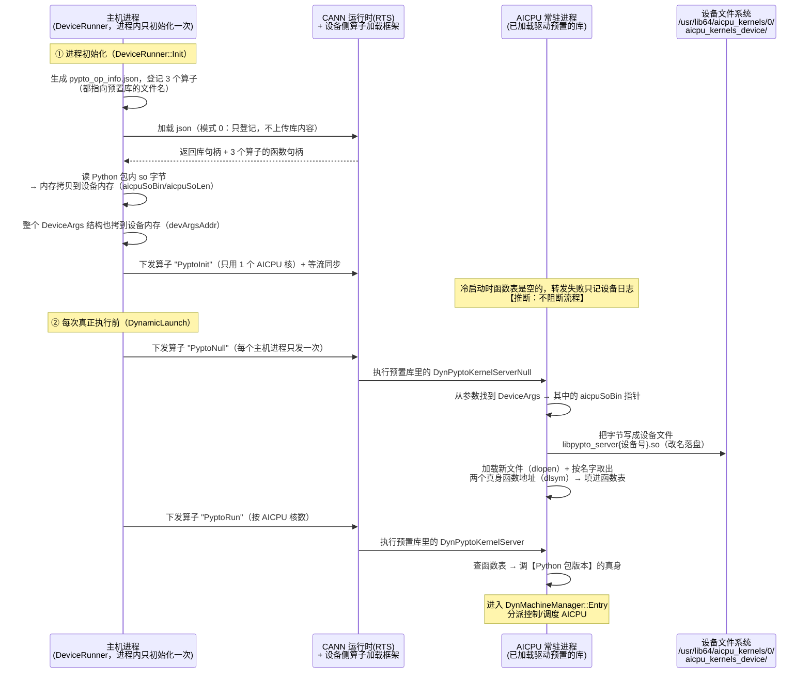
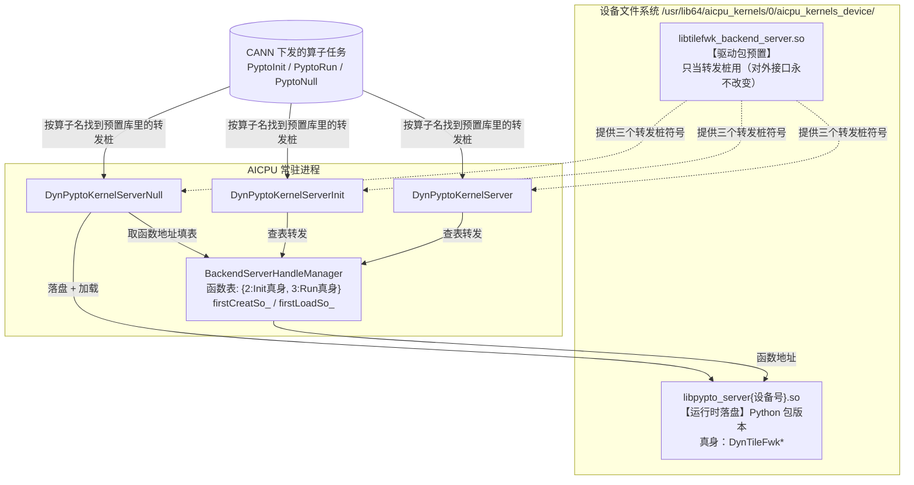

# PyPTO AICPU 动态库部署机制解析（参考档案）

> **文档定位**：长寿命参考档案。剖析 pypto 仓库怎么把它在 AICPU 上跑的动态库（so 文件）
> 部署到设备上并保持版本一致，作为 memfabric 部署链（见[部署档案](./部署档案.md)）的
> 对照与借鉴材料。
>
> **证据基线**：pypto 仓库 `/home/w00930648/pypto`，分支 `trunk_for_a1`，基线 `bf5df560e`。
> 所有 file:line 坐标均出自该基线；`nm -D` 输出与 Python 安装包内路径为本机实测。
> 标注 **【推断】** 的条目为代码阅读结论，未实机验证。
>
> **名词约定**：so 文件 = Linux 动态库；算子（op）= 注册给 CANN、可以下发到设备执行的
> 一个功能单元；GM = 设备全局内存；转发桩 = 只做"查表+转发"、自己不干活的入口函数。

## 1. 问题定义：AICPU 上执行算子的鸡生蛋

在 AICPU 上执行任何算子的前提是：承载这个算子实现的动态库**已经在设备文件系统上**、
能被设备侧的算子加载框架按文件名找到并加载。于是产生鸡生蛋问题——

- pypto 要跑的是一个**随软件包版本更新的服务端动态库**（`libtilefwk_backend_server.so`，
  里面是调度器和控制流执行器，与主机侧运行时同源编译，两边版本必须严格匹配）；
- 而把动态库字节送上设备的通道，本身又要借道一个已在设备上的算子。

memfabric 对同一问题的解法是 deployer（`CUSTAICPUKernel` 模式 1 迁移）+ mini_kfc
（设备内 shell `cat` 复制到 CP1 搜索路径）+ 验证门。pypto 的解法是**三件套**：
**json 按名登记算子 + 设备内存中转 + 转发桩转发**，全程不用 shell、不用外部工具。

## 2. 解法总览：三件套

```
① json 按名登记     主机侧生成 pypto_op_info.json，登记 3 个内置算子，
                    全部指向库文件名 "libtilefwk_backend_server.so"
                    —— 意味着设备上必须已有一份同名库（驱动包预置，见 §7）
② 设备内存中转      主机侧把 Python 安装包里那份 aarch64 动态库的字节，
                    一次普通内存拷贝（主机内存 → 设备内存）送到 GM，
                    指针存进 DeviceArgs.aicpuSoBin（注意：不是拷到文件系统！）
③ 转发桩转发        PyptoNull 算子在 AICPU 上执行：从 GM 取出字节，
                    写成设备文件 libpypto_server{设备号}.so 并加载、按名字取出
                    函数地址缓存；此后 PyptoInit/PyptoRun 两个转发桩算子
                    都经进程内的一张函数表，转发到这份"Python 包版本"的库
```

一句话：**设备上预置的库只提供永不改变的转发桩，真正干活的库在每次主机进程的
第一次下发前经设备内存推过去落盘激活——这样驱动里内置的版本和 pypto 软件包的
版本就互不牵制了。**

## 3. 构建期：一份库，三类符号

`tile_fwk_server` 构建目标（`framework/src/machine/device/CMakeLists.txt:43`）用
`file(GLOB_RECURSE *.cpp)`（同文件 :39，即"目录下所有 .cpp 一网打尽"）收编
`machine/device/` 全部源码——**包含转发桩源码 `machine_interface/pypto_aicpu_interface.cpp`
和真正干活的 `dynamic/device_sche.cpp`**——经 CANN hcc 工具链
`aarch64-target-linux-gnu-g++` 交叉编译（:31-32），产物改名
`libtilefwk_backend_server.so`（:86），安装进 Python 安装包的 `lib/` 目录
（顶层 `CMakeLists.txt:110`）。本机实测路径：

```
/usr/local/Ascend/cann-9.1.0/python/site-packages/pypto/lib/libtilefwk_backend_server.so
```

一份库同时导出三类符号（`nm -D` 实测）：

| 类别 | 符号 | 位置 | 职责 |
|---|---|---|---|
| 转发桩 | `DynPyptoKernelServerInit` / `DynPyptoKernelServer` / `DynPyptoKernelServerNull` | `machine_interface/pypto_aicpu_interface.cpp:29/53/65` | json 登记的算子入口；Null 负责部署，Init/Run 只查表转发 |
| 真身 | `DynTileFwkBackendKernelServerInit` / `DynTileFwkBackendKernelServer` | `dynamic/device_sche.cpp:45` | 服务端本体；入口按运行模式分派控制/调度 AICPU |
| 状态 | `BackendServerHandleManager`（含函数指针表 `kernelKey2FuncHandle_`） | `machine_interface/pypto_aicpu_interface.h:30` | 进程内的库句柄与函数地址缓存 |

## 4. 部署时序全景



## 5. 分步细节

### 5.1 第 1 步：json 登记三个内置算子

`DeviceRunner::Init`（`framework/src/machine/runtime/runner/device_runner.cpp:629`，
进程内只执行一次）先调 `LoadAicpuOp::GenBuiltInOpInfo`（`load_aicpu_op.cpp:47-73`）
在日志目录 `built_in/` 下生成 `pypto_op_info.json`，登记内容：

| 算子名（json 字段 opType） | 入口函数（functionName） | 库文件名（kernelSo） | 算子库类别（opKernelLib） |
|---|---|---|---|
| PyptoInit | DynPyptoKernelServerInit | libtilefwk_backend_server.so | KFCKernel |
| PyptoRun | DynPyptoKernelServer | libtilefwk_backend_server.so | KFCKernel |
| PyptoNull | DynPyptoKernelServerNull | libtilefwk_backend_server.so | AICPUKernel |

（括号里是 json 里的真实字段名；字段拼装见 `machine_utils.cpp:19-30`。）

随后 `GetBuiltInOpBinHandle`（`load_aicpu_op.cpp:142-176`）调
`RuntimeBinaryLoadFromFile(json, CPU_KERNEL_MODE=0)` —— **模式 0 表示"只登记 json，
经这个通道不上传任何库文件内容"** ——再用 `RuntimeFuncGetByName` 取回 3 个函数句柄。
这一步的关键语义：三个算子都按文件名指向 `libtilefwk_backend_server.so`，
意味着**设备侧必须已经有一份同名库可供加载**（谁来放？见 §7）。

### 5.2 第 2 步：库字节拷到设备内存（不是文件系统）

`InitDeviceArgs` → `InitAiCpuSoBin`（`device_runner.cpp:390-408`）：

1. `GetCurrentSharedLibPath()`（`interface/utils/file_utils.cpp:390`，原理：用 dladdr
   查自身所在库的路径）得到 Python 包的 `pypto/lib/` 目录，拼出那份 aarch64 动态库
   的路径，读出全部字节；
2. `CopyDataToDevice`（`device_runner.cpp:76-89`）= 从内存池要一块设备内存 +
   `RuntimeMemcpy(HOST_TO_DEVICE)` —— **就是一次普通的主机→设备内存拷贝，库字节
   落在 GM 里**；
3. 设备地址和长度存进 `DeviceArgs.aicpuSoBin / aicpuSoLen`
   （`interface/machine/device/tilefwk/aicpu_common.h:160-161`）。

随后 `Init` 把整个 `DeviceArgs` 结构体也拷到设备内存（`device_runner.cpp:647`）得到
`devArgsAddr`，塞进之后每个算子参数的 `kArgs.cfgdata` —— 这就是 AICPU 侧找到库字节的
**唯一线索链**：`kArgs.cfgdata → DeviceArgs → aicpuSoBin（GM 里的地址）`。

### 5.3 第 3 步：PyptoNull 算子在 AICPU 上落盘 + 加载

`DynamicLaunch`（`device_runner.cpp:565-573`）在每次真正执行前先下发
`LaunchPyptoNullOp`（`load_aicpu_op.cpp:196-207`，`isPyptoNullLaunched_` 保证每个
主机进程只发一次；只用 1 个 AICPU 核，走调度流）。设备侧执行预置库里的
`DynPyptoKernelServerNull`（`pypto_aicpu_interface.cpp:29-51`）：

```
算子参数 kArgs.cfgdata ──► DeviceArgs（在 GM）──► aicpuSoBin（GM 里的库字节）
      │
      ├─► SaveSoFile(字节, 长度, 设备号)           [h:32-67]
      │     写【设备文件系统】/usr/lib64/aicpu_kernels/0/aicpu_kernels_device/
      │           libpypto_server{设备号}.so        ← 注意改了名 + 按设备隔离
      │     firstCreatSo_ 标志保证每个 AICPU 进程只写一次
      │
      └─► SetTileFwkKernelMap()                    [h:71-80]
            └─► LoadTileFwkKernelFunc(...)         [h:103-137]
                  dlopen("libpypto_server{设备号}.so", RTLD_LAZY | RTLD_DEEPBIND)
                  dlsym 按名字取出 "DynTileFwkBackendKernelServerInit"
                        和 "DynTileFwkBackendKernelServer" 的地址
                  ──► 存入函数表 kernelKey2FuncHandle_[2 / 3]
```

两个细节值得注意：

- **改名落盘**：不覆盖预置的 `libtilefwk_backend_server.so`——预置那份里的转发桩
  **正是当前正在执行的代码**，覆写自己正在跑的库是自毁行为；
- **`RTLD_DEEPBIND` 加载标志**：让新库里符号优先在库内部解析，避免和进程里已加载的
  同名旧库符号互串（同一进程里同时存在两份同源不同版本的库）。

### 5.4 第 4 步：转发桩转到 Python 包版本

此后所有真正的服务端调用都走两个转发桩：

- `PyptoRun`（每次执行，按 AICPU 核数下发）：`LaunchDynamicAiCpu`
  （`device_runner.cpp:358-361`）→ 预置库的 `DynPyptoKernelServer` →
  `ExecuteFunc(args, 3)`（`pypto_aicpu_interface.cpp:53-63`）查函数表 → **Python 包
  版本的** `DynTileFwkBackendKernelServer` → `DynMachineManager::Entry` 按运行模式
  分派控制/调度 AICPU；
- `PyptoInit`（`DeviceRunner::Init` 末尾，`device_runner.cpp:410-448`）：同理转发到
  `DynTileFwkBackendKernelServerInit`。

### 5.5 第 5 步：幂等与生命周期

| 状态标志 | 作用范围 | 语义 |
|---|---|---|
| `isPyptoNullLaunched_` | 主机进程 | 每个主机进程只发一次 PyptoNull |
| `firstCreatSo_` / `firstLoadSo_` | AICPU 进程 | AICPU 常驻进程存活期内只落盘/加载一次；之后再收到 PyptoNull 就是空操作，重复执行无副作用 |

**AICPU 侧的服务是常驻进程**（比主机进程活得久）——这是本设计成立的前提：否则
函数表每次执行都是空的，`PyptoRun` 永远找不到函数。推论：AICPU 进程重启（比如设备
复位）后，下一个主机进程的 PyptoNull 会自动重新落盘激活，**不存在 memfabric
deployer 清理链删文件那类保活/生命周期错配问题**（部署档案第 2 节铁律）。

附带一个时序细节【推断】：`Init` 末尾的 `PyptoInit` 发出时，如果 AICPU 进程是冷启动
（函数表没填、库没部署），转发会失败、算子返回 1，只在设备日志里报错；这类算子的
返回码通常不影响流同步结果，流程继续。真正生效的初始化靠首次 PyptoNull 部署完成
之后的后续调用。

## 6. 设备侧终态



## 7. 设计动机分析

**为什么能绕开鸡生蛋？** 前提是**驱动包预置了一份含转发桩的库**。证据链：

- json 登记的三个算子全部指向库文件名 `libtilefwk_backend_server.so`，且走
  "只登记 json"的模式 0 通道（该通道不上传库内容）→ 设备侧只能按文件名在本地找；
- pypto 仓库内**没有任何**向设备预部署这个库的代码；
- pypto 的 FAQ（`docs/zh/tutorials/appendix/faq.md`）明示 **"PyPTO 驱动包支持
  25.2.0 以上版本"**，且老驱动上报
  `ae_kernel_lib_aicpu_kfc.cpp ... Get KFC DynTileFwkKernelServerInit api success, but func is nullptr`
  —— 老驱动缺的正是这份预置库。

**为什么要经设备内存中转落盘，而不是直接用预置那份？** 版本解耦：预置库随驱动
发布、更新慢；Python 包里的库与主机侧运行时同源同版本编译，行为严格匹配。转发桩
是刻意保持不变的稳定接口，真身随 pypto 版本任意演进。

**为什么不用 shell？** 落盘动作由一个 AICPU 算子（`DynPyptoKernelServerNull` 里
标准 C++ 文件写 ofstream）完成，不需要 memfabric mini_kfc 那样的设备侧 shell 通道
——自然也没有"只能发单条短命令"、`sync=` 退出码判定这些约束（部署档案第 3 节
规则 5）。

## 8. 与 memfabric 部署链对照

| 维度 | memfabric（deployer + KFC，见部署档案） | pypto（三件套） |
|---|---|---|
| "第一次"上设备 | deployer：`CUSTAICPUKernel` 模式 1 迁移 + KFC `cat` 复制到搜索路径 | 驱动包（≥25.2.0）预置含转发桩的库 |
| 日常部署/更新 | 一次性安装期动作，运行期不再传 | 每个主机进程第一次下发前：拷到设备内存 + Null 算子落盘 |
| 传输方式 | 文件迁移 + 设备内 shell 复制 | 设备内存中转（一次内存拷贝），算子内写文件 |
| 版本管理 | 改名 + KVER 递增（CP1 按文件名缓存） | 转发桩接口不变 + 新文件名 `libpypto_server{设备号}.so` + DEEPBIND 隔离 |
| 部署验证 | 验证门（`test -f` + `grep -q` 符号） | 取函数地址失败即报错，天然等价验证门 |
| 生命周期风险 | deployer 保活到期清理链**删设备文件**（P1 复现） | 无清理链；AICPU 进程重启后自动重新部署 |
| 目标平台 | 310P3（dav-2002） | A2/A3/A5（dav-2201/3510）为主、兼容 dav-2002 |
| 部署体量 | 单功能 kernel（SDMA 编排器） | 整个设备侧运行时（调度器+控制流执行器） |

### KFC 直发变体（旁支）

pypto 三流模式还有一条不经 json 的直发路径：
`RuntimeAicpuKernelLaunchExWithArgs(AICPU_KFC=5, "AST_DYN_AICPU", ...)`，真实的
函数名/库文件名通过参数内的偏移量指明（`RtAicpuArgsEx.kernelNameAddrOffset/
soNameAddrOffset`，`device_runner.cpp:372-373`），默认值为
`AiCpuArgs{kernelName="DynTileFwkKernelServer", soName="libaicpu_extend_kernels.so"}`
（`machine_ws_intf.h:105-110`；调用点 `device_launcher.cpp:494-528`、
`device_runner.cpp:501-550`）。该变体直接指名真身函数，FAQ 报错即出自设备侧
`ae_kernel_lib_aicpu_kfc.cpp` 对这些函数的解析。**【推断】**其符号解析依赖同一批
预置库（`libaicpu_extend_kernels.so` 是驱动侧 aicpu SDK 组件），本文不展开。

## 9. 对 memfabric 的可借鉴点与前提差异

1. **设备内存中转 + 落盘算子 = 不用 shell 的设备内自部署**。如果 memfabric 走部署
   档案第 5 节的库内自部署（L1），可以用同型方案替代 KFC `cat`：主机侧把 kernel
   so 字节拷到设备内存，经既有的 KFC json 通道下发一个已经在设备上的"落盘算子"
   去写文件。和 KFC shell 方案相比：不受"单条短命令"约束、无 `sync=` 判定歧义、
   无需为 shell 执行面做安全评审。**前提**：落盘算子自己得先上设备——memfabric
   的"第一次"仍要靠 deployer / OPP 通道承担（pypto 是把"第一次"外包给了驱动包）。
2. **版本解耦需求的差异**。pypto 是框架，主机侧运行时与设备侧服务必须逐版本匹配，
   所以需要稳定转发桩 + 每进程重部署；memfabric 是单功能 kernel，KVER 递增纪律
   （部署档案规则 3）已经够用，不需要引入转发桩的复杂度。
3. **常驻进程语义可依赖**。pypto 敢把部署状态放在 AICPU 进程内（`firstCreatSo_`），
   说明"设备重启后自动重新部署"的模型在其目标平台成立；memfabric 310P3 侧对应结论
   是 deployer 文件生命周期与进程脱钩带来的清理链问题——两者互为镜像，印证
   部署档案"自部署文件与进程同生命周期"的设计方向。

## 附录 A：源码坐标索引（pypto @ bf5df560e）

| 环节 | 位置 |
|---|---|
| so 构建（GLOB/交叉编译/改名） | `framework/src/machine/device/CMakeLists.txt:31,39,43,86` |
| so 装进 Python 包 | 顶层 `CMakeLists.txt:110` |
| json 生成（登记 3 个算子） | `framework/src/machine/runtime/runner/load_aicpu_op.cpp:36-73` |
| json 字段拼装 | `framework/src/machine/utils/machine_utils.cpp:19-30` |
| json 加载（模式 0 + 函数句柄） | `load_aicpu_op.cpp:142-176` |
| 库字节拷到设备内存 | `framework/src/machine/runtime/runner/device_runner.cpp:390-408`（InitAiCpuSoBin）、`:76-89`（CopyDataToDevice） |
| so 路径定位（dladdr） | `framework/src/interface/utils/file_utils.cpp:390-405` |
| `DeviceArgs.aicpuSoBin/aicpuSoLen` | `framework/src/interface/machine/device/tilefwk/aicpu_common.h:160-161` |
| DeviceArgs 拷到设备 / PyptoInit 下发 | `device_runner.cpp:629-660`（Init）、`:410-448`（LaunchAicpuServerInit） |
| PyptoNull 下发（每进程一次） | `device_runner.cpp:565-573`、`load_aicpu_op.cpp:196-207` |
| PyptoRun 下发 | `device_runner.cpp:358-361` |
| 设备侧 Null（落盘+加载） | `framework/src/machine/device/machine_interface/pypto_aicpu_interface.cpp:29-51`、`.h:32-67`（SaveSoFile）、`.h:71-80/103-137`（dlopen+dlsym） |
| 转发桩 → 真身 | `pypto_aicpu_interface.cpp:53-75`（ExecuteFunc 2/3） |
| 真身入口 | `framework/src/machine/device/dynamic/device_sche.cpp:45` |
| KFC 直发变体 | `framework/src/machine/utils/machine_ws_intf.h:105-110`、`device_runner.cpp:501-550`、`launcher/device_launcher.cpp:494-528` |
| 驱动版本要求 / FAQ 证据 | pypto `docs/zh/tutorials/appendix/faq.md`（"PyPTO驱动包支持25.2.0以上版本"、`func is nullptr` 日志） |

## 附录 B：事实与推断的置信度

| # | 内容 | 置信度 |
|---|---|---|
| F1 | 一份库同时含转发桩与真身（`nm -D` 实测 6 符号） | 实测 |
| F2 | 库字节拷到设备内存、指针存 `DeviceArgs`（代码直读） | 实测（代码） |
| F3 | 落盘路径 `/usr/lib64/aicpu_kernels/0/aicpu_kernels_device/libpypto_server{设备号}.so`（代码直读） | 实测（代码） |
| F4 | json 走模式 0 只登记不上传库内容；三个算子都指向预置库文件名 | 实测（代码） |
| F5 | 驱动包 ≥25.2.0 预置该库 | **推断**（F4 + FAQ 版本要求 + `func is nullptr` 报错 + 仓内无预部署代码，证据链强） |
| F6 | AICPU 常驻进程比主机进程活得久，函数表/幂等标志随之常驻 | **推断**（函数表机制成立的必要前提，代码结构强支持） |
| F7 | 冷启动时初始化期的 `PyptoInit` 转发失败不阻断流程 | **推断**（算子返回码与流同步的关系未实测） |
| F8 | KFC 直发变体的符号解析依赖预置/驱动侧库 | **推断**（旁支，未展开验证） |
