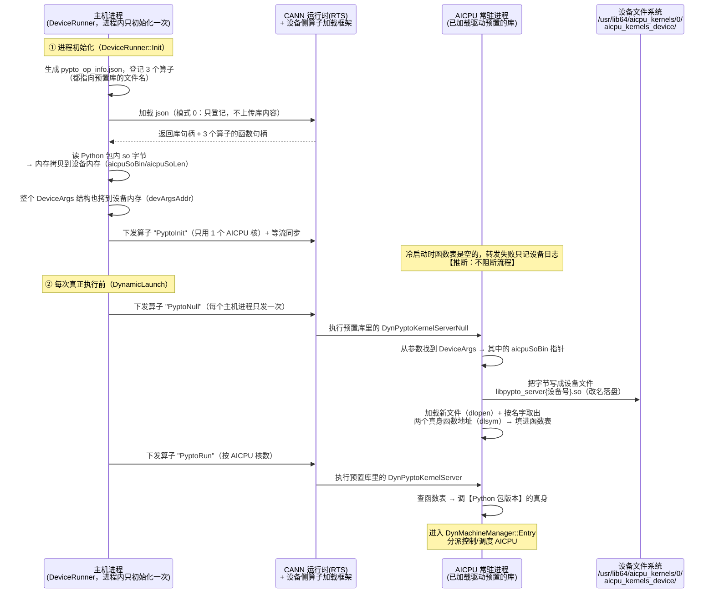

# PyPTO AICPU 动态库部署机制解析（参考档案）

> **文档定位**：长寿命参考档案。解析 pypto 仓库让代码跑上 AICPU 的机制——**实际
> 启用的机制**与**设计完备但未启用的储备机制**，作为 memfabric 部署链（见
> [部署档案](./部署档案.md)）的对照与借鉴材料。
>
> **证据基线**：pypto 仓库 `/home/w00930648/pypto`，分支 `trunk_for_a1`，基线 `bf5df560e`。
> 所有 file:line 坐标均出自该基线；`nm -D`/`strings` 输出、Python 安装包内路径、
> 设备侧文件探针（mini_kfc）均为本机实测。
>
> **名词约定**：so 文件 = Linux 动态库；算子（op）= 注册给 CANN、可以下发到设备执行
> 的一个功能单元；GM = 设备全局内存；转发桩 = 只做"查表+转发"、自己不干活的入口函数；
> 鸡生蛋 = "上设备的通道本身要先有东西在设备上"的自举问题。
>
> **一句话结论**：pypto 当前构建**零部署**——设备侧真身符号由 CANN 签名通道预置在
> `libaicpu_extend_kernels.so` 里，每次 KFC 按名直调；源码里另有一套设计完备的
> "json 三件套"（预置库 + GM 中转落盘 + 转发桩版本解耦），**被编译开关整体关闭**（§3）。

## 1. 问题定义：AICPU 上执行算子的鸡生蛋

在 AICPU 上执行任何算子的前提是：承载这个算子实现的动态库**已经在设备文件系统上**、
能被设备侧的算子加载框架按文件名找到并加载。于是产生鸡生蛋问题：

- pypto 要跑的是一个**随软件包版本更新的服务端动态库**（内含调度器和控制流执行器，
  与主机侧运行时同源编译，两边版本必须严格匹配）；
- 而把动态库字节送上设备的通道，本身又要借道一个已在设备上的算子。

memfabric 对同一问题的解法是 deployer（`CUSTAICPUKernel` 模式 1 迁移）+ mini_kfc
（设备内 shell `cat` 复制到 CP1 搜索路径）+ 验证门。pypto 源码里有两套方案：

| 方案 | 状态 | 一句话 |
|---|---|---|
| A. 签名通道预置 + KFC 直发 | **当前启用**（§2） | 华为把真身符号打进 extend 库随 CANN 部署，每次按名直调，零自举 |
| B. json 三件套（鸡生蛋 + 版本解耦） | **未启用**（编译关闭，§3） | 预置库出"名字"，运行时把 Python 包版本落盘激活，转发桩衔接 |

## 2. 实际机制（当前构建）：零部署 + KFC 直发

### 2.1 实际执行链

`BUILD_WITH_NEW_CANN` 关闭（证据见 §2.4），所有 AICPU 下发点走 `#else` 分支的
KFC 直发——`RuntimeAicpuKernelLaunchExWithArgs(AICPU_KFC=5, "AST_DYN_AICPU", ...)`，
真实函数名/库文件名通过参数内偏移指明（`machine_ws_intf.h:105-110` 默认值：
`kernelName="DynTileFwkKernelServer"`、`soName="libaicpu_extend_kernels.so"`）：

| 调用点 | 实际动作 | 说明 |
|---|---|---|
| 进程 Init 末尾 `LaunchAicpuServerInit`（device_runner.cpp:427-434） | KFC 直发 **`DynTileFwkKernelServerInit`**（extend 库） | 设备侧执行 server 初始化（信号注册/trace），extend 库有符号，正常执行 |
| 双流 `DynamicKernelLaunch` → `LaunchDynamicAiCpu`（:364-387） | KFC 直发 **`DynTileFwkKernelServer`** | 运行模式（runMode）藏在参数里 |
| 三流 `DynamicTripleStreamLaunch`（:530/:543，**无条件**，不受开关影响） | KFC 直发 ctrl（runMode=CTRL）+ sched（runMode=SCHE）两发 | launcher 侧另有 `device_launcher.cpp:494-528` 同型调用 |

```
host 下发（KFC 类型，kernelName/soName 在参数里）
    "调 libaicpu_extend_kernels.so 里的 DynTileFwkKernelServer"
        │
        ▼
设备侧 aicpu 框架按名解析（ae_kernel_lib_aicpu_kfc.cpp）
        │
        ▼
【extend 库】libaicpu_extend_kernels.so  ← CANN 签名通道预置（§5.1）
    DynTileFwkKernelServer(Init)  ←真身就在这里，直接执行
        └─► DynMachineManager::Entry → CTRL/SCHED AICPU → 调度 AICore
```

**没有鸡、没有蛋、没有转发**：真身符号本来就在设备上，每次按名直调。

### 2.2 设备侧依赖与实测（2026-10-10，mini_kfc 布尔探针）

用 memfabric 自有工具在本机 dev1（310P3，CANN 9.1.0 + 驱动 26.1.0）的 CP1 内
探针（`test -f` / `grep -cq`，退出码经 `sync=` 回传；含负对照）：

| 探测目标 | 结果 | 结论 |
|---|---|---|
| `libaicpu_extend_kernels.so`（直发目标库） | **存在**（sync=0） | 直发路径依赖在位 |
| 该库内 grep `DynTileFwkKernelServer` / `DynTileFwkKernelServerInit` | **命中** | **真身符号就在这份库内** |
| `libtilefwk_backend_server.so`（json 路径预置库） | **不存在** | json 路径依赖不在（但该路径本就未启用，见 §2.4） |
| 该 extend 库内 grep `DynPyptoKernelServerNull`（转发桩） | 不命中 | extend 库只带真身、不带转发桩 |
| `libpypto_server{0,1}.so`（json 路径落盘副本） | 不存在 | 落盘机制从未运行过（与 §2.4 一致） |
| 负对照：不存在的文件名 | sync=507018 | 探针技术可靠 |

注：探针是字符串匹配（grep），未区分导出符号表与普通字符串；但 KFC 机制本就按
符号名解析，FAQ 报错也证明这些名字正是解析目标，证据足够。

### 2.3 残影：仍在运行但无人消费的部分

编译开关只关掉了 json 路径的**消费端**，两处"生产端"仍无条件执行：

- `InitAiCpuSoBin`（device_runner.cpp:315 → :390-408）：每个主机进程 Init 时仍把
  Python 包里 `libtilefwk_backend_server.so` 的字节 H2D 拷到 GM
  （`DeviceArgs.aicpuSoBin`）——但唯一消费者 `DynPyptoKernelServerNull`（落盘）
  未启用，**拷贝成为死重**；
- `GenBuiltInOpInfo`（device_runner.cpp:633）：json 文件仍生成到日志目录
  `built_in/`——但 `GetBuiltInOpBinHandle` 函数体在 `#ifdef` 内为空，**从不加载**。

### 2.4 判定证据：为什么确定走 `#else`

`framework/src/machine/runtime/CMakeLists.txt:23`——`BUILD_WITH_NEW_CANN` 的
定义**被注释掉**：

```cmake
#$<BUILD_INTERFACE:$<$<BOOL:${BUILD_WITH_CANN}>:BUILD_WITH_NEW_CANN>>
```

交叉验证（strings 构建产物，找只在 `#ifdef BUILD_WITH_NEW_CANN` 函数体内出现的
日志串："Get BuiltIn FuncName" / "Get OpType" / "Load aicpu json failed"）：

| 构建产物 | NEW_CANN 独有串数量 | 判定 |
|---|---|---|
| CANN 9.1.0 内置 wheel（pypto 0.2.1）`libtile_fwk_runtime.so` | 0 | json 路径 inert |
| 本地 trunk_for_a1 构建 `libtile_fwk_runtime.so` | 0 | 同上 |

辅助信号：本地构建 `CMakeCache.txt` 里**不存在** `BUILD_WITH_NEW_CANN` 变量
（正常开启的开关必出现在缓存中）——源码与发布物一致，都是关。

## 3. 储备机制：json 三件套（设计完备，未启用）

> 本节解析"若解开 §2.4 的注释，机制如何运转"。它的设计目标是**版本解耦**：
> 设备上预置的库只提供永不改名的转发桩，真正干活的库在每次主机进程首次下发前
> 经设备内存推过去落盘激活——驱动内置版本与 pypto 软件包版本互不牵制。

### 3.1 三件套总览

```
① json 按名登记     主机侧生成 pypto_op_info.json，登记 3 个内置算子，
                    全部指向库文件名 "libtilefwk_backend_server.so"
                    —— 意味着设备上必须已有一份同名库（"鸡"，承载者未解，见 §5.1）
② 设备内存中转      主机侧把 Python 安装包里那份 aarch64 动态库的字节，
                    一次普通内存拷贝（主机内存 → 设备内存）送到 GM，
                    指针存进 DeviceArgs.aicpuSoBin（不是拷到文件系统）
③ 转发桩转发        PyptoNull 算子在 AICPU 上执行：从 GM 取出字节，
                    写成设备文件 libpypto_server{设备号}.so 并加载、按名字取出
                    函数地址缓存；此后 PyptoInit/PyptoRun 两个转发桩算子
                    都经进程内的一张函数表，转发到这份"Python 包版本"的库
```

### 3.2 启用后的时序全景



### 3.3 启用后的分步细节

**第 1 步：json 登记三个内置算子**（`load_aicpu_op.cpp:47-73`）
`DeviceRunner::Init` 生成 `pypto_op_info.json`：

| 算子名（json 字段 opType） | 入口函数（functionName） | 库文件名（kernelSo） | 算子库类别（opKernelLib） |
|---|---|---|---|
| PyptoInit | DynPyptoKernelServerInit | libtilefwk_backend_server.so | KFCKernel |
| PyptoRun | DynPyptoKernelServer | libtilefwk_backend_server.so | KFCKernel |
| PyptoNull | DynPyptoKernelServerNull | libtilefwk_backend_server.so | AICPUKernel |

（字段拼装见 `machine_utils.cpp:19-30`。）随后 `GetBuiltInOpBinHandle`
（`load_aicpu_op.cpp:142-176`）调 `RuntimeBinaryLoadFromFile(json, 模式 0)` ——
**模式 0 表示"只登记 json，经这个通道不上传任何库文件内容"** ——再用
`RuntimeFuncGetByName` 换回 3 个函数句柄。关键语义：三个算子都按文件名指向
`libtilefwk_backend_server.so`，意味着**设备侧必须已有同名库可供加载**（鸡从哪
来见 §5.1——当前为未解问题）。

**第 2 步：库字节拷到设备内存**（`device_runner.cpp:390-408`）
`GetCurrentSharedLibPath()`（dladdr 查自身）得到 Python 包 `pypto/lib/` 目录，
读出 aarch64 动态库字节 → `CopyDataToDevice`（:76-89，内存池分配 +
`RuntimeMemcpy(HOST_TO_DEVICE)`）→ 设备地址/长度存
`DeviceArgs.aicpuSoBin/aicpuSoLen`（`aicpu_common.h:160-161`）。整个 `DeviceArgs`
也拷到设备内存（:647）得 `devArgsAddr`，塞进算子参数 `kArgs.cfgdata`——AICPU 侧
找库字节的唯一线索链：`kArgs.cfgdata → DeviceArgs → aicpuSoBin`。

**第 3 步：PyptoNull 算子在 AICPU 上落盘 + 加载**（`pypto_aicpu_interface.cpp:29-51`）

```
算子参数 kArgs.cfgdata ──► DeviceArgs（在 GM）──► aicpuSoBin（GM 里的库字节）
      │
      ├─► SaveSoFile(字节, 长度, 设备号)           [h:32-67]
      │     写【设备文件系统】/usr/lib64/aicpu_kernels/0/aicpu_kernels_device/
      │           libpypto_server{设备号}.so        ← 改名 + 按设备隔离
      │     firstCreatSo_ 保证每个 AICPU 进程只写一次
      │
      └─► SetTileFwkKernelMap()                    [h:71-80]
            └─► LoadTileFwkKernelFunc(...)         [h:103-137]
                  dlopen(新文件, RTLD_LAZY | RTLD_DEEPBIND)
                  dlsym 取 DynTileFwkBackendKernelServer(Init) 地址
                  ──► 存入函数表 kernelKey2FuncHandle_[2 / 3]
```

两个细节：**改名落盘**——不覆盖预置库（预置那份的转发桩正是当前正在执行的代码，
覆写自己正在跑的库是自毁行为）；**RTLD_DEEPBIND**——新库符号优先自解析，避免和
进程里已加载的同名旧库符号互串（同进程两份同源不同版本的库共存）。

**第 4 步：转发桩转到 Python 包版本**
`PyptoRun`（`device_runner.cpp:358-361`，按 AICPU 核数下发）→ 预置库的
`DynPyptoKernelServer` → `ExecuteFunc(args, 3)` 查函数表 → **Python 包版本的**
`DynTileFwkBackendKernelServer` → `DynMachineManager::Entry`；`PyptoInit`
（Init 末尾）同理转发到 `DynTileFwkBackendKernelServerInit`。

**第 5 步：幂等与生命周期**

| 状态标志 | 作用范围 | 语义 |
|---|---|---|
| `isPyptoNullLaunched_` | 主机进程 | 每个主机进程只发一次 PyptoNull |
| `firstCreatSo_` / `firstLoadSo_` | AICPU 进程 | 常驻进程存活期内只落盘/加载一次，重复执行无副作用 |

**AICPU 侧服务是常驻进程**（比主机进程活得久）——本机制成立的前提。推论：AICPU
进程重启后，下一个主机进程的 PyptoNull 会自动重新落盘激活，不存在 memfabric
deployer 清理链删文件那类保活/生命周期错配问题（部署档案第 2 节铁律）。

附带一个时序细节【推断，仅适用于启用后的构建】：`Init` 末尾的 `PyptoInit` 发出时，
若 AICPU 进程冷启动（函数表未填），转发失败、算子返回 1，仅设备日志报错；真正生效
的初始化靠首次 PyptoNull 部署完成之后的后续调用。

### 3.4 启用后的设备侧终态


### 3.5 设计动机

**为什么经设备内存中转落盘，而不直接用预置那份？** 版本解耦：预置库随驱动/CANN
发布、更新慢；Python 包里的库与主机侧运行时同源同版本编译，行为严格匹配。转发桩
是刻意保持不变的稳定接口，真身随 pypto 版本任意演进。

**为什么不用 shell？** 落盘动作由一个 AICPU 算子（标准 C++ 文件写 ofstream）完成，
不需要 mini_kfc 那样的设备侧 shell 通道——自然也没有"只能发单条短命令"、
`sync=` 退出码判定这些约束（部署档案第 3 节规则 5）。

## 4. 构建期：一份库，三类符号

`tile_fwk_server` 构建目标（`framework/src/machine/device/CMakeLists.txt:43`）用
`file(GLOB_RECURSE *.cpp)`（:39）收编 `machine/device/` 全部源码——**包含转发桩
源码 `machine_interface/pypto_aicpu_interface.cpp` 和真身 `dynamic/device_sche.cpp`**
——经 CANN hcc 工具链 `aarch64-target-linux-gnu-g++` 交叉编译（:31-32），产物改名
`libtilefwk_backend_server.so`（:86），安装进 Python 包 `lib/`（顶层
`CMakeLists.txt:110`）。本机实测路径：

```
/usr/local/Ascend/cann-9.1.0/python/site-packages/pypto/lib/libtilefwk_backend_server.so
```

一份库同时导出三类符号（`nm -D` 实测）：

| 类别 | 符号 | 位置 | 职责 |
|---|---|---|---|
| 转发桩 | `DynPyptoKernelServerInit` / `DynPyptoKernelServer` / `DynPyptoKernelServerNull` | `machine_interface/pypto_aicpu_interface.cpp:29/53/65` | json 路径的算子入口；Null 负责部署，Init/Run 只查表转发 |
| 真身 | `DynTileFwkBackendKernelServerInit` / `DynTileFwkBackendKernelServer` | `dynamic/device_sche.cpp:45` | 服务端本体；入口按运行模式分派控制/调度 AICPU |
| 状态 | `BackendServerHandleManager`（函数指针表 `kernelKey2FuncHandle_`） | `machine_interface/pypto_aicpu_interface.h:30` | 进程内库句柄与函数地址缓存 |

注：当前实际机制（§2）**只消费真身符号，且消费的是 extend 库里的同源副本**——
这份 wheel 内的库在三件套启用前，其转发桩/落盘代码均不执行。

## 5. 设备侧预置内容的承载通道与版本

### 5.1 承载通道：华为签名固件通道（extend 库的"鸡"已实证，tilefwk 库的"鸡"未解）

设备 OS 上 `/usr/lib64/aicpu_kernels/0/aicpu_kernels_device/` 目录的内容不是用户
或 pypto 放的，而是**驱动/CANN 包经华为签名固件通道部署**。本机实测（CANN 9.1.0 +
驱动 26.1.0）：

- CANN 包 `opp/<芯片型号>/aicpu/` 下有三种设备侧 aicpu kernel 捆绑包：
  `Ascend310P-aicpu_syskernels.tar.gz`、`Ascend310P-aicpu_extend_syskernels.tar.gz`、
  `Ascend310P-aicpu_legacy.tar.gz`——文件头 `aa55aa` 的**签名固件格式**，本地无法
  解包验看内容（memfabric 部署档案墙① CMS 验签管的就是这类包）；
- 驱动 `version.info`（本机 26.1.0）携带 `aicpu_version=1.0 / tsfw_version=1.0 /
  dvppkernels_version=1.1` 字段——设备侧 aicpu 组件由驱动固件包承载和跟踪；
- **CANN 9.1.0 直接内置 pypto**：`aarch64-linux/lib64/pypto-0.2.1-cp37-abi3-*.whl`
  随 CANN 发布，安装记录显示装进 CANN 自带 python/site-packages——pypto 与 CANN
  同源打包；
- 命名对应：直发路径默认库名 `libaicpu_extend_kernels.so` ↔ 捆绑包名
  `*-aicpu_extend_syskernels.tar.gz`——310P 的真身符号经此包上设备（§2.2 实测）。

**两个"鸡"的现况不同**：

- **extend 库（当前机制的鸡）**：设备在位 + 含真身符号，实测闭环；承载归因
  （CANN 捆绑包 or 驱动固件）靠命名对应与包存在性推断，未解包直证；
- **tilefwk 库（三件套的鸡）**：本机设备上不存在（§2.2），且**没有任何环境
  存在它的直接证据**——"解开注释后哪个包会提供它"是未解问题，仅剩 FAQ 版本
  要求一条间接线索。这正是 memfabric 部署档案墙①对第三方封死、对华为自家包
  畅开的同一条通道。

### 5.2 复刻下发实测（2026-10-10）

用 mini_kfc 同骨架的小工具，逐字段复刻 pypto `GenBuiltInOpInfo` 的 PyptoNull
json 条目（`AICPUKernel` + `libtilefwk_backend_server.so` +
`DynPyptoKernelServerNull`，模式 0 加载后 blockDim=1 下发），本机 dev1：

| 用例 | 结果 | 判读 |
|---|---|---|
| A：PyptoNull 精确复刻（so 缺失） | launch=0，**sync=507018** | json 路径在本机 310P 上走不通——**但注意：这是手工复刻一条未启用的代码路径**，不能据此推断 pypto 实际运行受影响（实际走 §2 直发，无此环节） |
| B：so 改为设备上存在的 extend 库（符号不在其中） | launch=0，sync=507018 | 对照：区分"库缺失"与"符号缺失"，失败面相同 |
| C：阳性对照（KFCKernel + system，mini_kfc 等价） | launch=0，**sync=0** | 通道正常，排除方法问题 |

附带结论：**launch API 是异步下发、返回 0 不代表执行成功；失败在 stream 同步时
才现形（507018）**。A 用例的 507018 与 pypto FAQ"CANN包不兼容"故障特征一致——
FAQ 那条报错本身出自 KFC 直发路径的符号解析（`ae_kernel_lib_aicpu_kfc.cpp`），
说明老版本环境缺的是 extend 库里的真身符号，而非 tilefwk 预置库。

### 5.3 版本要求

pypto FAQ（`docs/zh/tutorials/appendix/faq.md`）：

| 依赖 | 最低版本 | 查看方法 |
|---|---|---|
| 驱动包 | **25.2.0** | `/usr/local/Ascend/driver/version.info`（FAQ 示例 25.3.rc1） |
| CANN 包 | **8.5.0** | `/usr/local/Ascend/ascend-toolkit/latest/opp/version.info`（FAQ 示例 8.5.0.2.220） |

版本不满足的故障特征（FAQ 原文）：算子上板报 507018，设备日志出现
`ae_kernel_lib_aicpu_kfc.cpp:105 CallKernelApi ... Get KFC DynTileFwkKernelServerInit
api success, but func is nullptr`——设备侧解析不到 pypto 符号。

pypto 与 CANN 版本配对（`build_and_install.md`）：CANN 8.5.0 ↔ PyPTO 0.1.2；
CANN 9.0.0 ↔ PyPTO 0.2.0（本机 CANN 9.1.0 内置 0.2.1）。

**精确版本（`tools/prepare_env.sh` 硬编码，实测读取）**：设备类型仅支持
**a2 / a3**（参数校验"must be a2 or a3"，310P 不在官方清单）；驱动 =
**Ascend HDK 25.3.RC1**（`Ascend-hdk-910b-npu-driver_25.3.rc1`（A2）/
`Atlas-A3-hdk-npu-driver_25.3.rc1`（A3））；固件 = **7.8.0.2.212**；CANN ops = 9.0.0。

**版本关系澄清（防误读）**：不存在"CANN 内置的必须是某个 pypto 开发分支"的问题。
本机检出的 `trunk_for_a1` 是 310P 适配**开发分支**（A1=310P/dav-2002，活跃提交中），
其 `pyproject.toml` 版本号 0.2.1 与 CANN 9.1.0 内置 wheel 一致，且两者 NEW_CANN
开关状态一致（都关）——310P 形态已随 CANN 9.1.0 发布，trunk_for_a1 是其继续开发线。

### 5.4 证据链汇总

- 当前机制（§2）：三处 launch 全走 `#else` KFC 直发（代码分支复核 + strings 双产物）；
- 设备侧 extend 库在位含真身符号（探针实测）；无 tilefwk 预置库、无落盘副本、
  全机无 pypto 运行痕迹（探针实测）；
- pypto 仓库内没有任何向设备预部署 tilefwk 库的代码（全仓检索）；
- 承载通道为华为签名固件格式（捆绑包实测存在，内容未验）；
- FAQ 版本要求针对 KFC 直发路径符号解析（报错文案出自 `ae_kernel_lib_aicpu_kfc.cpp`）。

## 6. 与 memfabric 部署链对照

| 维度 | memfabric（deployer + KFC） | pypto **实际**（当前构建） | pypto 三件套（未启用，§3） |
|---|---|---|---|
| "第一次"上设备 | deployer：CUST 模式 1 迁移 + KFC `cat` | 真身符号随 CANN 签名通道预置于 extend 库 | 需预置 tilefwk 库（承载者未解） |
| 日常部署/更新 | 一次性安装期动作 | **零部署**，按名直调 | 每主机进程首跑：GM 中转 + Null 算子落盘 |
| 版本管理 | 改名 + KVER 递增 | 随 CANN 发布联动（同源打包） | 转发桩稳定 + 落盘新名 + DEEPBIND 隔离 |
| 部署验证 | 验证门（test -f + grep -q） | 符号解析失败即报错 | dlsym 失败即报错 |
| 生命周期风险 | deployer 清理链删设备文件（P1 复现） | 无 | 无清理链；AICPU 进程重启自动重部署 |
| 目标平台 | 310P3 | 310P 实测（官方清单 a2/a3） | 未启用，无实证环境 |

**关键差异一句话**：pypto 实际落地的方式 = "华为把真身打进 CANN 签名包"——本质与
memfabric"kernel 直接上设备"同构，只是它搭了自家签名通道的便车；三件套那套精巧的
版本解耦机制反而是备而未用。

## 7. 对 memfabric 的可借鉴点

1. **设备内存中转 + 落盘算子 = 不用 shell 的设备内自部署**（借鉴对象是 §3 的
   **设计**——pypto 自己并未启用它）。若 memfabric 走部署档案第 5 节的库内自部署
   （L1），可用同型方案替代 KFC `cat`：主机侧把 kernel so 字节拷到设备内存，经既有
   KFC json 通道下发一个已在设备上的"落盘算子"写文件。相比 shell 方案：不受"单条
   短命令"约束、无 `sync=` 判定歧义、无需为 shell 执行面做安全评审。**前提**：落盘
   算子自己得先上设备（"第一次"仍靠 deployer / OPP 通道承担）。
2. **版本解耦需求的差异**。pypto 是框架，主机侧与设备侧必须逐版本匹配，所以设计了
   稳定转发桩 + 每进程重部署；memfabric 是单功能 kernel，KVER 递增纪律（部署档案
   规则 3）已够用。（注意：pypto 实际靠"CANN 同源打包"解决版本匹配，三件套是为
   驱动/CANN 与 pypto 版本脱钩场景准备的。）
3. **常驻进程语义**。三件套把部署状态放 AICPU 进程内（`firstCreatSo_`），依赖
   "设备重启后自动重部署"的进程模型；memfabric 310P3 侧的教训是 deployer 文件
   生命周期与进程脱钩带来的清理链问题——两者互为镜像，印证部署档案"自部署文件
   与进程同生命周期"的设计方向。

## 8. 误判复盘（方法论存档）

本档案 2026-10-10 版曾把 json 三件套当作"正在运行的部署机制"详述，2026-10-12
经用户质询修正。误判成因与教训：

1. **把"代码存在且精致"当成"代码在运行"**。`#ifdef` 两分支在源码里都是真代码；
   NEW_CANN 分支（json 生成/加载/落盘/转发）长而完整、像主干，`#else` 分支几行、
   像兜底。读代码者天然被精致分支吸引，第一步就锚定错了。
2. **没有先看构建系统**。决定分支生死的是 CMake 编译定义，而分析全程在读源码。
   被忽略的异常信号：`CMakeCache.txt` 里不存在 `BUILD_WITH_NEW_CANN` 变量——
   正常开启的开关必然出现在缓存里。
3. **证据的"可解释性"陷阱**。后续每条证据（FAQ 版本要求、CANN 捆绑包、设备无
   tilefwk 库）都能塞进"鸡生蛋"假说，但它们同样与"路径未启用"相容。最典型是
   507018 复刻实验：实验本身没错，解释错了——它验证的是一条死代码路径的失败
   形态，而非"鸡缺席拖垮了实际运行"。
4. **教训**：判断代码行为的第一性问题不是"源码写了什么"，而是"**编译进了什么**"。
   正确顺序：构建配置 → 构建产物 strings（分支独有日志串）→ 源码分支。本档案的
   F14 判定法（找 `#ifdef` 独有日志串）可复用。

## 附录 A：源码坐标索引（pypto @ bf5df560e）

| 环节 | 位置 |
|---|---|
| so 构建（GLOB/交叉编译/改名） | `framework/src/machine/device/CMakeLists.txt:31,39,43,86` |
| so 装进 Python 包 | 顶层 `CMakeLists.txt:110` |
| **NEW_CANN 开关（被注释）** | `framework/src/machine/runtime/CMakeLists.txt:23` |
| **KFC 直发三调用点（当前实际）** | `device_runner.cpp:427-434`（Init）、`:364-387`（双流）、`:530-550`（三流，无条件）；`launcher/device_launcher.cpp:494-528` |
| KFC 直发参数默认值 | `framework/src/machine/utils/machine_ws_intf.h:105-110`（kernelName/soName） |
| json 生成（登记 3 个算子，仍执行） | `load_aicpu_op.cpp:36-73`；调用点 `device_runner.cpp:633` |
| json 加载（模式 0，未启用时为空） | `load_aicpu_op.cpp:142-176` |
| 库字节拷到设备内存（仍执行，死重） | `device_runner.cpp:390-408`、`:76-89`；路径定位 `interface/utils/file_utils.cpp:390-405` |
| `DeviceArgs.aicpuSoBin/aicpuSoLen` | `interface/machine/device/tilefwk/aicpu_common.h:160-161` |
| PyptoNull 下发（未启用） | `device_runner.cpp:565-573`、`load_aicpu_op.cpp:196-207` |
| PyptoRun 下发（未启用） | `device_runner.cpp:358-361` |
| 设备侧 Null（落盘+加载，未启用） | `pypto_aicpu_interface.cpp:29-51`、`.h:32-67/71-80/103-137` |
| 转发桩 → 真身（未启用） | `pypto_aicpu_interface.cpp:53-75` |
| 真身入口 | `dynamic/device_sche.cpp:45` |
| 驱动版本要求 / FAQ 证据 | pypto `docs/zh/tutorials/appendix/faq.md` |
| 精确环境版本 | pypto `tools/prepare_env.sh`（仅 a2/a3，HDK 25.3.RC1，固件 7.8.0.2.212） |

## 附录 B：事实与推断的置信度

| # | 内容 | 置信度 |
|---|---|---|
| F1 | 一份库同时含转发桩与真身（`nm -D` 实测 6 符号） | 实测 |
| F2 | 库字节拷到设备内存、指针存 `DeviceArgs`（代码直读；**当前构建该拷贝为死重**，见 F14） | 实测（代码） |
| F3 | 落盘路径 `/usr/lib64/aicpu_kernels/0/aicpu_kernels_device/libpypto_server{设备号}.so`（代码直读，未启用路径） | 实测（代码） |
| F4 | json 走模式 0 只登记不上传库内容；三个算子都指向 tilefwk 库文件名（未启用路径） | 实测（代码） |
| F5 | tilefwk 预置库（三件套的"鸡"）的承载者：**未解**——当前所有可查证构建未启用该路径，无任何环境存在此库的直接证据；仅剩 FAQ 版本要求一条间接线索（且该报错指向 KFC 直发符号而非鸡） | **未解** |
| F6 | AICPU 常驻进程比主机进程活得久（三件套函数表机制成立的前提，未启用路径） | **推断** |
| F7 | ~~冷启动时初始化期 `PyptoInit` 转发失败不阻断~~ **作废**：该场景仅存在于 NEW_CANN 构建假设中；当前构建 Init 走 `#else` 直发 `DynTileFwkKernelServerInit` 正常执行 | 原推断作废（分析了错误分支） |
| F8 | 当前机制依赖的 extend 库：设备在位且含真身符号（探针实测）；承载归因 CANN extend_syskernels 捆绑包（命名对应 + 包实测存在，未解包直证） | **半实测** |
| F9 | CANN 9.1.0 内置 pypto 0.2.1 wheel（`aarch64-linux/lib64/pypto-0.2.1-cp37-abi3-*.whl`） | 实测 |
| F10 | CANN 9.1.0 `opp/Ascend310P/aicpu/` 下存在三种签名捆绑包（`aa55aa` 文件头）；驱动 26.1.0 version.info 带 aicpu/tsfw/dvppkernels 字段 | 实测（包存在与格式；内容未验） |
| F11 | 本机 310P3 设备侧（dev1 探针）：无 tilefwk 库、无落盘副本；有 extend 库且含真身符号、不含转发桩符号；全机无 pypto 运行痕迹 | 实测（2026-10-10） |
| F12 | 复刻 PyptoNull json 下发：launch=0、sync=507018；阳性对照 sync=0。判读修正：验证的是**未启用路径**的失败形态（库缺失→执行失败），不代表实际运行受影响 | 实测（判读已修正） |
| F13 | 理论变通（针对启用三件套的场景）：用 memfabric 部署链把 wheel 内 tilefwk 库补到设备搜索路径，可代行"第一次"预置。未实测（还需构造合法 `DeviceArgs` 链，且须防零参直调真身致设备进程崩溃） | **推断** |
| F14 | **json 三件套在当前构建整体关闭**：`BUILD_WITH_NEW_CANN` 定义被注释（CMakeLists.txt:23）；wheel 与本地构建产物中 NEW_CANN 独有日志串均为 0。**实际执行链**：Init 末尾 `#else` 直发 `DynTileFwkKernelServerInit`（extend 库）正常执行；双流直发 `DynTileFwkKernelServer`；三流无条件直发 ctrl/sched；`InitAiCpuSoBin` 仍执行但 GM 拷贝无人消费 | 实测（CMake 源 + strings 双产物 + 分支复核） |
| F15 | pypto 官方环境版本（`prepare_env.sh`）：仅 a2/a3；驱动 HDK 25.3.RC1；固件 7.8.0.2.212；CANN ops 9.0.0 | 实测（脚本内容） |
