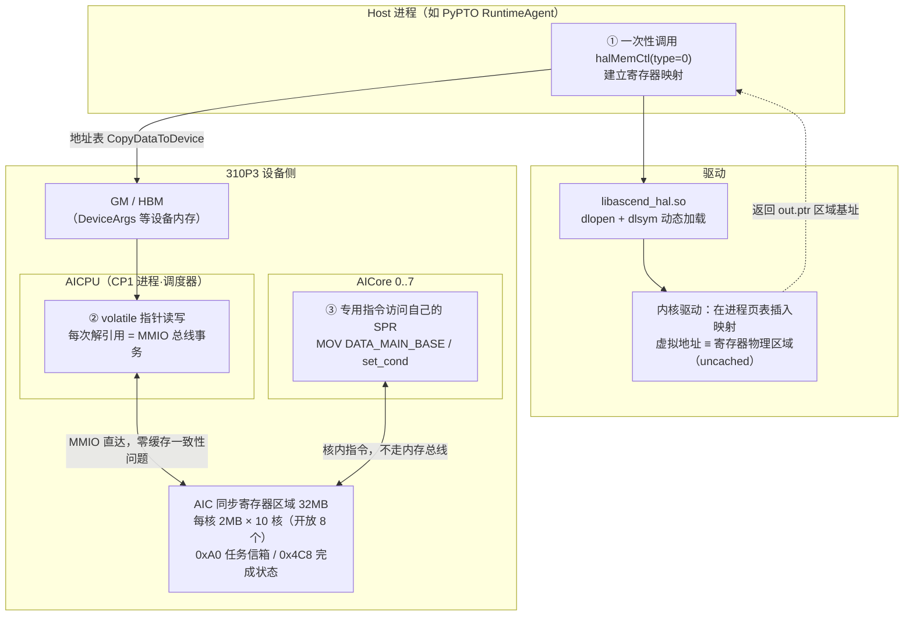
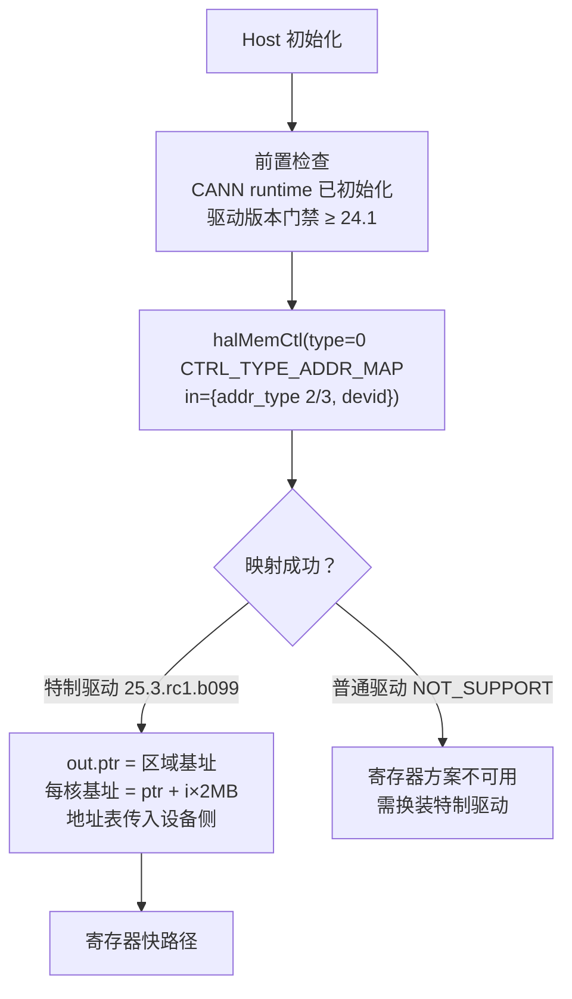
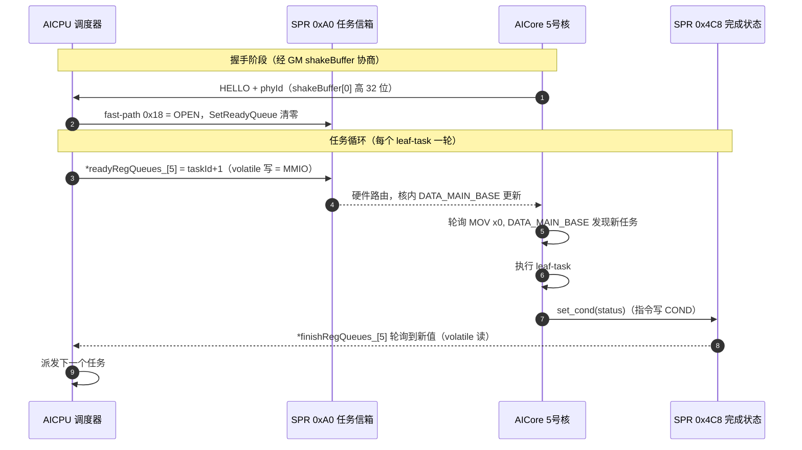
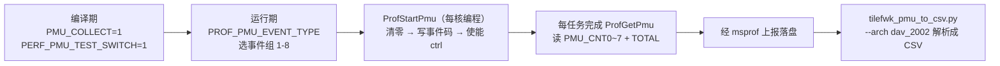
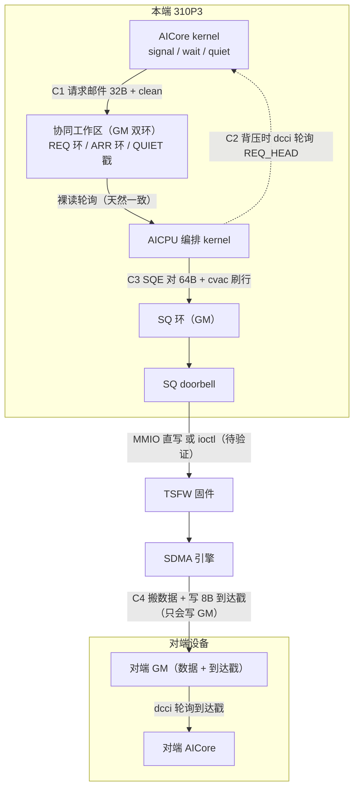
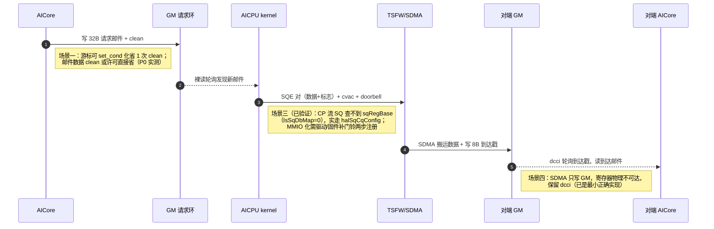

# 310P3 特制驱动寄存器开放机制与 memfabric AICPU 方案优化机会

> 调查日期：2026-10-09 / 2026-10-10
> **第一部分**（机制）：证据取自 **pypto 仓库**（`/home/w00930648/pypto`，分支 `trunk_for_a1`，基线 `9f4d16921`）；`mydocs/...`、`runtime_logs/...` 为其 git 历史中已删除的路径（恢复方式见附录 A.3）
> **第二部分**（应用）：分析对象为本仓库（memfabric_hybrid）310P AICPU 编排方案——生产路径 `smem_shm_aicore_base_sdma.h`（AICore 三件套）+ `hybm_overlap_kernel.cc`（AICPU 编排 kernel），机制依据 `docs/310p/机制档案.md`
> **一句话**：pypto 用一台装了特制驱动 `25.3.rc1.b099` 的机器实证了"改驱动开放寄存器"的完整模式；本文第一部分讲清该机制，第二部分把它应用到 memfabric 的 AICPU 方案上
> **阅读提示**：正文用架构图/流程图/时序图讲机制，全部源代码集中在**附录 D**按需查阅

---

# 第一部分：特制驱动寄存器开放机制

## 1. 背景：这个特制驱动开放了什么

同事拿到的是一个**特制驱动版本 `25.3.rc1.b099`**（CANN 9.0.0 配套）。它与普通驱动的唯一关键差异：

| | 普通驱动 | 特制驱动 25.3.rc1.b099 |
|---|---|---|
| `halMemCtl` 的 **type=0（`CTRL_TYPE_ADDR_MAP`）寄存器映射操作** | 310P3 上实测全部 addr_type（0-3）返回 `DRV_ERROR_NOT_SUPPORT (65534)` | **放行**（基线代码一次 map 成功，实测见附录 A） |

> 精确表述：`halMemCtl` 是驱动内部 9 种操作的通用控制入口（真实签名与结构体见附录 D.1），"寄存器映射"只是其中 type=0 这一条操作；特制驱动开放的就是**这条操作在 310P3 上的放行**——使下表两类寄存器区域可被映射进用户态。addr_type（入参 `AddrMapInPara.addr_type`）选择映射哪类资源。

它开放的是两类设备寄存器的**用户态映射权限**：

| 寄存器类 | addr_type | 用途（一句话） | 普通驱动机器上的后果 |
|---|---|---|---|
| **AIC 同步寄存器** | 2 (`ADDR_MAP_TYPE_REG_AIC_CTRL`) | AICPU 调度器 ↔ AICore 的任务分发/完成同步 | 不可用 |
| **AIC PMU 寄存器** | 3 (`ADDR_MAP_TYPE_REG_AIC_PMU_CTRL`) | 采集 AICore 微架构性能计数（流水线利用率、Cache 命中等） | 不可用（无替代路径） |

所以：**两类寄存器的使用都以特制驱动为前提**——只有装特制驱动的机器才能走寄存器路、才能做 PMU 采集；本文只关注寄存器方案。

## 2. 全景：谁在哪儿、怎么碰寄存器

### 2.1 总架构图



三个角色的分工：**Host 只负责"铺路"**（调一次映射拿到基址）；**AICPU 用内存方式**访问（volatile 解引用）；**AICore 用指令方式**访问自己的 SPR。GM 只承担地址表等普通设备内存的传递。

### 2.2 三层访问机制一览

| 层 | 执行者 | 访问方式 | 关键点 | 参考代码 |
|---|---|---|---|---|
| ① 拿地址 | Host 进程 | `halMemCtl(type=0, in={addr_type, devid}) → out={ptr, len}` | dlopen 动态加载 HAL 库；addr_type 选资源；返回**区域基址**（每核基址 = ptr + i×2MB 自算） | 附录 D.1/D.2 |
| ② AICPU 读写 | CP1 进程 | volatile 指针解引用 | 禁止编译器优化/缓存/重排，每次都是真实 MMIO 读写；区域 uncached，读到即硬件当前值 | 附录 D.3 |
| ③ AICore 读写 | 核自己 | CCE 专用指令/intrinsic | SPR 在核内，指令集直接访问（如同 ARM 的 MRS/MSR）；host 仿真有 stub 替身 | 附录 D.4 |

> `halMemCtl` 是驱动**内部接口**（非公开 SDK API、`ASCEND_HAL_WEAK` 弱导出、无兼容承诺），头文件几乎没有文档——布局知识（32MB/2MB stride/偏移）只能靠兄弟仓源码 + 头文件反推 + 实机探针获得，详见附录 D.1 的说明。

### 2.3 映射建立与自动降级（流程）



两个前置坑（pypto 实测教训，附录 C）：调 `halMemCtl` 前必须先初始化 CANN runtime（否则 ret=13）；此前不要做 map→unmap 探测（会破坏驱动内部状态导致真映射失败）。

### 2.4 映射原理（小白版）

1. CPU 眼里只有**地址**；程序访问任何地址都经**页表**翻译：虚拟地址 → 物理地址
2. AICore 的寄存器（SPR）占一段**物理地址空间**（在芯片内部，不在内存条上），这类区域叫 **MMIO 区域**
3. 平时用户进程碰不到它——不是指令不支持，而是**页表里没有这段映射，且普通驱动拒绝替你建**。这就是"原来不可操作的寄存器"的本质；"开放寄存器" = **允许为这段物理区域建立用户态页表映射**
4. 映射是**一次性的铺路**：之后每次读写只是一条普通 load/store（MMIO 总线事务直达硬件），无系统调用、无驱动参与——这是寄存器路快的根本原因

正确性靠两层保证，缺一不可：

| 层面 | 机制 | 作用 |
|---|---|---|
| 编译器层【实证】 | `volatile` | 禁止把轮询读优化成"读一次反复用"、禁止合并/删除/重排写 |
| 硬件层【推断】 | 页表 uncached 属性 | 不进 CPU cache，每次访问直达硬件——寄存器值随时被 AICore 改，缓存即旧值 |

## 3. 用途实证一：任务分发与完成同步

PyPTO 上板执行是 **MPMD 模式**（Multiple Program Multiple Data，区别于 CUDA 的 SPMD）：设备侧 AICPU 跑调度器程序、AICore 跑编译出的算子函数，不同核可同时跑**不同函数片段**。AICPU 把 kernel 拆成的 **leaf-task**（函数 DAG 的叶子节点，最小可调度执行单元）逐个派给核，靠这三个寄存器完成"派活—收工"：

| 偏移 | 名称 | 方向 | 用途 |
|---|---|---|---|
| `0xA0` | `REG_SPR_DATA_MAIN_BASE` | AICPU 写 / AICore 读 | **任务分发**：AICPU 写入 encodeTaskId+1，AICore 轮询取任务 |
| `0x4C8` | `REG_SPR_COND` | AICore 写 / AICPU 读 | **完成上报**：AICore 写完成状态，AICPU 轮询判断任务结束 |
| `0x18` | `REG_SPR_FAST_PATH_ENABLE`（OPEN=0xE/CLOSE=0xF） | AICPU 写 | **快速通路开关**：握手后打开、core 退出前必须关闭 |

### 3.1 一次完整任务往返（时序图）



### 3.2 关键 API 索引

| 侧 | API | 位置（pypto） | 功能 |
|---|---|---|---|
| AICPU | `MapRegistersForAllCores` | aicore_hal.h:419 | 初始化 ready/finish 队列指针 |
| AICPU | `SetReadyQueue`（单核/区间） | :233/:248 | 派发 leaf-task |
| AICPU | `GetFinishQueue` / `GetFinishedTask` | :301/:352 | 轮询完成 |
| AICPU | `WriteReg32` / `ReadReg32` | :161/:135 | 通用 MMIO 读写 |
| AICPU | `TryHandShakeByGm` / `CloseFastPathReg` | :551/:156 | 握手 / 退核关 0x18 |
| AICore | `GetTaskReg` / `GetNextLeafTask` | aicore_entry.h:178/:207 | 取任务（轮询） |
| AICore | `SendCond` | :190 | 报完成 |

**影响面**：测试代码不直接调这些 API；凡 `run_mode=npu` 上板执行 kernel（特制驱动机器），调度循环自动走这条通道——所有上板用例隐式依赖。

## 4. 用途实证二：PMU 性能计数采集

按 core 采集 AICore 微架构事件（流水线利用率、Cache 命中、L2 带宽等），用于性能分析。

### 4.1 PMU 寄存器布局（addr_type=3 映射）

| 偏移 | 名称 | 用途 |
|---|---|---|
| 0x200 | PMU_CTRL_0 | 全局使能 |
| 0x210~0x248 | PMU_CNT0~7 | **8 个事件计数器**（310P3 只有 8 个硬件计数器） |
| 0x250/0x254 | PMU_CNT_TOTAL0/1 | **总周期数（64 位拼合）**——可当周期计数器用 |
| 0x260~0x298 | PMU_CNT0~7_IDX | 每计数器的事件选择 |
| 0x2A0~0x2AC | START/STOP_CNT_CYC | 计数起止周期控制 |

事件码定义在 `aicore_prof.h:205-235`（VEC/SU/CUBE_BUSY_CYCLE、ICACHE/DCACHE、L2 命中等）。

### 4.2 采集流程



操作命令：

```bash
# ① 重编译（改宏后必须）
# ② export PROF_PMU_EVENT_TYPE=2        # 默认 PIPE_UTILIZATION
# ③ 采集（310P 只支持 l2 级，建议 CANN ≥ 9.1.0）
msprof --task-time=l2 --output=<路径> python xxx.py
# ④ 解析
python tools/profiling/tilefwk_pmu_to_csv.py -p PROF_xxx/device_x/data -pe=2 --arch dav_2002
```

**硬性依赖**：PMU 映射**无 fallback**——普通驱动上寄存器全 0、采集无数据（仅一条告警）。这是特制驱动不可替代的场景。

## 5. 实操速查

### 5.1 判断当前机器走哪条路（看运行日志）

| 日志 | 含义 |
|---|---|
| `Map AICore reg addr (type 2) 0x... for DAV_2002` | 寄存器映射成功，MMIO 生效（特制驱动） |
| `DAV_2002 halMemCtl PMU failed, PMU regs filled with zeros` | PMU 映射未放行 |

查本机驱动版本：`cat /usr/local/Ascend/driver/version.info`。上板硬门禁：驱动 ≥ 24.1（低于则 kernel launch 直接 abort；解析只看前两段数字，`25.3.rc1.b099` 按 25.3 比较）。

### 5.2 相关测试用例（pypto 仓库）

| 用例 | 位置 | 说明 |
|---|---|---|
| 上板 ST/models（隐式依赖） | `python/tests/st/**`、`models/**` | 凡 npu 模式执行 kernel 都走调度通道；"310P 上不被 soc 过滤"约 347 ST + 115 models 个测试函数是**共享通用用例**（soc 标记只区分 950 vs 其他），非 310P 专属 |
| 310P 专属 | `models/qwen3_moe/tests/`（45 个测试函数）、`models/yolov26/`、C++ STest `TestResNetStage` | 明确为 310P3 写/验证的用例 |
| 核数限制 | `python/tests/st/test_control_cores.py`（4 用例） | `set_stream_limit/set_device_limit` 限制核数后跑 matmul+add，解析 `tilefwk_L1_prof_data.json` 统计实际参与核数 |
| PMU | **无专门 pytest**，走 §4.2 手工流程 | — |
| UT（不依赖驱动） | `test_device_launcher_driver_gate.cpp`、`test_adapter_api.cpp`（StubHalMemCtl）、`test_device_runner.cpp` | 门禁解析/HAL adapter/初始化 |

### 5.3 验证命令

```bash
bash mybuild.sh --compile --no-clean      # 1. 构建
bash mybuild.sh --run -d 3 --no-board     # 2. 仿真
bash mybuild.sh --run -d 3                # 3. 上板（-d device id）
pytest python/tests/st/test_control_cores.py -v
msprof --task-time=l2 --output=out python xxx.py   # PMU
```

---

# 第二部分：memfabric AICPU 方案的寄存器优化机会

## 6. 判定方法论（先读）

一条通信通道能否寄存器化，**只看写者是谁**：

| 写者 | 寄存器化 | 原因 |
|---|---|---|
| 本地 AICPU | ✅ | 可直写目标 AICore 的 SPR（MMIO，第一部分 §3 ready 队列配方） |
| 本地 AICore | ✅ | 可 `set_cond()` 写自己 SPR，对端经映射读（第一部分 §3 finish 队列配方） |
| **SDMA 引擎 / TSFW** | ❌ | 只会写 GM（SQE 的 dst 是内存地址），够不到核内 SPR |
| 数据面（大块搬运） | ❌ | 寄存器是通知面机制，不承载带宽 |

由此得到核心结论：**memfabric 方案里最热的循环（`wait` 的到达戳 dcci 轮询）写者是 SDMA，寄存器帮不上**；能优化的集中在 AICore→AICPU 请求通知、AICPU→AICore 背压/ready、doorbell 提交、PMU 计时四处。

## 7. 现状全景

### 7.1 生产路径架构图



### 7.2 一次搬运的完整时序（含可优化点标注）



### 7.3 通道清单

| # | 通道 | 写者→读者 | 现状实现 | 每次成本 |
|---|---|---|---|---|
| C1 | 请求邮件（signal） | AICore→AICPU | 32B 槽 4×volatile 写 + clean；`REQ_TAIL` 写 + clean（`smem_shm_aicore_base_sdma.h:127-153`） | **2 次 clean**/封 |
| C2 | 背压轮询（满环时） | AICPU→AICore | AICore dcci 轮询 `REQ_HEAD`；demo 形态另有 ready flag（cvac + `dsb ish`，机制档案 §5） | 每迭代 dcci+GM 读 |
| C3 | SQE 提交 + doorbell | AICPU→TSFW | 64B SQE 直写 + cvac 逐行刷 + barrier；doorbell 双路径（`hybm_overlap_kernel.cc:319-332`） | MMIO=ns 级 / **ioctl=μs 级** |
| C4 | 到达/完成戳（wait/quiet） | **SDMA**→AICore | flag-SQE 写 8B 戳；AICore dcci + volatile 读每迭代 | 每迭代 dcci+GM 读 |
| C5 | AICore 计时 | — | dav-202 无 cycle 计数器（`GetSystemCycle` 返回 0 且拖慢 8 倍），等待段用 dcci 迭代数近似 | 精度损失 |
| C6 | 大块数据可见性 | AICore→SDMA | 写后 `ENTIRE_DATA_CACHE` clean（SDMA 只认 GM 一致性点） | **全 cache 清**/块 |

## 8. 六大场景逐一分析

### 8.1 场景一：请求邮件的生产通知（C1，AICore→AICPU）⚠️ 部分可行

- **现状**：每投递一封请求邮件 = 32B 槽写 + 1 次 clean（邮件行）+ 游标 `REQ_TAIL` 写 + 1 次 clean
- **方案**：32B 邮件**数据保留 GM**（定论 #1：AICore→AICPU 天然一致，AICPU 裸读即见）；`REQ_TAIL` 游标通知改 `set_cond(tail+1)`，AICPU 轮询映射的 SPR 0x4C8（第一部分 §3 finish 队列配方）
- **收益**：每封邮件省 1 次 clean；AICPU 轮询从 GM 读变寄存器读（边际收益小）
- **风险**：SPR 单槽 64 位——只搬"游标"不搬数据；`set_cond` 对 AICPU 的可见时序需实测；`tail+1` 递增天然满足序号防覆盖协议
- **零成本子优化（先做）**：邮件数据的 clean 可能本就多余（读者只有 AICPU）——实测去掉后 mode13 八步闭环 mismatch=0 是否保持
- **验证**：mode13 回归 + mode14 timeline 打点对比

### 8.2 场景二：背压与 ready 通知（C2，AICPU→AICore）✅ 配方现成

- **现状**：生产路径满环时 AICore dcci 轮询 `REQ_HEAD`；demo 形态 role1 AICPU 写 ready flag（cvac + `dsb ish`），AICore dcci + volatile 轮询
- **方案**：**pypto ready 队列配方原样照抄**——AICPU 直写目标 AICore SPR 0xA0（MMIO），AICore 用 `MOV x0, DATA_MAIN_BASE` 读自己的信箱
- **收益**：写侧 2 条 cache 指令+屏障 → 1 次 MMIO 写；读侧 AICore 轮询从"dcci + GM 读"（占 DDR 带宽、污染 cache）→ 纯寄存器读
- **风险**：host 需拿到每核 SPR 地址表并经 wire 契约传入 AICPU kernel；多 AICore 需 blockId→phyId 映射（注意奇数卡 phyId 8/9 边界）
- **定位**：demo 形态收益明显；生产路径仅背压时触发，优先级中等

### 8.3 场景三：SQE doorbell 提交路径（C3，AICPU→TSFW）❌ 已验证：查不到 sqRegBase，实走 ioctl

- **验证结论（2026-10-10，本机 310P3 / 驱动 26.1.0）**：CP 流 SQ 的 `sqRegBase` **查不到有效值**——doorbell 实走 `halSqCqConfig(SQ_TAIL)` HAL 路径（xcclpp v43 全链 PASS、memfabric mode13/14 验收全靠它）
- **证据链**（xcclpp aicpu-310p3 实机实验 + tsch 固件源码，无需重跑）：
  1. 设备日志 `[TsDrvNormalSqInfoInit] sqid=18 ... IsSqDbMap=0 IsHwSqMap=1`——CP 流 remote SQ 的 doorbell 寄存器页映射未建立（队列映射有，doorbell 映射无）
  2. zbal 式"直写 sqRegBase+0x8"提交路径实测失败（xcclpp 提交路径矩阵）
  3. tsch 源码：host 普通流门铃需**两步注册**——① 内核 `trs_sq_remap` 把 SQ 寄存器 4 页 remap 进进程 ② CREATE_TASK_CMD_SQCQ 邮箱让固件注册 SQ + 解除门铃中断屏蔽；**CP 流 remote SQ 的闭源注册 handler 两步都跳过了**（用户态无解，hcomm 官方 API `halResourceIdRestore` 本机无符号）
  4. 对照：host 普通流 `IsSqDbMap=1`（doorbell 映射存在，host 编排生产可用）——缺失是 CP 流 remote SQ 特有
- **优化路径修正**：不是"映射一个寄存器"就够——需驱动/固件侧补齐 remote SQ 的门铃两步注册（remap + 固件邮箱），比 pypto 式放行 halMemCtl 重
- **未知项**：特制驱动 25.3.rc1.b099 机器上 CP 流 `IsSqDbMap` 是否=1 未测——若=1 则该机器 zbal 式直写可用，值得优先验证

### 8.4 场景四：到达/完成检测（C4，SDMA→AICore）❌ 不可寄存器化

- **现状**：`wait_at` 热循环每迭代 dcci + volatile 读 ARR_STAMP；`quiet_at` 同构轮询 QUIET 戳；戳由 SDMA flag-SQE 写入
- **为什么不行**：写者是 SDMA 引擎，SQE 的 dst 只能是内存地址，物理上够不到核内 SPR。这是方案里**占比最大的等待成本**（mode13 单 chunk 预算 24000 迭代），但寄存器无解
- **保留结论**：dcci 单行轮询已是 E0c 定论的最小正确实现；固件级特性（TSFW 完成写 doorbell 寄存器）远超改驱动范围，不投入。**此场景的优化方向是降低等待本身**（通信掩盖、流水化——mode14 8.02x 已在做）

### 8.5 场景五：AICore 精确计时（C5，PMU 周期计数器）✅ 独特收益

- **现状**：dav-202 无 cycle 计数器，timeline 等待段只能用 dcci 迭代数近似——mode14 加速比、通信掩盖量化都建立在这个近似上
- **方案**：PMU 映射里的 **64 位周期计数器 `PMU_CNT_TOTAL0/1`（0x250/0x254）**，AICPU 按核读取（第一部分 §4 配方整链可抄：事件编程 → 计数器读取 → AICore 侧 `set_ctrl` 采样开关）
- **收益**：等待段/执行段从"迭代数×假设周期"变精确周期数——不改运行时性能，但**所有性能结论的置信度升级**（8.02x 加速比构成、掩盖窗口测量、后续调优标尺）
- **前置**：特制驱动 PMU 映射（无 fallback）；计数值读取时机需与 timeline 打点对齐

### 8.6 场景六：大块数据 cache clean（C6，AICore→SDMA）❌ 语义必需，可调研替代

- **现状**：AICore 大块 GM 写后必须 `ENTIRE_DATA_CACHE` clean（SDMA 从 GM 一致性点读，定论 #3）——全 cache 清，波及同 kernel 其他数据的 cache 驻留
- **为什么不能寄存器化**：数据面跨引擎可见性要求，不是通知面问题
- **可调研（非寄存器）**：CCE 是否有 write-through / non-temporal store（写时直通 GM、不驻留 cache）——若有则"事后全清"变"写时直通"，双重收益。独立调研项，与驱动改动无关

## 9. 汇总：优先级与行动清单

| 优先级 | 行动 | 类型 | 前置 |
|---|---|---|---|
| ~~P0~~ **已完成** | doorbell 现状确认 → **结论：CP 流 SQ 查不到 sqRegBase（IsSqDbMap=0），实走 halSqCqConfig**（§8.3 证据链：设备日志 + zbal 式实测失败 + tsch 源码两步注册分析） | 已验证 | — |
| **P0** | 请求邮件数据 clean 必要性实测（定论 #1 反推） | 零成本实验 | 无 |
| **P1** | 在特制驱动 25.3.rc1.b099 机器上验证 CP 流 `IsSqDbMap` 是否=1（若=1 则 zbal 式直写直接可用） | 实机验证 | 特制驱动机器 |
| **P1** | 若需本机 MMIO doorbell → 改驱动/固件补齐 remote SQ 门铃两步注册（trs_sq_remap + CREATE 邮箱，闭源 handler 现跳过） | **改驱动/固件** | 驱动仓 |
| **P1** | ready/背压通知 SPR 化（场景二配方） | kernel + wire 契约扩展 | 特制驱动 + host 传 regBase |
| **P2** | PMU 周期计数器接入 timeline（场景五配方） | kernel 侧 | 特制驱动（无 fallback） |
| **P2** | `REQ_TAIL` 游标 `set_cond` 化（场景一） | kernel 侧 | 同上 |
| **不做** | SDMA 到达戳寄存器化（物理不可达）、大块 clean 寄存器化（语义必需） | — | — |
| **调研** | CCE write-through store（场景六替代路线） | 独立调研 | 工具链文档/实验 |

## 10. 公共前置条件与风险

1. **特制驱动**：P1/P2 全部依赖 25.3.rc1.b099 模式（`halMemCtl` 的 type=0（ADDR_MAP）操作放行 addr_type=2/3），本方案以特制驱动为前提
2. **地址传递**：host 拿映射地址（`base+i*2MB`）后须经 wire 契约传入 AICPU kernel（param 扩展）；pypto 已实证 host 拿的 VA 在 AICPU 进程有效
3. **CCE kernel 改动**：`MOV x0, DATA_MAIN_BASE` / `set_cond` / `set_ctrl` 指令加进 AICore 设备头（pypto `aicore_entry.h:160-201` 现成代码，注意 host 仿真需 stub）
4. **SPR 单槽协议**：所有寄存器化通道需单调递增序号防覆盖（现有 `tail+1`/`seq+1` 游标语义天然兼容）
5. **安全 review**：寄存器直写绕过驱动校验，fast-path 0x18 等控制位误写有挂核风险——只碰 0xA0/0x4C8/PMU 区域，复用 pypto 的偏移常量定义
6. **固件相关性**：SQE 配方固件强相关（机制档案 §2 纪律），doorbell 寄存器偏移（+0x8）同样需实机回归

---

# 附录

## 附录 A 特制驱动 25.3.rc1.b099 证据链

### A.1 行为差异实测

| 环境 | 驱动 | `halMemCtl` type=0（`CTRL_TYPE_ADDR_MAP`）行为 |
|---|---|---|
| 远端 bz_310p3 (123.60.231.33, Docker env_wwl_docker_310p_20260521) | 普通（版本未记录） | 全部 addr_type（0-3）返回 `DRV_ERROR_NOT_SUPPORT (65534)`；`CTRL_TYPE_SUPPORT_FEATURE` bit2=0；`halGetDeviceInfoByBuff` 全部 NOT_SUPPORT |
| 本地 A1 机器（host deviceId=3） | **25.3.rc1.b099**（CANN 9.0.0） | 基线分支 `pypto_base_resnet18_0522` "HAL 一次 map 成功" |

即 25.3.rc1.b099 是开放寄存器映射的驱动构建；文档未明说其内部改动（那是驱动仓的事），仅记录两台机器的功能差异。

### A.2 时间线

| 日期 | 事件 | 证据 |
|---|---|---|
| 2026-06-16 | DAV_2002 全链路适配计划（含寄存器映射设计） | commit `022455012` |
| 2026-06-16 | `GetAicoreRegInfoForDAV2002` 落地 | commit `fef306e18` |
| 2026-06-17 | 普通驱动 halMemCtl 整体 NOT_SUPPORT → 零地址 fallback | commit `02c5bcec1`；`mydocs/tests/issue_dav2002_map_reg_addr_failed.md` |
| 2026-06-18~21 | 25.3.rc1.b099 机器调试：诊断 probe 破坏驱动状态；基线一次 map 成功 | `mydocs/tests/log/log_bugfixed_0621.md` 等（标注"驱动版本：25.3.rc1.b099"） |
| 2026-06-30 | ret=13 根因：缺 `aclrtCreateEventExWithFlag` | `mydocs/reviews/R11_dav2002_root_cause_analysis.md` §2 |
| 2026-07-14 | 驱动门禁 25.5 → 25.3，放行 25.3.rc1.b099 | commit `4c5dba721`（1 行改动，无正文） |
| 2026-07-15~16 | A1 PMU 机制分析 + 使能计划 | `mydocs/reqs/req_a1_pmu_mechanism_analysis.md`、`mydocs/plan/plan_a1_pmu_enable_dav2002.md` |
| 2026-07-25 | mydocs/ 与 runtime_logs/ 从仓库删除 | commit `50be3081d`、`d76569f74` |
| 2026-09-01 | 门禁再降 25.3 → 24.1（奇数卡机器驱动 24.1） | commit `4df2cfdf9` |
| 2026-09-14 | 310P PMU 采集落地 | commit `c11315094` |

### A.3 历史文档与日志的恢复方式

mydocs 已从 HEAD 删除但保留在 git 历史中：

```bash
git show 50be3081d^:mydocs/reqs/req_dav2002_aic_register_mapping.md   # 寄存器映射需求文档
git show 50be3081d^:mydocs/tests/issue_dav2002_map_reg_addr_failed.md # NOT_SUPPORT 完整诊断
git show 50be3081d^:mydocs/tests/log/log_bugfixed_0621.md             # 25.3.rc1.b099 机器日志分析
git show 50be3081d^:mydocs/reqs/req_a1_pmu_mechanism_analysis.md      # A1 PMU 机制分析
```

备份运行时日志（含 25.3.rc1.b099 版本串 `ParseVersionInfo: ... [Version=25.3.rc1.b099]`）：
`git show e7af3379a:runtime_logs/log_07061137_baseline_add_11_success/log/debug/plog/plog-16170_20260706114044628.log`

## 附录 B 环境要求汇总

| 项 | 要求 | 来源 |
|---|---|---|
| 驱动（上板门禁） | ≥ 24.1（硬编码） | `device_launcher_driver_gate.h:24-25` |
| 驱动（寄存器/PMU 快路径） | **25.3.rc1.b099（特制）** | 本文 §1、附录 A |
| 驱动（文档推荐） | Ascend HDK 25.5.0 | `docs/zh/install/prepare_environment.md:110` |
| FAQ 口径 | 驱动 ≥ 25.2.0、CANN ≥ 8.5.0 | `docs/zh/tutorials/appendix/faq.md:122` |
| CANN | mybuild.sh 支持 cann8.5.1/cann9.0；PMU l2 采集建议 ≥ 9.1.0 | `mybuild.sh`、performance.md:151 |
| 本机现状 | 驱动 26.1.0（非特制版） | `/usr/local/Ascend/driver/version.info` |

## 附录 C 历史已知问题（均已修复，留档）

| 问题 | 根因 | 修复 |
|---|---|---|
| MAP_REG_ADDR_FAILED (ret=65534) | 普通驱动 halMemCtl 整体 NOT_SUPPORT | 零地址 fallback（`02c5bcec1`）→ GM fallback |
| halMemCtl ret=13 | 缺 `aclrtCreateEventExWithFlag` 初始化 | 补 event 创建（R11 §2） |
| handshake SIGSEGV phyId=8 | 奇数卡 phyId 8/9 越界寄存器表 | 边界校验快速失败 + 驱动 24.1 奇数卡支持（`8663ef9cb`） |
| DAV2002_DIAG probe 破坏驱动状态 | map→unmap 探测后真实 map 失败 | 删除诊断代码（`d7e78584`） |

## 附录 D 参考代码（正文机制的源码依据）

### D.1 halMemCtl 真实签名与结构体

本机驱动头文件 `driver/kernel/inc/driver/ascend_hal.h:2822` / `ascend_hal_define.h:873-941`：

```c
// halMemCtl 是 5 参通用控制入口（type 分发 9 种操作：ADDR_MAP/UNMAP/FEATURE 查询/内存修复/
// CP_MMAP 等），寄存器映射只是其中 type=0 的一条
drvError_t halMemCtl(int type, void *param_value, size_t param_value_size,
                     void *out_value, size_t *out_size_ret);

struct AddrMapInPara  { unsigned int addr_type; unsigned int devid; };        // in：哪类资源+哪个设备
struct AddrMapOutPara { unsigned long long ptr; unsigned long long len; };   // out：映射基址+长度
struct AddrUnmapInPara { unsigned int addr_type; unsigned int devid;         // 解除映射（type=1）用
                         unsigned long long ptr; unsigned long long len; };
```

> **为什么官方文档几乎为零**：`halMemCtl` 是驱动**内部接口**（非公开 SDK API，`ASCEND_HAL_WEAK` 弱导出、无兼容承诺），头文件全部文档只有一句泛泛的 "This command is used to control memory"；`addrMapType` 枚举每项一行注释（如 "Used to map aicore synchronous register"）是仅有的语义说明。32MB 区域、每核 2MB stride、0xA0/0x4C8 偏移等**布局知识不在任何头文件里**，来自三条腿：① 兄弟仓源码（hcomm/pypto 基线）② 头文件反推 ③ 实机探针实验（pypto mydocs 诊断、xcclpp `comm/` probe 工具）。特制驱动能"开放寄存器"也正因它是内部接口——驱动团队改自己的门禁。

### D.2 pypto 的真实调用与地址计算

`runtime_agent.cpp:164-194`（经 adapter 封装落在 `HalMemCtl`）：

```cpp
struct AddrMapInPara inMapPara;
struct AddrMapOutPara outMapPara;
inMapPara.devid = deviceId;
inMapPara.addr_type = addrType;              // 2=AIC_CTRL / 3=AIC_PMU_CTRL
auto ret = HalMemCtl(0,                      // type=0 (CTRL_TYPE_ADDR_MAP)
    reinterpret_cast<void*>(&inMapPara),     // param_value
    sizeof(struct AddrMapInPara),            // param_value_size
    reinterpret_cast<void*>(&outMapPara),    // out_value
    nullptr);                                // out_size_ret 不用，传 null

// 地址计算（:167-168 注释）：驱动共映射 32MB，每核 2MB stride，A1 有 10 核开放 8 个
constexpr int nrCore = 10;
constexpr uint64_t coreStride = 0x00200000ULL;  // 2MB
for (int i = 0; i < nrCore; i++) {
    aic.push_back(baseAddr + i * coreStride);   // 每核基址
}
```

### D.3 AICPU 侧 volatile 读写（aicore_hal.h）

```cpp
// 初始化预计算队列指针 (MapRegistersForAllCores, :419-438)
readyRegQueues_[i]  = (volatile uint64_t*)(regAddrs_[i] + 0xA0);   // 派任务
finishRegQueues_[i] = (volatile uint64_t*)(regAddrs_[i] + 0x4C8);  // 收完成

// 通用读写 (:161-217)，批量广播有 8 路展开版本
*(volatile uint32_t*)(regAddrs_[phyId] + offset) = val;   // WriteReg32
return *(volatile uint32_t*)(regAddrs_[phyId] + offset);  // ReadReg32
```

PMU 同一套，多一步页对齐：`ProfStartPmu`（`aicore_prof.cpp:402`）先 `addr & ~(pageSize-1)`，再按 `kArchPmuConfigs` 偏移表把各寄存器换算成 `volatile uint32_t*`。

### D.4 AICore 侧 CCE 指令（aicore_entry.h）

```cpp
__asm__ volatile("MOV %0, DATA_MAIN_BASE\n" : "+l"(x));  // :163 读任务寄存器（内联汇编，SPR 名）
set_cond(value);                                          // :193 写完成寄存器（CCE intrinsic）
set_ctrl((uint64_t)get_ctrl() | 0x1);                     // :446 PMU 采样开关（intrinsic）
```

| 类别 | 例子 | 说明 |
|---|---|---|
| intrinsic（内置函数） | `set_cond`、`set_ctrl/get_ctrl`、`wait_flag/set_flag` | 编译器直接翻译成 AICore 指令，类比 CUDA `__syncthreads()` |
| 内联汇编 | `MOV %0, DATA_MAIN_BASE`（`+l` 是 64 位通用寄存器约束） | `DATA_MAIN_BASE` 是汇编器认识的 SPR 名 |
| 语言扩展 | `__gm__` 指针 | 全局内存地址空间限定符，类比 CUDA `__global__` |

同构例子：AICPU 读自己定时器 `asm volatile("mrs %0, cntvct_el0")`（`aicore_prof.cpp:520`）——核内寄存器用指令访问的通用模式。host 仿真 stub：`host_aicore_entry_adapter.h:66-77`（`set_cond`/`GetDataMainBase` 替换为模拟器模型读写）。

### D.5 PMU 代码链（谁在什么时候操作寄存器）

```
PmuCommon::InitPmuEventType (pmu_common.cpp:115)   读环境变量 → 按架构生成 8 个事件码
AiCoreProf::ProfInit (aicore_prof.cpp:103)         profLevel 达标且 PMU_COLLECT=1 → ProfInitPmu(corePmuRegAddr, pmuEventAddr)
AiCoreProf::ProfStartPmu (:402)                    AICPU 握手后调用：清零计数器 → SetPmuEvents 写事件码到 PMU_CNTx_IDX
                                                   → 写 START=0/STOP=0xFFFFFFFF → 置 PMU_CTRL_0 使能
DfxProcAfterFinishTask (aicore_manager.h:3131)     每个任务完成时 ProfGetPmu 读 PMU_CNT0~7+TOTAL → 上报 msprof
AiCoreProf::ProfStopPmu                             恢复 ctrl、上报剩余数据
```

### D.6 memfabric submitSqe 的 doorbell 双路径（hybm_overlap_kernel.cc:319-332）

```cpp
if (c->ch->sqRegBase != 0) {                    // 来自 cp1QueryProp(prop=5, DRV_SQCQ_PROP_SQ_REG_BASE)
    *(volatile uint32_t*)(sqRegBase + 0x8) = newTail;   // MMIO 直写（shmem 同款）
} else {
    doorbellViaHal(devId, sqId, newTail);        // halSqCqConfig → ioctl
}
```

kernel 头注释（:17）写"doorbell 走 halSqCqConfig (ioctl)"——**已验证属实**（§8.3：CP 流 SQ `IsSqDbMap=0`，sqRegBase 查不到有效值）。

## 附录 E 相关文件索引

**pypto 仓库（机制证据与配方）**：

| 文件 | 角色 |
|---|---|
| `framework/src/machine/runtime/runner/runtime_agent.cpp:164-194` | Host 侧 halMemCtl 映射 |
| `framework/src/machine/runtime/runner/runtime_agent.h:24-27` | ADDR_MAP_TYPE 常量（4/5 为非官方 AIV 类型） |
| `framework/src/machine/runtime/runner/device_runner.cpp:243-285` | GetAicoreRegs 寄存器地址获取 |
| `framework/src/machine/runtime/runner/device_launcher_driver_gate.{h,cpp}` | 驱动版本门禁 |
| `framework/src/machine/device/dynamic/aicore_hal.h` | AICPU 侧寄存器读写/队列/握手/fast-path |
| `framework/src/machine/device/dynamic/aicore_constants.h:48-50` | REG_SPR_FAST_PATH (0x18) |
| `framework/src/machine/device/dynamic/aicore_prof.{h,cpp}` | PMU 配置表与采集实现 |
| `framework/src/machine/device/dynamic/aicore_prof_dav2002_pmu.h` | 310P3 PMU 寄存器偏移 |
| `framework/src/machine/runtime/runner/pmu_common.cpp` | PROF_PMU_EVENT_TYPE → 事件码 |
| `framework/src/machine/utils/device_switch.h:24-30` | PMU_COLLECT / PERF_PMU_TEST_SWITCH 编译宏 |
| `framework/src/interface/machine/device/tilefwk/aicore_entry.h:178-205,445-465` | AICore 侧取任务/上报/PMU ctrl |
| `framework/src/interface/machine/device/tilefwk/aicpu_common.h:44-51,151-179` | DeviceArgs 寄存器字段、shakeBuffer 索引 |
| `framework/src/machine/device/dynamic/aicore_manager.h:737,1554,3131` | ProfStart / SetReadyQueue / ProfGetPmu 调用点 |
| `framework/src/machine/simulation/host_aicore_entry_adapter.h:66-77` | host 仿真 intrinsic stub |
| `tools/profiling/tilefwk_pmu_to_csv.py` | PMU 二进制 → CSV |
| `docs/zh/tutorials/debug/performance.md:100-158` | 310P PMU 采集使用文档 |
| `docs/zh/tutorials/appendix/faq.md:95-154` | CANN 不兼容 FAQ（含 25.3.rc1 version.info 样例） |

**memfabric_hybrid 仓库（应用对象）**：

| 文件 | 角色 |
|---|---|
| `src/smem/include/device/smem_shm_aicore_base_sdma.h` | AICore 三件套（signal/wait/quiet），C1/C2/C4 热路径 |
| `src/smem/include/device/smem_shm_sdma_layout.h` | 双环工作区布局（REQ_TAIL/REQ_HEAD/QUIET/ARR_STAMP/ARR_MAIL 偏移） |
| `310p-capability_matrix/17_aicore_aicpu_overlap/aicpu_kernel/hybm_overlap_kernel.cc` | AICPU 编排 kernel（submitSqe/pollSlot/cp1QueryProp） |
| `docs/310p/机制档案.md` | SQE 配方、通知链三件套与 cache 纪律、八个定论 |
| `openspec/specs/smem/310p-sdma-orch/spec.md` | 协同模式行为契约 |
| `examples/memory_pool/01_basic/08_310p_aicore_aicpu_sdma/` | 生产示例（三件套用法） |
