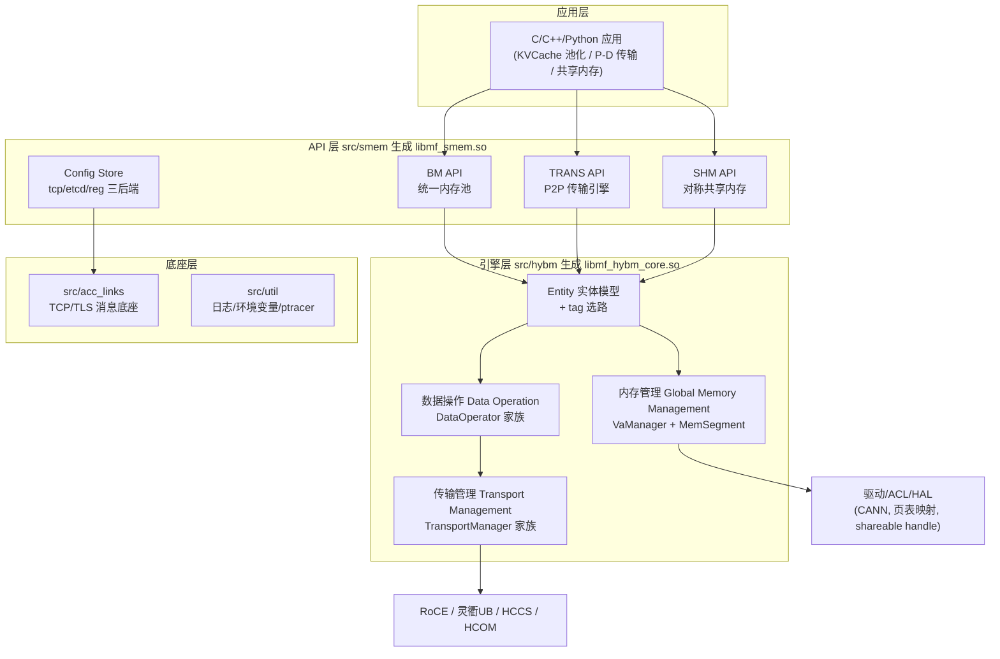
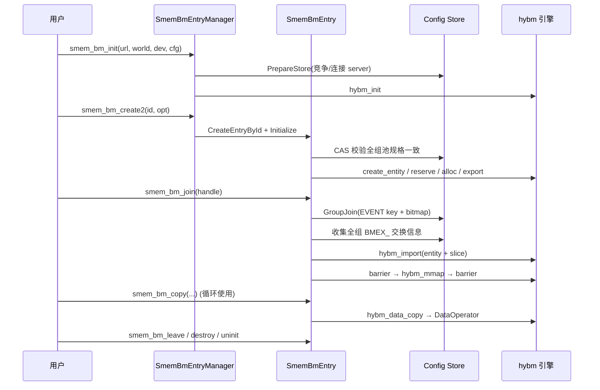

# MemFabric 架构概览

> 本文面向需要深入理解或参与开发 MemFabric 的工程师，讲清楚"系统怎么构成的、为什么这样设计、具体怎么运转"。与 [feature.md](./feature.md)（API 能力介绍）、[API.md](./API.md) / [pythonAPI.md](./pythonAPI.md)（接口清单）互补：那三篇回答"能用它做什么"，本文回答"它内部是怎么回事"。

## 本章导读

MemFabric 是一款面向昇腾（Ascend）系列与通用服务器的**内存池化软件**：把多节点的 DRAM 和 NPU HBM 统一编排成一个全局地址空间，应用用"一次拷贝"的内存语义访问任意节点上的内存，而不用关心底下走的是跨 die DMA、RoCE、灵衢 UB 还是共享内存。

读完本文你将建立以下认知：

- 四层代码结构如何对应"API → 引擎 → 底座"的职责划分；
- **GVA（全局虚拟地址）对称编址**如何让"对端的内存"变成"我地址空间里的一段"；
- 一次 `smem_bm_copy` 从用户代码到硬件 DMA 的完整路径；
- 控制面（config store 事件驱动）与数据面（按 tag 选路）为什么、如何彻底分离；
- 310P / 910B / A2 / A3 / A5 各平台如何通过"段 + 数据算子 + 传输管理器"三个插槽实现差异化适配。

文中所有机制均给出源码锚点（`文件:行号`），基于 `dev-v1.2.0` 代码基线（含 310P 支持）。

---

## 1. 全景：分层架构

### 1.1 What：MemFabric 由哪些层构成？

MemFabric 以动态库形式交付，自上而下分为四层：



从图中可以看到，应用的三种内存语义入口（BM/TRANS/SHM）最终都汇聚到 hybm 引擎层的同一个实体模型上——这是理解本系统的第一条主线。每层一句话职责：

| 层 | 目录 | 产物 | 职责 |
|---|---|---|---|
| API 层 | `src/smem/` | `libmf_smem.so` | 北向内存语义接口 + 组管理 + 配置存储 |
| 引擎层 | `src/hybm/` | `libmf_hybm_core.so` | 内存编排、数据操作、传输管理（三大核心模块） |
| 消息底座 | `src/acc_links/` | `libacc_tcp_net.a` | 进程间 TCP/TLS 可靠消息（config store 的传输层） |
| 公共设施 | `src/util/` | — | 日志、环境变量、URL 解析、ptracer 性能打点 |

`app/zbal/`、`app/tensorRTL/` 是构建在 MemFabric 之上的官方应用（消费者），不属于本架构范围，各自目录内有专属文档。

### 1.2 Why：为什么这样分层？

这套分层回答了三个设计问题：

**问题一：南向硬件差异极大，如何不被某一平台绑架？**
昇腾家族中，310P 只能走 ACL VMM + memcpy；A2 走 device RoCE；A3 超节点走 UB Jetty 或 SDMA；鲲鹏只有 host RoCE。MemFabric 的答案是把"内存怎么映射"（MemSegment）、"数据怎么搬"（DataOperator）、"链接怎么建"（TransportManager）做成三个**独立的插槽**，每个平台各填各的实现——引擎层的其他代码对此无感知。这就是"南向高可扩展"的落地方式。

**问题二：控制面和数据面为什么彻底分离？**
组管理、元数据交换、成员变更通知是低频、小流量、强一致性的需求，适合走一条通用 TCP（可加密）通道；而数据搬运是高频、大流量、低延迟的需求，必须按平台选择最快的 DMA/网络路径。两者耦合会让任何一侧的改动波及另一侧。MemFabric 让控制面完全落在 config store（`src/smem/csrc/config_store/` + `src/acc_links/`），数据面完全落在 hybm 传输层，中间只通过"导入完成"这一个事件衔接。

**问题三：为什么 API 层要有三种语义而不是一种？**
不同业务对"远端内存"的心智模型不同：KVCache 池化想要的是"一个大池子"（BM）；Prefill→Decode 分发想要的是"向某个对端推数据"（TRANS）；多卡算子通信想要的是"每张卡出一块对称缓冲，kernel 里直接用地址算术互访"（SHM）。三种 API 共享同一套引擎，只是入口语义封装不同——这是"简单的北向接口"原则的体现。

### 1.3 How：一次 copy 会穿过哪些层？

以第 8 章将详细追踪的 07 示例为例，`smem_bm_copy(hbm, &p, SMEMB_COPY_G2G, 0)` 的调用链是：

```
smem_bm_copy                       (src/smem/csrc/smem_bm/smem_bm.cpp:474)
  └→ SmemBmEntry::DataCopy         (src/smem/csrc/smem_bm/smem_bm_entry.cpp:639)
       └→ hybm_data_copy           (src/hybm/include/hybm_data_op.h:36)
            └→ MemEntityDefault::CopyData      (src/hybm/csrc/entity/hybm_entity_default.cpp)
                 └→ HostComposeDataOp::DataCopy (src/hybm/csrc/data_operation/host/hybm_compose_data_op.cpp:115)
                      └→ HostDataOpAclMemcpy::DataCopy   (310P 分派)
                           └→ aclrtMemcpyAsync(D2D)      (src/hybm/csrc/data_operation/host/hybm_data_op_acl_memcpy.cpp:77)
```

每一层只做自己的决策（合法性 → 方向翻译 → 地址分类 → 算子选路 → 硬件提交），职责单一。接下来各章自顶向下拆开讲。

---

## 2. 核心概念：GVA 统一编址与内存池化

> 类比：GVA 像一栋大楼的**统一门牌系统**——不管房间（物理内存）在哪层哪个角落、属于哪家公司（哪个 rank），所有访客（进程）拿到的门牌编号规则完全一致，"3 楼 305"在谁的地图上都是同一个房间。

### 2.1 What：对称 GVA 窗口是什么？

MemFabric 建池时，每个 rank 进程在自己的虚拟地址空间里预留一段**窗口**，把全组所有 rank 的池内存按 rank 顺序线性映射进去：

```
rank0 视角 GVA 窗口 (基址 0x12c140000000)     rank1 视角 GVA 窗口 (同一基址)
┌───────────────┬───────────────┐            ┌───────────────┬───────────────┐
│  rank0 池内存   │  rank1 池内存  │            │  rank0 池内存   │  rank1 池内存  │
│  (本地物理页)   │  (Import 映射) │            │  (Import 映射) │  (本地物理页)   │
└───────────────┴───────────────┘            └───────────────┴───────────────┘
  own = base + 0                              own = base + poolSize
  peer = base + poolSize                      peer = base + 0
```

上面是 07 示例（`examples/memory_pool/01_basic/07_310p_die_pair_pool/`）在 310P 实机上的真实地址：r0 的 `own=0x12c140000000 / peer=0x12c142000000`，r1 恰好互补。三个特性（引自 README）：

- GVA 是一个简单的 `uint64`；
- **所有进程的 GVA 起始地址一致**；
- 所有进程的 GVA 按 rank 线性排布且一致。

带来的直接好处：`peer_rank_ptr(peer_rank)` 只是 `base + peer_rank * segment_size` 的**纯算术**——不需要查表、不需要向对端查询，任何 rank 的内存在你的地址空间里都有确定位置。

### 2.2 Why：为什么要统一编址而不是按需查表？

对比两种方案就能看出动机：

| | 查表式（远端内存 ID + 注册表） | 对称 GVA（MemFabric 选择） |
|---|---|---|
| 获取对端地址 | 每次/每 buffer 向对端或元数据服务查询 | 本地算术推导，零开销 |
| 地址可用场所 | 通常仅 host 侧 API | **可直接下发到 AICore kernel**（SHM API 的根基） |
| 一致性维护 | 每次 join/leave 全量刷新映射表 | 窗口在 reserve 时一次确定，import 只填物理映射 |
| 代价 | — | 需要"所有 rank 池规格一致"的约定与预分配窗口 |

第三行是关键：只有地址是纯算术的，才能把 GVA 直接写进 kernel 参数里让 AICore 用 MTE/SDMA/RDMA 跨 rank 读写（`smem_shm.h:69` 明确支持）。查表式方案在设备侧无法低成本实现。

### 2.3 How：窗口如何建立与填充？

GVA 的建立分三步：**预留 → 分配 → 导入**。

**第一步：预留虚拟窗口。** `HybmVaManager::AllocReserveGva`（`src/hybm/csrc/mm/hybm_va_manager.cpp:332`）按 `maxPoolSize`（全组最大规格）在 DVA 空间找一段连续空闲区，同时登记 GVA 窗口。管理器维护三个地址空间（`hybm_va_manager.h:23-27`）：

- `HVM_GVA`：全局窗口（跨 rank 线性布局）；
- `HVM_DVA`：设备虚拟地址窗口；
- `HVM_HVA`：host 虚拟地址窗口。

若启用 56 位 GVA（`enable56BitsGva`，总地址空间超 32TB 时强制要求，见 `smem_bm.cpp:262-275` 的校验），GVA 从 `HYBM_56BITS_GVA_START_ADDR` 起的独立区间分配，LVA 与 GVA 尺寸解耦。另有平台特例：A5（950）因底软额外占用 1GB，预留时自动加一（`hybm_va_manager.cpp:341-344`）。

**第二步：本地物理内存分配。** 按 SoC 类型与介质选择 `MemSegment` 实现（详见第 4.3 节），分配本地物理页并登记进 `allocatedMap_`（每进程 VA 分配记录，`hybm_va_manager.h:349`）。

**第三步：交换与导入。** 各 rank 把自己的段元数据序列化后经 config store 交换，拿到对端信息后把**对端的物理内存**映射进自己 GVA 窗口的对应槽位——这一步是 `hybm_export` / `hybm_import`（`src/hybm/include/hybm_big_mem.h`），实现在第 4.4 节展开。

窗口建立后，`ClassifyAddressMask`（`hybm_data_op_entry.cpp:35`）可以判断任意地址落在哪类区域——这是数据面选路的依据（第 5 章）：

| 地址类别 | 含义 | 示例 |
|---|---|---|
| GD (GLOBAL_DEVICE) | 池内 HBM（本地或远端） | `peer_rank_ptr(rank, DEVICE)` |
| GH (GLOBAL_HOST) | 池内 DRAM | `peer_rank_ptr(rank, HOST)` |
| LD (LOCAL_DEVICE) | 本进程普通 HBM（`aclrtMalloc`） | 用户的 device buffer |
| LH (LOCAL_HOST) | 本进程普通内存 | `malloc` 的 host buffer |

理解了"地址即资源"，接下来看这套机制之上的三组 API 与组管理。

---

## 3. smem 层：三种 API 语义与组管理

### 3.1 三大 API 一览

三大 API 共享 hybm 引擎，但面向不同业务心智模型：

| | BM API | TRANS API | SHM API |
|---|---|---|---|
| 头文件 | `src/smem/include/host/smem_bm.h` | `smem_trans.h` | `smem_shm.h` |
| 心智模型 | 全局统一内存池 | 点对点传输引擎 | 对称共享内存 |
| 发起方 | host（`HYBM_TYPE_HOST_INITIATE`） | host（角色 SENDER/RECEIVER） | **AICore kernel**（`AI_CORE_INITIATE`） |
| 寻址方式 | GVA 算术 | `uniqueId`（推荐 ip:port） | `gva + symmetric_size * i`（各 rank 等量贡献） |
| 典型场景 | KVCache/内存池 | Prefill→Decode KV 分发 | 多卡算子互访（AllReduce 等） |
| 特色能力 | 动态扩容/成员回调/批量拷贝 | 量化传输（fp16→int8）/对端掉线回调 | barrier/allgather/全局原子编号 |

`smem_trans_def.h:16,45` 直接复用 BM 的 `data_op_type` 与拷贝语义——TRANS 本质上是 BM 语义子集的点对点封装。SHM 则配套**控制面集合通信**（barrier、allgather 含 subgroup 版、`topology_can_reach`、全局原子编号、global exit 广播），因为 kernel 侧发起的场景无法借用 host 侧的同步原语。

三者的实现结构完全同构：`csrc/<api>/smem_<api>.cpp`（C API 入口）+ `smem_<api>_entry(.h/.cpp)`（会话对象）+ `smem_<api>_entry_manager`（进程级管理器）。下文以最复杂的 BM 为主线讲解，TRANS/SHM 的差异点单独标注。

### 3.2 BM 会话生命周期：从 init 到 destroy

BM 的所有状态挂在 `SmemBmEntry`（一个池一个实例）与进程级单例 `SmemBmEntryManager` 上。建立全局认知的第一步：MemFabric 的初始化**不是一个函数，而是六级递进的过程**——每级解决不同层面的问题，作用域从粗到细，且各级恰好是"部署或扩展某个能力"时应处的挂载层：

| 级 | 触发入口 | 作用域 | 做什么 | 源码锚点 |
|---|---|---|---|---|
| **L0 安装期** | OPP `.run` 安装 / wheel 导入 | 机器一次（进程外） | AICPU kernel 装进 CANN OPP tree（`_provision.py` 仅特定 SoC+ACL 版本触发） | `script/kernel/`、`_provision.py` |
| **L1 进程级** | `smem_init` / `mf.initialize()` | 进程一次 | 日志级别、TLS、last-error | `smem.cpp:35-152` |
| **L1.5 引擎级** | `smem_bm_init` | 每种 API 一次 | store 连接/竞争建站 + rankId 分配 + `hybm_init`（ptracer、SoC 探测、驱动/ACL dlopen） | `smem_bm.cpp:71-111` |
| **L2 池级** | `smem_bm_create2` 前半 | 每池一次 | 全组规格 CAS 校验 → 组骨架（团队+监听线程+batch-copy 线程池）→ **entity 五步初始化**（tag 表 → dlopen 扩展库 → 段对象 → 传输 OpenDevice → 数据算子） | `smem_bm_entry.cpp:124-211`、`hybm_entity_default.cpp:106-133` |
| **L2.5 池资源** | create2 后半 | 每池一次 | 预留对称 GVA 窗口 → 分配 HBM/DRAM 物理内存 → 逐段导出交换信息 | `smem_bm_entry.cpp:157-208` |
| **L3 成员级** | `smem_bm_join` / `extend_local_mem` | 每次成员事件（可重复） | 收集全组交换信息 → import 对端段/增量建链 → 双 barrier 夹 mmap | `smem_bm_entry.cpp:442-478` |

从代码路径看，完整的初始化流与对称收尾如下图（节点标注了关键源码锚点，L2 内部①-⑤即 entity 五步）：

```mermaid
graph TB
    subgraph L0["L0 安装期（机器一次，进程外）"]
        INSTALL["OPP .run / wheel _provision.py<br/>AICPU kernel 进 CANN OPP tree"]
    end
    subgraph L1["L1 进程级 smem_init"]
        SMINIT["日志 / TLS / last-error"]
    end
    subgraph L15["L1.5 引擎级 smem_bm_init"]
        STORE["PrepareStore + AutoRanking<br/>rank0 建站或按 IP 竞争建站"]
        HYINIT["hybm_init<br/>ptracer 启动 + SoC 探测 + dlopen"]
    end
    subgraph L2["L2 池级 smem_bm_create2（每池一次）"]
        CAS["CheckRankConfigConsistency<br/>store CAS 校验全组池规格一致"]
        TEAM["CreateGlobalTeam + 双监听线程<br/>+ batch-copy 线程池"]
        TAG["① InitTagManager<br/>tag 表与 op 位图"]
        DL["② LoadExtendLibrary<br/>dlopen 扩展库"]
        SEG["③ InitSegment<br/>段对象（不分配内存）"]
        TM["④ InitTransManager<br/>OpenDevice（URMA 在此加载设备 kernel）"]
        DOP["⑤ InitDataOperator<br/>compose 到各数据算子"]
        RESERVE["hybm_reserve_mem_space<br/>预留对称 GVA 窗口"]
        ALLOC["hybm_alloc_local_memory + hybm_export<br/>HBM / DRAM 逐段分配导出"]
    end
    subgraph L3["L3 成员级 smem_bm_join（可重复：join / extend）"]
        GJ["GroupJoin<br/>写 EVENT key + bitmap 置位"]
        GATHER["等全组 BMEX_ key 齐备<br/>（先 join 者等后 join 者）"]
        IMPORT["hybm_import<br/>对端段映射 + 增量建链"]
        MMAP["双 GroupOpBarrier<br/>夹住 hybm_mmap"]
    end
    READY(("池就绪<br/>copy_data / extend"))
    EXIT["对称收尾：leave / destroy / uninit<br/>（顺序与初始化相反）"]

    INSTALL --> SMINIT
    SMINIT --> STORE
    STORE --> HYINIT
    HYINIT --> CAS
    CAS --> TEAM
    TEAM --> TAG
    TAG --> DL
    DL --> SEG
    SEG --> TM
    TM --> DOP
    DOP --> RESERVE
    RESERVE --> ALLOC
    ALLOC --> GJ
    GJ --> GATHER
    GATHER --> IMPORT
    IMPORT --> MMAP
    MMAP --> READY
    READY --> EXIT
```



从图中可以读到三个结构性事实：

1. **引擎初始化严格先于内存分配**——⑤ 算子 Initialize 执行时池内存尚不存在（`hybm_alloc_local_memory` 在 entity Initialize 返回之后才调用，`smem_bm_entry.cpp:168`）。任何依赖池地址的自检必须放到 join 之后；也正因为如此，数据算子的初始化只做"能力准备"（建流、加载资源），不触碰池内容。
2. **L3 是唯一可重复进入的级别**——join/leave/extend 都走同一套 EVENT 事件机制（3.3 节展开），L1.5/L2 的失败只能整体重试，L3 则是增量演进；扩容 `extend_local_mem` 复用的正是这条路。
3. **收尾与初始化完全对称、顺序相反**——destroy 先 `GroupLeave`（通知对端同步清理本 rank 映射）再逐层释放，uninit 先销毁 entry manager 再 `hybm_uninit`（顺序防 use-after-free）。

再从组件交互视角看同一个过程（用户 / entry manager / entry / config store / 引擎五个角色的协作时序）：



各阶段的关键细节：

**init（`smem_bm.cpp:71-111`）**：`SmemBmEntryManager::Initialize`（`smem_bm_entry_manager.cpp:46-91`）带**重试循环**（最多 5 次、间隔 20s，覆盖 HA server 约 60s 的恢复窗口）。`PrepareStore` 决定谁当 config store server：非自动排名时由 rank0 且 `startConfigStoreServer=true` 者建立；自动排名时所有 rank 执行 `RacingForStoreServer`（本机 IP 与 URL IP 匹配才参与竞争，`SM_RESOURCE_IN_USE` 视为他人已建，`smem_bm_entry_manager.cpp:130-146`）。随后 `hybm_init(deviceId, flags)` 初始化引擎层。

**create2（`smem_bm.cpp:200-320`）**：`SmemBmEntry::Initialize`（`smem_bm_entry.cpp:124-211`）按严格顺序执行：

1. `CheckRankConfigConsistency`（:874-922）——通过 store 的 **CAS 操作**（key=`check_rank_config_consistency`）确认所有 rank 的 maxDRAMSize/maxHBMSize/enable56BitsGva 一致，不一致直接失败（对称窗口的前提）；
2. `CreateGlobalTeam`——`SmemNetGroupEngine::Create` 注册 join/update/leave 回调；
3. 启动 2 线程 `executorService_`（"batch-copy" 并发批量拷贝线程池）；
4. `hybm_create_entity(id + HYBM_ENTITY_ID_BM_BASE, ...)`——创建引擎实体（第 4 章）；
5. `hybm_reserve_mem_space` 预留 GVA 窗口；
6. HBM/DRAM 逐段 `hybm_alloc_local_memory` + `hybm_export`（DRAM 按 flag 走 best-effort / 32GB 切片 / 一次性分配，`AllocDramMem` :95-123）；
7. 实体级 `hybm_export(HYBM_FLAG_EXPORT_ENTITY)` 生成 entityInfo。

**join（`smem_bm_entry.cpp:442-478`）**：循环调用 `GroupJoin`，`SM_INNER_BUSY`（对端尚未发布交换信息）时 sleep 1s 重试，总时长受 `MF_GROUP_JOIN_MAX_TIMEOUT` 控制。join 的完整语义在 3.3 节展开。

**copy（:639-665）**：`TransToHybmDirection`（:598-637）把 10 种 `SMEMB_COPY_*` 方向翻译为 hybm 方向枚举后调 `hybm_data_copy`。批量版本 `DataCopyBatchConcurrent`（:759-820）用线程池并发执行单条拷贝，支持部分成功语义（`SM_PARTIAL_FAILED` + 逐条结果）。

**destroy/uninit**：`Uninitialize`（:213-250）先 `GroupLeave`（让对端同步清理本 rank 的映射）→ 逐 slice `hybm_free_local_memory` → `hybm_unreserve_mem_space` → `hybm_destroy_entity`。`smem_uninit` 先销毁 entry manager 再 `hybm_uninit`（顺序防 use-after-free）。

### 3.3 组引擎：动态成员语义

`SmemNetGroupEngine`（`src/smem/csrc/net/smem_net_group_engine.cpp`）基于 config store 实现了"组"的概念——这是 MemFabric 控制面的核心。

**组的表示**：一个组对应 store 里一个 prefix（BM 每个池再套 `(id)_` 二级前缀，所以**每个池是独立的组**）。关键 key：

- `EVENT` key：值为 `SmemGroupInfo`（version/groupSize/curEvent/targetRank + `joinedRanksBitmap[8]×u64` 位图，`smem_net_group_engine.h:76-97`），通过 **CAS** 原子更新驱动全组事件；
- `BMEX_<rank>` key：每个 rank 的交换信息（entityInfo + 全部 sliceInfo 串接）；
- `_GA/_GW、_BA/_BW` 系列：barrier 与 allgather 的临时 key。

**join 为什么是"先 join 者等后 join 者"？** `GroupJoin`（:1380-1452）先清理本 rank 旧 key，再以 `JOIN_EVENT` 写入 EVENT key 并置位 bitmap，然后等待监听线程执行 joinCb。joinCb 即 `SmemBmEntry::JoinHandle`（`smem_bm_entry.cpp:271-360`）：

- 新 join 者（rk==self）：`GroupGatherPrefixKey` **要求所有已 join rank 的 `BMEX_` key 全部就位**（少一个就返回 `SM_INNER_BUSY` 回到 join 循环重试）——这就是"动态成员语义"的由来：先 join 者必须等后 join 者完成信息发布与导入；
- 已 join 者（rk==new）：监听线程收到新 rank 事件，取其 `BMEX_` key（可被 leave/linkdown 中断）；
- 两侧各自执行 `hybm_import`（entity 信息 + slice 信息，先 segment 后 transport）；
- **两组 `GroupOpBarrier` 夹住 `hybm_mmap`**——保证所有 rank 的映射都就绪后才一起通过；
- 任一步失败回滚：对每个已 join rank `hybm_remove_imported`。

事件分发由两条常驻监听线程完成（`StartListen` :1304-1331）：`GroupListenEvent`（watch EVENT key）与 `GroupListenLinkState`（watch rank 掉线）。事件按版本号去重（`TryUpdateInfo` :879-893）后回调 `SmemGroupOption` 的 joinCb/updateCb/leaveCb/linkDownCb。

**扩容（extend）**：`smem_bm_extend_local_mem`（`smem_bm_entry.cpp:509-555`）分配并导出新 slice 后走 `UPDATE_EVENT`，对端 `UpdateHandle`（:362-411）**只 import 新增 slice** 并重新 mmap——扩容不需要重建整个组。

> 07 示例的一个实践提示：因为 HBM 池和 DRAM 池是两个独立组，join 完 HBM 池不代表对端也 join 完 DRAM 池。示例在两个池都 join 后用文件标记做了一次额外同步（`07_310p_die_pair_pool.cpp:209-211`），避免用"对端地址尚不可见"的窗口发起拷贝。

### 3.4 Config Store：控制面的存储与高可用

**三种后端**（`smem_store_factory.cpp:175-231`）：

| URL | 后端 | 实现 | 适用 |
|---|---|---|---|
| `tcp://ip:port` | `SmemLocalMemoryBackend` | server 进程内存即存储 | 单 server 场景，零依赖 |
| `etcd://ip:port[#id]` | `SmemEtcdStoreBackend` | dlopen `libetcd_client_v3.so`（Go 实现，`src/util/etcd_client/etcd_store_backend/`） | 已有 etcd 的环境 |
| `reg://ip:port[#id]` | `SmemExternalBackend` | 用户经 `smem_config_store_set_backend_op` 注册操作集（`smem_def.h:45-96`） | 嵌入已有元数据系统 |

`#instanceId` 片段（仅 etcd/reg 支持）用于多集群隔离。后端抽象 `ConfigStoreBackend`（`smem_config_store_backend.h:47-190`）统一了 Get/Put(TTL)/Delete/PrefixGet + **分布式锁**（Acquire/TryAcquire/Release + RAII `DistributedLockGuard`）——分布式锁是 HA 选举的基石。

**TCP server 的故障恢复**：server 状态机 `SS_INITED → SS_RECOVER → SS_NORMAL`（`smem_tcp_config_store_server.cpp:202-234`）。RECOVER 窗口拒绝新连接，等待旧 rank 重连（分布式后端 60s / 非分布式 10s 扩容窗口），防止脑裂。

**HA Config Store**（`ha/smem_ha_config_store.cpp`）解决 TCP 单点问题：多个候选节点运行选举循环 `RunElectionLoop`（:225-300）——先探活 `KEY_LEADER`，有活 leader 则当 follower；没有则抢分布式锁 `KEY_ELECTION_LOCK` 后 `TryBecomeLeader`：从后端恢复 worldSize/alive ranks，起 server，以 **5s TTL 租约**注册 `KEY_LEADER`。leader 每 4s 健康检查后端，失败触发异步重选举（:528-534）；租约过期同样触发重选。集群 HA 部署详见 [config_store_cluster_ha.md](./config_store_cluster_ha.md)。

**watch 与成员感知**：`Watch(WATCH_RANK_LINK_DOWN)` 注册掉线关注（`smem_config_store.h:204-205`）。server 侧 TCP 断链（`LinkBrokenHandler`）或心跳超时（2s 心跳，`CheckerThreadTask`）→ rankId 入 `rankStateTaskQueue_` → `RankStateNotify` 线程向所有 watcher 广播 → 客户端 `SmemNetGroupEngine::RemoteRankLinkDownCb` → 组引擎 linkDownCb → BM 的 `LeaveHandle`（被动清理故障 rank 的映射）或 TRANS 的 peer down 回调。**这就是故障成员的感知与被动清理通路，全程不需要人工干预。**

理解了 API 层与控制面，下一章进入引擎层——看"实体"如何把内存段、数据算子、传输管理器组装到一起。

---

## 4. hybm 层（上）：Entity 模型与内存管理

> 类比：Entity 像一个**装修队**——它不生产建材（物理内存），而是把"房型"（Segment）、"搬运方式"（DataOperator）、"运输通道"（TransportManager）按图纸组装成一套可交付的房子（内存池）。

### 4.1 What：Entity 是什么？

Entity 是 hybm 层的核心抽象（`src/hybm/csrc/entity/hybm_entity.h:26-69`），一个 entity 对应一个"池实例"的引擎侧状态。唯一实现 `MemEntityDefault`（`hybm_entity_default.cpp`）持有：

```text
MemEntityDefault 内部结构
├── hbmSegment_ / dramSegment_     → 两类介质的内存段（MemSegment 家族）
├── transportManager_              → 传输管理器（TT_SDMA 或 TT_COMPOSE）
├── tagManager_                    → tag→opType 注册表（跨池选路中枢）
├── dataOperator_                  → 恒为 HostComposeDataOp（算子组合器）
├── importedRanks_                 → rankId → EntityExportInfo（已导入的对端）
└── importedMemories_              → rankId → set<TransportMemoryKey>（已导入的内存键）
```

**ID 分段**：entity id 全局分段避免不同 API 的池冲突（`src/hybm/include/hybm_def.h:44-48`）——SHM 占 0-63、BM 占 64-127（`HYBM_ENTITY_ID_BM_BASE=64`）、TRANS 占 128-191、OFFLOAD 占 192-255，上限 511（`hybm_define.h:38`）。`MemEntityFactory`（`hybm_entity_factory.cpp:27-59`）是进程级单例工厂，按 id 缓存/创建/反查/销毁 engine——同一进程内多个池（如 07 示例的 HBM 池 id=0 + DRAM 池 id=1）就是两个独立 entity 并存，各自有独立的段、传输管理器、tag 表和 store prefix。

**初始化流程**（`hybm_entity_default.cpp:106-133`）：`InitTagManager` → `LoadExtendLibrary`（dlopen device-rdma/sdma/urma/host-rdma 扩展库）→ `InitSegment`（:1129-1219）→ `InitTransManager`（:1221-1262，rankCount>1 且 op 需要传输时创建）→ `InitDataOperator`（创建 `HostComposeDataOp`）。

### 4.2 tag 机制：跨池互操作的中枢

**先澄清一个易混点**：07 示例源码里的 `TAG_HBM=0x5A5AA5A500000000ULL`（`07_310p_die_pair_pool.cpp:33-34`）只是**写进 buffer 的校验 pattern**，与这里的 tag 机制无关。真正的 tag 是建池时通过 `hybm_options.tag/tagOpInfo` 传入的**字符串标识**。

`HybmEntityTagInfo`（`hybm_entity_tag_info.cpp`）维护两张表：

- `rankTagInfo_`：rankId → tag 字符串（1-30 字符，限 `[a-zA-Z0-9_]`）；
- `tagOpInfo_`：`"tag1:tag2"` → op 类型**位图**。`AddOneTagOpInfo`（:51-82）解析 `"tag:OP_TYPE:tag"` 格式的规则，同 key 按位或叠加——即一条规则声明"从 tag A 的池到 tag B 的池允许走哪些 op"。

查询接口 `GetTag2TagOpType(tag1, tag2)`（:122-145）拼接正反两个 key 查表返回位图。这个位图被**三处**消费，构成跨池选路的中枢：

1. `HostComposeDataOp::GetPrioritedDataOperators`（`hybm_compose_data_op.cpp:261`）——数据算子按此过滤候选；
2. `ComposeTransportManager`（`compose_transport_manager.cpp:255,284,428`）——决定某远端 rank 走 host 栈还是 device 栈；
3. `InitTagManager`（`hybm_entity_default.cpp:59-99`）——初始化时自动为本地每种启用 op 生成 `"localTag:OP:localTag"` 兼容规则。

**设计动机**：一个作业里往往是异构池混布——本机双 die 的 HBM 想走 SDMA、跨机 HBM 走 Device RDMA、DRAM 池走 HOST_RDMA。tag 表让"哪两个池之间允许怎么搬"成为**声明式配置**而不是硬编码分支，这是 compose 组合模式（第 5、6 章）能成立的前提。

### 4.3 MemSegment 家族：内存怎么分配与登记

`MemSegment`（`src/hybm/csrc/mm/hybm_mem_segment.h:38-60`）是内存段抽象，接口覆盖 `ValidateOptions / ReserveMemorySpace / AllocLocalMemory / RegisterMemory / Export / Import / RemoveImported`。`MemSegment::Create` 按 **SoC 类型 + 介质**分派（`hybm_mem_segment.cpp:83-105`）：

```text
MemSegment 家族（src/hybm/csrc/mm/）
├── HybmAclVmmSegment      → HBM@310P：aclrtMallocPhysical + shareable handle 跨 die 导入
├── HybmVmmBasedSegment    → HBM@910B/A3：驱动 VMM/halMem 接口
├── HybmDevSegment / DevUser / DevLegacy → 设备内存（分 GVA 版本与场景）
├── HybmConnBasedSegment   → 连接型段（伴随建链生命周期的内存）
└── HybmHostShmSegment     → DRAM：POSIX 共享内存（hugepage 优先，回退 /dev/shm）
```

分派逻辑中平台判断优先于 GVA 版本判断——310P 驱动可能被映射为 V4 但没有 halMem 语义（`hybm_mem_segment.cpp:84-87`），这是 310P 适配中实测得出的经验。另有平台约束如 910B 的连接范围限制在 8 die 内（`ASC910B_CONN_RANKS=8`，:32、:277）。

**310P 的 AclVmmSegment 值得单独展开**（本平台为本文主要实例，`hybm_acl_vmm_segment.h/.cpp`）：

- 分配：`aclrtMallocPhysical`，必须 `ACL_MEM_HANDLE_TYPE_NONE + ACL_MEM_P2P_HUGE`；
- 导出：`aclrtMemExportToShareableHandle`，必须带 `ACL_RT_VMM_EXPORT_FLAG_DISABLE_PID_VALIDATION`——默认的 PID 白名单会拒绝对端 die 上的进程导入；
- 导入：对 die 显式 `SetContext` 后 `aclrtMapMem` 映射进预留窗口槽位（`ImportHandleForDiePair` / `MapImportedToSlot`，:87-88）；
- 交换结构：`AclVmmExportInfo`（:31，handle + segmentType + slice 布局），static_assert 锁定与通用交换布局一致。

SoC 探测有大量**容错兜底**：310P 驱动不支持 SDID/SERVER_ID 查询（实测返回 207000），`QueryDeviceInfoSocTolerant`（`hybm_mem_segment.cpp:171-174`）降级为无效值继续走——310P 上日志里看到的三个 WARN 即来源于此，属预期行为。

**HostShmSegment** 走纯 POSIX 链路：优先 hugepage（`/dev/hugepages`），不可用时回退 `/dev/shm`（`hybm_host_shm_segment.cpp:46`）。所有 rank `mmap` 同一个 shm 文件——DRAM 池的"跨 rank 访问"本质是**同一份物理页**，所以 07 示例的 DRAM 池选用 `HOST_SHM` op 后连传输管理器都不需要。

### 4.4 Export/Import：元数据交换与映射建立

Export/Import 是"窗口填充"的执行机制，贯穿 join/update/extend 三个流程：

- **`ImportEntityExchangeInfo`**（`hybm_entity_default.cpp:625-671`）：反序列化对端 `EntityExportInfo`（rankId/role/nic/tag/transportPrivateData）→ 存 `importedRanks_` → tag 表登记 → **首次**走 transport `Prepare+Connect`，后续 `UpdateRankOptions` → HBM 段导入；
- **`ImportSliceExchangeInfo`**（:535-572）：**先 segment 后 transport** 的顺序——segment 先建立 VA 映射，transport 再拿 memKey 建链（`ImportForTransport` :1083-1115 汇总 nic/privateData/memKeys 后 `ConnectWithOptions`）；
- **`RemoveImported`**（:740-781）：反序清理——transport `RemoveRanks`（销毁 QP/连接）→ 两个 segment 解除远端映射 → `dataOperator_->CleanUp()` → 清表。由 leave 回调与 link-down 触发，与 join 完全对称。

注意导入方向是**双向且各自独立**的：rank0 import rank1 的信息时，rank1 也在 import rank0 的——两侧都完成后（双 barrier 保证）双方的窗口才同时就绪。

引擎层的另一半——数据怎么搬、链路怎么选——由数据面与传输层承担，这是接下来两章的内容。

---

## 5. hybm 层（中）：数据面与 DataOperator 家族

> 类比：DataOperator 家族像一支**搬家公司梯队**——同一批家具（数据）可以选不同的车队（SDMA 直投 / RoCE / UB / 共享内存直取），`HostComposeDataOp` 是调度台，按"从哪到哪、什么货"自动派车，用户只需要报地址。

### 5.1 What：数据面如何选路？

`hybm_data_copy` 入口（`src/hybm/csrc/data_operation/hybm_data_op_entry.cpp:35`）先做两件事：

1. `ClassifyAddressMask` 判断 src/dst 各落在 GD/GH/LD/LH 哪类区域；
2. 结合 10 种拷贝方向（`smem_bm_def.h:71-85`：H2G/G2H/H2GH/GH2H/G2G/L2G/G2L/GH2L/L2GH/AUTO）确定 `hybm_data_copy_direction`。

随后 `MemEntityDefault::CopyData` → `HostComposeDataOp::DataCopy`（`hybm_compose_data_op.cpp:115-144`）按 `GetRank2RankOpType`（tag 表）过滤出候选算子，**按优先级逐个尝试**。批量拷贝（`BatchDataCopy`）先按 (srcRank, dstRank) 分组（`hybm_entity_default.cpp:834-847`），全组支持 SDMA 时整批走 SDMA（`AllSupportSdma`，:243-256）以获得合并收益。

### 5.2 六种数据算子对比

```text
DataOperator 家族（src/hybm/csrc/data_operation/host/）
├── HostDataOpSDMA        → A2/A3：host 手工构造 STARS SDMA SQE 直投
├── HostDataOpAclMemcpy   → 310P：aclrtMemcpy 系（同步 H2D/D2H + async D2D）
├── DataOpDeviceRDMA      → device RoCE：QP + WR + doorbell SQE
├── DataOpDeviceURMA      → UB：下发设备 kernel 批量搬运
├── HostDataOpRDMA        → host RoCE：HCOM 库通道
└── HostDataOpHostShm     → 同节点：共享内存直接访问
```

| 算子 | 平台/链路 | 核心机制 | 关键源码 |
|---|---|---|---|
| HostDataOpSDMA | 910B/A3 HBM | `InitG2GStreamTask` 手工填 `rtStarsMemcpyAsyncSqe_t`（type/kqos/credit/32 位拆地址）经 STARS 流 `SubmitTasks` 提交，**用 STARS CQE 同步**而非 AclrtSynchronizeStream | `hybm_data_op_sdma.cpp:406-466,522-544` |
| HostDataOpAclMemcpy | 310P | H2D/D2H 同步 `aclrtMemcpy`；D2D 必须 `AclrtMemcpyAsync`（同步 D2D 跨 die 返回 507899 不可用，实测结论）+ stream 同步；stream 出错时**重建自恢复** | `hybm_data_op_acl_memcpy.cpp:74-102` |
| DataOpDeviceRDMA | A2 RoCE | src 本地→`WriteRemote`（put）；dst 本地→`ReadRemote`（pull）；未注册内存经 **128MB 注册 swap buffer 分块中转**（`MF_HYBM_RDMA_SWAP_SPACE_SIZE`） | `hybm_data_op_device_rdma.cpp:379-398,1073-1147` |
| DataOpDeviceURMA | A3 UB | swap 用 HBM；批量直接 `WriteRemoteBatchAsync(CopyDescriptor)`——URMA 设备 kernel 原生支持批量列表，无需合并 | `hybm_data_op_device_urma.cpp:718-877` |
| HostDataOpRDMA | 鲲鹏/A2 host | 经 HcomTransportManager 通道（单例，TLS1.3） | `hybm_data_op_host_rdma.cpp` |
| HostDataOpHostShm | 同节点 DRAM | 同一物理页，host 侧直接访问 | `hybm_data_op_host_shm.cpp` |

**工厂的平台分派**（`hybm_data_op_factory.cpp:22-29`）是 310P 适配的关键设计：SDMA 槽位在 310P 上没有 STARS SQE 直投能力（`HalHostRegister` 不可用），工厂改派 `HostDataOpAclMemcpy` **占住 SDMA 语义槽位**——对上层（compose 的 `hybm_wait` 语义）完全透明。这体现了"语义槽位与平台实现分离"的原则。

**为什么需要 swap buffer 中转？** Device RDMA 的 `WriteRemote` 要求源地址在本地已注册 MR。用户的普通 device buffer（`aclrtMalloc`）未必注册过。SafePut/SafeGet 把未注册 buffer 的数据先拷进常驻的注册 swap 区，再从 swap 发起 RDMA——用一次本地拷贝换取免注册的便利。批量路径还会按远端地址连续性**合并段**（`BatchMergedWrite/Read`）摊薄中转成本。

**AICPU 扩展拷贝**：`HostDataOpSDMA` 的批量路径支持 `COPY_EXTEND_FLAG` 走 AICPU 扩展算子——host 注册 64MB paramSpace（170×384KB 槽 + 原子 mask 元数据，:26-73），经 `DlHybmExtendApi`（`dl_hybm_copy_extend.cpp`，按 `MEMFABRIC_HYBRID_EXTEND_LIB_PATH` dlopen `libmf_hybm_copy_extend.so`）调用 32 并发的批量拷贝/量化算子。这套扩展库的 AICPU kernel 由 `src/hybm/ops/hybm_kernel/` 构建体系产出（`HybmBatchRead/Write`，`libcann_hybm_kernel.json` 声明为 `AICPUKernel`），部署形态见 [installation_aicpu_kernel.md](./installation_aicpu_kernel.md)。

### 5.3 量化拷贝与异步语义

- **量化传输**（TRANS API `batch_transfer_write_with_quant`）：fp16/bf16 → int8 的在线量化搬运，走 `hybm_data_quant_copy` → AICPU 扩展算子，A3 SDMA 路径支持（`smem_trans.h:226-230`）；
- **异步与 Wait**：`hybm_data_copy` 带 stream 参数时为异步提交，`hybm_wait(entity)`（`hybm_data_op.h:56`）统一兑现等待。310P 的 AclMemcpy 算子一期将 async 降级为逐跳同步、Wait 为 no-op（`hybm_data_op_acl_memcpy.cpp:196-207` 注释明示），语义兼容但无异步收益——这是平台能力差异在 API 语义上的显式体现。

---

## 6. hybm 层（下）：传输层与 TransportManager 家族

> 类比：TransportManager 像不同的**货运公司**——数据算子决定"要不要发货"，传输管理器决定"用哪条航线、什么舱位"。`ComposeTransportManager` 则是货代总代理：同一单货里，近途走陆运（host 栈）、远途走空运（device 栈）。

### 6.1 What：传输层管什么？

`TransportManager` 抽象（`src/hybm/csrc/transport/hybm_transport_manager.h:25-129`）覆盖：设备生命周期（OpenDevice/CloseDevice）、内存注册族（Register/QueryMemoryRegion/QueryMemoryKey）、建链族（Prepare/Connect/AsyncConnect/WaitForConnected/UpdateRankOptions/RemoveRanks）、数据族（ReadRemote/WriteRemote ±Async/Batch、Synchronize）。工厂（`hybm_transport_manager.cpp:25-60`）按传输类型创建：

```text
TransportManager 家族
├── TT_SDMA    → SdmaTransportManager          （A3 SDMA 资源准备）
├── TT_HCCP    → RdmaTransportManager          （device RoCE QP）
│                └─ RdmaIndirectTransportManager（带外代理模式，驱动 <V4）
├── TT_HCOM    → HcomTransportManager          （host 栈，单例）
└── TT_COMPOSE → ComposeTransportManager       （host+device 双栈聚合）
```

选型规则：驱动 GVA 版本 < V4 或 `MF_TRANSPORT_MANAGER=INDIRECT` 时 device RDMA 走 indirect 变体（:46-60）。`TransportMemoryKey` 是 **14×7 槽位**结构（`hybm_transport_common.h:80-123`）：device 占前 6×14、hcom 占最后 14——这个分槽设计是为了 compose 聚合时一次携带双栈的 key。

### 6.2 各传输管理器的角色

**SdmaTransportManager（A3）——"资源准备者"而非数据面**：除资源准备外所有数据接口返回 `BM_NOT_SUPPORTED`（`aiv_sdma_transport_manager.cpp:66-156`）。它做的是：创建 48 个 STARS stream（`RtStreamGetSqid/Cqid`）、准备 16KB AICPU/AIV 共享 workspace、调 `AclnnShmemSdmaStarsQuery` AICPU 算子查询 SQ 元数据，全部写入设备内存 `HybmDeviceMeta.sdmaWorkSpace`（`hybm_entity_default.cpp:1049`）——**供 AIV kernel 直投 SDMA SQE 使用**（SHM API 的 device 侧根基）。真正的 SDMA 数据面在 host 侧是 `HostDataOpSDMA`（第 5 章），在 device 侧是用户的 AICore kernel。

**RdmaTransportManager（A2）——device RoCE QP**：设备初始化链 `TsdOpen→RaInit→RaRdevInitV2→RaRdevGetHandle`（:535-696；若 HCCL 已初始化则 mock 一个 hccl comm 拿 handle 复用，:509-533）。QP 管理按场景二选一（:104-109）：

- `FixedRanksQpManager`（AI_CORE_INITIATE 场景）：**一次性静态建链**，启动要求 rank 数齐平，之后不接受变更；QP 的 WQ/CQ 信息填入设备内存 `AiQpRMAQueueInfo` 供 **AI Core 直接下发 RDMA**（`GetQpInfoAddress`，host 侧反而拿不到 QP handle）——SHM API 的 RDMA 路径由此而来；
- `JoinableRanksQpManager`（host 发起场景）：**动态成员增量建链**。常驻 Server/Client 双循环线程，`SetRemoteRankInfo` 增量入队（rank 小于自己主动连、大于自己等连）→ HCCP socket 白名单 → 逐对建 QP；`RemoveRanks` 增量下线。与组引擎的 join/leave 事件一一对应。

数据提交用 `RaSendWrV2` post WR，并把返回的 doorbell 值用 **STARS `RT_STARS_WRITE_VALUE + RDMA_DB_SEND` SQE** 写进 RoCE VF DB 寄存器（`device_rdma_transport_manager.cpp:902-950`）——保证 WR 提交与流上其他任务**有序**，这是 device RDMA 能挂接 stream 语义的关键技巧。

**DeviceUrmaTransportManager（A3 UB）——设备 kernel 搬运**：基于 `dl_hcomm_api`（HcomMemImport/Channel/Thread），每 rank 维护 `RemoteRankState`（endpoint/channel/thread/imports/remoteFlagAddr）。数据面是 `LaunchDeviceKernelBatch` **下发设备 kernel** 执行批量搬运（kernel bin 由 `load_kernel.cpp` 加载）；per-thread `CompletionContext`（notify+stream+pendingTransfers）管理完成；Synchronize 用 marker kernel + 远端 flag。协议覆盖 HCCS/ROCE/PCIE/UB 等（`hcomm_transport_manager.h:49-59`）。

**HcomTransportManager（host 栈）——单例**：dlopen `libhcom`（未构建 HCOM 时日志可见加载失败 WARN，属预期），`ServiceCreate` 按协议（RDMA/TCP/UB/UBC）+ nic 建服务，心跳 10s+3×5s，TLS1.3+AES-GCM-256，断链重连由 `HcomReconnector` 负责。MR 注册**仅支持 DRAM**（`REG_MR_FLAG_DRAM`）——host 栈天然只搬 host 内存。

**Indirect 模式（驱动 <V4 兜底）**：把"用户线程直接 post WR"改为**带外 TCP 代理**——请求打包成 `QueueMessage` → 8 线程 `SenderSideQueue` → `AsyncSocketQueue`（epoll）发给对端 → 对端 4 线程 `ReceiverSideQueue` 在本地注册的 16MB swap buffer 上执行真正 RDMA 再回执（`device_rdma_indirect_transport_manager.cpp:317-491`）。老驱动没有 direct WR+doorbell 能力时的兼容路径。

### 6.3 ComposeTransportManager：双栈聚合的调度中枢

**为什么需要 compose？** 一体化作业里经常同时存在两类对端：同节点/DRAM 池适合 host 栈（HCOM），跨节点 HBM 池适合 device 栈（RoCE/UB）。`ComposeTransportManager`（`compose_transport_manager.cpp`）同时聚合一个 HcomTransportManager + 一个 device 栈管理器：

- `OpenDevice`（:65-108）按协议位分别打开两栈，nic 序列化为 `"host#...;device#..."`；
- `QueryMemoryKey`（:203-231）把 device key 与 hcom key **分槽写入**同一个 `TransportMemoryKey`；
- `Prepare/UpdateRankOptions`（:249-334）用 `tagManager_->GetRank2RankOpType(rank, self)` 决定**每个远端 rank 各走哪条栈**，拆分建链选项——tag 表在这里兑现成路由决策；
- `Read/WriteRemote`（:426-588）按 opType **先 device 后 host** 逐个尝试。

结合第 5 章的 `HostComposeDataOp`（算子层按 tag 过滤）与本节（传输层按 tag 拆栈），可以看到设计上的对称性：**选路决策统一由 tag 表驱动，算子层与传输层各自独立执行**——两层的组合自由度由此而来。

---

## 7. acc_links 与安全：控制面的字节底座

> 类比：acc_links 是**邮政系统**——只负责"信封标准、邮路畅通、挂号回执"；信里写什么（键值语义）、这封信属于哪个组织流程（组管理），是上层 config store 与组引擎的事。

### 7.1 What：acc_links 提供什么？

`src/acc_links/` 是独立编译的通用 TCP/HTTP 进程间消息库，是 TCP 后端 config store 的传输底座，**不参与数据面**。线上协议（`include/acc_def.h`）：

- 连接握手：`AccConnReq{magic,version,reconnect,rankId}` / `AccConnResp`（:46-59）；
- 消息帧：`AccMsgHeader{type,result,bodyLen,seqNo,crc}`（:75-95），body 上限 64MB。

组件结构（`csrc/`）：

```text
acc_links 内部结构
├── AccTcpListener          → accept 线程（poll 500ms，backlog 200）
├── AccTcpServerDefault     → listener + N 个 AccTcpWorker（每 worker 一个 epoll 线程）
│                             + AccTcpLinkDelayCleanup（断链延迟销毁）
├── AccTcpLinkComplexDefault → 非阻塞 link：发送侧 AccLinkedMessageQueue，
│                             接收侧 header→body 状态机，全 epoll 驱动
└── security/               → TLS：证书加载/CRL 校验/过期巡检/私钥解密回调
```

### 7.2 三层分工：谁负责什么消息

控制面的职责切分是理解本层的关键：

| 层 | 模块 | 职责类比 |
|---|---|---|
| 字节与连接 | acc_links | 邮政：可靠收发、挂号信（seqNo 匹配） |
| 键值与事件 | `AccStoreServer` / `TcpConfigStore`（`src/smem/csrc/config_store/tcp_store/`） | 收发室：SET/GET/PREFIX/WATCH/CAS/APPEND 等 13 种 Handler（`smem_message_packer.h:33-48`），keyWaiters/watchWaiters 实现 wait/watch 语义 |
| 组与成员 | `SmemNetGroupEngine` | 组织流程：join/leave/barrier 的协议状态机（第 3.3 节） |

客户端 `TcpConfigStore` 发送失败自动重连重发（`LocalNonBlockSend`），服务端把所有业务打包进单一 msgType 0 由 `SmemMessagePacker` 解包——acc_links 对上层语义完全无感。

### 7.3 安全体系

TLS 同时覆盖两个平面：

- **控制面加密**：`MF_CONFIG_STORE_URL` 的 tcp 通道，`smem_bm_config_t.storeTlsConfig`（`smem_bm.cpp:43`）配置；
- **数据面加密**：`hcomTlsConfig` 透传到 `hybm_options.tlsOption` → HcomTransportManager `ServiceSetTlsOptions`（TLS1.3+AES-GCM-256，`host_hcom_transport_manager.cpp:135-137`）。

证书体系（`security/acc_tcp_ssl_helper.h`）：CA/server/client 三级证书 + CRL 吊销校验 + 证书过期巡检线程 + **私钥口令自定义解密回调**（`RegisterDecryptHandler`——支持接入 KMS，`test/integration/decrypt/` 有完整示例）；强制 RSA≥3072。openssl 以**函数指针表 dlopen**（`under_api/openssl/openssl_api_dl.h:30-80`）方式加载，避免链接期依赖。证书生成脚本见 `test/certs/`。

---

## 8. 平台适配层、Python 层与可观测性

### 8.1 平台适配：三个插槽的填法

前文已经拆出了三个平台差异化插槽。汇总各平台的填法：

| 平台 | HBM Segment | 数据算子 | 传输 | 特有约束 |
|---|---|---|---|---|
| **310P（Atlas 300I Duo）** | `HybmAclVmmSegment`（MallocPhysical + shareable handle，die 对 SetContext 导入） | `HostDataOpAclMemcpy`（占 SDMA 槽位）+ **AICore×AICPU 协同模式**（SHM API 设备发起：AICore 产数据→GM 邮箱委托 AICPU 编排 kernel 代投 SDMA SQE，见 08 示例） | 无需传统传输管理器（同节点；协同模式经 `hybm_overlap_prep` 单例准备 CP 流+工作区+kernel） | 同步 D2D 不可用（507899）；sdid 查询失败需容错；HOST_SHM 要求纯 DRAM 池；协同模式需 `MF_310P_SHM_OVERLAP=1` 且 kernel 部署到设备 CP1 |
| 910B | VmmBased/DevSegment | SDMA（STARS SQE 直投）/ DeviceRDMA | RoCE QP（Joinable） | 连接范围限 8 die 内 |
| A2（Atlas 800I A2） | DevSegment | DeviceRDMA / HostRDMA | RoCE / HCOM | host 栈 MR 仅 DRAM |
| A3（超节点） | DevSegment | SDMA / DeviceURMA | UB Jetty + SdmaTransportManager 资源准备 | 量化传输（fp16→int8） |
| A5（950） | DevSegment | SDMA（`RtDavidStarsMemcpySqeT` V2 格式） | — | 预留窗口 +1GB（底软占用） |
| 鲲鹏（无卡） | —（仅 DRAM） | HostRDMA | HCOM（TCP/RDMA/UB） | `XPU_TYPE=NONE` 构建 |

310P 行的所有条目都来自实机验证（07 示例，本基线 `dev-v1.2.0`）。适配新平台时按"段 → 算子 → 传输"三步走：`hybm_mem_segment.cpp:83-105` 加分派分支，`hybm_data_op_factory.cpp` 加算子分派，必要时新增 TransportManager——三者相互独立，影响面可控。

### 8.2 Python 层

Python 包 `memfabric_hybrid`（`src/smem/python/memfabric_hybrid/`）的结构：

```text
memfabric_hybrid/
├── __init__.py             → ctypes RTLD_GLOBAL 预加载核心 so，再 import 三个 pybind 模块
├── _pymf_hybrid(.so)       → bm / shm 子模块（pymf_hybrid.cpp:867-879）
│                             bm: BmConfig/BigMemory(join/copy_data/peer_rank_ptr/wait...)
│                             shm: ShareMemory(barrier/all_gather/topology_can_reach...)
├── _pymf_transfer(.so)     → TransferEngine（pytransfer.cpp:777-839）
│                             initialize(role=Prefill|Decode)/transfer_sync_write/register_memory/
│                             batch_transfer_write_with_quant/set_peer_down_callback
├── _pymf_acc_offload(.so)  → KV offload 扩展（malloc/sparse_copy/group_pack_copy）
├── mf_acc_offload.py       → torch 集成（empty→torch.frombuffer）
├── _provision.py           → wheel 安装期按需编译安装 AICPU kernel 到 OPP vendors 目录
├── launch_ascend_mf_store.py → 独立配置存储进程（python -m 常驻）
└── setup.py                → wheel 打包（版本来自根目录 VERSION 文件）
```

两个值得注意的设计：

- **TransferEngine 的角色模型**：Decode 角色默认兼任 store server（自动在 `MF_CONFIG_STORE_PORT_START/END` 范围选端口），Prefill 角色纯客户端且**惰性建连**（每个远端 session 一条 trans 连接 + 注册内存重放 + 掉线回调清理）——这是 P-D 分发场景的开箱即用封装；
- **`_provision.py` 的 AICPU kernel 供给**：wheel 安装时检测环境（Ascend950 SoC + ACL≥1.17）现场编译 `cann_hybm_kernel` 并原子安装到 `$ASCEND_HOME_PATH/opp/vendors/cust/`——让 Python 用户零感知地具备 AICPU 扩展算子能力。

### 8.3 可观测性：ptracer

ptracer 是内置的低开销打点系统（[ptracer.md](./ptracer.md)），用法是把代码包进 `TP_TRACE_BEGIN(id)` / `TP_TRACE_END(id, ret)`。实现要点（`src/util/csrc/ptracer/`）：

- **静态二维数组**：64 模块 × 1024 traceID 的 `Tracepoint`（原子计数 + 惰性创建的延迟直方图，`tracers/ptracer_tracepoint.h:123-213`），无动态分配、无锁竞争热点；
- **输出**：`ptracer_dump` 线程每 10s 写 `/var/log/memfabric_hybrid/ptracer_<pid>.dat`，超 10MB 环形覆盖；指标含 P50/P99/P999/AVG/MAX；
- **计时**：aarch64 且 `ENABLE_CPU_MONOTONIC` 时直接读 `cntvct_el0` 寄存器；
- **接入点**：`hybm_init`（`hybm_entry.cpp:99-103`）自动启动——BM/TRANS/SHM 任一 API 初始化都会带上打点，失败仅 WARN 不阻断。

---

## 9. 源码导航与总结

### 9.1 目录导航与推荐阅读路径

```text
memfabric_hybrid/
├── src/smem/                  # API 层（libmf_smem.so）
│   ├── include/host/          #   公共 C 头文件：smem.h + smem_bm/trans/shm(.h/_def.h)
│   ├── csrc/
│   │   ├── smem_bm/           #   BM API：smem_bm.cpp / smem_bm_entry(.cpp) / entry_manager
│   │   ├── smem_trans/        #   TRANS API（结构同 BM）
│   │   ├── smem_shm/          #   SHM API（结构同 BM）
│   │   ├── net/               #   组引擎 smem_net_group_engine
│   │   ├── config_store/      #   tcp/etcd/reg 三后端 + HA + watch
│   │   └── python_wrapper/    #   pybind（_pymf_hybrid / _pymf_transfer）
│   └── python/                #   Python 包源码（setup.py / _provision / store 启动器）
├── src/hybm/                  # 引擎层（libmf_hybm_core.so）
│   ├── include/               #   公共头：hybm.h / hybm_big_mem.h / hybm_data_op.h / hybm_def.h
│   ├── csrc/
│   │   ├── entity/            #   Entity 模型 + tag 表 + 工厂
│   │   ├── mm/                #   内存管理：va_manager + MemSegment 家族
│   │   ├── data_operation/    #   DataOperator 家族 + compose
│   │   ├── transport/         #   TransportManager 家族（device/host/compose/indirect）
│   │   └── under_api/         #   动态库封装（dl_acl/dl_hcom/dl_hal/copy_extend）
│   └── ops/hybm_kernel/       #   AICPU kernel 源码 + hcc 构建（HybmBatchRead/Write）
├── src/acc_links/             # TCP/TLS 消息底座（libacc_tcp_net）
├── src/util/                  # 日志/环境变量/ptracer/etcd Go 后端
├── examples/                  # 示例（memory_pool 01-07 / transfer / hbm_share_memory / kv_offload）
├── test/                      # ut（82 文件/约 2000 用例，stub-based）/ python / integration
├── app/                       # 官方应用 zbal / tensorRTL（各有专属文档）
└── script/                    # build_and_pack_run.sh / run_ut.sh / run_all_examples.sh / kernel/
```

三条推荐阅读路径：

| 读者 | 路径 |
|---|---|
| **API 使用者** | `docs/feature.md` → `examples/memory_pool/01_basic/01→07` → `docs/API.md`/`pythonAPI.md` |
| **核心开发者** | 本文第 2-3 章 → `smem_bm_entry.cpp`（生命周期）→ `hybm_entity_default.cpp`（引擎组装）→ 第 5-6 章对应算子/传输源码 |
| **平台适配者** | 本文第 8.1 节 → `hybm_mem_segment.cpp`（分派）→ `hybm_data_op_factory.cpp` → 07 示例（310P 全链参考实现） |

### 9.2 设计原则回顾

全文可以提炼出五条贯穿性的设计原则：

1. **地址即资源**：对称 GVA 让"对端"退化为算术偏移，是零查询寻址与设备侧直用（SHM API）的共同根基；
2. **控制面/数据面彻底分离**：低频强一致走 config store 事件，高频大流量按平台走最快 DMA 路径，互不掣肘；
3. **三个插槽适配一切平台**：Segment（怎么映射）× DataOperator（怎么搬）× TransportManager（走什么链路），平台差异被封装在插槽内；
4. **语义槽位与实现分离**：310P 用 AclMemcpy 占 SDMA 槽位、tag 表声明式选路、compose 双栈聚合——上层语义稳定，下层实现随平台自由替换；
5. **事件驱动的对称成员管理**：join/leave/update/link-down 全部通过 store 事件双侧对称执行，故障成员被动清理无需人工。

### 9.3 关键知识点回顾

| 知识点 | 一句话 | 源码锚点 |
|---|---|---|
| 对称 GVA | 全 rank 窗口基址一致、按 rank 线性排布，peer 地址纯算术 | `hybm_va_manager.cpp:332` |
| 初始化六级 | 安装期→进程→引擎→池→池资源→成员；**算子初始化先于内存分配** | `smem_bm.cpp:71`、`smem_bm_entry.cpp:124` |
| 三大 API | BM 池 / TRANS 点对点 / SHM 设备侧对称内存 | `src/smem/include/host/` |
| 池 = 独立组 | 每个 BM 池独立 entity + 独立 store prefix 组 | `smem_bm_entry_manager.cpp:126` |
| join 语义 | 先 join 者等全组 BMEX key 齐备，双 barrier 夹 mmap | `smem_net_group_engine.cpp:1380` |
| tag 选路 | `"tag:OP:tag"` 位图同时驱动算子层与传输层 | `hybm_entity_tag_info.cpp:122` |
| 地址分类 | ClassifyAddressMask 判 GD/GH/LD/LH 定方向 | `hybm_data_op_entry.cpp:35` |
| 310P 链路 | AclVmm 段（shareable handle 跨 die）+ AclMemcpy 占 SDMA 槽 | `hybm_data_op_factory.cpp:22` |
| config store 三后端 | tcp（进程内存）/ etcd / reg（用户注册），HA 靠 TTL 租约选举 | `smem_store_factory.cpp:175` |
| compose 双栈 | 一个 entity 同时挂 host+device 传输栈，按 tag 逐 rank 拆分 | `compose_transport_manager.cpp:249` |
| 掉线感知 | server 心跳/断链 → watch 广播 → 组引擎 linkDownCb 被动清理 | `smem_tcp_config_store_server.cpp:913` |

---

## 附录：相关文档

| 文档 | 内容 | 与本文关系 |
|---|---|---|
| [feature.md](./feature.md) | API 能力与场景介绍 | 用户的入门读物，本文是它的"下一层" |
| [API.md](./API.md) / [pythonAPI.md](./pythonAPI.md) | C/Python 接口清单 | 查接口签名时用 |
| [environment_variables.md](./environment_variables.md) | 全量环境变量 | 调优与排障参考 |
| [installation_aicpu_kernel.md](./installation_aicpu_kernel.md) | AICPU kernel run 包安装 | 第 5.2 节扩展拷贝的部署侧 |
| [config_store_cluster_ha.md](./config_store_cluster_ha.md) | 集群 HA 部署 | 第 3.4 节 HA 的运维视角 |
| [ptracer.md](./ptracer.md) | 性能打点使用 | 第 8.3 节的用户侧文档 |
| [installation.md](./installation.md) | 编译安装 | 环境搭建 |
