# llamacpp 架构

`llama.cpp` 是一个以 C/C++ 为核心的高性能大语言模型推理框架，主要用于在 CPU、GPU 及异构硬件上运行 LLaMA 系列以及其他兼容架构的 Transformer 模型。

理解 llama.cpp，建议从三个层次展开：

1. **推理执行架构**（Inference Architecture）：模型如何加载、计算图如何构建、算子如何执行，以及 CPU/GPU 如何协同工作。
2. **KV Cache 管理机制**（Key-Value Cache Management）：Attention 中间状态如何存储、组织、复用、扩容和淘汰。
3. **推理生命周期与性能优化**（Inference Lifecycle & Optimization）：Prefill、Decode、Batching、Context Shifting、Prefix Reuse 等机制如何协同。

其中，KV Cache 是理解 llama.cpp 推理性能、显存占用、并发能力和长上下文处理能力的关键。

> KV Cache 保存的是 Transformer 每一层 Attention 计算过程中产生的 Key 和 Value 张量。 在自回归生成时，历史 Token 对应的 K/V 可以直接复用，避免每生成一个新 Token 都重新计算整个历史序列的 K/V。

这使得模型能够以增量方式完成 Token 生成，同时将计算开销从重复计算历史状态转化为读取和追加缓存。

## 一、llama.cpp 整体架构

### 1.1 架构分层

llama.cpp 采用分层架构设计，核心计算引擎由 `libllama + ggml` 构成。

整体调用链可以抽象为：

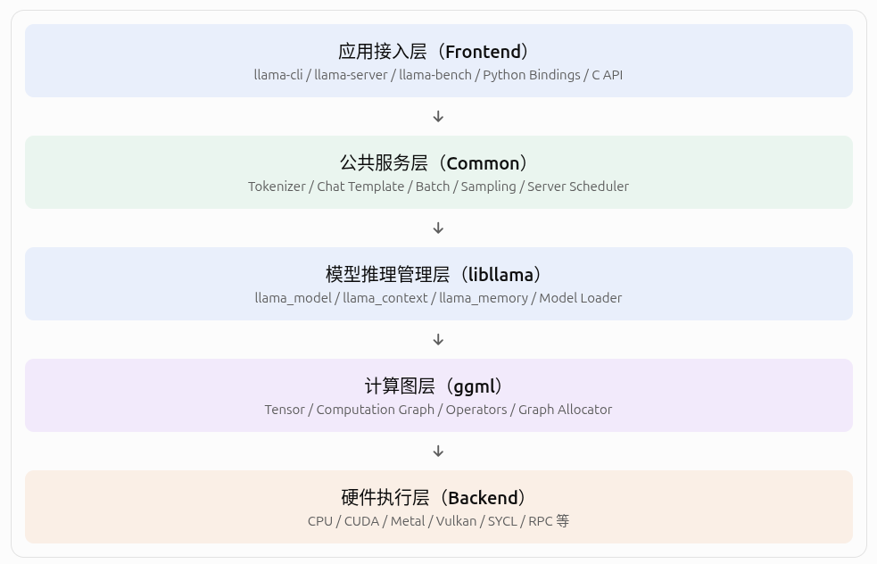

各层具体职责如下。

**第一层：应用接入层**，这一层主要解决模型如何被应用调用的问题。主要包括：

- `llama-cli`：命令行交互式推理。
- `llama-server`：HTTP 服务，支持 OpenAI 兼容 API。
- `llama-bench`：性能测试。
- Python Bindings：Python 应用调用。
- C API：提供模型加载、推理、上下文管理等基础接口。

**第二层：Common 公共服务层**，主要负责：

- Tokenizer：文本与 Token ID 转换。
- Chat Template：构造模型输入 Prompt。
- Batch：管理批量输入。
- Sampling：Temperature、Top-K、Top-P 等采样。
- Server Scheduler：管理并发请求和连续批处理。

例如，三个用户同时请求模型：

```
Request A: [Prompt A]
Request B: [Prompt B]
Request C: [Prompt C]
```

Server Scheduler 可以把三个请求的 Token 组织成一个逻辑 Batch，再根据计算限制拆分为多个 Micro Batch。这样能够提高 GPU 利用率。

**第三层：libllama 核心推理层**，这是理解 llama.cpp 最重要的一层。核心对象包括：

| 核心对象         | 职责                                  |
| ---------------- | ------------------------------------- |
| `llama_model`    | 管理模型结构、权重、词表和超参数      |
| `llama_context`  | 管理推理上下文、Backend、计算图和输出 |
| `llama_memory_i` | 统一管理模型运行时状态                |
| `llama_kv_cache` | 管理传统 Attention KV Cache           |
| `llama_batch`    | 管理 Token、Position、Sequence ID     |
| `llama_sampler`  | 管理 Token 采样                       |

这里需要特别注意：当前 llama.cpp 已经抽象出 `llama_memory_i` 内存管理接口。不同模型可以根据自身架构创建不同的 Memory 实现。

例如：

- 普通 Transformer：`llama_kv_cache`
- Sliding Window Attention：`llama_kv_cache_iswa` 等
- Hybrid Transformer：`llama_memory_hybrid`
- Mamba 等循环架构：`llama_memory_recurrent`
- 部分混合架构：Hybrid + KV Cache + Recurrent State

因此，传统 KV Cache 是 llama.cpp Memory 管理体系中的一种实现。不同模型不一定都使用标准的 K/V 双张量缓存。

**第四层：ggml 计算图层**，`ggml` 是 llama.cpp 的底层 Tensor 计算引擎。它负责：

- Tensor 数据结构。
- Tensor 运算。
- 计算图构建。
- 计算图内存规划。
- 算子调度。
- Backend 执行。

例如 Transformer 中的矩阵乘法：$Y=XW$，在 ggml 中会表示为相应的 Tensor 运算节点。模型构建计算图时，并不立即执行所有计算，而是先建立计算依赖关系。例如：`Input --> Embedding --> RMSNorm --> QKV Projection --> RoPE --> Attention ---> Residual ---> FNN ---> Output`。计算图构建完成后，Backend Scheduler 决定各个节点在哪个硬件上执行。

**第五层：Backend 硬件执行层**，Backend 负责将 ggml 算子映射到具体硬件。例如：

| Backend | 主要硬件                 |
| ------- | ------------------------ |
| CPU     | x86、ARM                 |
| CUDA    | NVIDIA GPU               |
| Metal   | Apple GPU                |
| Vulkan  | 支持 Vulkan 的 GPU       |
| SYCL    | Intel 等支持 SYCL 的设备 |

Backend 还负责：

- Buffer 分配。
- Tensor 数据传输。
- Kernel 执行。
- 异步计算。
- 多设备协同。

例如，模型的前 20 层运行在 GPU，剩余层运行在 CPU。计算图执行时，需要根据 Tensor 所属设备处理必要的数据传输。

### 1.2 模型加载过程

**llama.cpp 使用 GGUF 作为主要模型文件格式**。GGUF 包含两类重要信息：

1. **Metadata**：模型架构、层数、Embedding 维度、Attention Head 数量、RoPE 参数等。
2. **Tensor Data**：模型权重及其数据类型。

模型加载大致经过以下过程：`model.gguf---> GGUF Parser ---> 读取 Metadata ---> 识别 Model Architecture ---> 读取 Hyperparameters ---> 创建 llama_model ---> 建立 Tensor Mapping ---> 分配 CPU/GPU Buffer ---> 加载/映射模型权重 ---> 创建 llama_context`。

这里有两个关键技术。

**第一，Architecture Dispatch**。llama.cpp 根据 GGUF 中的架构信息，选择对应的模型实现。例如：

```
switch (arch) {
    case LLM_ARCH_LLAMA:
        return new llama_model_llama(params);

    case LLM_ARCH_QWEN2:
        return new llama_model_qwen2(params);

    case LLM_ARCH_MAMBA:
        return new llama_model_mamba(params);

    // 其他模型架构
}
```

每种模型可以有自己的：

- Hyperparameters Loader。
- Tensor Loader。
- Graph Builder。
- Memory Factory。

**第二，mmap 与 GPU Buffer**。llama.cpp 支持通过 Memory Mapping 加载模型。mmap 将模型文件映射到进程虚拟地址空间，降低不必要的数据复制，并支持按需读取。当启用 GPU Offload 时，部分或全部模型 Tensor 会被放置到 GPU 对应的 Buffer 中。模型权重的量化格式与 KV Cache 的量化格式相互独立。

## 二、KV Cache 的基本原理

理解 KV Cache，需要先理解 Transformer 的 Attention。

### 2.1 为什么需要 KV Cache？

假设输入 Prompt：

```
I love machine learning
```

Tokenizer 转换为：

```
Token 1: I
Token 2: love
Token 3: machine
Token 4: learning
```

Transformer 每一层都会对这些 Token 计算：

\[ Q=XW_Q \]

\[ K=XW_K \]

\[ V=XW_V \]

其中：

- Q：Query，查询向量。
- K：Key，键向量。
- V：Value，值向量。

Attention 的计算公式：

\[ Attention(Q,K,V)= Softmax\left(\frac{QK^T}{\sqrt{d_k}}\right)V \]

在自回归生成过程中，假设模型已经输入了 1000 个 Token，现在需要生成第 1001 个 Token。如果没有 KV Cache，那么模型需要重新计算历史 1000 个 Token 的 K 和 V。

如果有 KV Cache：

- 历史 1000 个 Token 的 K、V 已经保存。
- 只需要计算新 Token 的 Q、K、V。
- 将新 Token 的 K、V 写入缓存。
- 新 Token 的 Q 与历史 K 进行 Attention。
- 根据 Attention 权重读取历史 V。

### 2.2 Prefill 和 Decode 阶段

KV Cache 的生命周期与两个推理阶段密切相关。

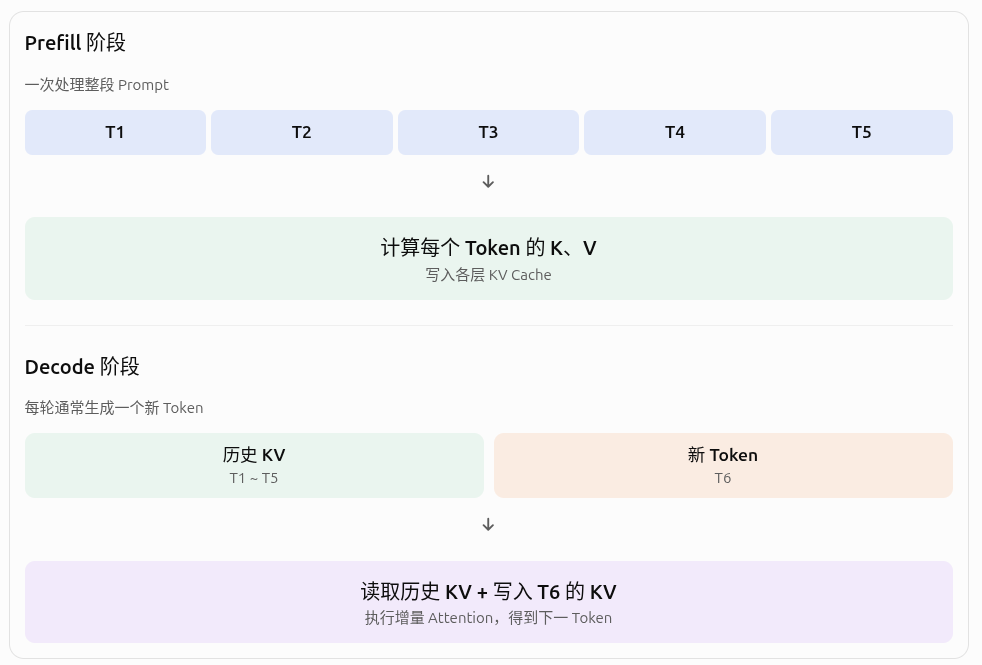

- Prefill 阶段通常具有较好的矩阵乘法并行度，适合 GPU 批量计算。
- Decode 阶段每轮只处理少量新 Token，需要读取越来越长的历史 KV Cache，通常更加依赖内存带宽和 Attention Kernel 效率。

> 这也是为什么上下文长度增长时，Decode 性能通常会受到明显影响。

### 2.3 KV Cache 保存什么？

对于传统 Transformer，每一层分别保存独立的 KV Cache。要注意：

- KV Cache 保存每层 Attention 的 K/V。
- Q 通常不保存。
- FFN 中间激活通常不保存。
- 历史 Token 的隐藏状态通常不作为标准 KV Cache 保存。

对于 RoPE 模型，写入缓存的 K 通常已经完成对应位置的旋转编码。

## 三、llama.cpp KV Cache 内部数据结构

当前主线实现主要涉及以下文件：

| 文件                     | 主要职责                   |
| ------------------------ | -------------------------- |
| `src/llama-kv-cache.h`   | KV Cache 类定义            |
| `src/llama-kv-cache.cpp` | KV Cache 分配、更新和管理  |
| `src/llama-kv-cells.h`   | KV Cell 元数据管理         |
| `src/llama-memory.h`     | Memory 抽象接口            |
| `src/llama-context.cpp`  | 推理上下文和 Decode 流程   |
| `src/llama-model.cpp`    | 模型架构和 Memory 类型选择 |
| `src/llama-graph.cpp`    | Transformer 计算图构建     |

| 文件                     | 主要职责                   |
| ------------------------ | -------------------------- |
| `src/llama-kv-cache.h`   | KV Cache 类定义            |
| `src/llama-kv-cache.cpp` | KV Cache 分配、更新和管理  |
| `src/llama-kv-cells.h`   | KV Cell 元数据管理         |
| `src/llama-memory.h`     | Memory 抽象接口            |
| `src/llama-context.cpp`  | 推理上下文和 Decode 流程   |
| `src/llama-model.cpp`    | 模型架构和 Memory 类型选择 |
| `src/llama-graph.cpp`    | Transformer 计算图构建     |

### 3.1 llama_kv_cache 核心结构

当前实现中，`llama_kv_cache` 继承自 `llama_memory_i`。

其核心成员可以简化理解为：

```c
class llama_kv_cache : public llama_memory_i {
public:
    struct kv_layer {
        uint32_t il;
        ggml_tensor * k;
        ggml_tensor * v;
        std::vector<ggml_tensor *> k_stream;
        std::vector<ggml_tensor *> v_stream;
    };

private:
    std::vector<kv_layer> layers;
    std::vector<uint32_t> v_heads;
    std::shared_ptr<llama_kv_cells_vec> v_cells_impl;
    llama_kv_cells_vec & v_cells;
    std::vector<uint32_t> seq_to_stream;
};
```

其中几个成员非常重要：

| 成员            | 含义                            |
| --------------- | ------------------------------- |
| `layers`        | 每一层的 K/V Tensor             |
| `v_heads`       | 每个 Stream 的缓存搜索起点      |
| `v_cells`       | KV Cache Cell 元数据            |
| `seq_to_stream` | Sequence ID 到 Stream ID 的映射 |
| `k_stream`      | 各 Stream 对应的 K Tensor View  |
| `v_stream`      | 各 Stream 对应的 V Tensor View  |

这些结构决定了 KV Cache 如何存储、定位和复用。

### 3.2 K/V Tensor 的物理存储布局

这是理解 llama.cpp KV Cache 的关键。在标准 Attention Cache 实现中，K Tensor 的主要维度为：

\[ K=[D_k \times T \times S] \]

V Tensor：

\[ V=[D_v \times T \times S] \]

其中：

- \(D_k\)：当前层所有 KV Head 的 K 维度。
- \(D_v\)：当前层所有 KV Head 的 V 维度。
- \(T\)：KV Cache Cell 数量。
- \(S\)：Stream 数量。

例如，一个模型：

```
n_layer       = 32
n_head_kv     = 8
head_dim      = 128
kv_size       = 8192
n_stream      = 1
```

那么单层 K Tensor 的逻辑维度为：`[1024, 8192, 1]`，因为\[ D_k=8\times128=1024 \]。V Tensor 在标准结构中也具有相应维度。

这里需要注意 ggml 的 Tensor 维度约定：`ne[0]` 是最内层维度，实际内存步长由 `nb[]` 描述。

此外，V Cache 的物理布局会随 Attention Kernel 变化：

- Flash Attention 开启时，V Cache 使用非转置布局。
- Flash Attention 关闭时，当前标准 KV Cache 实现会使用转置布局。

这属于 Kernel 数据布局优化，用于改善计算时的内存访问效率。

### 3.3 KV Cell：物理位置与逻辑位置分离

这是 llama.cpp 非常重要的设计。它没有简单地使用：`cache[position] = KV`

而是把物理 Cell 索引与逻辑 Token Position 分开管理。

一个 Cell 的元数据主要包含：

```c
struct llama_kv_cells {

    std::vector<llama_pos> pos;
    std::vector<llama_pos> shift;
    std::vector<seq_set_t> seq;
    std::vector<llama_kv_cell_ext> ext;
    std::set<uint32_t> used;
};
```

各字段含义：

| 字段       | 含义                                   |
| ---------- | -------------------------------------- |
| `pos[i]`   | 第 i 个 Cell 对应的逻辑 Token Position |
| `shift[i]` | 位置偏移记录                           |
| `seq[i]`   | 当前 Cell 所属的 Sequence ID 集合      |
| `ext[i]`   | 额外元数据，例如多模态空间位置         |
| `used`     | 当前已经使用的物理 Cell 索引集合       |

其中：$pos[i]=-1$，表示该 Cell 为空。

例如：KV Cache Cell 示例

| 物理索引 | 逻辑 Position | Sequence ID | 状态 |
| -------- | ------------- | ----------- | ---- |
| 0        | 0             | 0           | 占用 |
| 1        | 1             | 0           | 占用 |
| 2        | -1            | -           | 空闲 |
| 3        | 3             | 0, 1        | 共享 |
| 4        | 4             | 1           | 占用 |
| 5        | -1            | -           | 空闲 |

可以看到：

- 物理索引 3 对应逻辑 Position 3。
- Sequence 0 和 Sequence 1 可以共享这个 Cell。
- 物理索引 2 和 5 可以被重新分配。
- 逻辑 Position 与物理索引没有必须相等的要求。

这种设计使得 KV Cache 能够支持：

1. 多请求共享 Prefix。
2. 动态分配 Cell。
3. 不同 Sequence 之间的 KV 复用。
4. SWA 场景下的过期 Cell 回收。
5. Context Shift。

`llama_kv_cells` 还维护了按 Sequence 排序的 `seq_pos` 集合，可以快速获得某个 Sequence 当前缓存的最小和最大 Position。

## 四、KV Cache 的 Stream 与 Unified KV 机制

这是 llama.cpp 多请求并发管理的核心设计之一。

### 4.1 非 Unified KV Cache

假设有 4 个并发请求：

```
Sequence 0 -> Stream 0
Sequence 1 -> Stream 1
Sequence 2 -> Stream 2
Sequence 3 -> Stream 3
```

每个 Stream 有独立的 K/V 存储空间。

```
KV Cache
|
+-- Stream 0
|     +-- K[Layer 0]
|     +-- V[Layer 0]
|     +-- ...
|
+-- Stream 1
|     +-- K[Layer 0]
|     +-- V[Layer 0]
|     +-- ...
|
+-- Stream 2
|     +-- K[Layer 0]
|     +-- V[Layer 0]
|     +-- ...
|
+-- Stream 3
      +-- K[Layer 0]
      +-- V[Layer 0]
      +-- ...
```

每个 Sequence 独立管理自己的缓存。

优点：

- 不同请求相互隔离。
- 每个请求具有独立的缓存空间。
- 不需要在不同 Sequence 之间管理共享 Cell。

缺点：

- 容量分配比较固定。
- 请求长度不同时，容易产生空间利用率问题。
- 不同请求的 Prefix 复用效率较低。

### 4.2 Unified KV Cache

Unified 模式下：

```
Sequence 0 ─┐
Sequence 1 ─┼──> Stream 0
Sequence 2 ─┤       |
Sequence 3 ─┘       v
                  Shared KV Buffer
```

所有 Sequence 使用一个共享的 KV Buffer。

内部关键参数：

```
n_stream = unified ? 1 : n_seq_max;
```

也就是说：

- Unified：只有一个 Stream。
- 非 Unified：每个 Sequence 对应一个 Stream。

这可以从 `llama-kv-cache.cpp` 的构造函数中直接看到。

### 4.3 两种模式的容量区别

假设：

```
n_ctx      = 16384
n_seq_max  = 4
```

Unified 模式：

```
总 KV 容量 = 16384 Tokens

Sequence 0 ─┐
Sequence 1 ─┼── 共享 16384 个 Cell
Sequence 2 ─┤
Sequence 3 ─┘
```

每个请求可以根据实际使用情况占用空间。

非 Unified 模式：

```
Stream 0 = 4096 Tokens
Stream 1 = 4096 Tokens
Stream 2 = 4096 Tokens
Stream 3 = 4096 Tokens
```

每个请求分配固定容量。

需要注意：Unified 模式下的 `n_ctx` 是整个共享池的容量。4 个请求各自都需要 16384 Token 时，必须准备约 65536 Token 的总容量。

### 4.4 Unified KV Cache 的核心优势：Prefix 共享

假设有三个请求：

```
Request A: System Prompt + User Prompt A

Request B: System Prompt + User Prompt B

Request C: System Prompt + User Prompt C
```

其中 System Prompt 完全相同。

传统独立缓存：

```
Request A: System Prompt KV + User A KV
Request B: System Prompt KV + User B KV
Request C: System Prompt KV + User C KV
```

System Prompt 被计算和存储三次。

Unified Cache 配合 Sequence 共享：

```
Shared Prefix KV
       |
       +---- Sequence A -> User A KV
       |
       +---- Sequence B -> User B KV
       |
       +---- Sequence C -> User C KV
```

可以显著降低：

- Prefill 计算量。
- KV Cache 存储重复。
- GPU 显存占用。

这也是 Unified KV Cache 在多用户服务场景中的重要价值。

## 五、KV Cache 的分配和管理机制

下面深入分析 llama.cpp 如何找到一个可以写入新 Token 的 Cell。

### 5.1 find_slot：缓存槽位分配

核心函数：

```
llama_kv_cache::find_slot(
    const llama_ubatch & ubatch,
    bool cont
) const
```

它负责给当前 Micro Batch 中的 Token 寻找 KV Cache 存储位置。

分配流程：

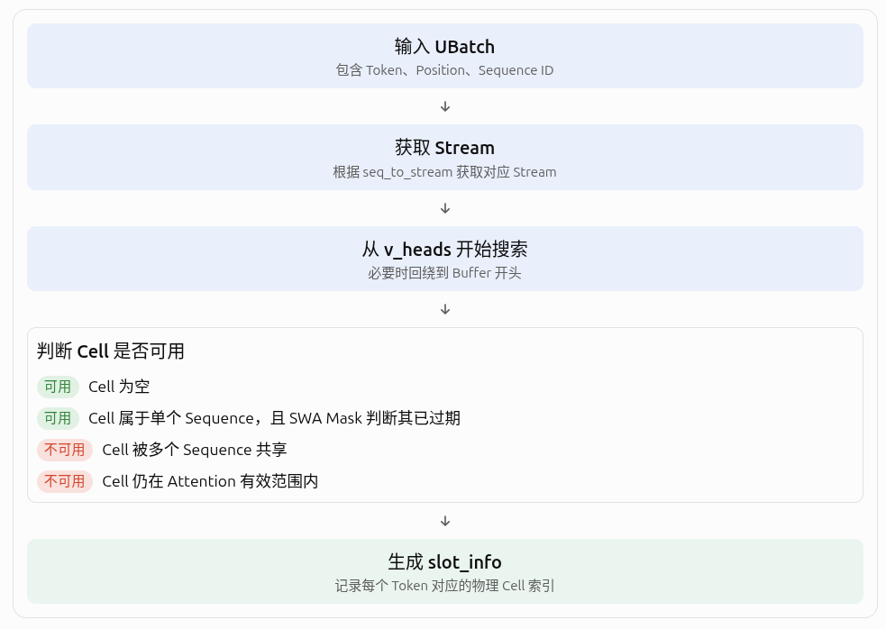

这里有几个值得关注的实现细节。

**第一：v_heads 是搜索指针**。

- 它记录下次从哪个物理 Cell 开始搜索。搜索时可以循环回到 Buffer 起点，因此具有 Ring Buffer 的搜索特征。
- 但它并不意味着标准 Full Attention Cache 可以像传统 LRU Cache 一样随意淘汰最老 Token。

**第二：标准 Full Attention 不会自动淘汰历史 KV**。

- 当前实现中，普通因果 Attention 的旧 Cell 覆盖逻辑被禁用。
- 只有满足 SWA 过期条件的 Cell 才能通过这条分配路径复用。
- 对于 Full Attention，如果缓存已满，需要通过显式删除、上下文滑动或其他缓存管理操作释放空间。

**第三：slot_info 保存物理位置映射**。

例如：

```
UBatch:

Token 0 -> Position 100
Token 1 -> Position 101
Token 2 -> Position 102
```

分配结果：

```
Token 0 -> Cell 50
Token 1 -> Cell 51
Token 2 -> Cell 60
```

后续计算图通过这些索引写入 KV Cache。因此，物理存储可以不连续。

### 5.2 apply_ubatch：提交 Cell 元数据

找到 Cell 后，`apply_ubatch()` 会更新对应元数据。

核心逻辑可以抽象成：

```c
for each token in ubatch:

    idx = assigned_cell[token];

    if (!cells.is_empty(idx)) {
        cells.rm(idx);
    }

    cells.pos_set(idx, token_position);

    for each seq_id:
        cells.seq_add(idx, seq_id);
```

实际代码还会处理：

- 多模态空间位置。
- Token 元数据。
- SWA 覆盖。
- Sequence Position 连续性。
- Ring 搜索指针更新。

这里有一个重要细节：当 SWA 允许覆盖较旧的 Cell 时，代码会记录被覆盖的最大 Position，然后清理该 Sequence 更早的缓存位置，以维持缓存位置区间的连续性。因此，Cell 的回收会影响整个 Sequence 的逻辑缓存范围。

### 5.3 prepare：批量预分配

`prepare()` 会对一个或多个 UBatch 进行槽位预分配。

其实现大致是：

```c
for (const auto & ubatch : ubatches) {

    auto sinfo = find_slot(ubatch, false);

    if (sinfo.empty()) {
        success = false;
        break;
    }

    // 保存原有 Cell 元数据
    save_old_cells();

    // 模拟提交
    apply_ubatch(sinfo, ubatch);
}

// 恢复原始元数据
restore_old_cells();

return success ? slot_infos : {};
```

为什么要这样做？

- 因为 llama.cpp 需要提前确认整个逻辑 Batch 的所有 UBatch 是否都能找到缓存空间。
- 如果只处理第一个 UBatch，后面的 UBatch 找不到空间，就可能出现部分状态已经更新、整个 Batch 却无法执行的问题。

`prepare()` 通过预分配和状态回滚机制，提前检查资源可用性。真正执行时，Memory Context 再应用对应的缓存更新。

## 六、KV Cache 的写入与读取过程

找到 Cell 后，计算图需要完成两个操作：

1. 将新计算出的 K/V 写入缓存。
2. 从缓存中读取历史 K/V，参与 Attention。

### 6.1 K Cache 写入

核心函数：

```c
ggml_tensor * llama_kv_cache::cpy_k(
    ggml_context * ctx,
    ggml_tensor * k_cur,
    ggml_tensor * k_idxs,
    int32_t il,
    const slot_info & sinfo
);
```

内部核心操作：

```
return ggml_set_rows(
    ctx,
    k,
    k_cur,
    k_idxs
);
```

这里的 `ggml_set_rows()` 可以理解为按照指定索引，把当前计算的 K 写入对应的 KV Cache 行。

例如：

```
Current K:
K0 K1 K2

Index:
50 51 60

Write:
cache[50] = K0
cache[51] = K1
cache[60] = K2
```

V Cache 使用类似机制。

因此，KV Cache 的更新主要通过计算图中的 Tensor Scatter/Set Rows 操作完成。

### 6.2 K/V Cache 读取

核心函数：

```
get_k()
get_v()
```

它们会根据当前 Layer、Stream 和缓存大小构造 Tensor View。

Attention 计算可以理解为：

```
Q_current
    |
    +----------+
               |
               v
         Attention
               ^
               |
       +-------+-------+
       |               |
    K_cache         V_cache
       |               |
       +---------------+
```

其中：

\[ Scores=\frac{QK^T}{\sqrt{d_k}} \]

再结合 Attention Mask：

\[ P=Softmax(Scores+Mask) \]

最后：

\[ Output=PV \]

Mask 会控制：

- 当前 Token 是否可以读取未来 Token。
- 当前 Sequence 是否可以读取其他 Sequence 的缓存。
- 是否满足 Sliding Window Attention 的限制。

## 七、KV Cache 的生命周期管理

这一部分直接关系到多轮对话、并发推理、上下文滑动和 Prefix Reuse。当前 llama.cpp 对外暴露了统一的 Memory 管理 API。

主要接口如下：

| API                          | 功能                     |
| ---------------------------- | ------------------------ |
| `llama_memory_clear()`       | 清空整个 Memory          |
| `llama_memory_seq_rm()`      | 删除指定 Sequence 的缓存 |
| `llama_memory_seq_cp()`      | 复制 Sequence 缓存       |
| `llama_memory_seq_keep()`    | 只保留指定 Sequence      |
| `llama_memory_seq_add()`     | 修改 Position            |
| `llama_memory_seq_div()`     | 对 Position 进行整数缩放 |
| `llama_memory_seq_pos_min()` | 查询最小 Position        |
| `llama_memory_seq_pos_max()` | 查询最大 Position        |
| `llama_memory_can_shift()`   | 判断是否支持位置滑动     |

这些接口都可以通过 `llama_get_memory(ctx)` 获取 Memory 对象后调用。

### 7.1 删除缓存：seq_rm

例如，Sequence 0 已经完成推理，需要清空：

```c
llama_memory_t mem = llama_get_memory(ctx);

llama_memory_seq_rm(
    mem,
    0,
    0,
    -1
);
```

参数含义：

```
seq_id = 0
p0     = 0
p1     = -1
```

表示删除 Sequence 0 所有 Position 的缓存。

注意一个重要细节：如果一个 Cell 同时被 Sequence 0 和 Sequence 1 共享，删除 Sequence 0 时，只会移除该 Cell 上的 Sequence 0 标记。

只有当这个 Cell 不再属于任何 Sequence 时，才会变成空闲 Cell。这保证了 Prefix 共享场景中的缓存安全。

### 7.2 复制缓存：seq_cp

假设：

```
Sequence 0: System Prompt + User Prompt
```

现在需要基于相同上下文生成两个不同答案：

```
Sequence 1:
System Prompt + User Prompt + Answer A

Sequence 2:
System Prompt + User Prompt + Answer B
```

可以复制：

```c
llama_memory_seq_cp(
    mem,
    0,
    1,
    0,
    -1
);

llama_memory_seq_cp(
    mem,
    0,
    2,
    0,
    -1
);
```

这就是 Sequence Branching。

具体实现取决于 Unified 配置：

- 两个 Sequence 在同一个 Stream：可以只更新 Cell 元数据，不需要复制 K/V Tensor 数据。
- 两个 Sequence 在不同 Stream：需要复制对应的 K/V Buffer 数据。

这也是 Unified KV Cache 在多分支生成场景中具有优势的原因。

### 7.3 保留指定 Sequence：seq_keep

例如：

```
llama_memory_seq_keep(mem, 1);
```

表示只保留 Sequence 1。其他 Sequence 的 Cell 元数据将被清理。如果某个 Cell 仅属于被删除的 Sequence，该 Cell 就会被释放。

### 7.4 修改 Position：seq_add

这个 API 非常重要。

```
llama_memory_seq_add(
    mem,
    0,
    100,
    -1,
    -50
);
```

含义：对 Sequence 0 中 Position 大于等于 100 的缓存位置减去 50。

例如：

```c
Before:

Position: 0 1 2 ... 100 101 102 103

After:

Position: 0 1 2 ... 50  51  52  53
```

这里要特别关注 RoPE。在 RoPE 模型中：

\[ K_{rot}=R(pos)K \]

其中 \(R(pos)\) 表示位置对应的旋转矩阵。

如果修改 Position：

\[ pos'=pos+\Delta \]

那么原来的 K 也需要对应调整：

\[ K'_{rot}=R(\Delta)K_{rot} \]

因此，只修改 Cell 的 Position 元数据是不够的。当前 llama.cpp 会记录 Cell 的 Shift，并在 Memory Update 阶段通过 `build_graph_shift()` 构建计算图，对缓存中的 K 执行 K-Shift。完成之后重置 Shift 元数据。V 通常不需要执行这种 RoPE 位置修正。

## 八、Context Shift：长上下文管理机制

Context Shift 是理解长文本连续生成的重要机制。假设模型最大上下文为 8192 Token。

当前已经使用：

```
Position 0 ~ 8191
```

现在继续生成新 Token，就会超过上下文容量。如果希望继续生成，可以删除部分历史 Token，保留重要的上下文。

例如：

```
原始缓存：

[System Prompt]
[Old Conversation]
[Recent Conversation]
```

可以执行：

```
保留：
System Prompt

删除：
部分 Old Conversation

保留并前移：
Recent Conversation
```

假设：

```
Keep:    Position 0 ~ 255
Remove:  Position 256 ~ 4351
Shift:   Position 4352 ~ 8191
```

那么执行：

```
llama_memory_seq_rm(
    mem,
    0,
    256,
    4352
);

llama_memory_seq_add(
    mem,
    0,
    4352,
    -1,
    -4096
);
```

新的 Position：

```
原始 Position:

0 ~ 255
256 ~ 4351
4352 ~ 8191

处理后：

0 ~ 255
      256 ~ 4095
```

缓存中的历史 KV 得到保留，逻辑位置也完成压缩。

需要注意：

1. 应用程序还需要同步更新自己的 Token 历史和 Position 计数。
2. 需要通过 `llama_memory_can_shift()` 检查当前 Memory 是否支持 Shift。
3. 对 RoPE 模型，需要正确执行 K-Shift。
4. 某些多维位置编码或特殊模型架构不支持这种通用 Shift。

在 llama-server 中，可以通过：

```
--context-shift
```

启用无限文本生成场景下的上下文滑动。该选项默认关闭。

## 九、Sliding Window Attention 与 KV Cache 回收

SWA 是另一种重要的 KV Cache 管理策略。

假设模型使用窗口大小：

\[ W=4096 \]

当前生成位置：

\[ pos=10000 \]

理论上，只需要读取最近 4096 个 Token 的 KV：

```
可访问范围：

5904 ~ 10000
```

更早的 Token 对当前层的 Attention 已经没有贡献，可以被回收。

在 llama.cpp 中，KV Cache 的 Cell 分配逻辑会调用：

```
llama_hparams::is_masked_swa(...)
```

判断旧 Cell 是否已经超出 Sliding Window 的有效范围。

如果满足：

- Cell 只属于一个 Sequence。
- 已经被 SWA Mask 排除。
- 不会破坏当前缓存的 Position 连续性。

就可以复用该 Cell。

这使得部分 SWA 层可以维持相对固定的缓存空间。需要注意，模型可能同时存在：

```
Layer 0: Full Attention
Layer 1: Sliding Window Attention
Layer 2: Full Attention
Layer 3: Sliding Window Attention
```

此时不同层的 KV Cache 管理策略也可能不同。因此，不能简单地认为所有 Transformer Layer 都会使用相同的 KV Cache 窗口。

另外，当前 llama.cpp 还有针对 SWA、Hybrid、DeepSeek 等架构的专门 Memory 实现。

## 十、KV Cache 量化管理

KV Cache 的显存开销通常与模型权重分开计算。

例如，一个模型权重量化为 Q4，但 KV Cache 默认仍然可能使用 FP16。

因此：

```
模型权重：Q4
K Cache：FP16
V Cache：FP16
```

这在长上下文情况下仍然可能产生很大的显存压力。

### 10.1 KV Cache 显存计算公式

对于标准 Transformer：

\[ M_{KV}=2\times L\times T\times H_{kv}\times D\times B \]

其中：

| 参数 | 含义                 |
| ---- | -------------------- |
| L    | Transformer Layer 数 |
| T    | KV Cache Token 容量  |
| Hkv  | KV Head 数           |
| D    | 每个 Head 的维度     |
| B    | 每个元素的字节数     |
| 2    | K 和 V 两份缓存      |

对于 K/V 维度不相等或不同层配置不同的模型，应使用分层公式：

\[ M_{KV}\approx T\sum_l (D_{k,l}B_k+D_{v,l}B_v) \]

### 10.2 实际计算案例

以 Llama 3.1 8B 为例：

```
n_layer       = 32
n_head_kv     = 8
head_dim      = 128
context       = 8192
KV Type       = FP16
```

每个 Token、每一层的 K Cache：

\[ 8\times128\times2=2048\ Bytes \]

V Cache 同样是 2048 Bytes。

总容量：

\[ 32\times8192\times(2048+2048) \]

结果：约 1 GiB

如果上下文变成 32768：

\[ 1GiB\times4=4GiB \]

这只是单个总容量为 32768 Token 的标准 Llama 8B FP16 KV Cache 的理论估算。

### 10.3 不同 Cache 类型

当前 llama.cpp 支持的主要类型包括：

| 类型   | 单个元素的存储特征  | 典型用途       |
| ------ | ------------------- | -------------- |
| F32    | 32-bit Float        | 高精度         |
| F16    | 16-bit Float        | 默认常用       |
| BF16   | 16-bit Float        | 部分硬件适配   |
| Q8_0   | 8-bit + Block Scale | 显存与精度平衡 |
| Q5_0   | 5-bit 量化          | 更低内存       |
| Q4_0   | 4-bit + Block Scale | 大幅节省内存   |
| IQ4_NL | 低比特非线性量化    | 极限压缩场景   |

这里的量化格式通常按 Block 存储，包含额外 Scale 信息，因此实际占用不会严格等于每个元素的理论位数。

例如：

- Q8_0 每 32 个元素约占 34 Bytes。
- Q4_0 每 32 个元素约占 18 Bytes。
- FP16 每 32 个元素占 64 Bytes。

Q8_0：$34/64\approx53.1\%$

Q4_0：$18/64\approx28.1\%$

以 16K 上下文、Llama 3.1 8B 为例：

| KV 类型         | 估算占用 |
| --------------- | -------- |
| FP16 K + FP16 V | 2 GiB    |
| Q8_0 K + Q8_0 V | 1.06 GiB |
| Q4_0 K + Q4_0 V | 0.56 GiB |

实际运行会受到对齐、Padding 和具体模型结构影响。

### 10.4 如何配置 KV Cache 量化？

llama-server 支持：

```
--cache-type-k q8_0
--cache-type-v q8_0
```

分别控制 K 和 V 的缓存数据类型。

例如：

```
./llama-server \
    -m model.gguf \
    -c 16384 \
    -ctk q8_0 \
    -ctv q8_0 \
    -fa on
```

有一个重要限制：

当前 llama.cpp 中，量化 V Cache 要求启用 Flash Attention。

如果没有启用，初始化时会报错。

另外，K Cache 和 V Cache 可以分别选择量化类型，便于根据精度和显存需求做权衡。

我的建议是：

- 首先使用 FP16 作为性能和精度基准。
- 显存不足时，优先测试 Q8_0。
- Q4_0 适合显存极其紧张的环境，但需要重点验证长上下文任务的输出质量。

## 十一、Flash Attention 与 KV Cache 的关系

Flash Attention 经常和 KV Cache 一起出现，但它们解决的问题不同。

KV Cache 负责：

- 保存历史 K/V。
- 复用历史计算结果。
- 管理历史 Token 的缓存生命周期。

Flash Attention 负责：

- 优化 Attention 的计算过程。
- 减少中间 Attention 矩阵的显存占用。
- 改善 K/V 读取与计算效率。
- 降低部分中间 Tensor 的内存访问开销。

普通 Attention：

```
Q × K^T
    |
    v
Attention Scores
    |
    v
Softmax
    |
    v
Attention Probabilities × V
    |
    v
Output
```

Flash Attention 则通过融合计算和分块处理，避免完整物化较大的 Attention Score 矩阵。可以将它理解为：

```
KV Cache = 历史数据管理

Flash Attention = Attention 计算优化
```

两者配合，尤其有利于长上下文推理。	

## 十二、Prompt Cache 与 Prefix Reuse

这一部分对生产环境尤其重要。

假设有一个 Agent 系统，每次请求都包含：

```
System Prompt: 5000 Tokens
Tool Definitions: 3000 Tokens
User Prompt: 500 Tokens
```

如果每次请求都重新 Prefill，将造成大量重复计算。

如果启用 Prompt Cache：

```
第一次请求：

Prefill System Prompt
Prefill Tool Definitions
Prefill User Prompt

保存 KV Cache

第二次请求：
识别相同 Prefix
    |
    v
复用历史 KV Cache
    |
    v
只计算新增 User Prompt
```

这样可以显著减少 Prefill 时间。

llama-server 提供以下参数：

| 参数                 | 作用                                               |
| -------------------- | -------------------------------------------------- |
| `--cache-prompt`     | 开启 Prompt Cache，当前默认启用                    |
| `--cache-reuse N`    | 设置通过 KV Shifting 尝试复用缓存的最小 Chunk 大小 |
| `--slot-save-path`   | 保存 Slot KV Cache 的路径                          |
| `--cache-ram`        | 控制缓存 RAM 使用上限                              |
| `--cache-idle-slots` | 管理空闲 Slot 的缓存                               |

特别是 `--cache-reuse`，它依赖 Prompt Cache。

这类缓存复用主要发生在 Server 进程管理的运行时缓存中。需要跨进程持久化时，可以进一步使用 Slot Save 或 llama.cpp 的 State Save/Load API。

## 十三、llama.cpp 一次完整推理的内部执行流程

假设用户发送：

```
Explain how KV Cache works.
```

完整流程如下：

1. 接收请求:llama-server 接收 HTTP 请求，处理 Chat Template。
2. Tokenizer：将文本转换为 Token ID。
3. Batch Scheduler：根据当前并发请求组织 Batch 和 UBatch。
4. Memory 初始化：调用 memory->init_batch()，分配 KV Cache Cell，生成 slot_info。
5. 计算图构建：调用 model.build_graph()，构建 Embedding、Attention、FFN 等计算节点。
6. KV Cache 更新：通过 K/V Scatter 写入当前 Token 的 K/V，并建立历史缓存的读取 View。
7. Backend Scheduler：将计算图节点分配给 CPU/GPU Backend。
8. 执行计算图：执行 Attention、FFN、LM Head，得到 Logits。
9. Sampling：根据采样策略选择下一个 Token。
10. 循环 Decode：新 Token 的 K/V 追加到缓存，重复执行推理，直到生成结束。

从源码调用角度，重点关注：

```
// 1. 初始化 Batch
balloc->init(...);

// 2. KV Cache 分配和管理
memory->init_batch(...);

// 3. 更新 Memory
memory_update(false);

// 4. 构建计算图
auto * gf = model.build_graph(gparams);

// 5. 执行计算图
ggml_backend_sched_graph_compute_async(
    sched.get(),
    gf
);

// 6. 获取 Logits
// 7. Sampling
```

实际实现还包含 UBatch 循环、图复用、异步数据传输、输出缓冲区管理等细节。


理解 llama.cpp 的架构，重点在以下五个方面。

1. 计算图驱动。llama.cpp 通过 ggml 构建计算图，再由 Backend Scheduler 将计算图映射到具体硬件。这使得同一套模型推理逻辑能够适配 CPU、CUDA、Metal 等不同设备。

2. Memory 抽象。`llama_memory_i` 将模型的运行时状态管理抽象出来。标准 Transformer 使用 KV Cache，Mamba 等架构可以使用 Recurrent State，混合模型则可以组合不同 Memory 类型。

3. KV Cache 使用预分配 Tensor + Cell 元数据管理。K/V Tensor 保存实际数值，Cell 保存物理索引、逻辑 Position、Sequence 归属等信息。两者分离使得缓存可以进行动态分配、共享和回收。

4. Unified KV Cache 实现多 Sequence 共享。通过 Stream、Cell、Sequence ID 三层结构，多个请求可以共享相同 Prefix 的 KV，减少重复 Prefill 和显存消耗。

5. KV Cache 管理与 Attention Kernel 深度协同。Flash Attention、K/V 量化、SWA、RoPE K-Shift 和 Prefix Reuse 都会影响缓存的存储布局、读取方式和生命周期。


# llamacpp 和 vllm 的 kv cache 机制区别

核心差异：llama.cpp 的标准 KV Cache 以 Token 级 Cell 索引和 Sequence 元数据组织；vLLM 以固定 Token 数的物理 Block、Block Table 和哈希前缀缓存组织。两者都能复用 Prefix，但寻址粒度和缓存生命周期不同。

- llama.cpp：**以 KV Cell、Stream、Sequence 为核心组织缓存**。 通过 Cell 元数据管理物理缓存位置及 Sequence 归属，Unified KV 模式允许多个 Sequence 共享 Cell。
- vLLM：**以 PagedAttention、KV Block、Block Table 为核心组织缓存**。 将 KV Cache 切分成固定大小的 Block，通过 Block Table 将逻辑 Token Block 映射到物理 GPU Block。

> llama.cpp 的 `--kv-unified` 表示多个 Sequence 映射到同一个 KV Stream/Buffer，配合 `seq_cp()` 可在同一 Stream 内通过 Cell 元数据共享已有 KV。它本身不等于 vLLM 的自动哈希 Prefix Cache。llama-server 还有 Prompt Cache / cache-reuse 逻辑，属于服务层的复用机制。

## 一、先理解两者的本质差异

llama.cpp 的 KV Cache 以 **token cell** 为基本管理单位，通过固定容量的 K/V Tensor、cell 元数据、序列映射和 Attention Mask 实现缓存管理。vLLM 则以**固定大小的 KV Block** 为管理单位，通过 Block Table、引用计数、Block Pool 和哈希索引实现动态分配及前缀复用。

两者都可以多请求推理、共享前缀、回收空间、支持 Sliding Window Attention，但资源分配的粒度和调度方式差异明显。

### 1. llama.cpp：Cell-based KV Cache

可以把它理解为一个预分配的 KV Tensor 数组：

```
K/V Tensor
┌────┬────┬────┬────┬────┬────┬────┐
│ C0 │ C1 │ C2 │ C3 │ C4 │ C5 │ C6 │
└────┴────┴────┴────┴────┴────┴────┘
  ↑    ↑    ↑    ↑
  └────┴────┴────┘
       Shared Prefix

Cell Metadata:
C0 -> Position 0, Seq {0,1}
C1 -> Position 1, Seq {0,1}
C2 -> Position 2, Seq {0,1}
C3 -> Position 3, Seq {0,1}
C4 -> Position 4, Seq {0}
```

核心机制：

- Cell 是 Token 级存储槽位。
- `find_slot()` 负责寻找空闲 Cell。
- `slot_info` 记录 Token 与 Cell 的映射。
- Sequence ID 集合决定哪些请求能够访问 Cell。
- `seq_cp()` 可以在 Unified Stream 中增加 Cell 的 Sequence 归属。
- `seq_rm()` 移除 Sequence 归属，没人使用的 Cell 可以重新分配。

### 2. vLLM：Paged KV Cache

可以把它理解为操作系统的分页内存管理思路在 KV Cache 上的应用。

```
Physical Block Pool

┌────────┐ ┌────────┐ ┌────────┐ ┌────────┐
│Block 0 │ │Block 1 │ │Block 2 │ │Block 3 │
│ S1-S4  │ │ A1-A4  │ │ B1-B4  │ │  Free  │
└────────┘ └────────┘ └────────┘ └────────┘
     ↑
     |
Block Table
     |
     +---- Request A: [0, 1]
     |
     +---- Request B: [0, 2]
```

核心机制：

- KV Cache 被切分为固定大小的 Block。
- 每个请求拥有自己的 Block Table。
- Block Table 将逻辑 Block 映射到物理 Block ID。
- Prefix Cache 通过 Hash 查找已计算的完整 Block。
- `ref_cnt` 管理 Block 的引用关系。
- Free Queue 和 LRU 管理空闲缓存及淘汰。

## 二、最重要的五个区别

| 维度        | llama.cpp           | vLLM                   |
| ----------- | ------------------- | ---------------------- |
| 分配单位    | Token Cell          | Token Block            |
| 寻址方式    | Cell Index          | Block Table            |
| Prefix 共享 | Sequence 元数据共享 | Hash Block 复用        |
| 生命周期    | Sequence 归属管理   | Ref Count + Free Queue |
| 缓存淘汰    | 空闲 Cell 复用      | LRU 等策略淘汰         |

还有三个特别重要的区别：

**第一，Prefix Sharing 的实现不同。**

llama.cpp 的 `--kv-unified` 让多个 Sequence 使用同一个 Stream。它本身不负责通过 Token Hash 自动寻找相同 Prefix。`seq_cp()` 是显式的 Sequence 缓存共享操作。llama-server 还有独立的 Prompt Cache 机制。

vLLM 则会主动计算 Block Hash，查找相同的历史 Prefix。

**第二，缓存复用粒度不同。**

假设两个请求前 5 个 Token 相同，之后发生分叉：

- llama.cpp 底层 Cell 机制可以按指定 Position 范围共享这 5 个 Cell。
- vLLM 如果 Block Size 为 4，通常只能直接复用前 4 个 Token 对应的完整 Block。剩余未对齐部分需要重新计算。

**第三，请求结束后的缓存处理不同。**

llama.cpp 的 Cell 没有 Sequence 引用后即可重新分配。

vLLM 的 Block 即使 `ref_cnt=0`，仍可能保留在 Prefix Cache 中，供后续请求复用。内存压力出现时，再执行 LRU 淘汰。

## 三、技术判断

从架构设计角度看：

- llama.cpp 更强调轻量化的内存管理、跨硬件推理和灵活的 Sequence 状态操作。
- vLLM 更强调 GPU 内存分页、动态资源分配、自动前缀复用和高并发服务。


# llama.cpp 五种 Memory 架构详解

这几个类实际上描述了 llama.cpp 为不同神经网络架构设计的运行时状态管理机制。

最重要的理解方式是：**先看模型每一层需要保存什么历史信息，再看 llama.cpp 如何为这些信息分配内存。**

| Memory 实现                | 保存的核心状态                        | 历史信息规模                             |
| -------------------------- | ------------------------------------- | ---------------------------------------- |
| `llama_kv_cache`           | 每层历史 Token 的 Key、Value          | 通常随上下文长度线性增长                 |
| `llama_kv_cache_iswa`      | Full Attention KV + Sliding Window KV | Full 部分持续增长，SWA 部分受窗口限制    |
| `llama_memory_recurrent`   | Mamba、RWKV 等模型的循环状态          | 单条序列的核心状态大小通常与历史长度无关 |
| `llama_memory_hybrid`      | Attention KV + Recurrent State        | 两种内存需求叠加                         |
| `llama_memory_hybrid_iswa` | Full KV + SWA KV + Recurrent State    | 三类历史状态组合管理                     |

这里需要纠正一个容易混淆的概念：这五种并非五个完全独立的缓存算法。 `llama_kv_cache_iswa` 内部组合了两个 `llama_kv_cache`；`llama_memory_hybrid` 组合了 KV Cache 和 Recurrent Memory；`llama_memory_hybrid_iswa` 则将 SWA 组合缓存与 Recurrent Memory 结合起来。具体类型由模型架构和超参数决定。

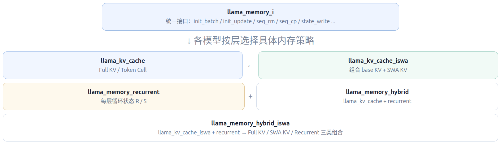


## 一、从同一个推理输入理解五种机制

假设模型需要依次处理以下 Token：

```
T1 → T2 → T3 → T4 → T5 → T6 → T7 → T8
```

1. 标准 Transformer： 生成 T8 时，当前层的 Query 会读取 T1～T8 的历史 K/V。每层保存历史 Token 的 K/V。
2. Sliding Window Attention： 假设窗口大小为 4，生成 T8 时，该 SWA 层只需要 T5～T8 的 K/V。旧 Token 可以从窗口缓存中淘汰；如果模型还包含 Full Attention 层，Full KV 仍需要保存更长的历史。
3. Recurrent / Mamba： 每处理一个 Token，都会更新一个状态。例如 `S8 = F(S7, T8)`。生成下一个 Token 时主要读取 S8，通常不需要为 T1～T8 分别保留 Attention K/V。
4. Hybrid： 假设奇数层采用 Attention，偶数层采用 Mamba。那么奇数层保存 KV Cache，偶数层保存循环状态。同一个 Token 会依次更新两类历史状态。
5. Hybrid + SWA： 模型中同时出现 Full Attention、SWA、Recurrent 层，运行时需要分别管理三种具有不同生命周期的状态。

其中，**Recurrent Memory 还有一个非常重要的限制：循环状态压缩了历史信息，通常无法像 Attention KV 那样随意删除中间几个 Token 后继续精确推理**。当前 llama.cpp 对部分模型提供有限的状态快照与回滚能力，但这与任意历史区间删除是不同的能力。

## 三、重点解释三个容易混淆的机制

### 1. `llama_kv_cache_iswa` 为什么要有两套 KV Cache？

假设模型有六层：

```
Layer 0: Sliding Window Attention
Layer 1: Sliding Window Attention
Layer 2: Full Attention
Layer 3: Sliding Window Attention
Layer 4: Full Attention
Layer 5: Sliding Window Attention
```

如果所有层使用同样长度的 KV Cache，会浪费 SWA 层的缓存空间。

因此，`llama_kv_cache_iswa` 将六层分成两个缓存组：

```
llama_kv_cache_iswa
│
├── kv_base
│   ├── Layer 2：Full KV
│   └── Layer 4：Full KV
│
└── kv_swa
    ├── Layer 0：Window KV
    ├── Layer 1：Window KV
    ├── Layer 3：Window KV
    └── Layer 5：Window KV
```

假设上下文长度 8192，SWA Window 为 1024：

- `kv_base` 需要支持较长的历史上下文。
- `kv_swa` 主要保留近期窗口所需的 K/V。

两套缓存各自进行 Cell 分配和元数据管理。在同一个 UBatch 中，两个子缓存都需要完成 `prepare()`，并在执行阶段更新对应层的 K/V。

实际 SWA 缓存容量还需要考虑 Batch、并发、Padding 等因素，所以通常不能简单地把物理分配量设为恰好 1024 个 Cell。

### 2. `llama_memory_recurrent` 为什么不需要长期保存 KV？

考虑简化的状态递推：

\[ S_t=F(S_{t-1},X_t) \]

假设模型处理八个 Token：

```
T1 → State1
T2 → State2
T3 → State3
T4 → State4
T5 → State5
T6 → State6
T7 → State7
T8 → State8
```

运行到 T8 后，后续生成通常只需要当前的 `State8`。

因此，内存中可以主要保存：

```
Sequence 0
  |
  +-- Layer 0: State8
  +-- Layer 1: State8
  +-- Layer 2: State8
  +-- Layer 3: State8
```

源码中主要使用 `r_l`、`s_l` 等张量保存循环状态，不同模型对应的状态含义有所差异。对于 Mamba 类模型，可以涉及卷积历史状态和状态空间模型的内部状态。

这类状态更新通常具有一个非常重要的性质：状态覆盖更新以后，过去每个 Token 对应的完整中间状态不会自动保留。

所以假设用户要求删除 T4，再保留 T5～T8 的历史结果继续生成，Recurrent Memory 一般无法直接完成精确修改。需要重新计算受影响的后缀，或者依赖足够的中间状态快照。

当前 llama.cpp 实现了 `n_rs_seq` 相关的有限回滚机制，但它不支持任意长度、任意位置的精确历史重写。

### 3. `llama_memory_hybrid` 与 `llama_memory_hybrid_iswa` 的区别

假设一个混合模型有六层：

```
Layer 0: Full Attention
Layer 1: Mamba
Layer 2: Mamba
Layer 3: Full Attention
Layer 4: Mamba
Layer 5: Full Attention
```

可以使用 `llama_memory_hybrid`，分别维护：

```
mem_attn → KV Cache
mem_recr → Recurrent State
```

当模型进一步包含 SWA 层：

```
Layer 0: SWA
Layer 1: Mamba
Layer 2: Full Attention
Layer 3: Mamba
Layer 4: SWA
Layer 5: Full Attention
```

就需要更复杂的组合：

```
llama_memory_hybrid_iswa
│
├── mem_attn
│   └── llama_kv_cache_iswa
│       ├── kv_base
│       └── kv_swa
│
└── mem_recr
    └── llama_memory_recurrent
```

源码中 `llama_memory_hybrid_iswa` 正是利用 `llama_kv_cache_iswa` 和 `llama_memory_recurrent` 两类对象实现这种组合。

## 四、从显存管理角度如何理解？

对于一个包含三类层的模型，可以粗略表示为：

\[ M_{\mathrm{total}}\approx M_{\mathrm{fullKV}}+ M_{\mathrm{SWA}}+ M_{\mathrm{recurrent}} \]

假设：

- Full Attention：2 层，每层每 Token 的 K/V 合计 4 KiB。
- SWA：2 层，每层每 Token 的 K/V 合计 4 KiB。
- Recurrent：2 层，每层状态假设占 16 KiB。
- 当前上下文长度：8192 Token。
- SWA Window：1024 Token。

那么理论有效状态规模为：

| 类型      | 计算             | 大小         |
| --------- | ---------------- | ------------ |
| Full KV   | 2 × 8192 × 4 KiB | 64 MiB       |
| SWA KV    | 2 × 1024 × 4 KiB | 8 MiB        |
| Recurrent | 2 × 16 KiB       | 32 KiB       |
| 合计      |                  | 约 72.03 MiB |

这是一个教学估算。实际分配会受到并发、Buffer 对齐、UBatch 大小、回滚快照和模型内部状态维度影响。

这里最重要的架构结论是：

随着上下文增长，Full Attention KV 通常是持续增长的主要部分；SWA 层可以通过滑动窗口限制历史缓存需求；Recurrent 层通过固定维度状态压缩历史信息，降低长期状态存储成本。

因此，Hybrid 模型的性能分析需要分别计算 Attention KV 和 Recurrent State 的开销。不能将所有层统一套入传统 Transformer 的 KV Cache 显存公式。

# llamacpp kv cache 架构

主要涉及模块如下

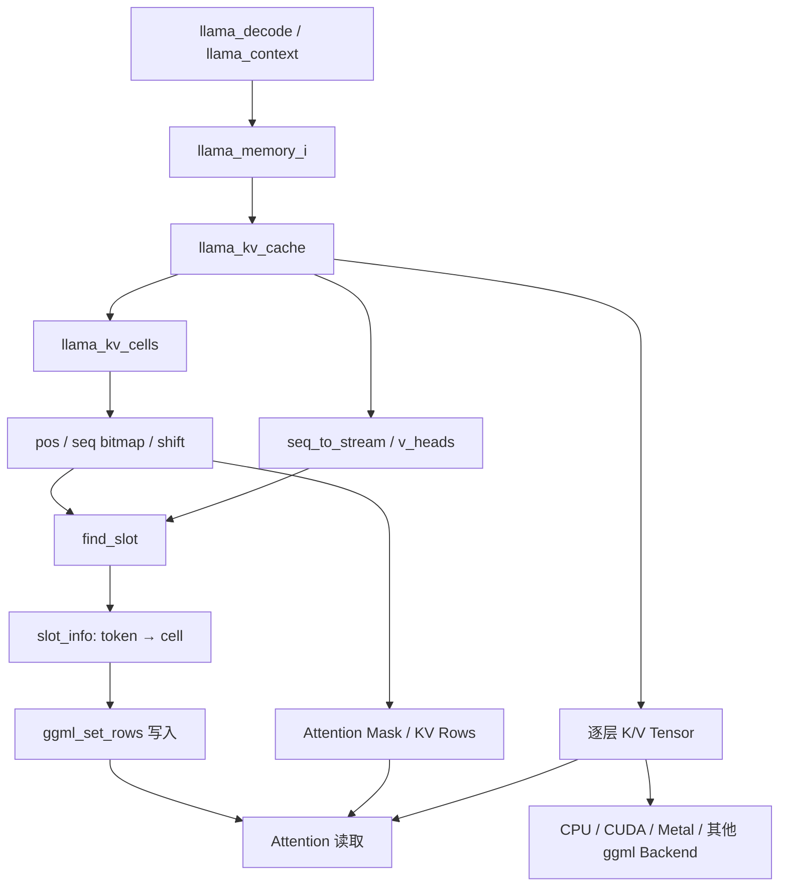

其中，`llama_memory_i` 是抽象接口，普通 Transformer 使用 `llama_kv_cache`，混合 Attention/Mamba 等架构可以使用其他 Memory 实现。

| 文件                                                         | 作用                           |
| ------------------------------------------------------------ | ------------------------------ |
| [llama-memory.h](https://github.com/ggml-org/llama.cpp/blob/master/src/llama-memory.h?utm_source=chatgpt.com) | Memory 抽象接口及执行上下文    |
| [llama-kv-cache.h](https://github.com/ggml-org/llama.cpp/blob/master/src/llama-kv-cache.h?utm_source=chatgpt.com) | KV Cache 对象和 slot_info      |
| [llama-kv-cache.cpp](https://github.com/ggml-org/llama.cpp/blob/master/src/llama-kv-cache.cpp?utm_source=chatgpt.com) | 物理分配、索引、Mask、操作实现 |
| [llama-kv-cells.h](https://github.com/ggml-org/llama.cpp/blob/master/src/llama-kv-cells.h?utm_source=chatgpt.com) | Cell 元数据和序列关系          |
| [llama-context.cpp](https://github.com/ggml-org/llama.cpp/blob/master/src/llama-context.cpp?utm_source=chatgpt.com) | Decode、Batch 与上下文配置     |
| [llama-model.cpp](https://github.com/ggml-org/llama.cpp/blob/master/src/llama-model.cpp?utm_source=chatgpt.com) | 根据模型架构创建 Memory        |

最关键的对象：**llama_kv_cells**，每个 Cell 可以理解为“一个物理 token 位置对应的 KV 存储槽位”。

```
// 结构示意，省略辅助字段和方法
class llama_kv_cells {
    std::vector<llama_pos> pos;
    std::vector<llama_kv_cell_ext> ext;
    std::vector<llama_pos> shift;

    // 每个 cell 属于哪些序列
    std::vector<seq_set_t> seq;

    // 已使用 cell 集合、按序列的位置索引等
};
```

例如：

```
请求 A：[System] [User] [Hello] [A]
请求 B：[System] [User] [Hello] [B]

物理 cell       0        1       2       3       4
             ┌────────┬──────┬───────┬───────┬───────┐
KV 内容       │ System │ User │ Hello │   A   │   B   │
             ├────────┼──────┼───────┼───────┼───────┤
Position     │   0    │  1   │   2   │   3   │   3   │
             ├────────┼──────┼───────┼───────┼───────┤
Sequence     │ {A,B}  │{A,B} │ {A,B} │  {A}  │  {B}  │
             └────────┴──────┴───────┴───────┴───────┘
```

第一，Position 和 Cell Index 是两种不同的坐标。Cell Index 用于定位物理内存，Position 用于确定 RoPE 位置、因果关系和滑动窗口可见性。上例中两个分支都拥有 Position 3，却使用不同的物理 Cell。

第二，`seq_id` 可以关联多个 Cell，而一个 Cell 可以同时关联多个 `seq_id`。删除请求 A 时，公共前缀仍然属于请求 B，不能释放。

**物理 K/V Tensor 怎样组织？**

- 源码中的典型分配逻辑：

```
ggml_tensor * k = ggml_new_tensor_3d(ctx, type_k, n_embd_k_gqa, kv_size, n_stream);

ggml_tensor * v = ggml_new_tensor_3d(ctx, type_v, n_embd_v_gqa, kv_size, n_stream);
```

因此可以把每层 K 的底层存储理解为：$K_l \in \mathbb{R}^{D_K \times C \times S}$，其中 \(C=\text{kv\_size}\)，\(S=\text{n\_stream}\)，\(D_K=H_{kv}D_h\)。

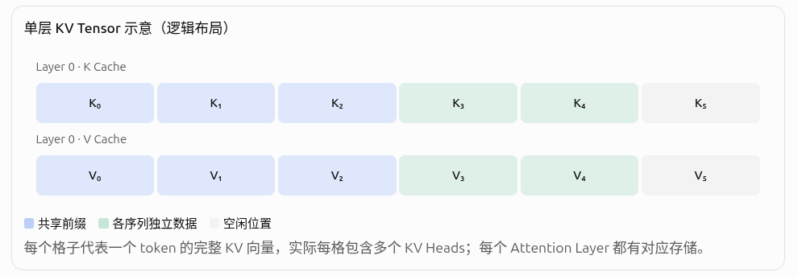

K/V Tensor 的布局还受到 Flash Attention 影响：

- Flash Attention 路径中，V 使用非转置的存储访问布局。
- 非 Flash Attention 路径中，V 会按转置方式进行索引和读取，`cpy_v()` 也需要为每个分量构造相应写入位置。
- K/V 可以设置不同的数据类型，甚至量化为较低 bit 的存储格式。

**Unified 和 Non-unified：差别在哪里？**

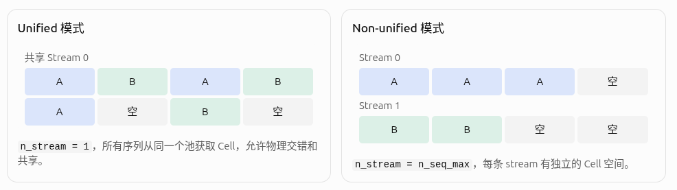

**一次 llama_decode() 内部，KV Cache 如何运作？**

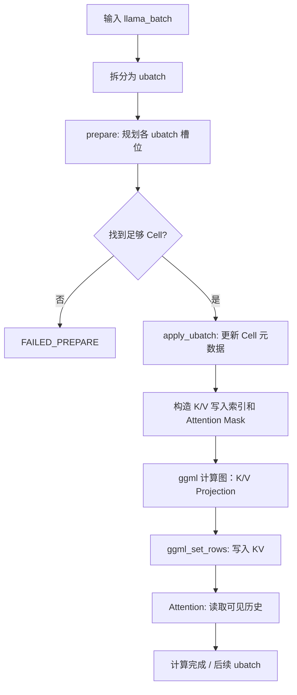

- 阶段一：找到可用 Cell

假设物理池有 10 个 Cell：

```
Cell Index:  0  1  2  3  4  5  6  7  8  9
             ─────────────────────────────
当前内容:     A  A  ·  B  ·  B  A  ·  ·  ·
                  空闲    空闲      空闲

新 batch:    [C0, C1, C2]

可能分配:    C0→2, C1→4, C2→7

分配后:      A  A  C  B  C  B  A  C  ·  ·
```

**llama.cpp 如何回收、共享和移动 KV Cache？**

- 请求结束：`seq_rm()` 释放引用，假设 Cell 0、1、2 被 A、B 两条序列共享：

```
删除前：
Cell 0,1,2  → {A, B}
Cell 3      → {A}
Cell 4      → {B}

执行 seq_rm(A, 0, -1) 后：
Cell 0,1,2  → {B}       继续保留
Cell 3      → {}        可重新分配
Cell 4      → {B}       继续保留
```

- 分叉请求：`seq_cp()` 的成本。假设当前有一条长度 1000 的序列 A，需要派生出 B、C 两条不同生成分支。Unified 模式下，三条序列可以共享前 1000 个 Cell。`seq_cp()` 在同一 stream 内主要更新 Cell 的序列关系，前缀的 K/V 不必重复写入。

```
            ┌── A：token 1000,1001,…
共同前缀 ────┼── B：token 1000,1001,…
(1000 KV)   └── C：token 1000,1001,…
```

## 展开解释llama.cpp KV Cache ：从物理存储、Cell 到 Sequence

理解 llama.cpp KV Cache，最重要的是把 Token、Position、Cell、Sequence 这四个概念区分清楚。

```
Token：     我    喜欢    苹果
Position：  0      1       2
Sequence：  A      A       A
```

模型计算每个 Token 时，会在每个 Transformer Attention Layer 产生对应的 Key、Value，并把它们保存到 KV Cache。

假设系统给这三个 Token 分配的物理位置为 `Cell 5、Cell 2、Cell 7`：

```
逻辑顺序：
Sequence A

Position     0          1          2
           ┌──────┐  ┌──────┐  ┌──────┐
Token      │ 我    │→ │ 喜欢 │→ │ 苹果 │
           └──────┘  └──────┘  └──────┘
              │         │         │
              ▼         ▼         ▼
物理 Cell     5         2         7
```

这里出现了三个不同的编号：

- Position = 2：苹果在序列 A 中处于第 2 个位置（从 0 开始）。
- Cell Index = 7：苹果对应的 KV 存放在物理缓存的第 7 号槽位。
- Sequence ID = A：这份 KV 属于逻辑序列 A，A 后续计算 Attention 时可以使用它。

这三个编号相互独立。Position 决定 Token 在上下文中的位置，Cell Index 决定 KV 的物理存储地址，Sequence ID 决定 KV 被哪些逻辑序列使用。

**可以把 llama.cpp 的 KV Cache 理解成一个有两层的存储系统**：

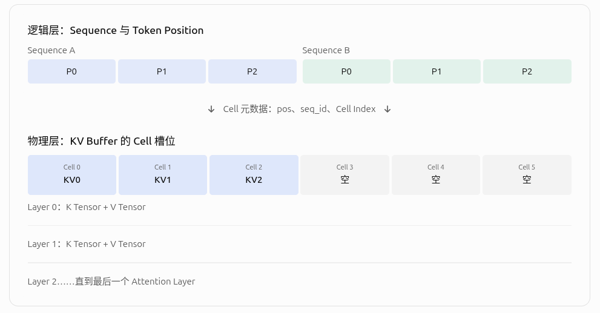

**逻辑序列和物理 KV 存储可以多对一**。 多个 Sequence 可以使用同一个 Cell 中的 KV；同一条 Sequence 的历史 KV 也可以分散在不同物理 Cell 中。

### 1 一个 Cell 对应一个 Token 的 KV 存储槽位

假设模型只有 3 层，每个 Token 在每层产生一个 K 向量和一个 V 向量。Token `苹果` 被分配到 Cell 7，那么它的 KV 实际分布是：

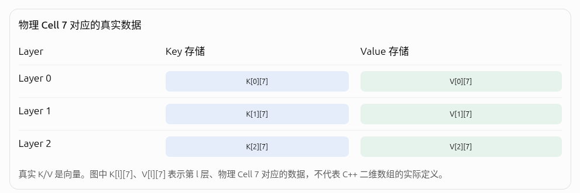

Cell 是跨 Attention Layer 统一使用的逻辑槽位编号。对于普通 Transformer KV Cache，Cell 7 对应每个相关层的第 7 个 K/V 存储位置。

**假设 Unified KV Cache 有 8 个物理 Cell，分别模拟 A 的 Prefill、复制前缀给 B、分叉、删除 B、复用空闲 Cell。**

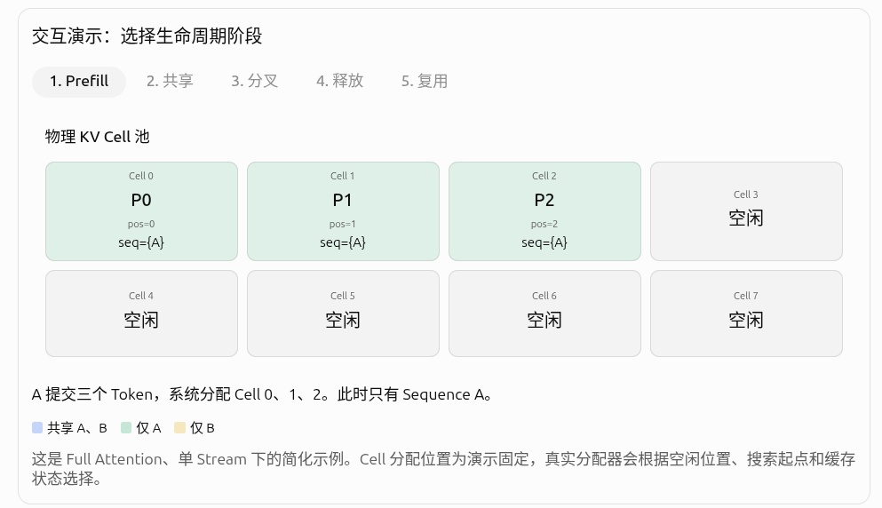

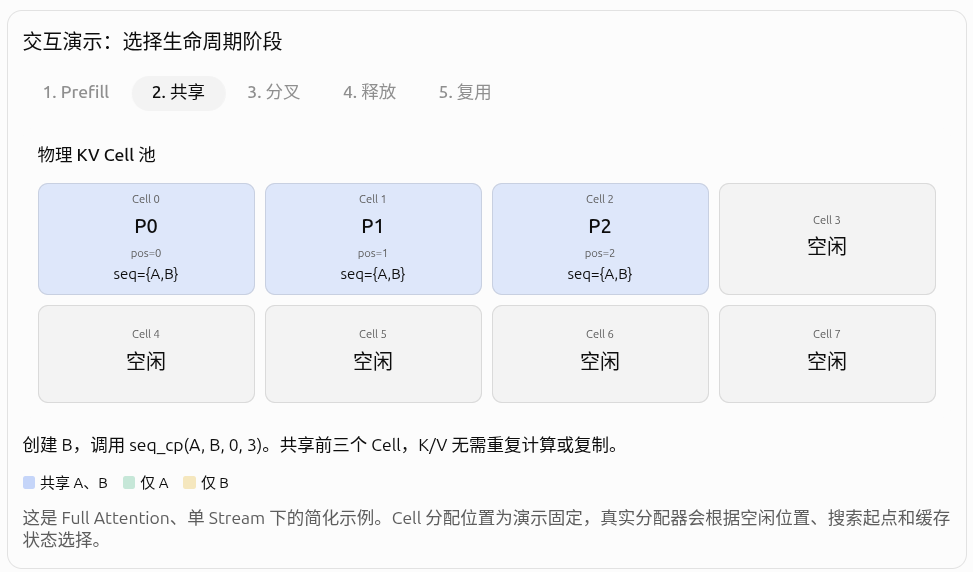

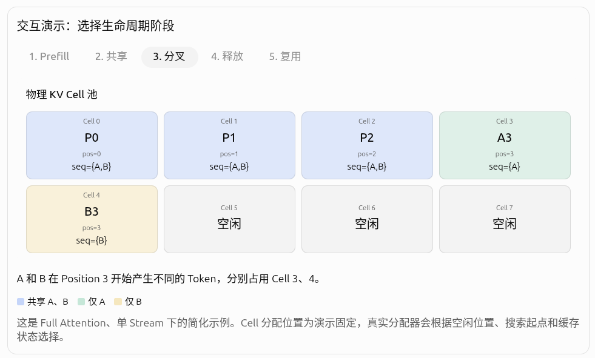

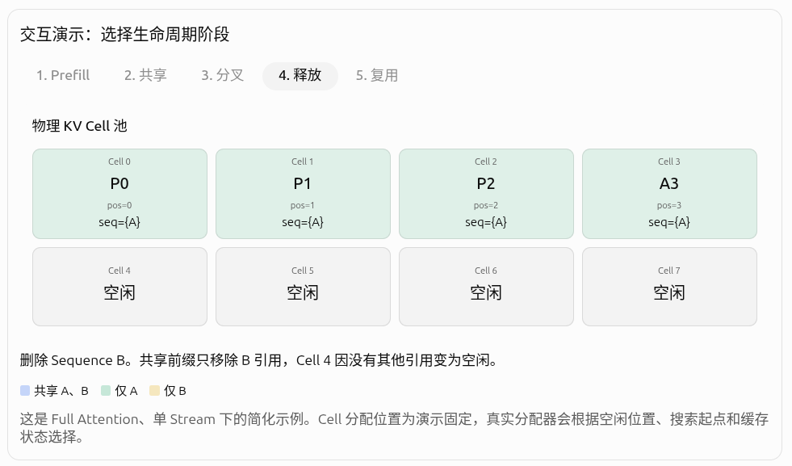

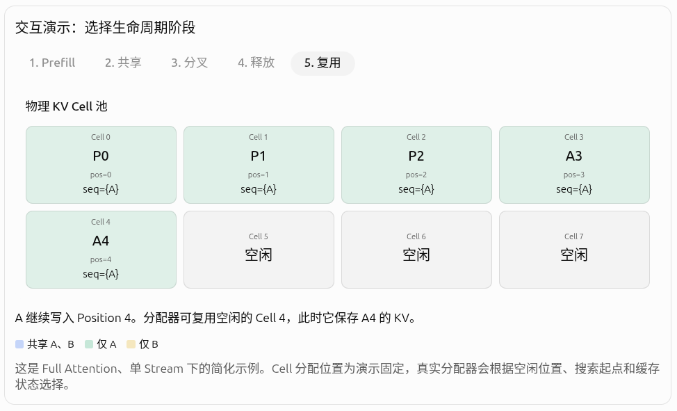

总结：


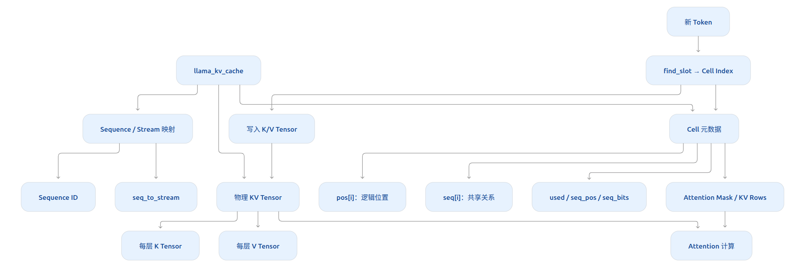


如果启用 Unified KV Cache，不同 Sequence 可以使用同一个 Cell 数组，Cell 内通过 `seq` bitset 记录所属关系。如果不启用 Unified KV Cache，不同 Sequence 使用独立的 Stream。

这个区别对后面的 Prefix Sharing 非常重要：同一个 Stream 内可以通过 Cell 元数据直接共享 K/V；跨 Stream 则涉及实际 Tensor 数据复制。


## llama.cpp 的 RAM Prompt Cache

llama.cpp 的 RAM Prompt Cache，本质上是一个基于 CPU 内存的 KV Cache 快照系统。

**工作原理：把某条 Sequence 已经计算好的 KV 数据从 GPU KV Buffer 中读取出来，序列化成一块 CPU 内存中的字节数组。后续请求如果具有相同的 Token 前缀，就把对应状态恢复到 GPU KV Buffer，省去重复 Prefill。**

可以理解成 KV Cache 的二级缓存：

- 一级缓存： GPU KV Buffer，直接参与 Attention 计算，速度快，容量有限。
- 二级缓存： CPU RAM Prompt Cache，保存历史 Sequence 的计算状态，容量可以更大，但恢复需要数据传输。


## 和 vllm 的差异

llama.cpp 侧重管理每个 KV 存储位置属于谁、能被谁读取；vLLM 侧重管理每个请求持有哪些 KV 内存块，以及这些内存块能否被其他请求复用。

**llama.cpp 主要通过“Cell 元数据 + Tensor 写入索引 + Attention Mask”管理共享 KV；vLLM 主要通过“Block Table + 引用计数 + Hash Cache + Scheduler”管理 KV。**

- 物理内存如何分配： llama.cpp 按 Cell 分配，vLLM 按 Block 分配。
- Attention 如何找到自己的 KV： llama.cpp 利用 Cell 的 Sequence 元数据生成可见性规则；vLLM 利用每个请求的 Block Table 找到对应物理 KV。
- 不同请求如何复用历史 KV： llama.cpp 可以让多个 Sequence 共同引用 Cell；vLLM 可以通过 Hash 找到并复用已经计算好的 KV Block。

用一个例子来解释：假设两个请求同时运行，它们的前 4 个 Token 完全相同，后面开始分叉：

```
请求 A：P0 P1 P2 P3 A4 A5
请求 B：P0 P1 P2 P3 B4 B5
         └──共享──┘ └独立┘
```

两个请求逻辑上各有 6 个 Token，总计 12 个 Token，但只有 8 份不同的 KV 数据。我们希望两套引擎都只保存 8 份。

### 1. llama.cpp：在 Cell 上记录谁有权使用

假设启用了 Unified KV Cache，物理存储可能长这样：

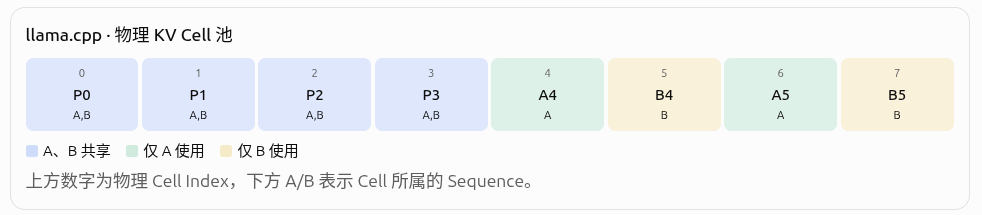

请注意 Cell 4 和 Cell 5：它们具有相同的逻辑 Position 4，但属于不同的 Sequence，因此保存着不同的 KV。

**现在 A 需要读取自己的全部历史 KV，应该怎么做？**

- llama.cpp 根据当前 Query 的 Sequence ID 和 Position，判断每个 Cell 是否可见。
- 假设 A 当前计算 Position 5，完整因果注意力的可见性为：

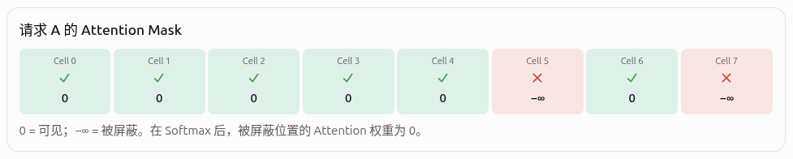

于是 A 可以看到：

```
物理位置：0, 1, 2, 3, 4, 6
逻辑顺序：P0 P1 P2 P3 A4 A5
```

请求 B 可以看到：

```
物理位置：0, 1, 2, 3, 5, 7
逻辑顺序：P0 P1 P2 P3 B4 B5
```

这就是 Cell 元数据和 Attention Mask 的关系：**Cell 元数据描述物理 KV 的归属，Attention Mask 利用这些信息限制读取权限**。

### 2. vLLM：每个请求拥有自己的物理 Block 地址表

还是一样的请求，假设每个 Block 容纳 2 个 Token。物理内存里有这些 Block：

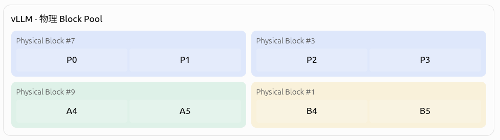

然后为两个请求各建立一张 Block Table：

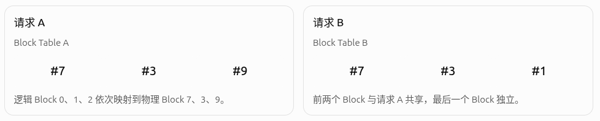

现在 A 要读取逻辑 Position 5 对应的 KV：

```
逻辑 Position = 5
Block Size    = 2

逻辑 Block Index = 5 // 2 = 2
Block 内偏移     = 5 % 2  = 1

A 的 Block Table[2] = 9

最终读取：Physical Block #9，Offset 1
对应：A5
```

整个地址转换就是：

\[ \text{Logical Token Position} \rightarrow \text{Logical Block} \rightarrow \text{Physical Block} \rightarrow \text{KV Address} \]

这个机制类似操作系统的虚拟内存页表。

请求认为自己的 KV 按逻辑顺序存储，实际可以分散在整个物理 Block Pool。每个请求保存一张映射表，Attention Kernel 根据这张表访问其 KV。

Block Table 解决的是在哪里找到 KV的问题。Attention Kernel 仍然需要正确处理 Causal Mask、Sliding Window 等注意力语义，并非完全没有 Mask。

vLLM 的 `KVCacheManager`、`BlockPool`和 Attention Backend 分别负责 Block 分配、管理和读取。

# llamacpp kv cache 的调度机制

> slot 是 llama-server 预先维护的请求执行上下文。一个正在运行的请求占用一个slot，但一个slot可以先后服务多个请求。

| 概念     | 含义                                 | 生命周期           |
| -------- | ------------------------------------ | ------------------ |
| Request  | 一次 HTTP 推理请求                   | 请求开始到结束     |
| Slot     | Server 管理的执行上下文              | Server 生命周期内  |
| Sequence | llama.cpp Memory 中的一条逻辑序列    | 随 Memory 状态管理 |
| Cell     | KV Cache 中一个 Token 的逻辑存储位置 | 随 KV 分配和回收   |


llama.cpp Server 有两套需要分别检查的缓存。

1. GPU/活动 KV Cache：保存当前推理 Context 中的 K/V Tensor。它由 `llama_kv_cache` 管理，Cell 记录 Sequence 和 Position 的归属。
2. CPU RAM Prompt Cache：保存从活动 Sequence 导出的状态快照，由 `server_prompt_cache` 管理，Entry 包含 Token 历史、Checkpoint 和序列化状态。

Server 首先尝试利用活动 Slot 的上下文；在需要选择或替换 Slot 时，再考虑 RAM Cache 中的历史状态。RAM 命中后，恢复到活动 Context，最终仍然由活动 KV Cache 执行 Attention。

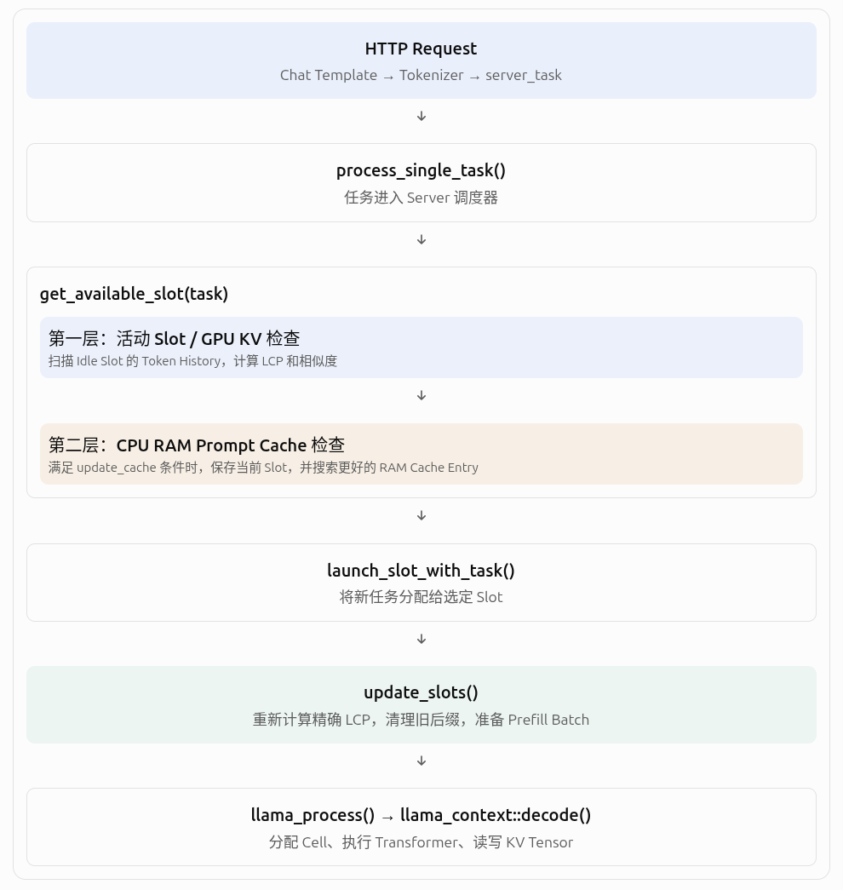

- GPU Cache 和 CPU RAM Cache 并不是每个请求都会依次无条件查询。当前 `get_available_slot()` 的策略是：

| 情况                                        | GPU Slot 检查 | CPU RAM 检查            |
| ------------------------------------------- | ------------- | ----------------------- |
| 找到相似 GPU Slot，旧上下文保留比例 ≥ 50%   | 选择 GPU Slot | 不检查                  |
| 找到相似 GPU Slot，旧上下文保留比例不足 50% | 选择 GPU Slot | 保存当前 Slot，然后检查 |
| 没有合适 GPU Slot，选择 LRU Slot            | 选择 LRU      | 保存当前 Slot，然后检查 |
| 所有 Slot 都在运行                          | 无法分配      | 请求进入 Deferred Queue |

因此，CPU RAM Cache 是在调度器认为需要替换大量旧上下文，或者需要使用 LRU Slot 时介入的。


**场景一、首次请求**：建立 GPU KV Cache

```
# 1. HTTP请求进入 Server
server_routes::post_chat_completions 
| -->  oaicompat_chat_params_parse() 
| -->  server_routes::handle_completions_impl(...)
| --> tokenize_input_prompts(...)
| --> rd.post_tasks(std::move(tasks), chat_session); # 将任务提交到 Server Task Queue
# 2. 调度器选择 slot
server_context_impl::process_single_task()
| --> get_available_slot(task) # 第一次只有一个空 slot --> slot 0: prompt.tokens=[]; GPU KV = empty
| --> get_free_slots(1, -1);   # GPU slot 相似度扫描，执行 LRU 选择空 slot/idle slot（LRU）
| --> prompt_save(); # 由于走了 LRU 路径，需要保存 cache 到 CPU RAM。由于第一次请求slot没有token，则不操作。
| --> launch_slot_with_task(*slot, std::move(task)); # 将请求 1 分配给 slot 0
# 3. 更新 slot：准备完整 prefill
server_context_impl::update_slots()
| --> slot.prompt.tokens.get_common_prefix(input_tokens); # 计算kv cache 前缀，第一次是空，则保留0
| --> slot.prompt.tokens.pos_next(); # 清理slot中不匹配的数据，因为没有旧 KV，所以没有实际数据需要清理。
| --> batch.add() # 将所有 Prompt Token 加入 Batch
| --> slot.prompt.tokens.push_back(cur_tok)
#4. 进入 libllama，建立 GPU KV
llama_process()
| --> llama_context::decode()
| --> balloc->init()
| --> memory->init_batch()
| --> llama_kv_cache::init_batch()
| --> prepare()
| --> find_slot() # 找到空闲 cell
| --> process_ubatch()
| --> mctx->apply()
| --> llama_kv_cache::apply_ubatch() # 更新 cell 元数据
| --> model.build_graph()
| --> graph_compute() # 写入各层 KV Tensor
```

**场景二：复用GPU中的prompt**

```
Request 1 的历史：

[S: 400][U1: 60][R1: 1040]
|-------------------------------|
           1500 tokens

Request 2：

[S: 400][U2: 60]
|-----------------|
     460 tokens
```

函数调用栈：

```# 
# 1. GPU 活动 slot 检查
get_available_slot(task)
--> slot.prompt.tokens # 扫描 idle slots 为上次的 slot
--> # 计算 LCP 和 相似度 = 0.87%，则选择 slot0，这意味着 Server 找到了一个 GPU 活动 KV Cache 候选。
# 2. 把请求1保存到 CPU RAM
--> prompt_save() # 由于 f_keep <  0.5 保留 token 到 CPU RAM

server_context::get_available_slot()
    |
    v
server_slot::prompt_save()
    |
    +-- llama_state_seq_get_size_ext()
    |
    +-- server_prompt_cache::alloc()
    |       |
    |       +-- 检查重复 Entry
    |       +-- 检查容量
    |       +-- 分配 vector<uint8_t>
    |       +-- states.push_back()
    |
    +-- llama_state_seq_get_data_ext() #  最终会调用 KV cache 的序列化状态逻辑，例如 llama_kv_cache::state_write_meta() 保存 Cell 元数据，state_write_data() 按 Layer 导出 K/V Tensor 数据。
            |
            v
        导出 Sequence State
            |
            v
        CPU RAM Buffer
# 3. 检查 CPU RAM Cache
prompt_load()
| --> server_prompt_cache::load()
| --> prompt.tokens.get_common_prefix(tokens_new);

# 4. CPU Prefix Reuse
launch_slot_with_task()
| --> update_slots()
| --> slot.prompt.tokens.get_common_prefix()
| --> slot.prompt.tokens.keep_first()
| --> slot.prompt.tokens.pos_next()
| --> slot.mem.seq_rm(slot.id, p0, -1);

完整调用栈：
POST /v1/chat/completions
    |
    v
post_chat_completions()
    |
    v
handle_completions_impl()
    |
    +-- tokenize_input_prompts()
    |
    +-- rd.post_tasks()
            |
            v
process_single_task()
    |
    v
get_available_slot()
    |
    +-- 扫描 GPU Idle Slots
    |
    +-- get_common_prefix()
    |
    +-- f_sim = 0.87
    |
    +-- f_keep = 0.267
    |
    +-- update_cache = true
    |
    +-- prompt_save()
    |      |
    |      +-- llama_state_seq_get_size_ext()
    |      +-- server_prompt_cache::alloc()
    |      +-- llama_state_seq_get_data_ext()
    |
    +-- prompt_load()
           |
           v
       server_prompt_cache::load()
           |
           +-- 遍历 CPU RAM Entry
           +-- 比较 f_keep / f_sim
           +-- 无更优候选
           +-- 保留当前 GPU Slot
    |
    v
launch_slot_with_task()
    |
    v
update_slots()
    |
    +-- get_common_prefix() = 400
    +-- keep_first(400)
    +-- seq_rm(400, -1)
    +-- batch.add(U2)
    |
    v
decode()
    |
    v
llama_process()
    |
    v
llama_context::decode()
    |
    v
GPU KV Cache:
    保留 S
    写入 U2 的新 K/V
```

- 对于

```
System Prompt S: 400 tokens
User Prompt U1:   60 tokens
Generated R1:  1040 tokens
-------------------------
总计：           1500 tokens

GPU slot 0
[S:400][U1:60][R1:1040]

GPU slot 1
[S:400][U2:60]
```

- 公共前缀是 `[S:400]`，所以 LCP=400，计算 
  - `f_sim=0.87=400/460` 表示新请求的 87% 可以从 GPU 当前 Slot 复用。
  - `f_keep=400/1500=0.267` 表示旧 Slot 的 26.7% 可以保留。
- 调度器判断 `f_keep < 0.5f` 时
  - 如果旧 slot 能保留的历史不足 50% --> 说明替换 slot 会丢失大量上下文 --> 先保存旧 slot 的完整状态到 CPU RAM --> 再使用旧的 slot 服务新请求
  - 如果 > 0.5，那么直接在原来的 slot 上替换后面的内容，通过 LCP 保留公共前缀、清理旧后缀，然后处理新请求
- 这是 `get_available_slot` 中的路径，还有 `--cache-idle-slots` 路径主动保存 idle slot

- 对于请求 2 启动后的 Idle slot 处理
  - 当前例子有两个 Slot，其中 slot 0 供请求2运行，Slot空闲


**请求3：GPU slot忙碌，从CPU RAM恢复 System Prompt**

- 假设请求2仍然在生成，请求3和请求2并发

```
# 1. GPU活动 cache 检查
get_available_slot(task)
# 2. 检查 CPU RAM Cache
prompt_save()
| --> prompt_load()
| --> server_prompt_cache::load()
# 3. 将 CPU State 恢复到 slot1
llama_state_seq_set_data_ext()
# 4. 移动 prompt 元数据，并删除 RAM Entry
# 5. 重新计算 LCP，复用 System Prompt

POST /v1/chat/completions
    |
    v
post_chat_completions()
    |
    v
handle_completions_impl()
    |
    v
tokenize_input_prompts()
    |
    v
rd.post_tasks()
    |
    v
process_single_task()
    |
    v
get_available_slot()
    |
    +-- GPU Slot 检查
    |      |
    |      +-- Slot 0: Busy -> Skip
    |      +-- Slot 1: Empty -> Skip
    |
    +-- LRU -> Slot 1
    |
    +-- prompt_save()
    |      |
    |      +-- 空 Slot，不保存
    |
    +-- prompt_load()
           |
           v
       server_prompt_cache::load()
           |
           +-- 遍历 Entry A1
           +-- get_common_prefix()
           +-- f_keep = 0.267
           +-- f_sim  = 0.870
           +-- 选中 A1
           |
           v
       llama_state_seq_set_data_ext()
           |
           +-- llama_context::state_seq_set_data()
           |
           +-- llama_kv_cache::state_read_sinfo()
           |       |
           |       +-- state_read_meta()
           |       |       |
           |       |       +-- seq_rm()
           |       |       +-- find_slot()
           |       |       +-- apply_ubatch()
           |       |
           |       +-- state_read_data()
           |               |
           |               +-- 恢复 K Tensor
           |               +-- 恢复 V Tensor
           |
           +-- prompt = std::move(...)
           +-- states.erase(it_best)
    |
    v
launch_slot_with_task()
    |
    v
update_slots()
    |
    +-- get_common_prefix() = 400
    +-- keep_first(400)
    +-- seq_rm(400, -1)
    +-- batch.add(U3)
    |
    v
llama_process()
    |
    v
llama_context::decode()
    |
    v
GPU KV Cache:
    使用恢复的 S
    计算 U3
```

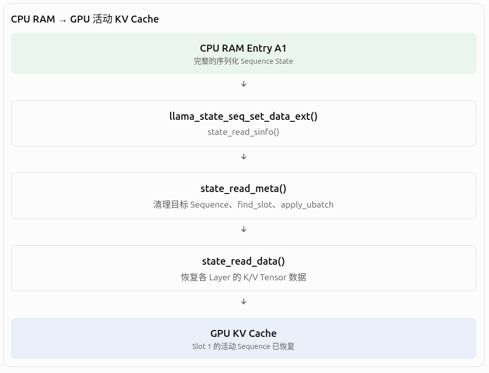


## GPU KV Cache 的新增和淘汰机制

GPU KV Cache 的生命周期分成三个阶段：

1. 初始化时分配 K/V Tensor。
2. Prefill / Decode 时分配 Cell，并写入 K/V。
3. Prefix 截断、Slot 清理、窗口滑动或内存压力时回收 Cell。

### KV Cache 新增

初始化阶段：

```
llama_context
    |
    v
model.create_memory()
    |
    v
llama_kv_cache
    |
    +-- Layer 0 K/V Tensor
    +-- Layer 1 K/V Tensor
    +-- ...
    +-- Layer N K/V Tensor
    |
    v
llama_kv_cells
    |
    v
Cell 元数据数组
```

- K/V Tensor 和 Cell 元数据空间已经分配好，后续 Token 不需要动态扩展 Tensor。

每次推理

```
llama_context::decode()
    |
    v
memory->init_batch()
    |
    v
llama_kv_cache::init_batch()
    |
    v
prepare()
    |
    v
find_slot()
```

`find_slot()` 从 Cell 数组中寻找可用位置，返回：`slot_info.idxs`，比如：

```
当前 Cell:

C0: used
C1: used
C2: free
C3: used
C4: free
C5: used

新 UBatch:

Token A
Token B

find_slot():

Token A -> C2
Token B -> C4
```

然后正式执行：

```
llama_kv_cache::apply_ubatch()
```

更新：

```
C2:
    pos = 6
    seq = {0}

C4:
    pos = 7
    seq = {0}
```

最后由 Transformer 计算图执行 K/V 写入。

核心调用关系：

```
find_slot()
    |
    v
slot_info.idxs
    |
    v
apply_ubatch()
    |
    v
更新 Cell 元数据
    |
    v
model.build_graph()
    |
    v
cpy_k() / cpy_v()
    |
    v
ggml_set_rows()
    |
    v
写入各 Layer K/V Tensor
```

这里有一个特殊情况：对于 Sliding Window Attention，`find_slot()` 可以选择一个已经被该 Sequence 的 SWA Mask 屏蔽、且只属于一个 Sequence 的 Cell，供新 Token 覆盖。

因此，SWA 模型可以在窗口滑动过程中回收旧 Cell。普通 Full Attention 则主要依赖显式释放 Sequence 归属。


### KV cache 淘汰

GPU Cell 的释放主要有四种场景。

**场景 A：Prefix 不匹配，删除旧后缀。**

Request 2 中：

```
slot.mem.seq_rm(slot.id, 400, -1);
```

作用：

```
Position 0～399:
    保留

Position 400～1499:
    删除 Sequence 归属
```

Cell 如果没有其他 Sequence 使用，就会变为空闲状态。

实际 K/V Tensor 中的旧数据可能还留在原内存位置，但它已经没有有效的 Sequence 归属，后续分配时会被新 K/V 覆盖。

**场景 B：整个 Slot 被清理。**

```
void prompt_clear() {
    mem.seq_rm(id, -1, -1);
    prompt.clear();
}
```

这会清理整个 Sequence 的 KV 归属以及 Token History。

**场景 C：新请求启动时，主动清理 Idle Slot。**

在：

```
process_single_task()
```

中：

```
if (params_base.cache_idle_slots) {
    for (auto & slot : slots) {
        if (!slot.is_processing()) {
            slot.prompt_save(*prompt_cache);

            if (params_base.kv_unified) {
                slot.prompt_clear();
            }
        }
    }
}
```

Unified KV Cache 下：

```
Idle Slot
    |
    v
保存到 CPU RAM
    |
    v
prompt_clear()
    |
    v
释放 GPU Cell
```

非 Unified KV Cache 下：

```
Idle Slot
    |
    v
保存到 CPU RAM
    |
    v
保留 GPU KV
```

**因为非 Unified 模式下，每个 Sequence 使用独立 Stream，清理一个 Slot 的 Stream 无法为其他 Sequence 提供可共享的 KV 空间。**

这是两种 KV 配置在调度行为上的重要区别。

**场景 D：KV Cache 空间不足。**

Server 执行模型计算时，如果没有足够的 Cell：

```
if (ret != 0) {
    if (!try_clear_idle_slots()) {
        n_batch /= 2;
    }

    return false;
}
```

而 `try_clear_idle_slots()`：

```
bool try_clear_idle_slots() {
    if (!params_base.kv_unified) {
        return false;
    }

    for (auto & slot : slots) {
        if (slot.is_processing()) {
            continue;
        }

        if (slot.prompt.n_tokens() > 0) {
            slot.prompt_clear();
            return true;
        }
    }

    return false;
}
```

它会在 Unified KV Cache 下清理一个 Idle Slot，然后重试。

注意：这个内存压力回收函数本身没有调用 `prompt_save()`。如果此前没有 RAM 快照，这次清理可能导致该 Slot 的历史上下文丢失。`--cache-idle-slots` 的主动保存机制可以提前保护 Idle Slot 的状态。

### GPU 淘汰机制总结

| 触发条件               | 操作                               | CPU RAM 是否保留副本 |
| ---------------------- | ---------------------------------- | -------------------- |
| Prefix 不匹配          | `seq_rm()` 删除后缀                | 取决于此前是否保存   |
| Slot 被整体清理        | `prompt_clear()`                   | 取决于此前是否保存   |
| Unified Idle Slot 清理 | `prompt_save()` + `prompt_clear()` | 是，保存成功时       |
| KV 空间不足            | `try_clear_idle_slots()`           | 不在此函数中保存     |
| SWA 窗口滑动           | 复用已 Mask 的 Cell                | 通常不需要 RAM 快照  |

最重要的一点：

GPU 的 Cell 分配不使用 Slot LRU 算法。

- Slot LRU：由 Server 调度器决定使用哪个 Slot。
- Cell 分配：由 `find_slot()` 决定使用哪个 Cell。
- Cell 回收：由 `seq_rm()`、`prompt_clear()` 和 SWA 机制处理。

这三层职责不同。

## CPU RAM Prompt Cache 的新增和淘汰

CPU RAM Cache 的核心数据结构：

```c
struct server_prompt_cache {
    std::list<server_prompt_cache_state> states;

    size_t limit_size;
    size_t limit_tokens;
};
```

每个 Entry：

```c
struct server_prompt_cache_state {
    server_prompt prompt;
    server_prompt_data data;
};
```

其中：

```c
struct server_prompt_data {
    std::vector<uint8_t> main;
    std::vector<uint8_t> drft;
};
```

它是一个按需分配的 RAM 状态缓存池。

### CPU Cache 新增：什么时候保存？

当前有两个主要入口。

| 入口                    | 触发条件                                                     |
| ----------------------- | ------------------------------------------------------------ |
| `get_available_slot()`  | LRU 选择 Slot，或 `f_keep < 0.5`                             |
| `process_single_task()` | 新任务启动后，扫描所有 Idle Slots，且启用 `cache_idle_slots` |

其中第二个入口尤其值得关注。

例如：

```
Slot 0: Request A，Idle
Slot 1: Request B，正在运行
Slot 2: Request C，Idle
Slot 3: Empty
```

新的 Request D 启动后：

```
process_single_task()
    |
    v
launch_slot_with_task()
    |
    v
扫描 Idle Slots
    |
    +-- Slot 0 -> prompt_save()
    |
    +-- Slot 2 -> prompt_save()
    |
    +-- Slot 3 -> 空，无需保存
    |
    v
prompt_cache->update()
```

如果使用 Unified KV Cache：

```
Slot 0:
    保存 CPU RAM
    清理 GPU KV

Slot 2:
    保存 CPU RAM
    清理 GPU KV
```

这样可以批量释放 Idle Slot 占用的 Cell。

### 6.2 CPU Cache 的 Entry 去重

在：

```
server_prompt_cache::alloc()
```

首先会检查：

```
if (cur_lcp_len == (int) prompt.tokens.size()) {
    return nullptr;
}
```

意思是：如果当前准备保存的 Prompt 已经完整包含在一个已有缓存 Prompt 中，就跳过新增。

例如：

```
RAM 已有：

[A B C D E F]

准备保存：

[A B C]
```

已有缓存已经包含当前状态的完整 Token 前缀，因此无需重复存储。

另一个方向：

```
RAM 已有：

[A B C]

准备保存：

[A B C D E F]
```

此时旧 Entry 已经被新 Prompt 完整包含。代码会将旧 Entry 删除，再保存更完整的新状态。这样可以减少重复前缀的状态副本。

## 6.3 CPU Cache 容量不足时如何淘汰？

假设：

```
--cache-ram 4096

RAM Cache Limit = 4096 MiB
```

当前：

```
Entry A = 1200 MiB
Entry B = 1100 MiB
Entry C = 1000 MiB

Total = 3300 MiB
```

现在需要新增：

```
Entry D = 1500 MiB
```

总计：$3300+1500=4800MiB$

超过 4096 MiB。`alloc()` 中：

```
while (!states.empty() &&
       size() + state_size_new > limit_size) {

    states.pop_front();
}
```

会从列表头部开始删除旧 Entry。

假设顺序为：

```
[A, B, C]
```

执行：

```
删除 A：还剩 2100 MiB

加入 D：总计 3600 MiB
```

最终：

```
[B, C, D]
```

这是一种基于 Entry 插入顺序的 FIFO 淘汰策略。它没有在每次命中时把 Entry 移动到队尾，因此不能把它理解成标准 LRU。

另外，`update()` 还有 Token 数量限制：

```
while (!states.empty() &&
       n_tokens() > limit_tokens_cur) {

    states.pop_front();
}
```

因此 CPU Cache 同时考虑：

- 实际状态字节数。
- 缓存 Token 总数。

## 6.4 CPU Cache 命中后为什么删除 Entry？

恢复时：

```
prompt = std::move(it_best->prompt);

states.erase(it_best);
```

已经恢复的 Entry 会被消费。

所以 CPU Cache 的生命周期是：

```
prompt_save()
    |
    v
RAM Entry
    |
    +-- 未命中：继续保留
    |
    +-- 命中：恢复到 Live Slot
                  |
                  v
              删除 RAM Entry
```

以后如果这个 Live Slot 又被替换：

```
prompt_save()
    |
    v
重新创建 RAM Entry
```

这意味着 CPU RAM Cache 是一个状态快照池，Entry 在恢复时会被转移到活动 Context。

## GPU 和 CPU kv cache 调度协同

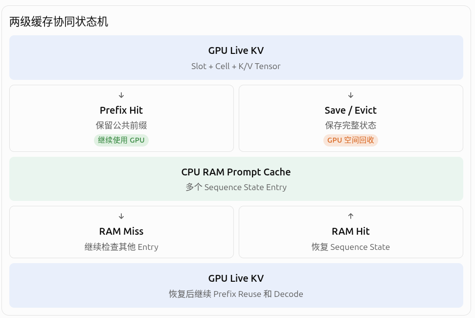

| 优先级 | 检查内容                              | 命中后的动作              |
| ------ | ------------------------------------- | ------------------------- |
| 1      | 当前可用 Slot 的 Prompt Token History | 直接复用活动 KV           |
| 2      | 当前 Slot 的历史是否值得保存          | 保存完整状态到 RAM        |
| 3      | CPU RAM 中是否存在更好的 Prompt       | 恢复到目标 Sequence       |
| 4      | 新请求的精确公共前缀                  | 截断旧后缀，保留可复用 KV |
| 5      | 剩余 Prompt                           | 执行 Prefill              |

- CPU RAM Cache 的候选必须比当前 Slot 的匹配结果更好，才会被恢复。

**三个核心配置**：

| 配置                 | 管理对象         | 作用                                                |
| -------------------- | ---------------- | --------------------------------------------------- |
| `--kv-unified`       | 活动 KV Cache    | 多个 Sequence 共享统一 Cell 空间                    |
| `--cache-idle-slots` | Server Slot      | 新任务启动时保存 Idle Slot，并在 Unified 模式下清理 |
| `--cache-ram`        | CPU Prompt Cache | 设置 RAM 状态缓存容量                               |

重点的相关函数

| 顺序 | 函数                                             | 重点                                        |
| ---- | ------------------------------------------------ | ------------------------------------------- |
| 1    | `get_available_slot()`                           | GPU Slot 选择、`f_keep`、RAM Cache 触发条件 |
| 2    | `server_slot::prompt_save()`                     | 活动 Sequence 导出到 CPU                    |
| 3    | `server_prompt_cache::alloc()`                   | RAM Entry 新增、去重、淘汰                  |
| 4    | `server_prompt_cache::load()`                    | RAM Cache 匹配、恢复、消费                  |
| 5    | `update_slots()`                                 | 精确 LCP、`seq_rm()`、新 Prompt Batch       |
| 6    | `llama_kv_cache::find_slot()` / `apply_ubatch()` | Cell 分配、元数据更新和实际 KV 写入         |

**GPU Cache 管理活动计算状态，CPU RAM Cache 管理暂时退出活动 Slot 的历史状态，Server 调度器负责决定何时保存、何时恢复，以及恢复到哪个 Sequence。**


# memcache适配到llamacpp

根据 [Ascend MemCache C++ API](https://gitcode.com/Ascend/memcache/blob/release%2F1.2/docs/memcache_c%2B%2B_api.md)，Sequence Snapshot 方案主要依赖：

MemCache 的 C++ API 基于面向对象设计，提供统一的 `ObjectStore` 抽象基类，封装了实例管理、缓冲区注册、数据操作、批量处理及分层张量等功能。提供`Put`/`Get`/`Remove`/`Register`等对象存储接口。

| 接口                                     | 用途                                       | 必要性 |
| ---------------------------------------- | ------------------------------------------ | ------ |
| `CreateObjectStore()`                    | 创建客户端                                 | 必须   |
| `Setup()`、`Init()`                      | 初始化服务、内存和传输协议                 | 必须   |
| `PutFrom()`                              | 将 Host Snapshot 写入 MemCache             | 必须   |
| `GetInto()`                              | 将 Snapshot 从 MemCache 读取到 Host Buffer | 必须   |
| `Remove()`                               | 删除不再使用的快照                         | 必须   |
| `IsExist()`                              | 检查缓存对象是否存在                       | 建议   |
| `GetKeyInfo()`                           | 校验大小、存储介质等                       | 建议   |
| `RegisterBuffer()`、`UnRegisterBuffer()` | 注册用于特定传输协议的 Host Buffer         | 按需   |
| `TearDown()`                             | 关闭客户端                                 | 必须   |

由于采用完整 Sequence 状态序列化，不需要使用 MemCache 的 `PutFromLayers()` / `GetIntoLayers()`，也不需要 MemCache 理解 Transformer Layer、KV Head、Cell Index 等内部结构。

**方案：接管 CPU Prompt Cache 的存储**：llama.cpp 将 Sequence State 导出为字节数据，由 MemCache 保存到外部 DRAM 池。恢复时从 MemCache 读取，再恢复到 GPU/CPU 活动 KV Cache。

- **重点在于：恢复的时候，不依赖原生的调度方案，删除原来的 CPU RAM kv cache snapshot，而是由另一套调度机制来做**

当前的 CPU RAM Cache 结构：

```c
struct server_prompt_data {
    std::vector<uint8_t> main;
    std::vector<uint8_t> drft;
};

struct server_prompt_cache_state {
    server_prompt prompt;
    server_prompt_data data;
};

struct server_prompt_cache {
    std::list<server_prompt_cache_state> states;

    size_t limit_size;
    size_t limit_tokens;

    server_prompt_cache_state * alloc(...);
    bool load(...);
    void update();
};
```

其中的 `std::vector<unit8_t> main` 保存 Target model 的 Sequence State，`drft` 保留 Draft Model 的 Sequence State。

在 `server_slot::prompt_save()` 中：

```c
const size_t cur_size_tgt =
    llama_state_seq_get_size_ext(
        ctx_tgt,
        id,
        LLAMA_STATE_SEQ_FLAGS_NONE
    );

auto * cur = prompt_cache.alloc(
    prompt,
    cur_size_tgt,
    cur_size_dft
);

llama_state_seq_get_data_ext(
    ctx_tgt,
    cur->data.main.data(),
    cur_size_tgt,
    id,
    LLAMA_STATE_SEQ_FLAGS_NONE
);
```

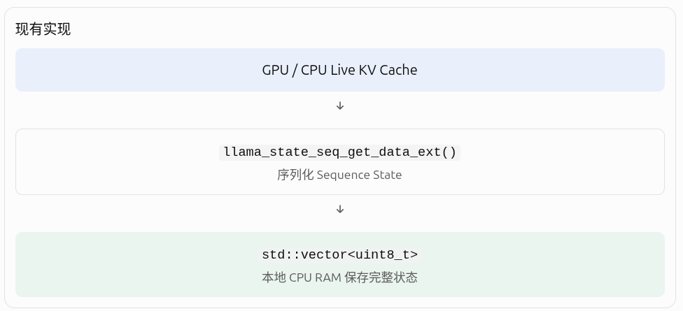

恢复时：

```c
llama_state_seq_set_data_ext(
    ctx_tgt,
    data.data(),
    data.size(),
    id,
    LLAMA_STATE_SEQ_FLAGS_NONE
);
```

所以改造最自然的位置是：保留 `llama_state_seq_get_data_ext()` 和 `llama_state_seq_set_data_ext()`，替换 `server_prompt_cache` 中实际保存数据的存储后端。

这意味着先不需要改动：

- `llama_kv_cache::find_slot()`
- `llama_kv_cache::apply_ubatch()`
- `llama_kv_cache::cpy_k()`
- `llama_kv_cache::cpy_v()`
- Transformer Attention 计算图

这些依然负责活动 KV Cache。


**推荐架构**：将 llama.cpp 的 CPU Prompt Cache 改造成一个可插拔的 Storage Backend。

```
server_prompt_cache
    |
    +-- states
          |
          +-- prompt
          |
          +-- data.main (vector)
          |
          +-- data.drft (vector)
```

修改为：

```
server_prompt_cache
    |
    +-- states
    |     |
    |     +-- prompt metadata
    |     +-- object_key
    |     +-- state_size
    |     +-- model_fingerprint
    |
    +-- storage_backend
          |
          +-- LocalRamBackend
          |
          +-- MemCacheBackend
                  |
                  +-- ObjectStore
                  +-- StagingBufferPool
                  +-- MemCache Index
```

核心思想是将两类数据分离：

| 数据                     | 存储位置              | 原因                            |
| ------------------------ | --------------------- | ------------------------------- |
| Prompt Token、Checkpoint | llama-server 本地内存 | 用于快速 LCP 匹配               |
| KV Sequence State        | MemCache 外部内存池   | 占用空间大，适合外部化          |
| Staging Buffer           | 本地 CPU 内存         | 用于 State 导出和 MemCache 传输 |
| 活动 K/V Tensor          | 原有 GPU/CPU Backend  | 继续参与 Attention 计算         |

**建议的类设计**：

- 新增抽象接口：

```c
class prompt_state_storage {
public:
    virtual ~prompt_state_storage() = default;

    virtual bool put(
        const std::string & key,
        const void * data,
        size_t size
    ) = 0;

    virtual bool get(
        const std::string & key,
        void * data,
        size_t size
    ) = 0;

    virtual bool exists(
        const std::string & key
    ) = 0;

    virtual bool remove(
        const std::string & key
    ) = 0;

    virtual size_t size(
        const std::string & key
    ) = 0;
};
```

- 然后实现两个 Backend

```c
class local_ram_storage :
    public prompt_state_storage {
    // 原有 std::vector / RAM 实现
};

class memcache_storage :
    public prompt_state_storage {
    // MemCache ObjectStore 实现
};
```

`server_prompt_cache` 只依赖抽象接口：

```c
class server_prompt_cache {
private:
    std::list<server_prompt_cache_state> states;

    std::unique_ptr<prompt_state_storage> storage;

public:
    bool save(...);
    bool load(...);
    void evict(...);
};
```

- 增加新的 Entry 结构：

```c
struct server_prompt_cache_state {
    server_prompt prompt;
    server_prompt_data data;
};
```

- 调整为：

```c
struct server_prompt_cache_state {
    server_prompt prompt;

    std::string object_key;

    size_t state_size_tgt = 0;
    size_t state_size_dft = 0;

    size_t total_size = 0;

    uint64_t prompt_hash = 0;
    uint64_t model_fingerprint = 0;

    int64_t last_access_time = 0;

    size_t token_count = 0;
};
```

其中 prompt 继续保存 Token History 和 CheckPoints。object_key 对应 MemCache 中的对象 key。

**MemCache初始化**：

- 需要单独部署 MetaService 进程
- 然后在 `server_context_impl` 初始化模型后，创建 Prompt Cache 时，初始化 MemCache 和相关内存池。

```c
class memcache_storage {
private:
    std::shared_ptr<ock::mmc::ObjectStore> store;

public:

    bool init(uint32_t device_id) {

        store =
            ock::mmc::ObjectStore::CreateObjectStore();

        if (!store) {
            return false;
        }

        auto config =
            ock::mmc::create_default_local_config();

        // 可以直接设置配置文件路径
        // 也可以修改 protocol、DRAM 等字段

        if (store->Setup(config) != 0) {
            return false;
        }

        if (store->Init(device_id, true) != 0) {
            return false;
        }

        return true;
    }

    bool put(
        const std::string & key,
        void * buffer,
        size_t size
    ) {
        return store->PutFrom(
            key,
            buffer,
            size,
            SMEMB_COPY_H2G
        ) == 0;
    }

    bool get(
        const std::string & key,
        void * buffer,
        size_t size
    ) {
        return store->GetInto(
            key,
            buffer,
            size,
            SMEMB_COPY_G2H
        ) == 0;
    }

    bool remove(const std::string & key) {
        return store->Remove(key) == 0;
    }

    ~memcache_storage() {
        if (store) {
            store->TearDown();
        }
    }
};
```

几个关键参数：

| API              | 方向                | 用途                                  |
| ---------------- | ------------------- | ------------------------------------- |
| `SMEMB_COPY_H2G` | Host → Global       | 将本地 Staging Buffer 写入 MemCache   |
| `SMEMB_COPY_G2H` | Global → Host       | 从 MemCache 读取到本地 Staging Buffer |
| `SMEMB_COPY_L2G` | Local Card → Global | 设备内存写入全局池                    |
| `SMEMB_COPY_G2L` | Global → Local Card | 全局池读取到设备内存                  |

**核心实现：将 KV Cache 保存到 MemCache**

- 当前的实现 `server_slot::prompt_save()`
- 修改为：

```
server_slot::prompt_save()
        |
        v
llama_state_seq_get_size_ext()
        |
        v
申请 Staging Buffer
        |
        v
llama_state_seq_get_data_ext()
        |
        v
得到完整 Sequence State
        |
        v
封装 Metadata Header
        |
        v
MemCache PutFrom()
        |
        v
保存成功
        |
        v
更新 server_prompt_cache Index
```

代码：

```c
bool prompt_save(
    server_prompt_cache & prompt_cache
) const {

    if (prompt.tokens.empty()) {
        return false;
    }

    const size_t size_tgt =
        llama_state_seq_get_size_ext(
            ctx_tgt,
            id,
            LLAMA_STATE_SEQ_FLAGS_NONE
        );

    const size_t size_dft =
        ctx_dft
        ? llama_state_seq_get_size_ext(
              ctx_dft,
              id,
              LLAMA_STATE_SEQ_FLAGS_NONE
          )
        : 0;

    const size_t total_size =
        sizeof(state_header) +
        size_tgt +
        size_dft;

    // 从 Staging Pool 获取 Buffer
    auto lease =
        prompt_cache.staging_pool().acquire(total_size);

    if (!lease) {
        return false;
    }

    auto * header =
        reinterpret_cast<state_header *>(
            lease.data()
        );

    header->magic = STATE_MAGIC;
    header->version = STATE_VERSION;
    header->size_tgt = size_tgt;
    header->size_dft = size_dft;

    uint8_t * ptr =
        lease.data() + sizeof(state_header);

    // 导出 Target State
    const size_t written_tgt =
        llama_state_seq_get_data_ext(
            ctx_tgt,
            ptr,
            size_tgt,
            id,
            LLAMA_STATE_SEQ_FLAGS_NONE
        );

    if (written_tgt != size_tgt) {
        return false;
    }

    // 导出 Draft State
    if (ctx_dft) {

        const size_t written_dft =
            llama_state_seq_get_data_ext(
                ctx_dft,
                ptr + size_tgt,
                size_dft,
                id,
                LLAMA_STATE_SEQ_FLAGS_NONE
            );

        if (written_dft != size_dft) {
            return false;
        }
    }

    const std::string key =
        prompt_cache.make_key(prompt);

    // 写入 MemCache
    if (!prompt_cache.storage().put(
            key,
            lease.data(),
            total_size
        )) {
        return false;
    }

    // 保存 Token Metadata 和 Object Key
    prompt_cache.commit(
        prompt,
        key,
        total_size,
        size_tgt,
        size_dft
    );

    return true;
}
```

这里的 `state_header` 和 `staging_pool` 是建议新增的组件。

为什么设计 header？

```c
struct state_header {

    uint64_t magic;

    uint32_t format_version;

    uint64_t model_fingerprint;

    uint64_t prompt_hash;

    uint64_t token_count;

    uint64_t size_tgt;

    uint64_t size_dft;

    uint64_t payload_size;

    uint64_t checksum;
};
```

- 原因是 `llama_state_seq_get_data_ext()` 保存的是和当前模型 Context 相关的 Sequence State。
- 无法支持场景：model A 的 kv state 可以直接恢复到 model B 的 Context。
- 建议采用内容寻址 Key + Header 校验。

**核心实现：如何从 MemCache 中恢复 KV Cache？**

- 原来的实现：`server_prompt_cache::load()` 从 main 中读取 CPU RAM 中的 Buffer。
- 修改为：

```
server_prompt_cache::load()
        |
        v
找到最匹配的 Prompt Metadata
        |
        v
读取 Object Key
        |
        v
MemCache GetKeyInfo()
        |
        v
Staging Pool acquire()
        |
        v
MemCache GetInto()
        |
        v
校验 Header / Checksum / Fingerprint
        |
        v
llama_state_seq_set_data_ext()
        |
        v
恢复活动 Sequence 的 KV Cache
        |
        v
update_slots()
        |
        v
get_common_prefix()
        |
        v
seq_rm() 清理不匹配后缀
        |
        v
继续 Prefill
```

示例代码：

```
bool load(
    const server_tokens & tokens,
    llama_context * ctx,
    llama_seq_id seq_id
) {

    auto * entry = find_best_match(tokens);

    if (!entry) {
        return false;
    }

    auto lease =
        staging_pool.acquire(entry->total_size);

    if (!lease) {
        return false;
    }

    const auto info =
        store->GetKeyInfo(entry->object_key);

    if (info.size_ != entry->total_size) {
        return false;
    }

    if (store->GetInto(
            entry->object_key,
            lease.data(),
            entry->total_size,
            SMEMB_COPY_G2H
        ) != 0) {

        return false;
    }

    // 检查 Header
    const auto * header =
        reinterpret_cast<const state_header *>(
            lease.data()
        );

    if (!validate_header(*header, *entry)) {
        return false;
    }

    const uint8_t * ptr =
        lease.data() + sizeof(state_header);

    // 恢复 Target
    const size_t restored =
        llama_state_seq_set_data_ext(
            ctx,
            ptr,
            header->size_tgt,
            seq_id,
            LLAMA_STATE_SEQ_FLAGS_NONE
        );

    if (restored != header->size_tgt) {
        llama_memory_seq_rm(
            llama_get_memory(ctx),
            seq_id,
            -1,
            -1
        );

        return false;
    }

    // 更新 Slot 的 Prompt Metadata
    // 注意恢复成功后再提交元数据。

    return true;
}
```

**重点：MemCache Entry 不在命中后立即删除**

- llamacpp 的 RAM Cache 成功恢复后会删除这个 Entry：`states.erase(it_best)`
- 如果把 MemCache 当成多节点共享缓存，建议改变这一行为：

```
MemCache Entry:

保存后
    |
    v
允许多个请求命中
    |
    v
多个 Slot / 多个 Server 可以恢复
    |
    v
达到淘汰条件后 Remove
```

- 推荐的外部 Cache 行为：`entry->last_access_time = now;`


**MemCache 如何知道哪个 KV State 可以复用？**

- 现在的 llamacpp 的 `server_prompt_cache::load()` 会遍历本地的 `std::list<server_prompt_cache_state> states;`对每个 Entry 执行：`entry.prompt.tokens.get_common_prefix(tokens_new);` 然后计算 LCP 来选择合适的候选。
- 现在可以替换为对 MemCache 的对象 key 查询

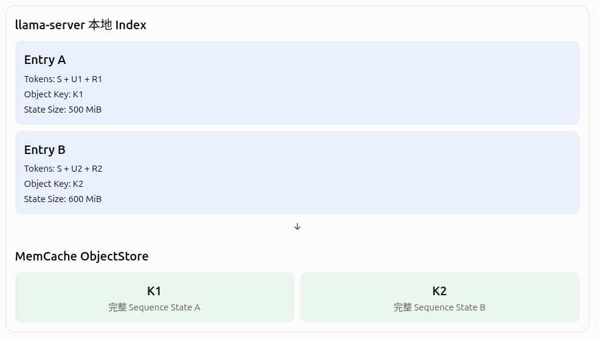


部署

- MetaService：负责整个内存池的资源管理，以及 LocalService 的加入和退出。

- LocalService：既提供客户端 API，也可以贡献一段连续内存作为内存池的一部分。

- 多个 LocalService 可以加入同一个 MetaService 管理的内存池，彼此访问对方提供的内存。

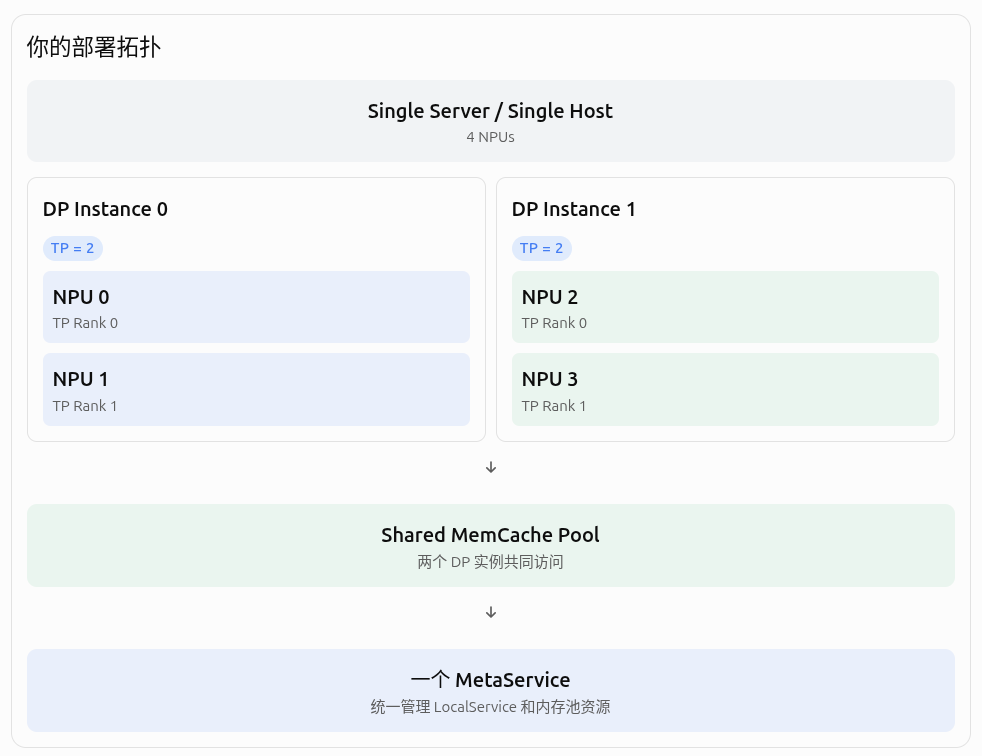

- 两个实例连接到同一个 memcache 管理域。

```
# DP0
auto store0 = ock::mmc::ObjectStore::CreateObjectStore();
store0->Init(device_id_0);
# DP1 
auto store1 = ock::mmc::ObjectStore::CreateObjectStore();
store1->Init(device_id_1);

配置相同的：
meta_service_url
config_store_url
protocol
world_size
```

注意：MemCache 可以配置容量上限，如下所示。**但是MemCache不理解 KV Cache的业务语义**

```
ock.mmc.evict_threshold_high = 90
ock.mmc.evict_threshold_low = 80
```

- 使用率超过 90% 时触发淘汰。
- 淘汰持续进行，直到使用率下降到 80% 左右。
- 这是 MemCache 内存池层面的资源管理。

相关的内存回收策略：

| 层次             | 负责方    | 职责                                    |
| ---------------- | --------- | --------------------------------------- |
| L1：GPU KV Cache | llama.cpp | Slot 清理、Cell 回收                    |
| L2：MemCache     | MemCache  | 内存池容量控制、自动淘汰                |
| L2 业务索引      | llama.cpp | Prefix 索引维护、缓存价值判断、主动删除 |

**Memcache是否支持异步IO？**

- 公开的C++ API给出的是同步接口 `PutFrom`、`GetInto`、`BatchPutFrom`、`BatchGetInto`。
- 可以在 llamacpp 中专门增加单独的线程池来做异步任务队列处理。
  - 方案一：在 llama-server 中用单独的线程池来做，配置多个单独的读写Worker
  - 方案二：使用独立的 MemCache Proxy 进程

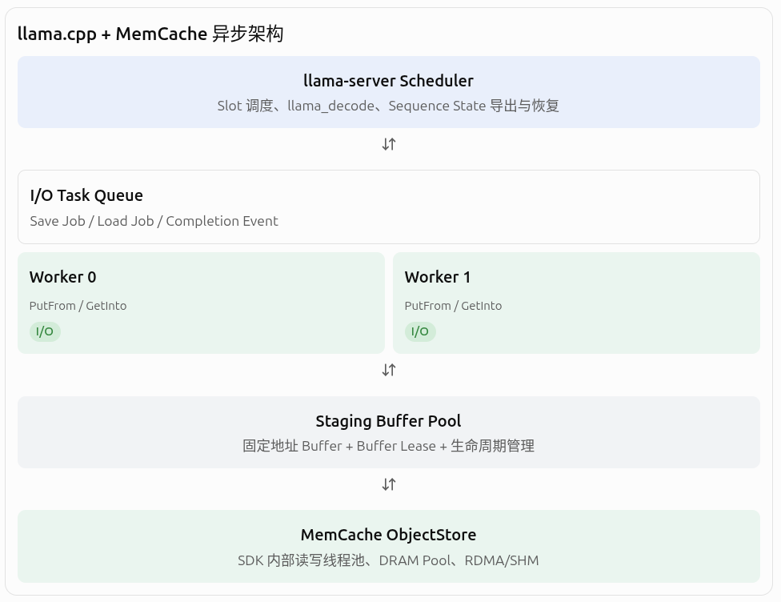

同步流程：

```
Scheduler
    |
    v
prompt_save()
    |
    v
llama_state_seq_get_data_ext()
    |
    v
store->PutFrom()
    |
    v
等待 PutFrom 返回
    |
    v
prompt_clear()
```

异步流程：

```
Scheduler Thread
    |
    v
prompt_save()
    |
    v
llama_state_seq_get_data_ext()
    |
    v
Staging Buffer
    |
    v
提交 Save Job
    |
    +--------------------------+
    |                          |
    v                          v
继续处理其他请求           MemCache Worker
                               |
                               v
                          store->PutFrom()
                               |
                               v
                          保存完成
                               |
                               v
                          Completion Event
                               |
                               v
                          Scheduler 更新状态
```

**注意：MemCache 替换的是 KV State 的 CPU 数据存储，llama.cpp 仍然需要保留 Prompt 元数据，用来判断哪个 KV State 可以复用。**

- Memcache 提供的内存池能力，不提供对应的前缀匹配能力来识别能复用的 kv cache 请求
- 因此llamacpp需要根据请求，找到最匹配的 Entry，再根据 Object Key 从 MemCache 读取 KV State。这个称为本地 Index

改造前的 Llamacpp 的元数据逻辑：

```c
struct server_prompt_cache_state {
    server_prompt prompt;
    server_prompt_data data;
};

struct server_prompt_data {
    std::vector<uint8_t> main;
    std::vector<uint8_t> drft;
};
```

目标：

- KV State Payload：几百 MB 的 K/V 状态数据，全部放到 MemCache，不再放入 llama.cpp 的 CPU RAM Cache。

- Prompt Metadata：Token IDs、Object Key、State Size 等索引信息。它也可以放到 MemCache，不要求保留在 llama.cpp 本地。

下面是让 index 都保存在 memcache 中，并提供外部接口来做。

```
llama-server
    |
    v
server_prompt_cache
    |
    +-- states
          |
          +-- prompt.tokens
          |
          +-- data.main  (KV State)
          |
          +-- data.drft  (Draft State)
          
改造后：
llama-server
    |
    v
MemCache Prompt Cache Manager
    |
    +-- Prefix Index
    |      |
    |      +-- Prompt Token Metadata
    |      +-- Object Key
    |      +-- State Size
    |
    +-- KV State Storage
           |
           +-- Target KV State
           +-- Draft KV State
    |
    v
MemCache ObjectStore
    |
    v
External DRAM Pool
```

**当前的 Llamacpp 的 Slot 前缀匹配**

- GPU KV Cache 匹配
- CPU RAM Prompt Cache 匹配，根据上面的数据结构的 entry，在请求到达的时候， `load()` 会遍历整个 states，来计算 $f_{keep}$ 和 $f_{sim}$ 

```
Prompt Metadata
    |
    +-- Token IDs
    +-- Checkpoints

KV State
    |
    +-- Target KV
    +-- Draft KV
```

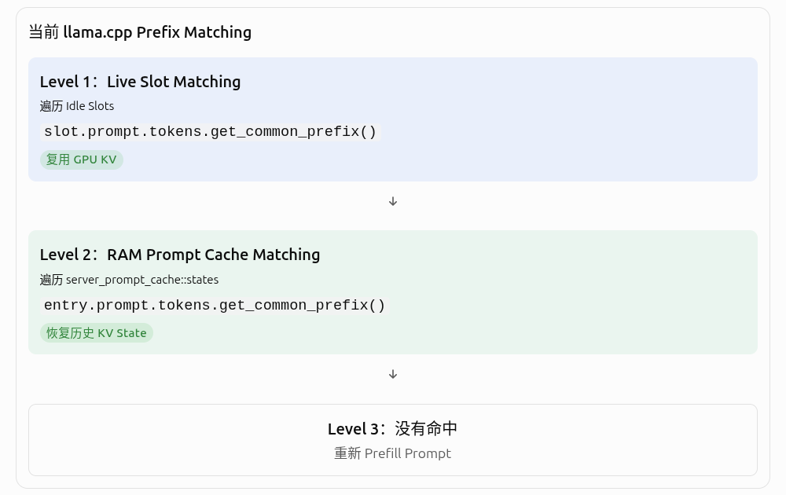

- 当前 llama.cpp 的 RAM Prompt Cache 没有使用 Trie、Prefix Hash Tree 或其他专门的前缀索引结构。
- 当前就是逐个遍历：`std::list<server_prompt_cache_state> states` 中的 Token ID 来计算 LCP。

**推荐的新架构**：外部 memcache 内存池 + 内部的 kv cache 前缀匹配

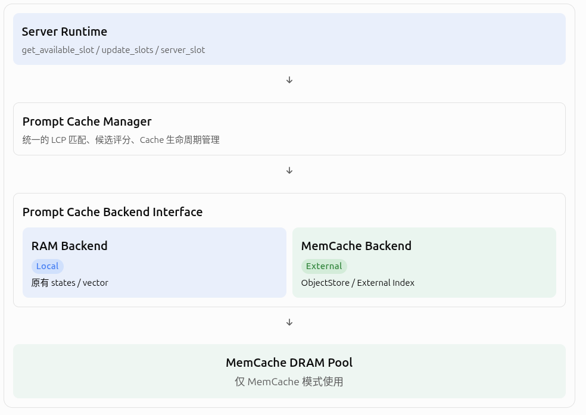

- 在现有的匹配机制上，增加一个后端抽象逻辑，Prompt Cache Manager 负责匹配策略，Backend 负责提供候选和读写数据。

```c
class server_prompt_cache_backend {
public:
    virtual ~server_prompt_cache_backend() = default;

    // 保存 Prompt Metadata + KV State
    virtual bool save(
        const server_prompt & prompt,
        const void * state_tgt,
        size_t size_tgt,
        const void * state_dft,
        size_t size_dft
    ) = 0;

    // 查询候选 Prompt Metadata
    virtual std::vector<server_prompt_cache_candidate>
    find_candidates(
        const server_tokens & tokens
    ) = 0;

    // 读取 KV State
    virtual bool load(
        const std::string & snapshot_id,
        void * state_tgt,
        size_t size_tgt,
        void * state_dft,
        size_t size_dft
    ) = 0;

    // 删除 Snapshot
    virtual bool remove(
        const std::string & snapshot_id
    ) = 0;

    // 容量和淘汰管理
    virtual void update() = 0;
};
```

数据结构：

```c
struct server_prompt_cache_candidate {

    std::string snapshot_id;

    server_prompt prompt;

    size_t size_tgt = 0;
    size_t size_dft = 0;

    uint64_t fingerprint = 0;
};
```

**MemCache 模式如何寻找 Prefix 候选？**

- 本地模式下，因为所有 Entry 都在本地 std::list 中，所以可以直接遍历。
- 但 MemCache ObjectStore 的 Key-Value API 并没有直接提供：`FindLongestCommonPrefix(tokens);` 的方式。
  - 方案一：在 MemCache 中增加一个 Catalog 对象来处理前缀匹配
  - 方案二：当 Catalog 规模较大时，可以引入 Prefix Hash Index。


> vLLM 的前缀匹配机制：
>
> - 收到新请求后，vLLM 根据请求 Token 计算 Block Hash，再通过一个 Hash Map 找到 GPU 中已有的 KV Block。
> - 将KV cache卸载到 CPU后，GPU block释放。Hash index不一定会消失，只有在对应block被重分配的时候会删除对应的hash映射
> - KV Cache 卸载到 CPU 后，vLLM 有另一套索引
>   - SimpleCPUOffload 模式下，CPU有自己的 Block Pool。明确创建了独立的 CPU KV Cache Coordinator 和 CPU Block Pool。GPU和CPU两套 Block Pool 独立管理物理内存，但可以使用相同的 Block Hash。
>   - vLLM OffloadingConnector：使用 OffloadKey 和 OffloadingManager
>     - 它会根据 Request 的 Block Hash 生成外部存储 Key。
>     - 外部缓存的查找依据是：
>       - Request 的 Block Hash。
>       - KV Cache Group ID。
>   - Request 提供 Hash，Connector 生成 OffloadKey，OffloadingManager 在对应内存层查询数据。
>   - vLLM 将本地命中、外部命中和需要新计算的 Token 分别管理。在 Scheduler 查询的时候分别调度。
>
> LMCache：通过 Token Sequence 生成稳定的 Chunk Key，再通过 Storage Backend 查找 KV Chunk。
>
> - LMCache 使用 TokenDatabase 将 Token Sequence 转换成 Cache Key。
> - 每个 Chunk 独立存储。新请求只要 Token Prefix 相同，就可以重新生成相同的 Cache Key。因此，LMCache 能够在 CPU、Disk 等不同存储层之间查找和恢复 KV。


**Prompt 前缀匹配所需的信息，必须由一个独立于 GPU KV Cache 的 Metadata Index 保存。GPU KV 是否还存在，不应该决定 Prompt Metadata 是否存在。**

在 llama.cpp 中，这部分信息目前主要由两类对象持有：

- `server_slot::prompt.tokens`：记录当前 Slot 的 Token History。
- `server_prompt_cache::states`：记录已经退出活动 Slot、被保存为历史缓存的 Prompt Metadata 和 KV State。

**即使原来的 Slot 被重新分配，原来的 Prompt Metadata 仍然存在于 `server_prompt_cache::states` 中。**

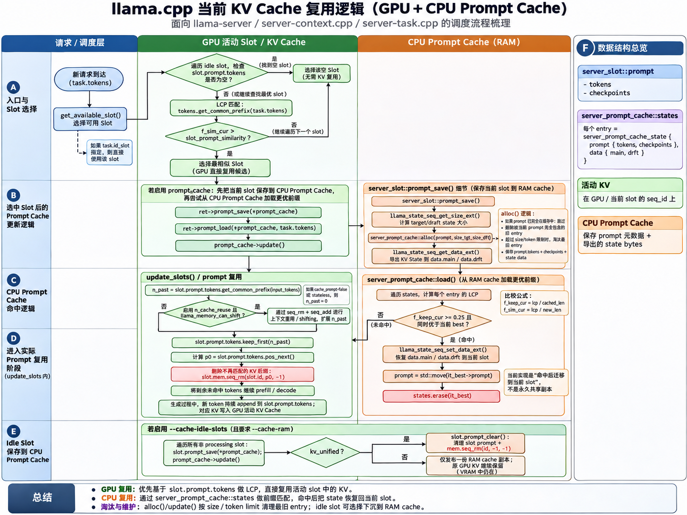

