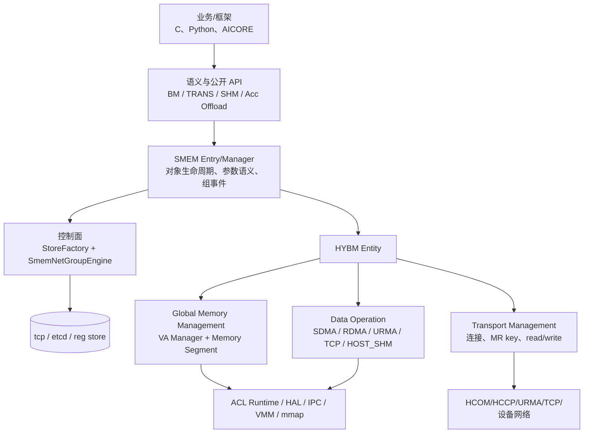
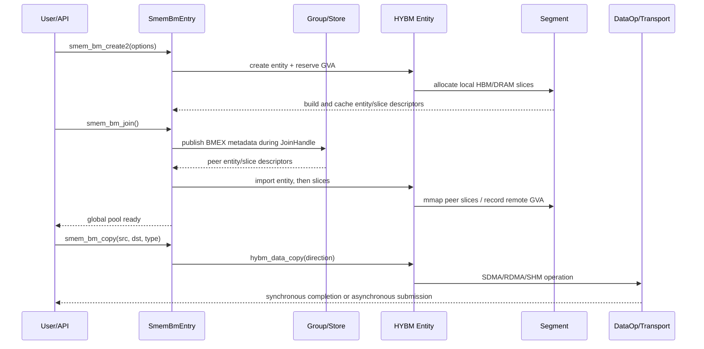
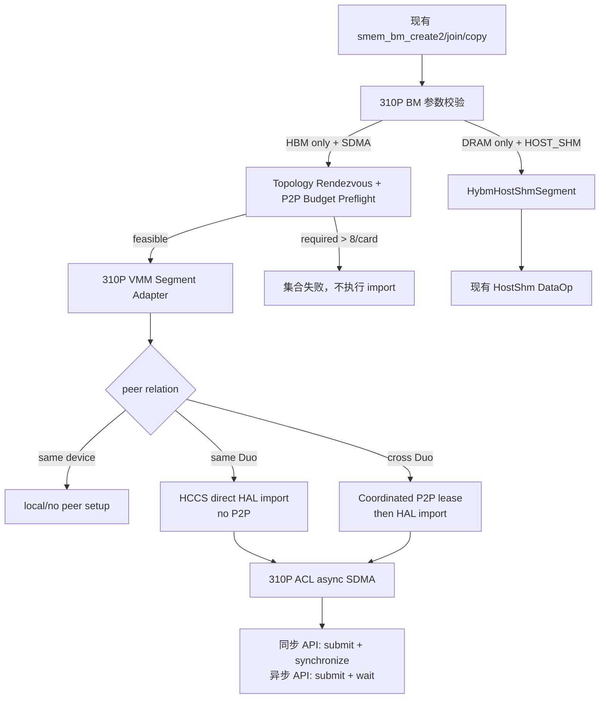

# Memfabric 310p duo 内存池化方案

> **文档状态：上游设计文档（方案定稿）**
> 其中 D1-D9 决策与 V1-V8 验证项已由后续两份开发文档落地并实机验收；平台实机
> 事实以 `docs/310p/平台事实.md` 为准。本文档保留设计动机与论证，作为深挖材料。

## 硬件环境

**硬件**：Atlas 300I Duo (310P3)

**驱动版本**：CANN 9.1.0。

**整体机器PCIe拓扑以及带宽**

- 卡间支持 PCIe 4.0 x 16 lane，16Gbps/lane，单向理论带宽 31.5 GB/s，双向带宽 63GB/s
- die 间支持 HCCS x 8 lane，24Gbps/lane，单向理论带宽

当前机器不同设备的PCIe带宽是不一样的，如下表，PCIe 带宽不同设备不一样，本质上是主板物理槽位的 PCIe 通道分配不同导致。

- 可能是主板设计决定的（CPU PCIe 总 lane 数有限，无法所有槽都分配 x16），但是不一定

| **NPU** | **Device** | **Bus-Id** | **Root Port** | **LnkCap** | **LnkSta** | **单向带宽** | **状态** |
| ------- | ---------- | ---------- | ------------- | ---------- | ---------- | ------------ | -------- |
| 5664    | 0, 1       | 18:00.0    | 16:04.0       | Gen4 x16   | Gen4 x8    | ~15.7 GB/s   | ⚠️ 降速   |
| 16384   | 2, 3       | 41:00.0    | 40:00.0       | Gen4 x16   | Gen4 x16   | ~31.5 GB/s   | ✓ 正常   |
| 38144   | 4, 5       | 96:00.0    | 95:00.0       | Gen4 x16   | Gen4 x8    | ~15.7 GB/s   | ⚠️ 降速   |
| 43520   | 6, 7       | ab:00.0    | aa:00.0       | Gen4 x16   | Gen4 x16   | ~31.5 GB/s   | ✓ 正常   |

- Root Port 16:04.0 和 95:00.0 的 LnkCap（硬件能力）就是 x8，

**当前机器的所有 Prot**

| **Root Port** | **LnkCap** | **当前挂载设备**      | **状态** |
| ------------- | ---------- | --------------------- | -------- |
| 01:00.0       | Gen5 x1    | VGA (iBMC)            | 已用     |
| 01:01.0       | Gen5 x1    | iBMA 虚拟网卡         | 已用     |
| 01:02.0       | Gen4 x2    | 空                    | 未用     |
| 01:03.0       | Gen4 x2    | 空                    | 未用     |
| 16:00.0       | Gen4 x8    | RAID 控制器 (17:00.0) | 已用     |
| 16:04.0       | Gen4 x8    | NPU Dev 0/1 (18:00.0) | 已用     |
| 40:00.0       | Gen5 x16   | NPU Dev 2/3 (41:00.0) | 已用     |
| 95:00.0       | Gen4 x8    | NPU Dev 4/5 (96:00.0) | 已用     |
| 95:04.0       | Gen4 x8    | 空                    | 未用     |
| aa:00.0       | Gen5 x16   | NPU Dev 6/7 (ab:00.0) | 已用     |

- 全机只有 40:00.0 和 aa:00.0 两个 Root Port 支持 Gen5 x16（目前跑在 Gen4 x16 是因为 NPU 卡只支持 Gen4）

- 其余 Root Port 最大只有 x8，这是主板/CPU PCIe lane 分配的硬限制


**硬件规格总览**：

- CPU：Kunpeng 920 5250W × 2，每个 socket 都是 2 个 die，支持 DDR5
- 总内存：
  - 单 socket：8 ch × DDR4-2933 × 8 byte，大概 187.7GB/s，双 socke 也就是 16 ch × DDR4-2933 × 8 byte，大概 375.4 GB/s

整体硬件逻辑拓扑图如下：
```
========================================================================
                       300I Duo 服务器逻辑拓扑
========================================================================

┌────────────────── Socket 0 (Kunpeng 920 5250W) ────────────────────┐
│                                                                      │
│  ┌──────────────┐       Huawei Link       ┌──────────────┐          │
│  │    Die 0     │◄═══════════════════════►│    Die 1     │          │
│  │  NUMA Node 0 │                         │  NUMA Node 1 │          │
│  │  24x ARMv8   │                         │  24x ARMv8   │          │
│  └──────┬───────┘                         └──┬────────┬──┘          │
│         │                                    │        │              │
│  ┌──────┴───────┐                            │        │              │
│  │    DDR5      │                            │        │              │
│  │  6ch×64GB    │                            │        │              │
│  │    384GB     │                            │        │              │
│  │  ~250 GB/s   │                            │        │              │
│  └──────────────┘                            │        │              │
│                                              │        │              │
│                                       ┌──────┴────────┴──────┐       │
│                                       │   PCIe RC (Die 1)   │       │
│                                       └──────┬───────────┬───┘       │
│                                         ┌────┘           └────┐      │
│                                  ┌──────┴────────┐  ┌─────────┴────┐  │
│                                  │  RP 16:04.0   │  │  RP 40:00.0  │  │
│                                  │  Cap:Gen4 x8  │  │  Cap:Gen5x16 │  │
│                                  │  Sta:Gen4 x8  │  │  Sta:Gen4x16 │  │
│                                  │  ~15.7 GB/s ⚠ │  │  ~31.5 GB/s ✓│  │
│                                  └──────┬────────┘  └──────┬───────┘  │
└─────────────────────────────────────────┼─────────────────┼─────────┘
                                          │                 │
                           ┌──────────────┴───────┐ ┌───────┴──────────────┐
                           │  310P3 Duo Card 0    │ │  310P3 Duo Card 1    │
                           │  Bus 18:00.0         │ │  Bus 41:00.0         │
                           │  NUMA Node 1         │ │  NUMA Node 1         │
                           │                      │ │                      │
                           │ ┌────────┐┌────────┐ │ │ ┌────────┐┌────────┐ │
                           │ │Primary ││Second. │ │ │ │Primary ││Second. │ │
                           │ │Chip 0  ││Chip 1  │ │ │ │Chip 0  ││Chip 1  │ │
                           │ │~48GB   ││~48GB   │ │ │ │~48GB   ││~48GB   │ │
                           │ │LPDDR   ││LPDDR   │ │ │ │LPDDR   ││LPDDR   │ │
                           │ └───┬────┘└───┬────┘ │ │ └───┬────┘└───┬────┘ │
                           │     └───HCCS──┘      │ │     └───HCCS──┘      │
                           │ 24Gbps×8lane ~24GB/s │ │ 24Gbps×8lane ~24GB/s │
                           └──────────────────────┘ └──────────────────────┘

═══════════════════════════ Cross-Socket Interconnect ═════════════════════════════

┌────────────────── Socket 1 (Kunpeng 920 5250W) ────────────────────┐
│                                                                      │
│  ┌──────────────┐       Huawei Link       ┌──────────────┐          │
│  │    Die 0     │◄═══════════════════════►│    Die 1     │          │
│  │  NUMA Node 2 │                         │  NUMA Node 3 │          │
│  │  24x ARMv8   │                         │  24x ARMv8   │          │
│  └──────┬───────┘                         └──┬────────┬──┘          │
│         │                                    │        │              │
│  ┌──────┴───────┐                            │        │              │
│  │    DDR5      │                            │        │              │
│  │  6ch×64GB    │                            │        │              │
│  │    384GB     │                            │        │              │
│  │  ~250 GB/s   │                            │        │              │
│  └──────────────┘                            │        │              │
│                                              │        │              │
│                                       ┌──────┴────────┴──────┐       │
│                                       │   PCIe RC (Die 1)   │       │
│                                       └──────┬───────────┬───┘       │
│                                         ┌────┘           └────┐      │
│                                  ┌──────┴────────┐  ┌─────────┴────┐  │
│                                  │  RP 95:00.0   │  │  RP aa:00.0  │  │
│                                  │  Cap:Gen4 x8  │  │  Cap:Gen5x16 │  │
│                                  │  Sta:Gen4 x8  │  │  Sta:Gen4x16 │  │
│                                  │  ~15.7 GB/s ⚠ │  │  ~31.5 GB/s ✓│  │
│                                  └──────┬────────┘  └──────┬───────┘  │
└─────────────────────────────────────────┼─────────────────┼─────────┘
                                          │                 │
                           ┌──────────────┴───────┐ ┌───────┴──────────────┐
                           │  310P3 Duo Card 2    │ │  310P3 Duo Card 3    │
                           │  Bus 96:00.0         │ │  Bus ab:00.0         │
                           │  NUMA Node 3         │ │  NUMA Node 3         │
                           │                      │ │                      │
                           │ ┌────────┐┌────────┐ │ │ ┌────────┐┌────────┐ │
                           │ │Primary ││Second. │ │ │ │Primary ││Second. │ │
                           │ │Chip 0  ││Chip 1  │ │ │ │Chip 0  ││Chip 1  │ │
                           │ │~48GB   ││~48GB   │ │ │ │~48GB   ││~48GB   │ │
                           │ │LPDDR   ││LPDDR   │ │ │ │LPDDR   ││LPDDR   │ │
                           │ └───┬────┘└───┬────┘ │ │ └───┬────┘└───┬────┘ │
                           │     └───HCCS──┘      │ │     └───HCCS──┘      │
                           │ 24Gbps×8lane ~24GB/s │ │ 24Gbps×8lane ~24GB/s │
                           └──────────────────────┘ └──────────────────────┘

  Note: Primary Die -- PCIe endpoint, direct CPU connection
        Secondary Die -- no direct PCIe, accessed via Primary + HCCS
        Host -> Secondary = PCIe + HCCS (two-hop, higher latency)

========================================================================
                          Bandwidth Summary
========================================================================
  Host DRAM: 768GB (12ch×64GB DDR5-5200, ECC)  ~500 GB/s total
  NPU Mem:   8 chip × ~48GB LPDDR = ~384GB total
  HCCS:      24 Gbps × 8 lane = 24 GB/s (one-way)
  PCIe x16:  ~31.5 GB/s ✓      PCIe x8: ~15.7 GB/s ⚠
========================================================================
```


**PCIe IPC 导入和导出限制**：310p duo硬件的最大 enable 数量是 8，并且卡内两个die是共享的。

```c
/**
 * @ingroup driver
 * @brief p2p Enable mem interface
 * @attention
 * 1. Both directions must be set to take effect, and support sdma and vnic interworking.
 * 2. When using device access host memory, the MAX enable number will be reduced.
 * 3. The two devices of Ascend310P Duo share 8 MAX enable number.
 * 4. dev and peer_dev cannot be equal or share the same PCIE device.
 * 5. VF devices are not supported.
 * -----------------------------------------------------------
 * Chip Type        |   Support phy_id   | MAX enable number |
 * ------------------ ----------------------------------------
 * Ascend910A1      |        0~15        |        8          |
 * Ascend910A2      |        0~15        |        8          |
 * Ascend910A3      |        0~15        |        8          |
 * Ascend950        |        0~15        |        16         |
 * Ascend310P       |  0/2/4...34/36/38  |        8          |
 * Ascend310P Duo   |        0~39        |        8(shared)  |
 * Ascend310B       |     Not Support    |    Not Support    |
 * -----------------------------------------------------------
 * @param [in]  dev : logical device id
 * @param [in]  peer_dev : physical device id
 * @param [in]  flag : reserve para fill 0
 * @return   0 for success, others for fail
 */
DLLEXPORT drvError_t halDeviceEnableP2P(uint32_t dev, uint32_t peer_dev, uint32_t flag);
```


## 310p duo卡的能力矩阵

### 1、ACL（Ascend Computing Language）设备内存与内存拷贝基线测试，单进程单设备，无 MPI。

| 步骤 | 测试接口                                              | 说明                                                   |
| ---- | ----------------------------------------------------- | ------------------------------------------------------ |
| 1    | aclrtMalloc / aclrtFree                               | 设备内存分配/释放                                      |
| 2    | aclrtMemcpy (H2D / D2H)                               | 使用 pageable host 内存的 Host↔Device 拷贝             |
| 3    | aclrtMemcpy (D2D sync)                                | 同设备 Device→Device 同步拷贝                          |
| 4    | aclrtMemcpyAsync + aclrtSynchronizeStream (D2D async) | 同设备 D2D **异步**拷贝（stream 模式）                 |
| 5    | aclrtMallocHost / aclrtFreeHost + H2D/D2H             | pinned host 内存分配 + 拷贝（对比 step 2 的 pageable） |
| 6    | aclrtMemcpy 带宽                                      | H2D/D2H/D2D-sync/D2D-async 四条路径的带宽              |
| 7    | D2D sweep (sync vs async-pipe vs async-serial)        | 不同 size（4/16/64/256MB）下三种 D2D 路径性能对比      |

**涉及 API**：

- 初始化/清理:`aclInit` → `aclrtSetDevice` → `aclrtCreateStream` → … → `aclrtDestroyStream` → `aclrtResetDevice` → `aclFinalize`
- 设备内存:`aclrtMalloc`(ACL_MEM_MALLOC_HUGE_FIRST)/ `aclrtFree`(两块 32MB)
- host 内存:`aclrtMallocHost` / `aclrtFreeHost`(32MB pinned)
- 拷贝:`aclrtMemcpy`(HOST_TO_DEVICE / DEVICE_TO_HOST / DEVICE_TO_DEVICE)
- 异步拷贝:`aclrtMemcpyAsync`(DEVICE_TO_DEVICE)+ `aclrtSynchronizeStream`


**结论**:

- H2D ~13.9 GB/s，D2H ~12.8 GB/s（pinned host）
  - 测试了对于两种 host 内存的 H2D/D2D，分别是 Pageable 和 Pinned（分别有 malloc 和 aclrtMallocHost 分配）
  - Pageable 可被OS换出，物理地址不固定，Pinned 物理地址固定。因此 Pageable buffer 会从 host → 驱动内部 staging buffer(固定物理地址) → device（两次拷贝）

```

Pageable:  hbuf(pageable) ──memcpy──> staging(pinned) ──DMA──> da(device)
Pinned:    hp(pinned)     ─────────────── DMA 直达 ──────────> da(device)
```

**测试数据矩阵**：使用的是 DEV=2，使用 PCIe 4.0 x 16 lane，单向理论带宽是 31.5GB/s，双向理论带宽为 63GB/s，使用测试数据量 16MB和128MB，对比结论：

1. D2D sync 恒定 ~5 GB/s — drvMemcpy 驱动路径天花板,与 size 无关
2. D2D async +36% — SDMA 引擎受益,128MB 接近渐近峰值(step7: 64MB=84, 256MB=91)
3. H2D/D2H pinned sync 仅 +5% — 16MB 时已接近 PCIe 带宽上限
4. D2H pageable 翻倍(+109%) — 变化最大的项,小 size 时 staging 中转固定开销占比极大
5. sync vs async 差距缩小(pinned):16MB 时 sync 快 1.4×,128MB 时缩至 1.2×

| **方向** | **Host 类型** | **API** | **16MB (GB/s)** | **128MB (GB/s)** | **变化** | **说明**                            |
| -------- | ------------- | ------- | --------------- | ---------------- | -------- | ----------------------------------- |
| **H2D**  | Pinned        | Sync    | 26.96           | 28.25            | +5%      | PCIe 已近饱和,微涨                  |
| **H2D**  | Pinned        | Async   | 19.13           | 24.13            | +26%     | 大 size 摊薄提交开销,流水线收益增加 |
| H2D      | Pageable      | Sync    | 9.16            | 12.33            | +35%     | staging 中转固定开销被摊薄          |
| H2D      | Pageable      | Async   | 8.97            | 11.32            | +26%     | 同上                                |
| **D2H**  | Pinned        | Sync    | 24.22           | 25.40            | +5%      | PCIe 已近饱和,微涨                  |
| **D2H**  | Pinned        | Async   | 17.75           | 21.95            | +24%     | 大 size 摊薄提交开销                |
| D2H      | Pageable      | Sync    | 5.62            | 11.87            | +111%    | 小 size 时 staging 中转开销占比极大 |
| D2H      | Pageable      | Async   | 5.59            | 11.69            | +109%    | 同上                                |
| D2D      | —             | Sync    | 5.18            | 5.20             | 0%       | drvMemcpy 路径上限,不随 size 变     |
| D2D      | —             | Async   | 65.18           | 88.35            | +36%     | SDMA 引擎随 size 渐近峰值           |

- 单设备分配的两个内存 da 和 db 之间的 D2D 带宽，测试三种路径：

1. aclrtMemcpy（同步拷贝），特点：CPU 和设备串行工作，CPU 等完一次才提交下一次，无法流水线化。带宽上限 ~5 GB/s，是驱动路径本身的天花板，不随 size 增长。

```
底层走 drvMemcpy，CPU 侧阻塞等待每次拷贝完成后才发起下一次。
CPU 线程                          Device (310P3)
─────────────────────────────────────────────────────
aclrtMemcpy(32MB) ──提交──>    drvMemcpy: bufA → bufB
      <──────阻塞等待完成──┘
aclrtMemcpy(32MB) ──提交──>    drvMemcpy: bufA → bufB
      <──────阻塞等待完成──┘
aclrtMemcpy(32MB) ──提交──>    drvMemcpy: bufA → bufB
      <──────阻塞等待完成──┘
... (共30次)
```

2. aclrtMemcpyAsync，async-pipe（异步流水线）：30 次 aclrtMemcpyAsync 连续提交，只在最后同步一次。设备 SDMA 引擎可以流水线执行，拷贝之间无 CPU 干预间隔。特点：CPU 快速提交后立即返回，SDMA 引擎流水线执行 30 次拷贝，仅计总时间。带宽随 size 渐近峰值（1GB 时 ~92.5 GB/s）。测的是 SDMA 引擎的流水线吞吐。

```
CPU 线程                          Device SDMA 引擎
─────────────────────────────────────────────────────────
MemcpyAsync(32MB) ──提交──>    ┌─ copy 1 ─┐
MemcpyAsync(32MB) ──提交──>    │  ┌─ copy 2 ─┐
MemcpyAsync(32MB) ──提交──>    │  │  ┌─ copy 3 ─┐
  ... (连续提交,不等)           │  │  │  ...
MemcpyAsync(32MB) ──提交──>    └──┘──┘──────┘── copy 30 ─┐
                                                        │
SynchronizeStream ──阻塞─────── 等全部完成 <───────────────┘
```

3. async-serial（异步串行）：每次 aclrtMemcpyAsync 后立即 aclrtSynchronizeStream，等同步完成再提交下一次。特点：虽然走了 SDMA 路径（比 sync 快），但每次都要等 CPU 同步开销。测的是 SDMA 单次开销 vs CPU 同步开销的总和。带宽介于 sync 和 async-pipe 之间。

```
CPU 线程                          Device SDMA 引擎
─────────────────────────────────────────────────────────
MemcpyAsync(32MB) ──提交──>    copy 1
SynchronizeStream ──阻塞──>              <── 完成
MemcpyAsync(32MB) ──提交──>               copy 2
SynchronizeStream ──阻塞──>                      <── 完成
MemcpyAsync(32MB) ──提交──>                       copy 3
SynchronizeStream ──阻塞──>                              <── 完成
... (30次 提交+等待 交替)
```

**结果**：单元为 GB/s

| **size** | **sync (drvMemcpy)** | **async-pipe (SDMA 流水线)** | **async-serial (SDMA 串行)** |
| -------- | -------------------- | ---------------------------- | ---------------------------- |
| 64 MB    | 5.23                 | 84.04                        | 77.41                        |
| 128 MB   | 5.28                 | 88.41                        | 84.63                        |
| 256 MB   | 5.29                 | 90.84                        | 88.60                        |
| 512 MB   | 5.30                 | 91.52                        | 91.02                        |
| 1024 MB  | 5.30                 | 92.56                        | 91.92                        |

> 可能需要考虑测试 310p 使用的 MTE 带宽，目前不需要考虑这个


### 2、基于IPC方式的 die 间 D2D

同卡双 die 间 IPC key 链路的正反对照测试，MPI 双进程(rank0=exporter, rank1=importer)验证。

测试方式：r0 在 dev2 上分配物理内存并导出 IPC key，r1 在 dev3 上通过 key 获得指向同一块物理内存的虚拟地址 p，然后验证各种读写路径——async D2D 和 host 直达可用，同步 D2D 和 PEER_ACCESS 确定性失败。

总结：

1. 跨 die IPC 唯一正确路径：DEFAULT import + aclrtMemcpyAsync(D2D) + aclrtSynchronizeStream。使用 aclrtMemcpy 同步 D2D 在所有 die 对上确定性返回 507899，不可用。
2. importer 对 imported VA 直接 host D2H 读 + H2D 写是可以的，可以直接对导入的另一个设备的IPC，进行host2device的H2D/D2H的读写

```
路径：async D2D（Device → Device，异步）—— 跨 die 路径
  r0, dev2 设备内存                    r1, dev3 设备内存
  ┌────────┐   ┌───────────┐     ┌────────┐
  │   da   │◄──┤  跨die总线 ├────►│  loc   │
  │  (=p)  │   │ (DMA引擎)  │     │        │
  └────────┘   └───────────┘     └────────┘
       ▲                              ▲
       │         提交到 stream         │
       └──────── aclrtMemcpyAsync ────┘
                 + SynchronizeStream
- 含义：数据直接从 dev2 的显存搬到 dev3 的显存（或反向），不经过主机内存，通过 NPU 的 DMA 引擎直接搬运
- 两个方向：
- 读方向 p → loc：r1 从远端内存读到自己本地
- 写方向 loc → p：r1 从自己本地写到远端内存
- 为什么必须用 async：跨 die 的 DMA 搬运需要流式异步调度。aclrtMemcpyAsync 把搬运任务提交到 stream 队列，由硬件 DMA 引擎异步执行，aclrtSynchronizeStream 等待完成。同步接口没有这条通路。
- 带宽 ~19 GB/s 读 / ~17.5 GB/s 写

路径：host 直达远端（importer 直接 D2H/H2D on p）
  r0, dev2 设备内存           r1, host CPU 内存(dev3进程的)
  ┌────────┐            ┌────────┐
  │   da   │◄──DMA/DMA──►│ hbuf/  │
  │  (=p)  │            │ vbuf   │
  └────────┘            └────────┘
       ▲                      ▲
       │  r1(importer进程)     │
       │  直接对 p 做          │
       │  aclrtMemcpy D2H/H2D │
       └──────────────────────┘
- 含义：r1 进程不经过本地设备缓冲 loc，直接用 aclrtMemcpy 在自己 import 得到的 p 和主机内存之间搬运。数据直接在 dev2 的显存和 r1 的主机内存之间流动
- 两个方向：
- D2H 读：p → vbuf，r1 直接从远端设备读出数据到主机内存（step6a）
- H2D 写：hbuf → p，r1 从主机内存直接写入远端设备（step6b）
- 为什么能用：IPC DEFAULT import 建立的 VA p 对 host CPU 和 DMA 都可见。aclrtMemcpy 的 D2H/H2D 路径只需要一个源地址和一个目标地址，不关心源是本地设备还是远端设备——驱动层通过 VA 映射找到物理地址后直接 DMA 搬运
- 与 async D2D 的区别：host 直达走的是 H2D/D2H 通道（设备↔主机），而 async D2D 走的是 D2D 通道（设备↔设备，不经主机内存）
```


### 3、 基于 IPC 方式的 卡 间 D2D

测试 IPC key 跨卡(PCIe)内存访问能力，MPI 双进程架构：
- *rank0 (exporter)*：分配 32MB P2P 设备内存 → 写入校验 pattern → 导出 IPC key → MPI 发送给 rank1
- *rank1 (importer)*：用 key 以 ENABLE_PEER_ACCESS 导入 → 执行 async D2D 双向读写校验 → host 直达远端 VA 的 H2D/D2H → 带宽测试(30×16MB async + 1 次 Sync)
- cleanup：双方 DisablePeerAccess 拆 P2P(防 D 态挂死)→ close key → free

结论：

- 跨卡 IPC-PEER 全功能可用(import/async D2D/host 直达均 OK)
- 写 > 读，符合 PCIe 链路预期；4→1 存在单向读慢的不对称现象


### 4、 基于 VMM 方式的 卡间 D2D

> 参考：[通过VMM接口实现进程间共享内存](https://www.hiascend.com/document/detail/zh/canncommercial/latest/programug/acldevg/runtime_doc_dev_0038.html#ZH-CN_TOPIC_0000002537093348__zh-cn_topic_0000002531509292_section209121513115119)

基于 VMM 方式来做 die 间 D2D，相关API使用说明：

1. 在A进程中：

   1. 调用[aclrtMallocPhysical](https://www.hiascend.com/document/detail/zh/canncommercial/latest/API/runtimeapi/aclcppdevg_03_0112.html)接口，申请物理内存。

      先调用[aclrtMemGetAllocationGranularity](https://www.hiascend.com/document/detail/zh/canncommercial/latest/API/runtimeapi/aclcppdevg_03_0122.html)接口获取内存申请粒度，然后再调用[aclrtMallocPhysical](https://www.hiascend.com/document/detail/zh/canncommercial/latest/API/runtimeapi/aclcppdevg_03_0112.html)接口申请物理内存时size按获取到的内存申请粒度对齐，以便节约内存。

      若需申请地址连续的虚拟内存、最大化利用物理内存，此处可配合[aclrtReserveMemAddress](https://www.hiascend.com/document/detail/zh/canncommercial/latest/API/runtimeapi/aclcppdevg_03_0114.html)、[aclrtMapMem](https://www.hiascend.com/document/detail/zh/canncommercial/latest/API/runtimeapi/aclcppdevg_03_0116.html)、[aclrtMemSetAccess](https://www.hiascend.com/document/detail/zh/canncommercial/latest/API/runtimeapi/aclcppdevg_03_2044.html)等接口申请虚拟内存、建立虚拟内存与物理内存之间的映射、设置虚拟内存的访问权限。

   2. 调用[aclrtMemExportToShareableHandle](https://www.hiascend.com/document/detail/zh/canncommercial/latest/API/runtimeapi/aclcppdevg_03_0118.html)接口，导出物理内存handle，输出shareableHandle。

      调用[aclrtMemExportToShareableHandle](https://www.hiascend.com/document/detail/zh/canncommercial/latest/API/runtimeapi/aclcppdevg_03_0118.html)接口时，可指定是否启用进程白名单校验，若启用，则需单独调用[aclrtMemSetPidToShareableHandle](https://www.hiascend.com/document/detail/zh/canncommercial/latest/API/runtimeapi/aclcppdevg_03_0120.html)接口将B进程的进程ID设置为白名单；反之，则无需调用[aclrtMemSetPidToShareableHandle](https://www.hiascend.com/document/detail/zh/canncommercial/latest/API/runtimeapi/aclcppdevg_03_0120.html)接口。

   3. 调用[aclrtFreePhysical](https://www.hiascend.com/document/detail/zh/canncommercial/latest/API/runtimeapi/aclcppdevg_03_0113.html)接口，释放物理内存。

      内存使用完成后，要及时调用[aclrtFreePhysical](https://www.hiascend.com/document/detail/zh/canncommercial/latest/API/runtimeapi/aclcppdevg_03_0113.html)接口释放物理内存，实现销毁shareableHandle。若有进程还在使用shareableHandle，则等待shareableHandle使用完成后再执行销毁任务。

      所有涉及共享内存的进程都必须释放其物理内存，只有当所有相关进程都完成释放操作后，物理内存才能真正被释放。释放物理内存后，原先分配的内存将被归还给操作系统，此后使用该handle将导致未定义的行为。

2. 在B进程中：

   1. 调用[aclrtDeviceGetBareTgid](https://www.hiascend.com/document/detail/zh/canncommercial/latest/API/runtimeapi/aclcppdevg_03_0119.html)接口，获取B进程的进程ID。或者在导出的时候设置为不进行PID白名单验证：ACL_RT_VMM_EXPORT_FLAG_DISABLE_PID_VALIDATION

      本接口内部在获取进程ID时已适配物理机、虚拟机场景，用户只需调用本接口获取进程ID，再配合其它接口使用，达到物理内存共享的目的。若用户不调用本接口、自行获取进程ID，可能会导致后续使用进程ID异常。

   2. 调用[aclrtMemImportFromShareableHandle](https://www.hiascend.com/document/detail/zh/canncommercial/latest/API/runtimeapi/aclcppdevg_03_0121.html)，获取shareableHandle里的信息，并返回本进程中的handle。

      在调用[aclrtMemImportFromShareableHandle](https://www.hiascend.com/document/detail/zh/canncommercial/latest/API/runtimeapi/aclcppdevg_03_0121.html)接口前，需确保待共享的物理内存存在，不能提前释放。

      若需申请地址连续的虚拟内存、最大化利用物理内存地址，此处可配合[aclrtReserveMemAddress](https://www.hiascend.com/document/detail/zh/canncommercial/latest/API/runtimeapi/aclcppdevg_03_0114.html)、[aclrtMapMem](https://www.hiascend.com/document/detail/zh/canncommercial/latest/API/runtimeapi/aclcppdevg_03_0116.html)、[aclrtMemSetAccess](https://www.hiascend.com/document/detail/zh/canncommercial/latest/API/runtimeapi/aclcppdevg_03_2044.html)等接口申请虚拟内存、建立虚拟内存与物理内存之间的映射、设置虚拟内存的访问权限，请参见对应接口的说明。

   3. 调用[aclrtFreePhysical](https://www.hiascend.com/document/detail/zh/canncommercial/latest/API/runtimeapi/aclcppdevg_03_0113.html)接口，释放物理内存。


**310P3 属于 Atlas 推理系列(非 A3/A2)**。实测支持 6 种 memAttr 类型:

| 类型 | 说明 | 官方文档 | 310P3 实测 | gran |
|------|------|----------|------------|------|
| `ACL_MEM_NORMAL` | 普通内存 | 通用 | ✓ 成功 | 2MB |
| `ACL_MEM_HUGE` | 2M 大页 | 通用 | ✓ 成功 | 2MB |
| `ACL_MEM_P2P_NORMAL` | P2P 普通 | 通用 | ✓ 成功 | 2MB |
| `ACL_MEM_P2P_HUGE` | P2P 2M 大页 | 通用 | ✓ 成功 | 2MB |
| `ACL_HBM_MEM_HUGE` | HBM 2M 大页 | ✗ 仅 350/A3/A2 | **✓ 成功** ⚠ | 2MB |
| `ACL_HBM_MEM_NORMAL` | HBM 普通 | ✗ 仅 350/A3/A2 | **✓ 成功** ⚠ | 2MB |

**不支持的类型**:

- 1G 大页(`ACL_MEM_HUGE1G`/`ACL_MEM_P2P_HUGE1G`): ret=207000
- HBM_P2P 组合: ret=100000
- DDR 前缀(仅 Host 内存): ret=100000


测试结果：

- Exporter 在 devA 上分配 32MB 物理内存, 通过七级 memAttr 回退链选中 ACL_MEM_P2P_HUGE, 依次执行 ReserveMemAddress → MapMem → SetAccess(RW) → EnablePeerAccess → H2D pattern → ExportToShareableHandle, 最终得到 shareable handle 经 MPI 发送给 Importer。

- 标准 CANN 跨卡 VMM 流程中，Exporter 和 Importer 双方都需要在 Import 前调用 aclrtDeviceEnablePeerAccess(peer) 建立 P2P 访问权限。但在 310P3 上，Importer 不调用 EnablePeerAccess，直接执行 aclrtMemImportFromShareableHandle + ReserveMemAddress + MapMem + SetAccess，整个链路返回成功，后续 D2D 读写和数据校验均正常。说明 310P3 驱动在 Export/Import 阶段已经隐式处理了跨卡权限，EnablePeerAccess 在此场景下是冗余调用。
- Importer 在 devB 上 Import sh1, 执行 ImportFromShareableHandle → ReserveMemAddress → MapMem → SetAccess(RW), 建立完整的 VMM 窗口。
  - 读方向: Importer 从 imported VA (实际物理在 devA) async D2D 复制 32MB 到本地 local 缓冲, 再 D2H 回 host, 逐字校验 TAG_EXP pattern, 全部通过
  - 写方向: Importer 将 TAG_BACK pattern 从 host H2D 写入本地 local, 再 async D2D 写回 imported VA, StreamSync 后完成
  - Exporter 复核: Exporter 对自己 devA 上的 ownVA 做 D2H, 逐字校验 TAG_BACK pattern, 全部通过
  说明跨卡 VMM import 后, async D2D 双向读写和数据完整性均正确。
- "ctx 技巧"是指在 Importer 进程中先 SetDevice(devA) 切换到 Exporter 设备 A 的上下文，然后调用 ImportFromShareableHandle(sh, devB)，即用 A 的 ctx 导入归属 B 的内存。这个技巧原本被认为是只有同卡双 die（如 310P3 单卡内 dev0/dev1）才能成功。但在 310P3 跨卡场景（如 dev1 和 dev4）下实测同样成功——Import 返回 0，说明 ImportFromShareableHandle 的第二个参数（目标设备）才是决定性因素，调用时所在的 ctx 设备不影响结果。
  - 跨卡用本进程 ctx 就能直接 Import（step2 已验证）。ctx 技巧是解决同卡双 die 场景的方案（同进程内借用另一 die 的 ctx），跨卡场景下根本不需要它。

- Importer 对 imported VA 直接做 host 内存访问, 不经过 device 中转:

  - D2H 读: 从 imported VA (跨卡) 直接 memcpy 16MB 到 host buffer, 逐字校验 TAG_BACK pattern, 通过

  - H2D 写: 将 TAG_HOST_W pattern 从 host buffer 直接 memcpy 16MB 到 imported VA, Exporter D2H 复核, 通过


### 5、基于 VMM 方式的die间 D2D

 die 对之间通过 VMM shareable handle 共享内存时，CANN runtime 的 P2P 前置检查会拒绝操作（返回错误码 507899）。测试验证了一种 "ctx 技巧" 可以绕过该限制。


**ctx 技巧本质**
问题: die 对 import 被 runtime P2P 前置 para_check 拒绝 → 507899

解决:
  1. aclrtSetDevice(devA)       ← 临时切到导出方 die 上下文
  2. ImportFromShareableHandle(sh1, devB, &h_imp)  ← runtime 以为"本地" import
  3. aclrtSetDevice(devB)       ← 切回本进程上下文

本质: 欺骗 runtime 的 P2P 前置检查，让 import 在导出方 ctx 下执行


结论：

1. die 对必须用 ctx 技巧，本进程 ctx 直接 import → ret=507899；ctx 技巧绕过成功


### 6、host内存池需要的能力

1. host pinned 内存 aclrtMallocHost，进行 H2D/D2H 往返逐字校验 + 带宽
2. POSIX shm 跨进程 host DRAM 共享，


1. 带宽完全由 PCIe lane 数量决定，x16 卡是 x8 卡的 ~1.9 倍；
2. POSIX shm + H2D 链路可实现跨进程 host DRAM 共享，对端写入后立即生效；
3. 310P3 上所有 host register 接口（RT/HAL 层）均不可用，设备无法直接访问 host 内存，SDMA 的 BatchCopyExtend（依赖 paramSpace DVA 映射）无法工作。


理想情况下，host register 的作用是让 NPU 设备直接访问 host 内存（DMA 直接读写 host 物理页，零拷贝）。这样：
- 设备主动从 host 拉数据（或推数据到 host），无需 CPU 参与拷贝
- 跨进程共享时，对端写完数据，设备直接 DMA 读，CPU 零开销

但 310P3 的驱动层不支持这个能力（RT_FEATURE_MEM_HOST_REGISTER 未启用），所有 register 调用都返回 207000。

```
进程 rank0 (生产者)                    进程 rank1 (消费者)
──────────────────                    ──────────────────
shm_open + mmap(MAP_SHARED) ─┐
写入数据到共享区                 │         shm_open + mmap(MAP_SHARED)
                              └──→  两进程映射同一物理页
                                     rank1 直接看到 rank0 写的数据
                                        │
                                        ▼
                                  aclrtMemcpy(H2D)  ← CPU 发起 DMA
                                  把共享区数据拷到 NPU 显存
                                        │
                                        ▼
                                  NPU 开始计算/处理
关键点：
- POSIX shm 解决的是两个进程之间的内存共享（host 侧，CPU 可见）
- aclrtMemcpy(H2D) 解决的是host → NPU 的数据搬运（由 CPU 发起，不依赖设备主动访问 host）
```

只能使用：**CPU 每次显式调用 aclrtMemcpy 在 host 和设备之间搬数据。**


- host register 系列边界探测:
  - `aclrtHostMemMapCapabilities` 查询所有 10 种 HAC 类型 **均返回 NOT_SUPPORTED**
  - `aclrtHostRegister` V1/V2 MAPPED → 均 207000(ACL_ERROR_RT_FEATURE_NOT_SUPPORT)
  - `aclrtHostRegisterV2` PINNED → ret=0 但**实际什么都没做**(仅 RT 层记录区间,无驱动调用)
  - `aclrtHostGetDevicePointer` → ret=107000(PINNED 无映射,查不到设备指针)
  - `halHostRegister` HAL 层 flag=0 → ret=8(DRV_ERROR_PARA_ERROR)
  - `halHostRegister` HAL 层 flag=3 → ret=65534(DRV_ERROR_NOT_SUPPORT)
  - **结论**: 310P3 上所有 host register 路径均不可用,无法实现设备直接访问 host 内存


### 7、8 NPU (MPI 8 进程) IPC 内存池全链路测试

测试步骤

1. create — 每 rank 分配 16MB P2P slab，填充 pattern，导出 IPC key
2. exchange — MPI_Allgather 交换 8 个 key
3. join — token 环串行 import 7 个 peer（die 对用 DEFAULT flag，跨卡用 ENABLE_PEER_ACCESS flag）
4. VA 一致性 — 比对 8 个进程看到的虚拟地址矩阵是否一致
5. 全网写+校验 — 每 rank 向 (r+1)%8 做 D2D 写，再 D2H 逐字校验
6. 带宽（可选）— async D2D 读测带宽
7. cleanup — 先 DisablePeerAccess 再 ResetDevice（防止 D 态死锁挂死）


**核心发现**：

- 每卡 8 个 P2P 入向槽位是硬件硬约束（ascend_hal_base.h 文档确认 310P Duo 两 die 共享 8 个）
- DEFAULT flag 不支持跨卡，PEER_ACCESS 不支持同卡 die pair — 两种 flag 各有适用范围，无法互换绕过
- VMM 路径也隐式消耗同一配额，同样不可达
- 4-rank 方案（每卡 1 rank，每卡 3 条 ≤ 8）已通过验证，是可行替代方案
- D 态修复（DisablePeerAccess before ResetDevice）完全生效，cleanup 干净退出无挂死


**问题：跨卡 P2P 映射资源耗尽(ret=507899)**

- **310P Duo 每卡共享 8 个 P2P 连接槽位**。


**文档来源**: `ascend_hal_base.h:1665-1715`

```text
halDeviceEnableP2P 接口说明:
1. Both directions must be set to take effect (双向生效)
2. When using device access host memory, the MAX enable number will be reduced
3. The two devices of Ascend310P Duo share 8 MAX enable number ← 关键!
4. dev and peer_dev cannot be equal or share the same PCIE device
```

| Chip Type          | MAX enable number |
| ------------------ | ----------------- |
| Ascend910A1/A2/A3  | 8                 |
| Ascend310P         | 8                 |
| **Ascend310P Duo** | **8 (shared)**    |


每张卡的两个 die **共享 8 个 P2P 连接槽位**:

```text
Card 0 (dev0 + dev1): 共享 8 个 P2P 槽位
Card 1 (dev2 + dev3): 共享 8 个 P2P 槽位
Card 2 (dev4 + dev5): 共享 8 个 P2P 槽位
Card 3 (dev6 + dev7): 共享 8 个 P2P 槽位
```

当 `ENABLE_PEER_ACCESS` import 时,内部调用 `halDeviceEnableP2P`,消耗一个槽位。

测试结果：

| 测试   | r0(dev0) PEER import        | card0 已用槽位 | r1(dev1) PEER import | 需要槽位 | 结果         |
| ------ | --------------------------- | -------------- | -------------------- | -------- | ------------ |
| T120   | p2,p3,p4,p5,p6,p7 (6个)     | 6              | p4,p5,p6             | 3        | ❌ 6+3=9 > 8  |
| T121   | p4,p5,p6,p7 (4个)           | 4              | p4,p5,p6             | 3        | ✅ 4+3=7 ≤ 8  |
| T130   | p2,p4,p5,p6,p7 (5个)        | 5              | p4,p5,p6             | 3        | ✅ 5+3=8 ≤ 8  |
| T131   | p3,p4,p5,p6,p7 (5个)        | 5              | p4,p5,p6             | 3        | ✅ 5+3=8 ≤ 8  |
| T132   | p2,**p3**,p4,p5,p6,p7 (6个) | 6              | p4,p5,p6             | 3        | ❌ 6+3=9 > 8  |
| T20/07 | p1-p7 (6个PEER)             | 6              | p2-p7 (6个)          | 6        | ❌ 6+6=12 > 8 |

- 每个卡内的两个die，为了建立和其他6个设备的 P2P 关系，需要使用 enableP2P 建立，都需要 6 个 P2P 槽位，共12个，但是目前硬件限制只有8个，因此失败

>  IPC导入时可用设置flag，**DEFAULT vs PEER_ACCESS flag 对比测试** ，但是 flag 无法绕过 P2P 设置


**结论**：要做全连接的话，最好是 4-rank。

- VMM中的 VA 一致性问题的专用方案，已在 17_vmm_matrix 验证：
- 传统 IPC:  每 rank 各自 import → 驱动分配 VA → 不同 rank 拿到不同 VA（不可控）

VMM 槽位窗口:
    1. 每 rank 先 aclrtMemReserve(128MB) 预留一块连续 VA 空间
    2. 划分为 N 个 16MB 槽位: slot_p = base + p × 16MB
    3. peer p 的 slab 固定 import 到 slot_p→ 全网所有 rank 对同一 slab 得到相同 VA（按构造保证）

好处：发送端可以用硬编码地址写 D2D memcpy，接收端无需查表。适合需要 VA 确定性的场景（如 kernel 直接引用远端内存地址）。

代价：VMM 跨卡 import 仍然消耗同一份 P2P 槽位配额，所以 8-rank 全连接仍然不可达，只适用于 4-rank 或稀疏拓扑。


如果实在要做全连接单节点内存池，那么需要做类似于 ring/double


Ring: r0 ↔ r1 ↔ r2 ↔ r3 ↔ r4 ↔ r5 ↔ r6 ↔ r7 ↔ r0

直接邻居: 1 hop D2D
非邻居:    中转 1 次 = 2 hop D2D

P2P 槽位消耗：Ring 每卡只需 2 个跨卡 P2P 关系（die 对走 HCCS 不占槽），远低于 8：

```
card0 (dev0,dev1): dev0↔dev7(跨卡) + dev1↔dev2(跨卡) = 2 槽 ✅
card1 (dev2,dev3): dev2↔dev1(跨卡) + dev3↔dev4(跨卡) = 2 槽 ✅
...
```

中转开销分析，8-rank ring 中任意两点的 hop 数（最短路径）：

| **距离** | **hop 数** | **带宽放大** | **延迟放大** | **覆盖的对数**         |
| -------- | ---------- | ------------ | ------------ | ---------------------- |
| 0        | 0          | 1×           | 1×           | 8（自身）              |
| 1        | 1          | 1×           | 1×           | 8（邻居）              |
| 2        | 2          | 2×           | 2×           | 8（隔 1 个）           |
| 3        | 2          | 2×           | 2×           | 8（隔 2 个）           |
| 4        | 2          | 2×           | 2×           | 4（对径，仅 r0↔r4 等） |

最坏情况 2 hop，数据量翻倍（写一份到中转 buffer + 从中转读出）。

1. 中转 buffer 谁来驱动？
  1. 方案 A: 源端驱动两次拷贝（hcomm 模式）
      r0 持有 r1 的 import VA → r0 把数据写入 r1.relay_buf（D2D）
      r0 持有 r1 的 import VA → r0 再从 r1.relay_buf 读出（D2D）
      ✅ 不需要 r1 参与，源端单侧完成
  2. 方案 B: 中转端驱动（需要 r1 主动搬运）
      ❌ 需要 r1 进程配合，增加同步开销，不适合内存池语义

r0 可以把 r5 的数据"拉"到 r1 的 relay buffer，再从 r1 的 relay buffer 拉到本地。全程 r0 单侧驱动，r1 不感知。

2. 中转端 relay buffer 需要预分配


适合的场景：访问模式以邻居为主、偶发远端访问。
不适合的场景：大量随机远端访问（2 hop 开销累积明显）。

>  如果想进一步降低 hop 数，可以考虑 双环（每 rank 连 4 个 peer，每卡 4 槽仍 ≤ 8），8-rank 任意两点最多 1 hop。
>
> - 6rank 的方式可行


或者使用 doubling 拓扑方案来做，加权平均 1.71 hop，最坏 3 hop（log₂8）。对比 Ring 最坏 4 hop / 平均 2.0，Doubling 延迟更优但槽位更紧张（6/8 vs 2/8）。


### 8、host-swap 中转能力

验证 **host 中转兜底路径**:当设备间直达传输不可用时(同步路径失败),通过 `远端设备内存 → host 内存 → 本地设备内存` 的 D2H + H2D 两跳搬运仍能完成跨设备数据传输,并量化该兜底路径与 direct D2D 的带宽差距。


结论：

- host-swap 是任何 IPC 链路上的保底路径，带宽约 ~3 GB/s

- 与 direct D2D 的差距：die 对 ~6x，跨卡 ~3.5x


### 9、基于 VMM 的 shareable handle 在同设备跨进程场景下的能力

测试过程：

- rank 0 (exporter): MallocPhysical→ Reserve → Map → SetAccess → H2D 填充 pattern → Export shareable handle → MPI 发送
- rank 1 (importer): Import handle → Reserve → Map → SetAccess → async D2D 读/写双向校验 + host 直达读写 + 带宽测试


结论：

1. 同设备跨进程 VMM shareable handle 可行，且无需 EnablePeerAccess
2. sync D2D 在同设备场景下依然不可用（ret=207000），与跨设备/跨 die 行为一致，必须走 async
3. host 端可以直接对 imported VA 做 H2D/D2H，无需额外中转


### 10、测试VMM方式在跨卡设备上的可达性

场景: Atlas 300I Duo (310P3), 双 MPI 进程, rank0=exporter(dev1) 分配并 export 一块 VMM 物理内存, rank1=importer(dev4) 尝试 import。测试两种方式：
1. 方式一 — 本进程 ctx import：直接用 importer 自己的 context (devB) 调用 aclrtMemImportFromShareableHandle
2. 方式二 — ctx 技巧 import：先 SetDevice(devA) 借导出方 context，再 import

这里面测试的是不同卡上的设备，不需要使用 ctx 技巧也是可以的，**但是对于同一个卡上的不同die，那么需要使用 ctx 技巧。**

**源码证明**：内核 devdrv_p2p_para_check 显式拒绝同芯片 P2P

- import ioctl 的 fd 是进程全局唯一的 /dev/davinci_manager（devmm_svm_init.c:40,121），不携带设备信息
- 内核按 (share_devid, share_id) 查找共享块（svm_master_mem_share.c:1154），与导入方用什么 context 完全无关
- “导出方 context 是否激活过”对 import ioctl 成败零影响（两个层面均已核实）


**ctx 技巧的真实机制**：调用链中唯一依赖当前 context 的代码点在 api_impl.cc:7338-7343

```c
//  api_impl.cc:7338-7343
Context* curCtx = CurrentContext();          // 当前线程 context
Device* dev = curCtx->Device_();
dev->EnableP2PWithOtherDevice(peerPhyDeviceId);  // peer = 从 handle 解出的导出方设备

// 而 raw_device.cc:2206：
if (phyDeviceId != peerPhyDeviceId) {   // 当前 ctx 设备 == 导出方设备 → 整体跳过!
    NpuDriver::EnableP2P(...);          // 双向启用 P2P
}
```

**关键链条**：

1. 无技巧时：当前 ctx=devB，peer=devA → runtime 自动在 A↔B 间启用 P2P
2. 310P3 同卡双 die 共享一个 PCIe 设备（npu-smi 证实 dev0/dev1 同为 0000:18:00.0）
3. 内核 devdrv_p2p_para_check（devdrv_ctrl.c:4458）显式拒绝同芯片 P2P，注释原文 /* 2DIe : 1PCIe 2PF */（:4424），返回 -EINVAL → 用户态 507899
4. import 在 P2P 这一步就夭折，根本没发出 import ioctl
5. ctx 技巧让当前 ctx=导出方 → phyDeviceId == peerPhyDeviceId → 跳过 P2P → 直接发 import ioctl
6. 内核 import 路径对同卡跨 die 没有任何限制 → 成功

>


**替代方式**

- 方式一：SetDevice(A) + Import：可用，但会 lazy 创建 A 的 primary context —— 不推荐，实测成功，原因：会 lazy 创建 devA 的 primary context 且无法显式销毁（只能 ResetDevice），资源生命周期失控。
- 方式二：CreateContext(A) + SetCurrentContext + Import：context 生命周期显式可控，Create/Destroy 配对，语义干净

```c
aclrtContext expCtx;
aclrtCreateContext(&expCtx, devA);                     // 显式建导出方 ctx
aclrtSetCurrentContext(expCtx);                        // 切过去(仅写 TLS,零驱动交互)
aclrtMemImportFromShareableHandle(sh, devB, &h);       // devId 仍传 devB
aclrtSetDevice(devB);                                  // 切回
aclrtDestroyContext(expCtx);                           // 显式回收
```

- 方式三：rtGetPriCtxByDeviceId + rtCtxSetCurrent：要求 A 的 primary ctx 已存在，否则不可用，鲁棒性差 —— 不推荐，也没有实际测试


完整调用链：以 dev0→dev1 同卡跨 die

- 公共前缀（步骤 1-4）：从 ACL 到 ApiImpl

```c
① ACL 包装层 — runtime/src/acl/aclrt_impl/memory.cpp:1243
aclrtMemImportFromShareableHandle(sh1, devB=1, &h)
  └→ rtMemImportFromShareableHandle(sh1, devB, &h)     // 只做判空
② Runtime C 接口 — runtime/src/runtime/api/api_c.cc:3744
apiInstance->ImportFromShareableHandle(sh1, devB, &h)  // 只做实例判空
③ 参数校验层 — api_error.cc:6385
ChgUserDevIdToDeviceId(devB)   // 用户设备号→驱动设备号(纯映射)
CheckDeviceIdIsValid(devB)     // 号码合法性
  └→ impl_->ImportFromShareableHandle(sh1, realDevB, &h)
此层不碰 context。
④ 核心实现 — api_impl.cc:7323（★唯一依赖“当前 ctx”的函数）
rtError_t ApiImpl::ImportFromShareableHandle(uint64_t sh, int32_t devId, ...)
{
    // 4a. 检查 devId(=B) 的 ctx 存在 → importer 初始化时 SetDevice(B) 过,通过
    CheckCurCtxValid(devId);

    // 4b. 从 shareable handle 解出导出方物理设备号 → peerPhyDeviceId = devA(0)
    NpuDriver::GetPhyDevIdByMemShareHandle(sh, &peerPhyDeviceId);
        // npu_driver.cc:718 → halMemShareHandleInfoGet → info.phyDevid

    // 4c. 取当前线程 ctx 的设备  ← 分叉点!
    Context* curCtx = CurrentContext();
    Device* dev = curCtx->Device_();

    // 4d. 用当前 ctx 的设备 ↔ 导出方设备 启用 P2P
    dev->EnableP2PWithOtherDevice(peerPhyDeviceId);     // ★★死亡点或跳过点★★

    // 4e. 真正的 import ioctl
    NpuDriver::ImportFromShareableHandle(sh, devId, handle);
}
```

- 分叉 A：方式一（当前 ctx = devB）→ **死亡链路**
  - 结果：-EINVAL 沿链路逐层返回 → ApiImpl 在 4d 处直接 return → 步骤 4e 的 import ioctl 根本没发出 → 方式一 ret=507899。
  - 证据闭环：用户直接调 aclrtDeviceEnablePeerAccess(0↔1) 走的是同一条 4d 链路，返回同码 507899——实测完全吻合。

```c
4d-1 — raw_device.cc:2198：
phyDeviceId = devB 的物理号;                    // 1
if (phyDeviceId != peerPhyDeviceId) {           // 1 != 0 → 进分支!
    NpuDriver::EnableP2P(0, 1, 0);              // 双向启用 P2P
}
4d-2 — npu_driver.cc:1011 → halDeviceEnableP2P（devdrv_pcie.c:787）：
return DmsEnableP2P(dev, peer_dev, DRV_P2P_TYPE_MEM);
4d-3 — dms_p2p_attr.c:108 → 填 urd_p2p_attr(op=DEVDRV_P2P_ADD) → ioctl 到 /dev/davinci_manager
4d-4 — 内核处理链（全部在 sdk_driver）：
devdrv_get_p2p_attr_urd (msg_chan_urd.c:74)
  └→ devdrv_p2p_attr_op (msg_chan_dev_info.c:217)
      └→ devdrv_pcie_p2p_attr_op (devdrv_pci.c:1777)
          └→ devdrv_enable_p2p (devdrv_ctrl.c:4627)
              └→ 310P 芯片(HISI_MINI_V2 < HISI_CLOUD_V4) → devdrv_enable_p2p_all
                  └→ devdrv_enable_p2p_inner (devdrv_ctrl.c:4555)
                      └→ devdrv_p2p_para_check (devdrv_ctrl.c:4458)  ★★死在这★★
4d-5 — devdrv_ctrl.c:4482（我逐行核实过）：
if (pci_ctrl->pdev == pci_ctrl_peer->pdev) {    // dev0/dev1 同属 0000:18:00.0!
    devdrv_warn("dev_id and peer_dev_id is on the same chip...");
    return -EINVAL;                              // → 用户态 507899
}
// 兜底检查 :4424-4429 注释原文 "/* 2DIe : 1PCIe 2PF */":
// if ((dev_id/2) == (peer_dev_id/2)) return -EPERM;  → 0/2 == 1/2 == 0
```

- 分叉 B：方式二/三（当前 ctx = devA）→ **生还链路**
  - 结果：ret=0，import 成功。

```c
4d — raw_device.cc:2206：
phyDeviceId = devA 的物理号;                    // 0
if (phyDeviceId != peerPhyDeviceId) {           // 0 != 0 → false
    ...                                         // P2P 启用整体跳过!不发出任何 ioctl
}
4e-1 — npu_driver_mem.cc:588 → halMemImportFromShareableHandle（devmm_svm.c:6672）：
share_handle.devid   = devmm_get_share_devid(sh);  // handle bits[39:32] = 导出方 devA
share_handle.share_id = devmm_get_share_id(sh);    // handle bits[31:0] = 共享块 ID
  └→ devmm_import_from_share_handle (devmm_svm.c:6586)
       arg.head.devid = devB;                      // 显式参数:导入目标设备
       devmm_svm_ioctl(g_devmm_mem_dev, DEVMM_SVM_MEM_IMPORT, &arg);
       // g_devmm_mem_dev = 进程全局唯一 fd(/dev/davinci_manager),不携带设备信息
4e-2 — 内核 devmm_ioctl_mem_import_local_server（svm_master_mem_share.c:1135，逐行核实）：
blk = devmm_share_agent_blk_get(share_devid=devA, share_id);  // 按导出方设备+ID 查 rbtree
                                                               // 查找键不含导入方设备 → 跨 die 无障碍
if (blk->export_pid == 当前pid && blk->devid == arg->head.devid)  // 仅拒绝"导出进程
    return -EACCES;                                               // 在同设备自导入",跨进程放行
devmm_share_mem_import(...)   // 发 channel 消息给 devB 的 agent,在 B 侧建映射
return 0;                      // ★全路径无任何同卡/拓扑检查★
```


实际代码测试结果：

| **方式** | **当前 ctx 是谁**           | **怎么让 ctx 落在导出方**                                    | **devId 参数传谁** |
| -------- | --------------------------- | ------------------------------------------------------------ | ------------------ |
| 方式一   | devB（importer 自己的设备） | 什么都不做（初始化时 SetDevice(B) 的 ctx）                   | devB               |
| 方式二   | devA（导出方设备）          | aclrtSetDevice(A) 借导出方 primary ctx                       | devB               |
| 方式三   | devA（导出方设备）          | aclrtCreateContext(A) + aclrtSetCurrentContext（不用 SetDevice） | devB               |


### 11、IPC 共享内存虚拟地址(VA)确定性测试

1. step 2/3(核心):三个进程按相同顺序 import 相同 keys,Allgather 各自拿到的 VA 并比对——检验多进程 import 是否得到相同虚拟地址(即"对称 GVA 池"是否可行)
2. step 4:rank1 通过 imported VA 做 async D2D 拷贝 + D2H 校验,确认数据路径正确
3. step 5:rank1 测跨卡读带宽(3 预热 + 30×16MB async + 单次 Sync)
4. step 6:先 IpcMemClose 再由 exporter free 物理内存;跨卡进程 DisablePeerAccess 后才 ResetDevice(防 D 态挂死)


结论：

- importer 之间 VA 完全一致(跨卡 PEER 和同设备 DEFAULT 都一样),且等于 exporter 的 malloc 地址
- exporter 自己 import 同一 key 得到不同 VA
- 对称 GVA 池"部分可行"——多个 importer 可以直接共用同一指针传递地址,无需查表;但 exporter 自身要用原始 malloc 地址而非自 import 的 VA。带宽瓶颈由目标 die 类型决定:数据先到 PCIe 主 die(die0),再经 HCCS 转发到副 die,导致 dst=副 die 时带宽骤降至 ~4 GB/s(卡内则 ~19 GB/s)。


同一块物理内存，实际上出现了 3 种 VA

```
rank0 (exporter, dev1)
  ├─ aclrtMalloc 返回地址        → origin VA   (例如 0x...A000)   ← 只有 r0 看得到
  ├─ import 自己导出的 key       → r0 自 import VA (例如 0x...C000) ← 和别人都不一样
  │
rank1 (dev3, PEER import 同一 key) → VA 0x...B000  ┐
rank2 (dev1, DEFAULT import 同一 key) → VA 0x...B000 ┘ 两个 importer 完全一致
```

关键点：import 机制并不会识别“这是我自己的内存、直接返回已有映射”，而是重新映射一段新的 VA。所以 rank0 去 import 自己的 key 时，驱动又给它建了一个新映射，落在了和 origin 不同的地址。


实验结果：

Step 1 — 导出：exporter 在 dev1 上分配 4×16MB,origin VA 为 0x12c140000000 / 0x12c141200000 / 0x12c142400000 / 0x12c143600000——注意相邻间隔 0x1200000(18MB),即每块 16MB + 2MB 对齐空隙。

Step 3 — VA 比对：

| **key** | **r0 自import** | **r1 (dev3, PEER)** | **r2 (dev1, DEFAULT)** | **origin**         |
| ------- | --------------- | ------------------- | ---------------------- | ------------------ |
| 0       | 0x12c180000000  | 0x12c140000000      | 0x12c140000000         | 0x12c140000000     |
| 1       | 0x12c181000000  | 0x12c141000000      | 0x12c141000000         | 0x12c1412**00000** |
| 2       | 0x12c182000000  | 0x12c142000000      | 0x12c142000000         | 0x12c142**4**00000 |
| 3       | 0x12c183000000  | 0x12c143000000      | 0x12c143000000         | 0x12c143**6**00000 |

1. r1 == r2,4 个 key 全部一致——跨卡 PEER 和同设备 DEFAULT 两种路径的 importer 拿到完全相同的 VA。对称 GVA 池在 importer 之间成立，
2. r0 自 import 落在 0x12c18xxxxxxx——因为 0x12c14xxxxxxx 区间已被它自己的 origin 映射占用，驱动只能给自 import 另开新区间。这印证了"exporter 不能用自 import VA 换取公共指针”。
3. r1 经 imported VA 做 async D2D 读取 + D2H 校验，4 块 pattern 全部 OK——跨卡 VA 映射功能真实可用。


### 12、设备拓扑探测程序，探测 8 个 device(4 卡 × 2 die)间的 P2P 互访能力

前提：对于PCIe连接的卡，需要使用 rtEnableP2P


1. SetDevice 可用性：逐个 aclrtSetDevice(0..7) 验证 8 个 dev 均可用
2. CanAccessPeer 8×8 矩阵：查询任意有序对 (i,j) 的 P2P 可达性(先全部查完，避免 sticky enable 状态污染结果)
3. EnablePeerAccess 试探矩阵：对 56 个有序对逐对调 EnablePeerAccess(j,0) 记录返回码，每对测完立即 DisablePeerAccess 消除累积状态污染


| **类别**                    | **CanAccessPeer**             | **EnablePeerAccess**                          |
| --------------------------- | ----------------------------- | --------------------------------------------- |
| die 对 (0,1)(2,3)(4,5)(6,7) | can=0(4/4，双向，无 P2P 通路) | 507899 = ACL_ERROR_RT_DRV_INTERNAL_ERROR(8/8) |
| 跨卡对                      | can=1(24/24，双向对称)        | 全部成功 ret=0(48/48)                         |


### 13、完整的带宽测试

根据硬件设备拓扑卡性质，PCIe的能力来进行带宽测试。测试了三种传输后端

| 后端          | 说明           | API                                                          |
| ------------- | -------------- | ------------------------------------------------------------ |
| **IPC**       | 进程间内存共享 | `aclrtIpcMemGetExportKey` / `aclrtIpcMemImportByKey`         |
| **VMM**       | 虚拟内存管理   | `aclrtMallocPhysical` / `aclrtReserveMemAddress` / `aclrtMapMem` |
| **host-swap** | 主机内存中转   | D2H + H2D 两步                                               |


**PCIe的两种读写模式**：

- Pull 模式（本端 DMA 读远端）：MPI 双进程，在指定设备对 (A_DEV→B_DEV) 上对比三种传输后端带宽：IPC 共享内存、VMM 物理映射、host-swap（D2H+H2D 主机中转）

- Push 模式（本端 DMA 写远端）：验证读写方向对带宽的影响
- PCIe 事务类型：
  - Posted 事务：发送方不需要等待确认、单向数据流、延迟低、带宽高
  - Non-Posted 事务：发送方必须等待 Completion TLP，双向数据流、延迟高、带宽受限


duo卡结构：跨卡 P2P 数据必须先到 dst 的 die0，再经 HCCS 转发到 die1，也就是副 die 的数据必须经过 HCCS 到主 die，然后由主 die 的 PCIe DMA 处理


**卡间 P2P 数据路径**：

1. **同 socket 跨卡：**

```text
src NPU → PCIe → CPU PCIe Root Port → CPU 内部 PCIe Fabric → CPU PCIe Root Port → PCIe → dst NPU
                    ↑ 不经过 host 内存，但经过 CPU 内部 fabric
```

2. **跨 socket 跨卡：**

```text
src NPU → PCIe → CPU0 → Kunpeng 片间互联 → CPU1 → PCIe → dst NPU
```


**实践建议**：跨卡通信优先选 dst=die0（偶数设备，也就是主die）作接收端；必须用 die1 时选 Push 模式；避免“跨 socket + dst=die1 + Pull”最差组合（仅 1.25 GB/s）。


#### PUll模式的测试结果

#### 3.1 测试覆盖

共 **56 组** Pull 模式测试，全部 PASS：
- 8 组 die 对（卡内 die0↔die1 双向）
- 16 组同 socket 跨卡（socket 0 全部 8 方向 + socket 1 全部 8 方向）
- 32 组跨 socket（card0↔card2/3, card1↔card2/3 全部方向）
- 每种拓扑覆盖 src die0/die1 × dst die0/die1 全部方向

另补充 **Push 模式**测试（使用 `test_reverse.c`），覆盖关键场景。

#### 3.2 die 间通信（卡内 HCCS 直传）

| 卡 | src→dst | src die | dst die | IPC | VMM | host-swap |
|----|---------|---------|---------|-----|-----|-----------|
| 卡0 | 0→1 | die0 (主) | die1 (副) | 19.03 | 19.03 | 3.11 |
| 卡0 | 1→0 | die1 (副) | die0 (主) | 19.01 | 19.02 | 3.30 |
| 卡1 | 2→3 | die0 (主) | die1 (副) | 19.03 | 19.03 | 3.46 |
| 卡1 | 3→2 | die1 (副) | die0 (主) | 19.05 | 19.05 | 2.98 |
| 卡2 | 4→5 | die0 (主) | die1 (副) | 19.00 | 19.02 | 2.07 |
| 卡2 | 5→4 | die1 (副) | die0 (主) | 19.02 | 19.01 | 2.33 |
| 卡3 | 6→7 | die0 (主) | die1 (副) | 19.03 | 19.04 | 2.07 |
| 卡3 | 7→6 | die1 (副) | die0 (主) | 19.02 | 19.03 | 2.38 |

**结论：** 卡内 die 间双向带宽对称，均 ~19 GB/s，方向无影响

#### 3.3 同 socket 跨卡（PCIe P2P）

##### Socket 0: card0 ↔ card1 (x8 ↔ x16)

| src→dst | src die | dst die | IPC | VMM | host-swap |
|---------|---------|---------|-----|-----|-----------|
| 0→2 | die0 (主) | die0 (主) | 11.09 | 11.70 | 3.49 |
| 0→3 | die0 (主) | die1 (副) | 4.17 | 4.18 | 3.02 |
| 1→2 | die1 (副) | die0 (主) | 11.66 | 11.47 | 3.61 |
| 1→3 | die1 (副) | die1 (副) | 3.98 | 3.98 | 3.02 |
| 2→0 | die0 (主) | die0 (主) | 12.36 | 12.37 | 3.87 |
| 2→1 | die0 (主) | die1 (副) | 4.37 | 4.37 | 3.24 |
| 3→0 | die1 (副) | die0 (主) | 12.29 | 12.30 | 3.51 |
| 3→1 | die1 (副) | die1 (副) | 4.00 | 4.00 | 3.30 |

##### Socket 1: card2 ↔ card3 (x8 ↔ x16)

| src→dst | src die | dst die | IPC | VMM | host-swap |
|---------|---------|---------|-----|-----|-----------|
| 4→6 | die0 (主) | die0 (主) | 11.14 | 11.75 | 1.96 |
| 4→7 | die0 (主) | die1 (副) | 4.15 | 4.15 | 1.91 |
| 5→6 | die1 (副) | die0 (主) | 11.42 | 11.34 | 2.28 |
| 5→7 | die1 (副) | die1 (副) | 3.94 | 3.46 | 2.30 |
| 6→4 | die0 (主) | die0 (主) | 12.36 | 12.38 | 2.07 |
| 6→5 | die0 (主) | die1 (副) | 4.38 | 4.37 | 2.36 |
| 7→4 | die1 (副) | die0 (主) | 12.30 | 12.31 | 2.07 |
| 7→5 | die1 (副) | die1 (副) | 4.00 | 4.00 | 1.84 |

**结论：** 同 socket 跨卡，dst=die0 时 ~11-12 GB/s，dst=die1 时 ~4 GB/s

#### 3.4 跨 socket 通信（PCIe P2P + Kunpeng 片间互联）

> **术语说明：** 本文档使用 "Kunpeng 片间互联" 而非 Intel 的 "QPI/UPI"。
> 本测试平台使用华为 Kunpeng 920 ARM 处理器，其 socket 间采用华为自研的片间互联协议。

##### card0 ↔ card2 (x8 ↔ x8)

| src→dst | src die | dst die | IPC | VMM | host-swap |
|---------|---------|---------|-----|-----|-----------|
| 0→4 | die0 (主) | die0 (主) | 11.60 | 11.62 | 2.68 |
| 0→5 | die0 (主) | die1 (副) | 1.29 | 1.29 | 2.34 |
| 1→4 | die1 (副) | die0 (主) | 11.38 | 11.61 | 2.71 |
| 1→5 | die1 (副) | die1 (副) | 1.29 | 1.29 | 2.65 |
| 4→0 | die0 (主) | die0 (主) | 11.07 | 11.48 | 2.32 |
| 4→1 | die0 (主) | die1 (副) | 1.29 | 1.29 | 2.22 |
| 5→0 | die1 (副) | die0 (主) | 11.70 | 11.55 | 2.49 |
| 5→1 | die1 (副) | die1 (副) | 1.29 | 1.29 | 1.82 |

##### card1 ↔ card3 (x16 ↔ x16)

| src→dst | src die | dst die | IPC | VMM | host-swap |
|---------|---------|---------|-----|-----|-----------|
| 2→6 | die0 (主) | die0 (主) | 12.27 | 12.11 | 2.75 |
| 2→7 | die0 (主) | die1 (副) | 1.24 | 1.24 | 3.14 |
| 3→6 | die1 (副) | die0 (主) | 11.19 | 11.21 | 2.84 |
| 3→7 | die1 (副) | die1 (副) | 1.23 | 1.23 | 2.68 |
| 6→2 | die0 (主) | die0 (主) | 12.26 | 12.30 | 2.55 |
| 6→3 | die0 (主) | die1 (副) | 1.23 | 1.24 | 2.14 |
| 7→2 | die1 (副) | die0 (主) | 11.08 | 11.10 | 2.46 |
| 7→3 | die1 (副) | die1 (副) | 1.23 | 1.23 | 2.36 |

##### card0 ↔ card3 (x8 ↔ x16)

| src→dst | src die | dst die | IPC | VMM | host-swap |
|---------|---------|---------|-----|-----|-----------|
| 0→6 | die0 (主) | die0 (主) | 11.69 | 11.54 | 2.81 |
| 0→7 | die0 (主) | die1 (副) | 1.25 | 1.25 | 2.60 |
| 1→6 | die1 (副) | die0 (主) | 11.14 | 11.48 | 2.97 |
| 1→7 | die1 (副) | die1 (副) | 1.25 | 1.25 | 3.07 |
| 6→0 | die0 (主) | die0 (主) | 11.96 | 11.97 | 2.56 |
| 6→1 | die0 (主) | die1 (副) | 1.28 | 1.28 | 2.11 |
| 7→0 | die1 (副) | die0 (主) | 11.21 | 11.13 | 2.64 |
| 7→1 | die1 (副) | die1 (副) | 1.28 | 1.28 | 2.12 |

##### card1 ↔ card2 (x16 ↔ x8)

| src→dst | src die | dst die | IPC | VMM | host-swap |
|---------|---------|---------|-----|-----|-----------|
| 2→4 | die0 (主) | die0 (主) | 11.97 | 11.98 | 2.76 |
| 2→5 | die0 (主) | die1 (副) | 1.28 | 1.28 | 2.53 |
| 3→4 | die1 (副) | die0 (主) | 11.18 | 11.18 | 3.05 |
| 3→5 | die1 (副) | die1 (副) | 1.28 | 1.28 | 2.40 |
| 4→2 | die0 (主) | die0 (主) | 11.25 | 11.27 | 2.34 |
| 4→3 | die0 (主) | die1 (副) | 1.25 | 1.25 | 2.28 |
| 5→2 | die1 (副) | die0 (主) | 10.90 | 11.14 | 2.34 |
| 5→3 | die1 (副) | die1 (副) | 1.25 | 1.25 | 2.08 |

**结论：** 跨 socket，dst=die0 时 ~11-12 GB/s，dst=die1 时 ~1.25 GB/s

#### 3.5 汇总矩阵

| 场景 | dst=die0 (主) | dst=die1 (副) | 差异倍数 |
|------|---------------|---------------|---------|
| die 间 (卡内 HCCS) | ~19 GB/s | ~19 GB/s | 1x (无差异) |
| 同 socket 跨卡 | ~11-12 GB/s | ~4 GB/s | 3x |
| 跨 socket | ~11-12 GB/s | ~1.25 GB/s | 9x |


#### Push模式结果


**同 socket 跨卡 (card0↔card1, Socket 0)**

| src→dst | src die | dst die | Pull IPC | Push IPC | 差异 |
|---------|---------|---------|----------|----------|------|
| 0→2 | die0 (主) | die0 (主) | 11.09 | 12.90 | +1.81 |
| 0→3 | die0 (主) | die1 (副) | 4.17 | **12.95** | **+8.78 (3.1x)** |
| 2→0 | die0 (主) | die0 (主) | 12.36 | 12.88 | +0.52 |
| 2→1 | die0 (主) | die1 (副) | 4.37 | **12.92** | **+8.55 (2.9x)** |

**跨 socket (card0→card2)**

| src→dst | src die | dst die | Pull IPC | Push IPC | 差异 |
|---------|---------|---------|----------|----------|------|
| 0→4 | die0 (主) | die0 (主) | 11.60 | 13.11 | +1.51 |
| 0→5 | die0 (主) | die1 (副) | 1.29 | **13.08** | **+11.79 (10.1x)** |

**关键发现：**
- Push 模式下，dst=die0 和 dst=die1 带宽一致（~13 GB/s）
- Pull 模式下，dst=die1 带宽骤降（同 socket ~4 GB/s，跨 socket ~1.25 GB/s）
- Push 模式可完全绕过 dst=die1 的带宽瓶颈


| 模式 | dst=die0 | dst=die1 | 说明 |
|------|----------|----------|------|
| **Pull (读)** | ~11-12 GB/s | ~4 GB/s (同 socket) / ~1.25 GB/s (跨 socket) | 3x-10x 差异 |
| **Push (写)** | ~13 GB/s | ~13 GB/s | 基本一致 |


> 当dst地址是主die的时候，不管src是另一个卡的主die还是副die，带宽差异不大。
>
> - Pull 模式的复制是由 dst 侧发起的，Read TLP 的发起者和 Completion 的接受者都是 dst 卡；src 卡只是被动响应方
> - dst=die0：引擎就在 PCIe 主 die 上，“发 Read → 收 Completion” 事务环完全不经 HCCS，环路最短
>   - src=die0：响应方读自己 HBM，零 HCCS，Completion 直接回流
>   - src=die1：响应方 die0 经 HCCS 取 die1 数据再回 Completion，被动方内部多一跳，被流水线吸收
> - 对照 dst=die1 为什么慢：引擎在 die1，请求要经 HCCS 到 die0 才能出 PCIe，Completion 也要回到 die0 再经 HCCS 回 die1 才能完成请求——HCCS 往返落在发起方的请求→完成关键环路上；DMA 引擎 outstanding 窗口固定，周转延迟被拉长 → 流水线气泡 → 4 GB/s / 1.25 GB/s
>   - Outstanding 窗口 = DMA 引擎同一时刻能挂起的“已发出、还没收到 Completion”的 Read 请求数上限。因为 PCIe Read 是 Non-Posted 事务，每个在途请求都要占用一个硬件追踪标签/队列槽，标签寄存器数量有限，所以窗口是固定值
>   - 带宽上限 = 窗口大小 × 每请求字节数 ÷ 往返延迟(RTT)，即瓶颈不是链路带宽，而是“在途请求数 × 周转速率”这个乘积——延迟升高时窗口无法扩大，带宽只能被动下降。
>     - dst=die0：RTT 短 → 32 个槽快速周转，流水线满载 → ~11-12 GB/s
>     - dst=die1：RTT 多一次 HCCS 往返变长 → 同样 32 个槽周转变慢，引擎发满 32 个后就只能干等（气泡）→ 带宽成比例下降
>     - Push 不受限：Write 是 Posted 事务，没有 Completion 要等、不占完成追踪槽，可以无限连发


src=die1（不掉速）：HCCS 一跳在响应方内部。对端 die0 收到 Read TLP 后去 die1 取数，对它而言这只是“访问 NUMA 远端内存”——HCCS 是一致性网络，允许几十上百个读并发在飞、深度流水。它的容量上限 19 GB/s > PCIe 的 12 GB/s，不构成新瓶颈；发起方（die0 引擎）窗口不变，只是 RTT 略增，被窗口余量吸收。（也就是HCCS带宽>PCIe）

dst=die1（骤降）：引擎在 die1，它不能直接出 PCIe，每个请求要 die1→die0 代理转发出去，且 Non-Posted 的 Completion 必须精确路由回 die1 的引擎。这个跨 die 的 PCIe 事务代理深度极浅——近似一次只能挂 1 个请求在飞，变成串行乒乓。


## 14、IPC 共享 NPU 内存的远端直达传输

rank0 (dev A) 申请 32MB P2P 内存并 export IPC key，rank1 (dev B) import 得到远端 VA，然后直接在其上做 H2D/D2H 传输


结论：

- pageable 远端 D2H：4.47 GB/s（sync ≈ async，async 无重叠优势）
- pinned 远端 D2H：12.78 GB/s
- pinned 本地 D2H：12.84 GB/s


远端 imported VA 与本地 dev 带宽一致（12.78 vs 12.84），都是 die0 → PCIe x8 → host，与 Test 01 基线 12.8 GB/s 吻合


## 15、跨卡 IPC import 是否需要 enable peer access

跨卡 IPC import 必须使用 ENABLE_PEER_ACCESS flag，或者两个设备都是用aclrtDeviceEnablePeerAccess后才行：
- DEFAULT flag 跨卡必然失败（507899），即使先显式调用 aclrtDeviceEnablePeerAccess 成功也不行

- PEER flag 的核心操作就是双向 EnablePeerAccess，不是额外的 VA 映射 magic。用户手动在两端各调一次 aclrtDeviceEnablePeerAccess + DEFAULT flag 即可达到相同效果。

测试调用链：

```c
ENABLE (失败):
  rank1(dev2): aclrtDeviceEnablePeerAccess(0)
    → halDeviceEnableP2P(2, phyId=0)     // 仅 dev2→dev0
  rank1(dev2): aclrtIpcMemImportByKey(DEFAULT)
    → OpenIpcMem → halShmemOpenHandleV2
      → svm_ipc_open_handle
        → svm_casm_mem_map → svm_smm_remote_map
          → UMC: 设备端页表映射需要双向 P2P → ❌ 缺 dev0→dev2 → 507899

ENABLE_BOTH (成功):
  rank0(dev0): aclrtDeviceEnablePeerAccess(2)
    → halDeviceEnableP2P(0, phyId=2)     // dev0→dev2
  rank1(dev2): aclrtDeviceEnablePeerAccess(0)
    → halDeviceEnableP2P(2, phyId=0)     // dev2→dev0
  rank1(dev2): aclrtIpcMemImportByKey(DEFAULT)
    → OpenIpcMem → halShmemOpenHandleV2
      → svm_ipc_open_handle
        → svm_casm_mem_map → svm_smm_remote_map
          → UMC: 双向 P2P 就绪 → ✅ 成功

PEER flag (成功):
  rank1(dev2): aclrtIpcMemImportByKey(PEER)
    → IpcOpenMemory:
      GetPhyDevIdByIpcMemName(name)       // 自动从 key 解析 exporter 设备
      EnableP2PWithOtherDevice:
        EnableP2P(0, phyId=2)             // dev0→dev2
        EnableP2P(2, phyId=0)             // dev2→dev0
    → OpenIpcMem → ... → ✅ 成功
```


**原因分析**：IpcOpenMemory 中的 flag 分支逻辑

```c
rtError_t ApiImpl::IpcOpenMemory(void** ptr, const char_t* name, uint64_t flags)
{
    ...
    if ((flags & RT_IPC_MEM_IMPORT_FLAG_ENABLE_PEER_ACCESS) != 0UL) {
        // 仅 PEER flag 才走这个分支
        uint32_t peerPhyDeviceId = 0U;
        error = NpuDriver::GetPhyDevIdByIpcMemName(name, &peerPhyDeviceId);  // 从 IPC name 解析出 exporter 的物理设备 ID
        error = dev->EnableP2PWithOtherDevice(peerPhyDeviceId);              // 建立双向 P2P
    }
    // 无论什么 flag，都走这里
    error = dev->Driver_()->OpenIpcMem(name, ptr, devId, latestAttr);
    ...
}
```

- DEFAULT flag 时，整个 P2P 使能块被跳过，直接调用 OpenIpcMem。

EnableP2PWithOtherDevice 做了什么（双向 P2P）

```c
// raw_device.cc:2198-2213：
rtError_t RawDevice::EnableP2PWithOtherDevice(const uint32_t peerPhyDeviceId)
{
    ...
    if (phyDeviceId != peerPhyDeviceId) {
        NpuDriver::EnableP2P(peerDeviceId, phyDeviceId, 0U);    // 方向 1: peer → self
        NpuDriver::EnableP2P(deviceId_, peerPhyDeviceId, 0U);   // 方向 2: self → peer
    }
}
```

- 双向调用了 halDeviceEnableP2P → DmsEnableP2P。


aclrtDeviceEnablePeerAccess 做了什么（单向 P2P）

```c
// memory.cpp:906-933：
aclError aclrtDeviceEnablePeerAccessImpl(int32_t peerDeviceId, uint32_t flags)
{
    int32_t deviceId = 0;
    rtGetDevice(&deviceId);                           // 当前设备 (如 dev 2)
    uint32_t peerPhyId = 0U;
    rtGetDevicePhyIdByIndex(peerDeviceId, &peerPhyId); // peer 物理 ID (如 dev 0)
    rtEnableP2P(deviceId, peerPhyId, flags);           // 仅一次调用，单向
}

```

- 只调用一次 halDeviceEnableP2P(dev=2, peer_dev=0)，即单向。


原因：

1. 方向不够，需要双向。驱动侧的 svm_smm_remote_map（smm_client.c:21）在设备端建立页表映射时，可能需要双向 P2P 通路。
2. PEER flag 在 runtime 层做了两件事：
   1. 通过 halShmemInfoGet 从 IPC name 解析出 exporter 的物理设备 ID
   2. 调用 EnableP2PWithOtherDevice 建立双向 P2P

而 aclrtDeviceEnablePeerAccess 只做了单向 P2P，没有从 IPC name 获取设备信息这个步骤——runtime 无法知道你要 import 的内存属于哪个设备，无法自动建立正确的跨卡映射。

最终 OpenIpcMem → halShmemOpenHandleV2 → svm_ipc_open_handle → svm_casm_mem_map → svm_smm_remote_map 发送 SVM_SMM_MMAP_EVENT 到设备微控制器时，设备端发现 P2P 通路未就绪，返回错误，runtime 层转换为 507899 (ACL_ERROR_RT_DRV_INTERNAL_ERROR)。

```c
PEER flag:
  IpcOpenMemory
    ├─ GetPhyDevIdByIpcMemName()          ← 解析 exporter 物理设备 ID
    ├─ EnableP2PWithOtherDevice()         ← 双向 P2P
    │    ├─ EnableP2P(peer→self)
    │    └─ EnableP2P(self→peer)
    └─ OpenIpcMem()                       ← 跨卡映射成功
         └─ halShmemOpenHandleV2()
              └─ svm_ipc_open_handle()
                   ├─ svm_casm_get_src_va_ex()   ← 获取源 VA 信息
                   ├─ svm_ipc_malloc_opened_va()  ← 在 importer 分配 VA
                   └─ svm_casm_mem_map()          ← 页表映射
                        └─ svm_smm_remote_map()    ← 发 UMC 消息到设备端，成功

DEFAULT flag:
  IpcOpenMemory
    └─ OpenIpcMem()                       ← 无 P2P 前置
         └─ halShmemOpenHandleV2()
              └─ svm_ipc_open_handle()
                   └─ svm_casm_mem_map()
                        └─ svm_smm_remote_map()    ← 设备端发现无 P2P，失败 → 507899
```

**几个结论**：

-  同卡 IPC 免 enable：devdrv_init_p2p_io_mem 对 HCCS 连接直接 return 0（devdrv_ctrl.c:4268）——同卡 die 间不需要 ATU 窗口
- PEER flag 没有魔法：它就是 runtime 里 EnableP2PWithOtherDevice 帮你调了两次 halDeviceEnableP2P（api_impl_standard_soc.cc:687），恰好凑齐双向触发硬件配置
- 03 测试的 sticky 之谜：P2P ref 按进程持有，同进程内 PEER import 建立的双向 P2P 不释放，后续 DEFAULT import 自然可用；进程退出即回收（实测：PEER 跑完后 DEFAULT 仍 507899）
  - 旧的


**完整的函数调用栈**：

- 调用链 1：`aclrtDeviceEnablePeerAccess`（用户态 → 内核，单向）

```c
aclrtDeviceEnablePeerAccess(peer, 0)                      [test.c:172, 当前 dev=2, peer=0]
└─ aclrtDeviceEnablePeerAccessImpl()                      [memory.cpp:906]
   ├─ rtGetDevice(&deviceId)                              // 取当前设备 2
   ├─ rtGetDevicePhyIdByIndex(0) → peerPhyId              // 逻辑→物理 id
   └─ rtEnableP2P(devId=2, peerPhyId=0, 0)                [api_c_device.cc:325]
      └─ Api::Instance()->EnableP2P()                     // ApiErrorDecorator→ApiDecorator→ApiImpl 装饰链
         └─ ApiImpl::EnableP2P(devIdDes, phyIdSrc)        [api_impl.cc:3492]  ← 无任何附加逻辑,直通
            └─ NpuDriver::EnableP2P(2, 0, 0)              [npu_driver.cc:1011]
               └─ halDeviceEnableP2P(2, 0, 0)             [libascend_hal.so 导出符号]
                  └─ DmsEnableP2P(2, 0, MEM)              [dms_p2p_attr.c:108]
                     └─ dms_p2p_attr_operate()            [dms_p2p_attr.c:16]
                        └─ urd_usr_cmd(DMS_SUBCMD_DEV_P2P_ATTR)   // ioctl 进内核
                           └─ devdrv_pcie_p2p_attr_op()   [devdrv_pci.c:1777, case DEVDRV_BASE_P2P_ADD]
                              └─ devdrv_enable_p2p(pid, 2, 0, MEM)   [devdrv_ctrl.c:4627]
                                 └─ devdrv_enable_p2p_inner()        [devdrv_ctrl.c:4555]
                                    ├─ p2p_attr     = attr[2][0]     // 方向 dev2→dev0
                                    ├─ p2p_peer_attr = attr[0][2]     // 方向 dev0→dev2
                                    ├─ if (ref[2][0]==0 && ref[0][2]>0):   ← :4588 关键判定
                                    │    devdrv_p2p_cfg_enable()     // 对向已 enable 才配硬件
                                    │    └─ [devdrv_ctrl.c:4350] 一次配双向:
                                    │       ├─ add_p2p_msg_chan(A→B) + init_p2p_io_mem(A→B)
                                    │       │    └─ IOMMU map + PCIe TX ATU 窗口  [:4262]
                                    │       │       (HCCS 同卡连接则直接 return 0,免配置)
                                    │       └─ add_p2p_msg_chan(B→A) + init_p2p_io_mem(B→A)
                                    └─ ref[2][0]++                    // 只给本方向计 ref
调用 1 次（ENABLE 模式）：ref[2][0]=1, ref[0][2]=0 → 条件不满足 → ATU 从未配置
调用 2 次（ENABLE_BOTH）：第二次 ref[0][2]++ 时发现 ref[2][0]>0 → devdrv_p2p_cfg_enable 下发硬件配置
```

- 调用链 2：aclrtIpcMemImportByKey（两种 flag 分叉处）

```c
aclrtIpcMemImportByKey(&p, key, flag)                     [test.c:194]
└─ aclrtIpcMemImportByKeyImpl()                           [memory.cpp:1795]
   └─ rtsIpcMemImportByKey()                              [api_c_memory.cc:866]
      └─ ApiErrorDecorator::IpcOpenMemory()               [api_error.cc:3779]
         └─ ApiDecorator::IpcOpenMemory()                 [api_decorator.cc:999]
            └─ ApiImpl::IpcOpenMemory(ptr, name, flags)   [api_impl_standard_soc.cc:674]
               │
               ├─【仅 flag=PEER(0x1) 时执行 :687-693】
               │  ├─ NpuDriver::GetPhyDevIdByIpcMemName(key)   [npu_driver.cc:588]
               │  │    └─ halShmemInfoGet(key) → exporter 物理 dev=0
               │  └─ dev->EnableP2PWithOtherDevice(0)          [raw_device.cc:2198]
               │       ├─ NpuDriver::EnableP2P(0, phy(2))      // dev0→dev2 方向, 走链1
               │       └─ NpuDriver::EnableP2P(2, phy(0))      // dev2→dev0 方向, 走链1
               │            // 第二条到达时 ref[0][2]>0 已成立 → 触发 p2p_cfg_enable
               │
               ├─【两种 flag 共同路径 :705】OpenIpcMem(name, ptr, devId=2, attr)
               │  └─ NpuDriver::OpenIpcMem()               [npu_driver.cc:564]
               │     └─ halShmemOpenHandleByDevId(2, key, vptr)   // 本机 HAL 唯一 open 接口
               │        └─ [devmm_svm.c:2290]
               │           ├─ devmm_record_create_and_get()      // 进程内 IPC 记录缓存
               │           ├─ devmm_ipc_mem_query()              // ioctl: 查 owner(len/huge/devid=0)
               │           │    └─ devmm_ioctl_ipc_mem_query     [svm_shmem_interprocess.c:482]
               │           ├─ devmm_ipc_mem_open()               [devmm_svm.c:2238]
               │           │    ├─ devmm_alloc_proc(16MB)        // 在 importer SVM 区分配 VA
               │           │    └─ ioctl DEVMM_SVM_IPC_MEM_OPEN
               │           │         └─ devmm_ioctl_ipc_mem_open [svm_shmem_interprocess.c:408]
               │           │              ├─ devmm_ipc_node_open [svm_shmem_node.c:852]
               │           │              │    ├─ PID 白名单校验 + wlist 绑定
               │           │              │    └─ 标记页为 IPC_OPEN
               │           │              └─ devmm_ipc_proc_node_add()
               │           └─ drvMemPrefetchToDevice(ptr, 16MB, 2)  [devmm_svm.c:2338]
               │                └─ ioctl DEVMM_SVM_PREFETCH
               │                     └─ devmm_ioctl_prefetch       [svm_master_advise.c:1035]
               │                          └─ devmm_ioctl_advise_populate  [:537]
               │                               └─ is_ipc_open_mem(bitmap)==true → :554
               │                                  devmm_ipc_page_table_create_process  [:358]
               │                                    ├─ query_owner_attr → owner dev0 的 VA/pid
               │                                    ├─ msg_id = DEVMM_CHAN_PAGE_P2P_CREATE_H2D_ID
               │                                    └─ devmm_p2p_page_create_msg()
               │                                         └─ devmm_chan_msg_send()     [svm_msg_client.c:109]
               │                                              └─ 设备侧 devmm daemon(AI CPU 固件)
               │                                                   → 经 ATU 窗口取 dev0 HBM 物理页
               │                                                     填 dev2 P2P 页表
               │
               └─ Runtime: ipcMemNameMap[name].vaList.push_back(ptr)  [:711-722]
```


## 16、 VMM 接口尝试 8-rank 内存池全连接

测试步骤：

1. 建池：每 rank MallocPhysical(16MB,七级 memAttr 回退，310P3 仅 ACL_MEM_P2P_HUGE 成功)→ ReserveMemAddress 预留 128MB VA 槽位窗口 → own 内存映射到 slot r → ExportToShareableHandle
2. 交换：MPI Allgather 8 个 shareable handle
3. join:token 环串行，每 rank import 其余 7 个 peer 的物理内存并 MapMem 到对应 slot——全程零显式 EnablePeerAccess(die 对走 ctx 技巧，跨卡走本进程 ctx 直接 import)
4. 验证：全网写(每 rank D2D 写 1 个 peer)+ D2H 逐字 pattern 校验；VA 矩阵一致性观测；带宽测量(正确性过关才跑)

对照此前的 07_d2d_matrix(IPC 路径)：IPC 全连接因每卡 8 个 P2P 授权槽位而不可达。本测试验证假设：VMM shareable handle 路径不显式调 EnablePeerAccess,是否能绕过 P2P 槽位配额，实现 56 条有向链路全连接。另用 SLAB_MB=2/16/64 三档对照排除“内存大小超限”解释。


**结论**(实测 FAIL,假设被否定)

- join 失败矩阵与 IPC 版逐格一致：r0/r2 = 7/7,r1/r3 = 3/7(失 p4-p7),r4-r7 = 5/7(失 p1/p3)，16 条跨卡 import 报 507899
- 直接证据——**VMM import 隐式消耗 P2P 槽位**：cleanup 时 DisablePeerAccess 成功数与各 rank 跨卡 import 成功数完全相等(r0=6、r1=2、r4=4...)
- 配额模型：一条跨卡 import = 双向 P2P 关系，两端卡各扣 1 槽；每卡 2 die 共享 8 槽。最终 4 卡恰好全部 8/8 饱和，失败分布可被模型逐条解释
- 与内存大小无关：slab 从 2MB 到 64MB(32 倍)，失败矩阵完全不变
- 驱动代码实证：HAL 注释明示“310P Duo 两 die share 8”;根因是设备侧 TX ATU 窗口 16 ÷ 每连接 2 = 8;**runtime 源码确认 ImportFromShareableHandle 内部调 EnableP2PWithOtherDevice**
- 正面收获：VA 矩阵 8 进程完全一致(槽位窗口构造)——全网同 VA 场景 VMM 方案可行


**VA 矩阵一致测的是什么**？va_tab[p] = pool_base + p*16MB,它只取决于每进程 ReserveMemAddress(128MB, NULL) 返回的 base,与该 slot 的 import 是否成功无关(import 失败的 slot 只是背后没有映射内存，VA 地址照样算得出来)。实测 8 个进程 base 全是 0x12c140000000,所以 8 行完全一致。只要连接建得起来，槽位窗口构造就能让所有进程用同一个虚拟地址访问 peer p 的内存。


## MemFabric 场景及架构分析

### 分析口径

本节以当前仓库源码为准，区分四类内容：

1. **基础语义**：BM、TRANS、SHM，是 `src/smem/` 对外提供的三类核心 API。
2. **专项能力**：Acc Offload，复用 HYBM 内存管理并增加 DRAM 卸载算子。
3. **上层应用**：ZBAL、TensorRTL，它们消费 BM 或 SHM，并不构成新的底层内存语义。
4. **基础设施**：配置存储、组网控制、GVA、内存段、数据操作和 transport。

需求中的“PAI”在当前仓库中没有对应的独立符号或适配层。下文将其按
“公开编程接口/API”理解，覆盖
Host C API、Python API 和 SHM 的 AICORE 设备侧 API。如果 PAI 指外部平台封装，则外部 PAI 到
`memfabric_hybrid.BigMemory` 或 `smem_*` 的适配不在本仓源码范围内，不能作为当前实现能力。

仓库对总体架构的定义是 Global Memory Management、Data Operation、Transport Management 和 API 四层，
对应说明见 `README.md:40-50`；对四个用户场景的公开描述见 `docs/feature.md:3-116`。

### 场景总览

| 场景 | 核心语义 | 主要使用者 | 入口 | 数据对象 |
| --- | --- | --- | --- | --- |
| BM | rank 间 DRAM/HBM GVA 池与显式 copy | 参数、KV、reshard | C/Python | 内分配 slice |
| TRANS | 会话式点到点 read/write | PD、KV 或任意已注册 HBM 传输 | C/Python | 用户注册的 HBM |
| SHM | 对称 HBM、设备侧访问 | AICORE、collective | Host/Device API | 等长对称 HBM |
| Acc Offload | LOCAL/SHARED DRAM 池和稀疏拷贝 | KV Cache 卸载 | C/Python/Torch | 内部分配的 DRAM |
| ZBAL | SHM 上的二级分配与通信算子 | MoE、collective | 应用 API | SHM GVA |
| TensorRTL | BM 上的 tensor reshard | 训练/推理布局转换 | Python | BM HBM GVA |

#### BM：统一大内存池

BM 将每个 rank 贡献的 HBM、DRAM 按 rank 固定槽位编入全局虚拟地址。公开 API 包含初始化、
创建/销毁、join/leave、扩容、按 rank 取 GVA、同步/批量 copy、等待以及用户内存注册，见
`src/smem/include/host/smem_bm.h:46-260`。内存类型、数据操作后端和 copy 方向定义在
`src/smem/include/host/smem_bm_def.h:42-126`。

BM 的核心语义是：

- 每个 rank 先为所有 rank 预留 `rankCount * maxSize` 的地址窗口，只在自己的槽位提交
  `localSize`。
- `smem_bm_ptr_by_mem_type(handle, type, peerRank)` 返回对应 peer 槽位的 GVA 基址。
- 配置存储只交换 entity、slice、share handle、MR key 和组事件，不传用户数据。
- `smem_bm_copy` 将地址方向翻译成 HYBM copy direction，再由 SDMA、RDMA、URMA、TCP 或
  HOST_SHM 执行。
- `join/leave/extend` 改变已导入的 rank 或 slice，但不会重新规划已预留的 GVA 窗口。

BM 地址布局为：

```text
HBM_GVA(rank, offset)  = deviceGvaBase + rank * maxHBMSize  + offset
DRAM_GVA(rank, offset) = hostGvaBase   + rank * maxDRAMSize + offset
```

公式直接对应 `smem_bm_ptr_by_mem_type` 的实现（`src/smem/csrc/smem_bm/smem_bm.cpp:419-448`）。
因此“全局容量”必须区分虚拟窗口容量和已提交容量：前者是
`rankCount * maxSize`，后者是各 rank
实际 `localSize` 之和。

#### TRANS：已注册内存的会话式传输

TRANS 不创建一个供任意 rank 寻址的池，而是让 sender/receiver 以 `uniqueId` 发布本地已注册 HBM，
对端按 `remoteUniqueId + remoteAddr` 发起 read/write。它支持单条、批量、同步、
stream submit、量化写
和 peer-down 回调，公开声明见 `src/smem/include/host/smem_trans.h:30-250`。

主流程为：

```text
smem_trans_init
  -> hybm_init
smem_trans_create
  -> TRANS_ namespace config store
  -> SmemTransEntry / HYBM TRANS entity
smem_trans_register_mem
  -> hybm_register_local_memory
  -> export slice/MR key
  -> group update
smem_trans_write/read
  -> remote session -> rank/GVA translation
  -> hybm_data_batch_copy(AUTO)
  -> selected transport
```

关键实现位于 `src/smem/csrc/smem_trans/smem_trans.cpp:36-349` 和
`src/smem/csrc/smem_trans/smem_trans_entry.cpp:41-645`。当前
`smem_trans_deregister_mem` 仅做参数校验并返回成功
（`src/smem/csrc/smem_trans/smem_trans.cpp:166-173`），所以本方案只把
“反注册 API 存在”列为接口事实，不把完整资源回收描述成已实现能力。

#### SHM：算子侧对称 HBM

SHM 要求各 rank 贡献等长 HBM，创建后返回 device GVA。Host 侧提供 barrier、allgather、subgroup、
拓扑查询、原子编号、extra context 和全局退出；AICORE 侧通过 MTE 或 RDMA 直接访问
GVA。公开 Host API
见 `src/smem/include/host/smem_shm.h:28-222`，设备侧 API 见
`src/smem/include/device/smem_shm_aicore_base_api.h:19-139`。

SHM 创建是集合流程：

```text
create entity -> reserve symmetric GVA -> allocate local HBM
              -> allgather/import all slices
              -> allgather/import entity metadata
              -> mmap -> return GVA
```

该步骤链在 `src/smem/csrc/smem_shm/smem_shm_entry.cpp:102-297` 中显式定义。设备侧尾部还预留
元数据区，保存 rank、rankSize、symmetricSize、context 和 QP 信息；它与配置存储
控制面不是同一份数据。
当前 `smem_shm_query_support_data_operation` 只返回 MTE 位（`src/smem/csrc/smem_shm/smem_shm.cpp:364-367`），
不能仅凭 create 分支把查询结果外推为所有协议均受支持。

#### Acc Offload：DRAM 卸载与稀疏拷贝

Acc Offload 面向 KV Cache/稀疏张量卸载，提供 `initialize/malloc/free/sparse_copy/group_pack_copy`，
入口见 `src/acc_offload/include/host/acc_offload.h:21-114`。

- LOCAL：创建单 rank HYBM host entity，在本地 DRAM slice 上做二级分配。
- SHARED：rank0 启配置存储，所有 rank 交换并映射 DRAM slice，再从各自 rank 段分配。
- 数据搬运由设备侧 sparse/group-pack 算子完成，而不是 BM copy。

实现分别位于 `src/acc_offload/csrc/acc_offload_local_dram_entry.cpp:30-149`、
`src/acc_offload/csrc/acc_offload_shared_dram_entry.cpp:140-366` 和
`src/acc_offload/csrc/operators/acc_offload_sparse_copy.cpp:15-33`。

#### 上层应用边界

- ZBAL 在已有 SHM GVA 上提供二级分配、Dispatch/Combine 和 collectives。其 bootstrap 调用
  `smem_shm_init/create`，见
  `app/zbal/src/csrc/bootstrap/memory/memfabric/zbal_mem_mf_bootstrap.cpp:85-178`。它是 SHM 的消费者，
  不是第四种底层传输语义。
- TensorRTL 的 MemFabric executor 调用 Python BM 创建 HBM 池，并用批量 L2G/G2L 完成 reshard，见
  `app/tensorRTL/src/tensor_rtl/core/executor.py:155-260`。当前 MF 配置明确限制为 DEVICE+SDMA，不能外推
  为它已支持 HOST_RDMA 或 TRANS/SHM。
- `examples/` 用于展示组合能力；只有存在可执行源码的样例才可作为实现证据。
  仅含 README 或设计占位内容的目录
  不能视为已验证功能。

### 架构分析

#### 分层架构



各层职责如下：

| 层 | 路径 | 职责 | 不负责 |
| --- | --- | --- | --- |
| API/语义 | `src/smem/` | BM/TRANS/SHM 语义、C/Python/device API | 硬件内存映射细节 |
| 控制面 | `src/smem/csrc/config_store/`、`net/` | rank、元数据交换、barrier、组事件 | 用户 payload |
| HYBM entity | `src/hybm/csrc/entity/` | 组合 segment、transport、data op | 业务对象分配策略 |
| GVA/segment | `src/hybm/csrc/mm/` | 预留、分配、export/import、map、地址翻译 | 上层组成员语义 |
| Data Operation | `src/hybm/csrc/data_operation/` | copy direction 和执行后端选择 | rendezvous |
| Transport | `src/hybm/csrc/transport/` | 连接、MR、远程 read/write | GVA 槽位规划 |
| acc_links | `src/acc_links/` | TCP 控制通道内部连接 | BM 用户数据传输 |
| 应用 | `app/zbal/`、`app/tensorRTL/` | allocator、通信算子、tensor reshard | 核心内存语义 |

`MemEntityDefault::Initialize` 按 tag manager、扩展库、segment、transport、data operator 的顺序装配
内部对象（`src/hybm/csrc/entity/hybm_entity_default.cpp:106-133`）。segment 工厂再根据 HBM/DRAM、
GVA version、SoC 和 data op 选择 VMM、legacy、connection-based 或 HOST_SHM，见
`src/hybm/csrc/mm/hybm_mem_segment.cpp:61-108`。

#### API/PAI 到内部模块的映射

公共 C API 还包含一组跨场景入口：`smem_init/uninit`、配置存储 create/destroy、外部 reg backend、
日志/告警回调、TLS 和 last-error，见 `src/smem/include/host/smem.h:49-181`。这些接口建立运行环境和
控制面，不代表新的数据场景。Python 包相应导出 initialize、日志、TLS、错误查询和
`create_config_store`。

| 公开入口 | SMEM 对象 | HYBM 场景 | 地址/内存段 | 数据面 |
| --- | --- | --- | --- | --- |
| `smem_bm_*` / Python `bm` | `SmemBmEntry` | `HYBM_SCENE_DEFAULT` | HBM + DRAM | Compose DataOp |
| `smem_trans_*` / `TransferEngine` | `SmemTransEntry` | `HYBM_SCENE_TRANS` | 用户 HBM | selected transport |
| `smem_shm_*` / Python `shm` | `SmemShmEntry` | `HYBM_SCENE_SHM` | 对称 HBM | AICORE MTE/RDMA |
| `offload_*` / Python `offload` | Offload entry | host entity | LOCAL/SHARED DRAM | AIV sparse copy |

Python 包的导出面见 `src/smem/python/memfabric_hybrid/memfabric_hybrid/__init__.py:21-82`；BM/SHM
pybind 见 `src/smem/csrc/python_wrapper/memfabric_hybrid/pymf_hybrid.cpp:605-879`；TRANS 的独立绑定见
`src/smem/csrc/python_wrapper/mk_transfer_adapter/csrc/pytransfer.cpp:777-839`。

#### 控制面与数据面

控制面由 `StoreFactory` 根据 URL 选择 tcp、etcd 或外部 reg backend，见
`src/smem/csrc/config_store/smem_store_factory.cpp:90-126,175-230`。对象 namespace 相互隔离：

- BM：`BM_` 加 `(<id>)_`；当前 BM group 固定为 dynamic，GroupEngine 再加 `D_`。
- TRANS：`TRANS_`。
- SHM：`SHM_(<id>)_`。
- Shared Offload：`OFFLOAD_(<entity>)_`。

因此 `BMEX_<rank>` 是 group-relative key，完整形式为
`BM_(<id>)_D_BMEX_<rank>`，不应把它当成 store 根下的 key，见
`src/smem/csrc/smem_bm/smem_bm_entry_manager.cpp:126,184-186` 和
`src/smem/csrc/net/smem_net_group_engine.cpp:32,72-78`。

`SmemNetGroupEngine` 在 store 上提供 join/update/leave、barrier、allgather 和原子编号。entity export
包含 rank、role、tag、NIC 和 transport private data；slice export 包含 segment 描述以及可选 MR key，见
`src/hybm/csrc/entity/hybm_entity_default.cpp:347-469`。

数据面不经过 store。HYBM 先定位源/目的所属 rank，再由 `HostComposeDataOp`
按可达性和配置选择 SDMA、
DEVICE_RDMA、DEVICE_URMA/UBOE、HOST_RDMA/URMA/TCP 或 HOST_SHM；装配和优先级见
`src/hybm/csrc/data_operation/host/hybm_compose_data_op.cpp:25-144,258-295`。

HCOM 只处在 host transport 分支：HOST_RDMA/HOST_URMA/HOST_TCP 经
`ComposeTransportManager::OpenHostTransport` 进入 `HcomTransportManager`，见
`src/hybm/csrc/transport/compose/compose_transport_manager.cpp:32-75`。本文的 SDMA、DEVICE_RDMA 和
HOST_SHM 主路径都不经 HCOM。

#### BM 完整数据流



与 SHM 不同，BM 的动态 join 不是一次固定 8-way `AllGather`。每个 rank 发布 `BMEX_<rank>`，
`GroupJoin` 触发 `JoinHandle(targetRank)`，逐 rank 收集 entity/slice、import、barrier 和 mmap，见
`src/smem/csrc/smem_bm/smem_bm_entry.cpp:271-360,442-478` 以及
`src/smem/csrc/net/smem_net_group_engine.cpp:785-865,1380-1452`。

默认 `smem_bm_copy` 在返回前等待完成。设置 `ASYNC_COPY_FLAG` 时提交后直接返回，
调用方随后使用
`smem_bm_wait` 或其外部 stream 的同步机制；仅传 external stream 而不设置 async flag 时，当前 SDMA
实现会同步该 stream 后再返回。该差异见
`src/hybm/csrc/data_operation/host/hybm_data_op_sdma.cpp:92-99,237-324,568-590`。

#### TRANS 数据流

```text
sender local HBM --register/export MR key--> config store metadata
receiver/session  <--join/import metadata--- config store metadata

write: localAddr -> session/rank lookup -> imported remote GVA -> transport PUT
read : remoteAddr -> session/rank lookup -> imported remote GVA -> transport GET -> localAddr
```

Store 只完成 session、rank、地址和 key 的 rendezvous；用户 HBM payload 直接走选定 transport。

#### SHM 数据流

```text
Host create: equal local HBM -> allgather handle -> symmetric GVA mapping
Host control: config store -> barrier/allgather/subgroup/atomic id
Device data: AICORE kernel -> metadata tail -> peer GVA -> MTE/RDMA -> peer HBM
```

SHM 的关键区别是 device kernel 直接消费 GVA 和设备元数据，不必每次回到 Host `smem_bm_copy`。

#### 910B 单节点 4 卡 BM 示例

以四个进程分别绑定四张 910B、`rankId == deviceId == 0..3` 为例。每个进程执行同一条链：

1. `smem_bm_init(storeUrl, 4, deviceId, config)`：指定 rank 模式下，仅当
   `autoRanking=false && rankId==0 && startConfigStoreServer=true` 时 rank0 使用 `CSM_BOTH`，其余为
   client；默认 auto-ranking 模式由同机进程竞争启动 store，胜出者不是预先指定的 rank0。
   所有进程随后初始化 HYBM。
2. `smem_bm_create2(id, option)`：每个 rank 预留四个 HBM/DRAM 槽位，只提交自己的 local slice，
   并在本地缓存 entity/slice 描述。
3. `smem_bm_join`：`JoinHandle` 才把描述写入 BMEX key；每个进程最终导入另外三个 rank 的描述。
   HBM 若配置 SDMA，则 peer slice 需要
   IPC/VMM 映射；DRAM 若配置 DEVICE_RDMA，则只记录远端 GVA 并导入 MR key。
4. `smem_bm_ptr_by_mem_type(handle, DEVICE, 3)` 得到 rank3 HBM 槽位；`smem_bm_copy` 将本地 HBM
   复制到该 GVA，HYBM 根据地址定位 `(srcRank=local,dstRank=3)` 并调用 SDMA 或 transport。
5. Store 正常时，destroy 先 group leave，让 peer 移除本 rank 的 import，再释放本地 slice、GVA 和
   entity；Store 已断连时 leave 失败，本进程仍继续本地释放，peer 依赖 link-down/recovery 清理。

这里的一进程一 device 是硬约束：`hybm_init` 为进程级初始化，同一进程再次用不同
deviceId 初始化会失败，
见 `src/hybm/csrc/hybm_entry.cpp:77-93`。910B 的完整 8-rank、DRAM/HBM 分支调用栈见附录一。

## MemFabric 增加 310P Duo 的方案设计——仅 BM DRAM/HBM 内存池

### 方案结论

310P Duo 第一期不增加新的公开 API，也不引入 ring 路由层。采用两个独立 BM handle：

| 池 | 配置 | 2 rank | 4 rank | 8 rank | 结论 |
| --- | --- | --- | --- | --- | --- |
| DRAM | `HOST_SHM` | 支持 | 支持 | 支持 | 复用现有实现，不占 P2P 槽 |
| HBM | `SDMA` + VMM | 支持同卡双 die | 支持两卡四 die | 不支持全互联 | 增加 310P 适配和预检 |
| DRAM+HBM 同 handle | 单一 op 无法同时满足 | 不支持 | 不支持 | 不支持 | 第一期显式拒绝 |

关键原因是当前 BM 语义允许任意 `peerRank` 取址并发起 copy；join 会导入并映射
所有 peer slice。4 张
310P Duo、8 个 die 的 HBM 全互联要求每卡建立 `2 * 6 = 12` 条跨卡 device pair，而硬件每张 Duo
两 die 共享 8 个 P2P 槽。第 16 节实测也证明 VMM import 隐式消耗相同配额，不能绕过。

### 动机、目标与非目标

#### 目标

1. 在 Atlas 300I Duo（310P3）上复用 BM 的 GVA、create/join/copy/destroy 语义。
2. DRAM 池支持单节点 2/4/8 rank，使用现有 `SMEMB_DATA_OP_HOST_SHM`。
3. HBM 池支持同一 Duo 的 2 rank，以及两张 Duo、四个 die 的 4 rank 全互联。
4. 在导入任何远端 HBM 前计算 P2P 配额；不可行拓扑必须确定性失败且不留下设备连接。
5. 仅在 HYBM/SMEM 内部增加平台适配，C/Python BM API 保持兼容。
6. 为不同开发者给出边界清晰、可并行实施和独立验收的工作包。

#### 非目标

1. 不适配 TRANS、SHM、Acc Offload、ZBAL、TensorRTL 或 HCOMM。
2. 不增加跨节点 310P 支持，不引入 RDMA/URMA/TCP 新后端。
3. 不在一期实现 8-rank HBM ring/doubling/host-swap 路由。
4. 不支持一个 310P BM handle 同时包含 DRAM 和 HBM；业务应创建两个 handle。
5. 不改变 BM GVA 公式、copy type 或用户可见 handle 生命周期。
6. 不承诺 310P 上依赖 host register 的 BatchCopyExtend/quant 扩展路径。

#### 部署前提

- 使用本文件硬件章节中的 Atlas 300I Duo（310P3）和经 P0 验证的同一套 CANN/driver 版本。
- 一进程一 rank 一 die，进程初始化后不切换其业务 device；所有参与 device 对各进程可见。
- 所有 rank 使用相同 MemFabric 二进制、BM id、max size 和 data-op 配置。DRAM 池的
  local size 必须相同；HBM 池允许 local size 不同，但一期要求每个 rank 都非零且不超过
  max size。所有 rank 连接同一 `ASCEND_MF_STORE_URL` namespace；该 namespace 必须按作业唯一，
  etcd/reg 部署使用不同 `#instanceId`，不能复用上一次异常作业的实例。
- DRAM HOST_SHM 的全部 rank 位于同一 OS host 和可共享的 mount/ipc namespace；跨容器部署必须显式
  共享 `/dev/shm` 或 hugetlbfs，并保持 UID/GID 权限一致。
- HBM join 是集合操作；全部 world-size rank 必须同时进入。业务不得在 pool ready 后追加新 rank。
- HBM 所用 Duo 的 P2P 配额在 pool 生命周期内不得被其他 HCOMM/IPC/VMM 作业共同占用。
  preflight 只能
  计算本池的理论需求，实际 `RtEnableP2P` 返回仍是最终依据。

### 约束与源码差距

| 能力/约束 | 310P 实测 | 当前源码 | 需要的处理 |
| --- | --- | --- | --- |
| SoC 识别 | 310P1/310P3 可区分 | 仅 910B/910C/950 | 增加 310P1/310P3 类型；仅开放 310P3 |
| HBM VMM | 2 MiB granularity 可用 | V4 走 `HybmVmmBasedSegment` | 校准 mem property/import |
| 同卡双 die | HCCS，不可显式 P2P | import 前无差别 enable P2P | 同卡跳过 P2P，直接 HAL import |
| 跨卡 | ACL wrapper 隐式建 P2P | 直接 HAL import 需显式 enable | 双端 enable，跟踪租约 |
| P2P 配额 | 每 Duo 两 die 共享 8 | 无全局预算 | join 前 topology preflight |
| D2D copy | async 可用，sync 路径弱/不支持 | sync 默认发裸 SDMA SQE | 310P 统一走 ACL async+sync |
| host register | 所有有效映射路径不支持 | SDMA init 注册 paramSpace | 310P 禁用扩展参数区 |
| POSIX SHM | 可用 | 已有 `HybmHostShmSegment` | 直接复用并补隔离/清理 |

当前 SoC 识别只处理 910B、910C、950（`src/hybm/csrc/under_api/dl_acl_api.cpp:138-160`），未知 SoC
又会被 VA manager 拒绝（`src/hybm/csrc/mm/hybm_va_manager.cpp:43-53`），因此 310P 首先会在创建 segment
时失败。该问题必须在任何 VMM/SDMA 调整之前解决。

### 总体架构



设计只在现有抽象点增加能力分支：平台识别、segment import、SDMA operator 和 BM join preflight；
不创建新的顶层 manager 或 transport 插件。

### 公共接口与配置约束

公开 C/Python API 不变。用户必须显式选择以下组合：

```cpp
// DRAM pool: localHBMSize/maxHbmSize 必须为 0
option.dataOpType = SMEMB_DATA_OP_HOST_SHM;

// HBM pool: localDRAMSize/maxDramSize 必须为 0
option.dataOpType = SMEMB_DATA_OP_SDMA;
```

在 310P 上新增内部校验：

1. `HOST_SHM` 只允许 DRAM-only。当前 `smem_bm_create2_inner` 只检查
   `localDRAMSize != 0` 和 `localHBMSize == 0`，尚未拦截 `maxHbmSize > 0 && localHBMSize == 0`；
   310P 分支必须补上 `maxHbmSize == 0`，见 `src/smem/csrc/smem_bm/smem_bm.cpp:218-230`。
2. `HOST_SHM` 要求每个 rank 的 `localDRAMSize == maxDramSize`，且所有 rank 大小一致。现有 segment
   按 `rankCount * options.size` 预留并按该 size 计算 rank slot，见
   `src/hybm/csrc/mm/hybm_host_shm_segment.cpp:97-142`；不增加这一校验会与 SMEM 按 `maxDramSize`
   计算 peer GVA 的公式不一致。
3. `SDMA` HBM 池必须由 `smem_bm_init` 声明的全部 world-size rank 集合参与；一期拒绝首次建池后的
   dynamic join/leave 改变成员集合。当前 BM 创建 group 时把 dynamic 固定为 `true`，见
   `src/smem/csrc/smem_bm/smem_bm_entry.cpp:822-835`，因此这里需要显式的平台策略，不能只依赖
   `smem_bm_config_t::dynamicWorldSize`。建池后单独调用 `smem_bm_leave` 返回
   `SMEM_INVALID_PARAM` 并说明不支持 shrink；`destroy` 仍允许，但某 rank 销毁或断连后，
   其他 rank 不得继续以缩小池运行。
4. 一期 HBM 池要求每个参与 rank 的 `localHBMSize > 0`。这保证预检中统计的全部
   rank pair 都对应真实的 peer import；稀疏出资 rank 属于后续独立优化，不在本期范围。
5. HBM `maxHbmSize` 保持现有 VMM 要求的 GiB 对齐，实际 slice 保持 2 MiB 对齐，见
   `src/hybm/csrc/mm/hybm_vmm_based_segment.cpp:38-68,244-249`。
6. 310P 上 DRAM+HBM 同 handle、DRAM+SDMA、HBM+HOST_SHM 在 create 阶段返回现有
   `SMEM_INVALID_PARAM`；HBM 拓扑配额不足在 join 阶段返回现有 `SMEM_NO_RESOURCES`。两者都通过
   last-error 说明具体限制，并记录 rank、device、pool id、op type 和拓扑预算；
   不新增公开错误码。
7. 不隐式把用户的 SDMA DRAM 池改成 HOST_SHM，避免相同配置在不同平台产生不同语义。
8. HBM 保留 `smem_bm_extend_local_mem`：只允许在既有 rank slot 内扩容，新 slice 复用既有
   device-pair lease，失败只回滚本次 slice。DRAM 因 `localDRAMSize == maxDramSize` 没有扩容余量，
   调用时返回参数错误。

### 平台能力模型

在 `AscendSocType` 中分别增加 `ASCEND_310P1`、`ASCEND_310P3`，不能把两种形态合成一个
共享 Duo 配额的类型。本方案只给 `ASCEND_310P3` 开放 BM 能力；310P1 被准确识别后仍返回
不支持，等待独立能力验证。分类器先读 SoC name；如果名称不能区分 310P1/310P3，再查询
runtime/device type。无法证明是 Duo/310P3 时按不支持处理，不能根据 device 数量猜测。
不要在多个 segment 中散落字符串判断；在现有
common 层增加一个小型、只读能力结构：

```text
HybmPlatformCapability(310P3_DUO):
  hbmSegment           = VMM
  d2dCopy              = ACL_ASYNC_ONLY
  hostRegister         = false
  sameCardNeedsP2P     = false
  vmmImportLayer       = HAL
  crossCardP2pSetup    = EXPLICIT_BIDIRECTIONAL
  p2pSlotsPerCard      = 8
```

该结构不是新的插件系统，只集中回答现有分支需要的少量布尔/枚举问题。
`MemSegment::Create`、
`HybmVmmBasedSegment` 和 `HostDataOpSDMA` 读取能力，不再各自比较 SoC 字符串。

### 拓扑发现与 P2P 配额预检

#### 拓扑描述

310P 不能把 `deviceId / 2` 当成物理卡标识。使用 runtime 已有的
`INFO_TYPE_PHY_CHIP_ID`、`INFO_TYPE_PHY_DIE_ID` 查询，相关查询代码可复用
`src/hybm/csrc/transport/device/device_chip_info.cpp:20-50`。每个 rank 发布一个只用于 310P BM 的
versioned topology record：

```text
rankId, logicalDeviceId, physicalDeviceId,
serverId, physicalChipId, physicalDieId, platformFamily
```

预算中 `card(rank)` 精确定义为 `(serverId, physicalChipId)`，die 身份为
`(serverId, physicalChipId, physicalDieId)`；不使用 rank id 或 logical device id 做卡号推断。

该记录位于 BM 对象的专用 store prefix，不修改 BM/TRANS/SHM 共用的 `EntityExportInfo`，避免扩大
协议影响面。preflight 后，`SmemBmEntry` 通过一个 HYBM 内部接口把只读 rank-topology snapshot 安装到
本地 entity/segment，供 import 判断 same-Duo/cross-Duo；它不是公开 C/Python API。record magic/version
不匹配或混用旧库时，310P HBM join 直接失败，不能猜测卡号。
每个 rank 在发布前覆盖自己的旧 topology key；preflight 失败和 destroy 都删除本 rank 的 key。
结合必须全员参与和作业唯一 namespace，这可防止上次尝试的记录被误用。

#### 预算算法

全部 world-size rank 在 `smem_bm_join` 开始时，先在 BM 对象 namespace 下的专用 topology prefix
各自发布一条记录，并等待 `PrefixGet` 收齐全部 rank。这里不是调用只支持 static group 的
`GroupAllGather`；BM 当前使用 dynamic group，应复用其 store rendezvous/超时机制。收齐后，每个 rank
对相同排序快照独立计算预算。算法只统计跨卡的无向 device pair：

```text
relations = empty set
for each unordered rank pair (a, b):
    if card(a) != card(b):
        relations.add((min(device(a), device(b)), max(device(a), device(b))))

for each relation (a, b):
    required[card(a)] += 1
    required[card(b)] += 1

accept iff required[each card] <= 8
```

所有 rank 对排序后的 topology snapshot 和预算结果计算摘要并做一次 barrier。摘要不一致、
device 重复、card/die 字段冲突或任何卡超预算时，所有 rank 在第一次
`HalMemImport` 前失败。这样避免“前几个 rank
先占满槽，后几个 rank 才失败”的半建池状态。

示例：

| 拓扑 | 每卡跨卡 pair 数 | 结果 |
| --- | ---: | --- |
| 1 Duo × 2 die | 0 | 通过 |
| 2 Duo × 2 die | `2 * 2 = 4` | 通过 |
| 4 Duo × 1 die | 3 | 通过 |
| 4 Duo × 2 die | `2 * 6 = 12` | 拒绝 |

### HBM VMM 导入与映射

当前 `HybmVmmBasedSegment::Import` 对同机不同 physical device 无差别调用
`EnableRemotePeerAccess`（`src/hybm/csrc/mm/hybm_vmm_based_segment.cpp:465-516`）。310P 需要按关系改为：

| 关系 | 建链动作 | import/map | 资源记录 |
| --- | --- | --- | --- |
| 自身 | 无 | 复用本地 physical handle | local handle |
| 同 Duo 双 die | 禁止显式 P2P | 当前 context 直接 `HalMemImport`/map | imported handle |
| 跨 Duo | 每个端点启用自己的出向 P2P，barrier 后导入 | `HalMemImport`/map | handle + P2P lease |

这里必须区分两层 API：能力矩阵观测到的“VMM import 隐式建立 P2P”发生在 ACL Runtime
`aclrtMemImportFromShareableHandle` wrapper；当前 HYBM 实际调用的是直接加载的
`halMemImportFromShareableHandleV2`（`src/hybm/csrc/under_api/dl_hal_api.cpp:155` 和
`src/hybm/csrc/under_api/dl_hal_api.h:434-440`），所以不能删除跨卡的显式 enable 后假定 HAL 会代劳。

同 Duo 的最小路径是跳过 `EnableRemotePeerAccess`，直接执行现有 `HalMemImport`。
能力矩阵的内核分析表明，同卡失败发生在 ACL wrapper 自动 P2P 的前置检查，
HAL import ioctl 本身不依赖当前 ACL context。因此一期不默认引入 context 切换。
如果 P0 证明直接 HAL import 仍失败，才进入备选路径：使用显式创建/销毁的
exporter context 调 ACL import wrapper，严禁用裸 `aclrtSetDevice` 留下 primary context。

跨 Duo 建链分两阶段完成：每个 rank 对其所有跨卡 peer 调一次现有
`RtEnableP2P(localLogical, remotePhysical)` 并登记出向 lease；group barrier 确保 device pair
两端的出向关系都已建立后，再开始 `HalMemImport`。同一 peer 的多个 slice 复用 lease，
不重复 enable。任一 rank enable 失败时，所有 rank
先汇总状态，再逆序释放本轮已获取 lease，任何 rank 都不能进入 import。

正常且 Store 可用时，清理顺序固定为：停止 copy -> unmap -> release imported handles -> group barrier ->
lease refcount 归零后调用 `RtDisableP2P` 释放本进程建立的出向关系 -> 释放本地 physical
handle -> free VA。Store 已断连时不等待分布式 barrier；每个进程只逆序清理本地记账的资源，
peer 由 link-down/recovery 收敛。任何分支都只释放本池拥有的 lease，不盲目 disable
其他模块建立的连接。
当前 under-api 已加载 `rtDisableP2P`，但 segment 尚未使用，见
`src/hybm/csrc/under_api/dl_acl_api.h:515-528`。

`HalMemCreate` 的 310P HBM property 必须对应能力矩阵中已成功的 2 MiB HBM/P2P huge 类型；适配点在
`HybmVmmBasedSegment::MallocFromDevice`
（`src/hybm/csrc/mm/hybm_vmm_based_segment.cpp:201-205`）。禁止做多种属性静默回退；
应选择一个验证通过的属性，失败时记录 size、granularity、device、property 和 driver ret。

### 310P SDMA 数据路径

当前 SDMA 同步路径构造内部 stream task/SQE，只有外部 ACL stream 时才直接调用
`RtMemcpyAsync`，见 `src/hybm/csrc/data_operation/host/hybm_data_op_sdma.cpp:522-565`。310P 实测要求
异步 D2D，因此新增平台分支：

```text
sync smem_bm_copy:
  GVA -> DVA translation
  -> RtMemcpyAsync(D2D, internal ACL stream)
  -> AclrtSynchronizeStream

external-stream copy:
  GVA -> DVA translation
  -> RtMemcpyAsync(D2D, user stream)
  -> completion follows existing stream contract

ASYNC_COPY_FLAG without external stream:
  -> internal ACL stream submit
  -> smem_bm_wait synchronizes that ACL stream
```

H2D/D2H 继续复用现有临时 device buffer staging，调用链见
`src/hybm/csrc/data_operation/host/hybm_data_op_sdma.cpp:182-235`。一期支持 LD↔GD、GD↔GD、
LH↔GD 和 GD↔LH；不提供 DRAM global
方向，因为 HBM handle 不包含 DRAM。

`HostDataOpSDMA::Initialize` 当前在 ARM 非 950 上 `AclrtMallocHost` 后调用 `HalHostRegister`，见
`src/hybm/csrc/data_operation/host/hybm_data_op_sdma.cpp:42-75`。310P 必须像“不支持 batch extend”的
平台一样跳过 paramSpace 注册，并让 `COPY_EXTEND_FLAG`、quant/依赖该 DVA 的路径在入口返回明确的
不支持。普通逐项 batch copy 可循环
提交 async D2D；不得访问空的 `paramSpace_`。

### DRAM HOST_SHM 数据路径

DRAM 不需要新增 310P 专属 segment。现有 `HybmHostShmSegment` 已实现：

1. 当前实现按 `rankCount * localDRAMSize` 预留 host GVA；本方案强制 `localDRAMSize == maxDramSize`，
   使它与 BM 的 peer slot 公式一致。
2. 本 rank 在自己的 slot 映射 `/dev/hugepages` 或 `/dev/shm` 文件。
3. export rank/offset/size，join 后将 peer 文件映射到 `base + peerRank * maxSize`。
4. `HostDataOpHostShm` 执行 host↔host、device↔host 的同步 copy。

实现见 `src/hybm/csrc/mm/hybm_host_shm_segment.cpp:110-264,383-528` 和
`src/hybm/csrc/data_operation/host/hybm_data_op_host_shm.cpp:41-215`。这条路径不调用 host register，
不建立 P2P，也不依赖 310P device 直接读取 host 页。

当前共享文件名只有 `memfabric_hybrid_<rank>`
（`src/hybm/csrc/mm/hybm_host_shm_segment.cpp:383-392`），不同 BM 对象或
作业可能冲突。生产化时应把 `hash(store instance namespace, BM entity id)` 派生的非敏感 pool token
加入文件名，不把 store endpoint 或凭据原文落盘，并使用 owner-only 权限。
异常退出后的文件只能由
同 token 的新实例在确认无存活 owner 后回收，不能按
`memfabric_hybrid_*` 全局删除。

### 2-rank：单张 Duo、两个 die

目标拓扑：`rank0 -> card0/die0`，`rank1 -> card0/die1`。

#### HBM

1. topology preflight 得出跨卡关系数为 0。
2. 两个 rank 预留两个 HBM slot，分别创建并映射本地 physical handle。
3. exchange shareable handle 后，同卡 import 跳过 P2P，优先直接走现有 `HalMemImport`；只有 P0
   证明该路径失败时才评估 ACL context fallback。
4. 两边将 peer handle 映射到对方 slot，登记 GVA->DVA。
5. D2D 始终走 ACL async stream；同步 BM API 在内部等待。

验收必须覆盖公开 copy type `SMEMB_COPY_L2G`、`SMEMB_COPY_G2L`、`SMEMB_COPY_G2G`、
`SMEMB_COPY_H2G`、`SMEMB_COPY_G2H`（对应 HYBM 内部 LD↔GD、GD↔GD、LH↔GD 方向），以及反复
create/join/destroy 100 次后 device 状态正常、无 handle/VA 增长。

#### DRAM

两个 rank 使用同一 pool token 打开各自 shm 文件，映射两个 DRAM slot。验证公开 copy type
`SMEMB_COPY_H2GH`、`SMEMB_COPY_GH2H`、`SMEMB_COPY_L2GH`、`SMEMB_COPY_GH2L` 和 CPU 可见性；
整个过程中 P2P enable/disable 计数应为 0。

### 4-rank：两张 Duo、四个 die

目标拓扑：

```text
card0: rank0/die0, rank1/die1
card1: rank2/die0, rank3/die1
```

能力矩阵已实测通过的是“四张卡各一个 rank”的 4-rank 方案；
“两张 Duo、每卡两个 die”在配额模型上每卡只需四条关系，属于本设计的目标拓扑，
但不能写成已经实测通过。它必须通过 WP7 全 pair 集成测试后
才能进入正式支持矩阵。

#### HBM

每张卡只需四条跨卡 device pair：`r0-r2`、`r0-r3`、`r1-r2`、`r1-r3`，低于共享上限 8；同卡
`r0-r1`、`r2-r3` 不占槽。导入按全局确定顺序执行：先同卡，再按
`(srcCard, dstCard, srcDie, dstDie)` 排序的跨卡 pair；每完成一轮做 group barrier。
顺序的目的不是改变配额，而是让失败点一致、
便于回滚和审计。

四个 rank 最终仍映射三个 peer slot，保持任意 peer GVA 的 BM 语义。
任何跨卡 import 失败时，本 rank
逆序释放本轮 handle/map/lease，所有 rank 汇总状态后共同失败，不允许部分 rank 返回成功。

#### DRAM

仍使用 HOST_SHM；四个 rank 映射四个 shm slot，不感知 Duo 拓扑。
HBM 与 DRAM 若业务同时需要，应使用
不同 BM id 和两个 handle，控制面 namespace、地址空间和生命周期独立。

#### 通用 4-rank 规则

实现不硬编码“只能两张 Duo”。任何 4-rank 拓扑都运行相同预算算法。
例如四张卡各用一个 die 时每卡需要三条关系，同样可通过；是否列入正式支持矩阵
由对应拓扑集成测试决定。本期必须验收的是两张 Duo
四个 die。

### 8-rank：DRAM 支持，HBM 全互联拒绝

目标服务器有四张 Duo、八个 die。

#### DRAM

HOST_SHM 不使用 P2P，因此八个 rank 可以组建一个 DRAM 池。限制来自 host 内存容量、hugepage/shm
空间、文件 namespace 和进程权限，而不是 Duo 的连接槽。
验收需要覆盖 8-rank 全地址矩阵、任意 rank
pair copy、异常 rank 退出和 stale file 处理。

#### HBM

当前 BM 要求：

- `smem_bm_ptr_by_mem_type(..., peerRank)` 对任意 peer 返回可操作的 GVA；
- join 导入全部 peer slice；
- `smem_bm_copy` 没有“下一跳、relay buffer、远端进度引擎”参数。

因此 ring/doubling 不是替换一张拓扑表即可完成。它至少需要 routed-copy API/内部协议、
中转 buffer 所有权、第二跳执行者、进度线程、并发隔离、完成通知、故障处理和 teardown。
能力矩阵中“源端单侧完成两跳”的设想也不成立：源端如果不能直达最终 peer，
就不能仅凭对 relay 的一个映射让第二跳自动发生。

一期行为是确定性拒绝：topology preflight 算出每卡 12 条跨卡 pair，大于 8，
在任何 import 前返回 `SMEM_NO_RESOURCES`，last-error 标明 `topology limit`。
日志必须包含 pool id、worldSize、每卡 ranks、required=12、
limit=8 以及未执行 import 的事实。失败后 P2P lease 数必须仍为 0。

未来若确有 8-rank HBM 需求，应作为单独 RFC 定义“路由内存操作”，
而不是暗改 BM 指针语义；host-swap
可作为显式新 copy backend 评估，但不能让远端 GVA 成为可直接解引用地址。

### 工作分解与依赖

| 工作包 | 主要改动 | 交付物/完成条件 | 依赖 |
| --- | --- | --- | --- |
| WP1 平台识别 | `hybm_define.h`、`dl_acl_api.cpp`、能力 helper | 区分 310P1/3，仅 310P3 开放 | 无 |
| WP2 拓扑与预算 | topology record、device info、HYBM 内部 handoff | 2/4/8 拓扑 UT；超限零 import | WP1 |
| WP3 VMM 适配 | VMM segment、P2P lease helper | HAL import、双端 enable、回滚 | WP1、WP2 |
| WP4 SDMA 适配 | `hybm_data_op_sdma.*`、stream wait | async-only D2D；扩展路径明确拒绝 | WP1 |
| WP5 DRAM 集成 | `hybm_host_shm_segment.*`、pool token | 2/4/8 rank、隔离和 stale cleanup | 可并行 |
| WP6 SMEM 校验 | `smem_bm.cpp`、`smem_bm_entry.*` | 非法组合、HOST_SHM size CAS、集合失败日志 | WP2 |
| WP7 集成/性能 | 310P 测试、CI 标签、记录 | 功能、稳定性、性能达标 | WP3-6 |

建议分工：WP1+WP4 由数据路径开发负责；WP2+WP6 由 SMEM 控制面开发负责；
WP3 由内存映射开发负责；
WP5 独立由 DRAM/host 开发负责；WP7 由测试开发并行准备，待各工作包合入后联调。

### 实施阶段和合入顺序

1. **P0，硬件验证门**：在同一 CANN/driver 版本确认 HAL HBM property、同卡无 P2P 的直接 HAL
   import、跨卡双端 enable/import/free/disable 的引用平衡。
   每项都要有 100 次循环和失败注入记录。
2. **P1，平台底座**：合入 WP1、WP2，先做到 310P 能被识别且 8-rank 在零远端 import/P2P
   副作用下拒绝；create 阶段的本地 slice 由正常 destroy/失败回滚释放。
3. **P2，最小闭环**：并行合入 WP3 的 2-rank HBM、WP4 async SDMA、WP5 DRAM 2/4/8 rank。
4. **P3，4-rank HBM**：打开两张 Duo 跨卡 import，完成 lease/refcount 和集合回滚。
5. **P4，稳定性与文档**：合入 WP6/7，只有全矩阵通过后才将 310P 标为正式支持。

### DFX、日志与可观测性

新增错误返回必须在根因处记录 ERROR，并带上实际存在的关键参数：

- 平台识别：`socName`、`deviceId`、driver/runtime return code。
- 拓扑：`poolId`、`rankId`、`physicalDeviceId`、`chipId/dieId`、required/limit。
- import/map：source/destination rank、device pair、share handle index、size、VA、ret。
- copy：source/destination rank、direction、size、stream 类型、runtime ret。
- cleanup：pool-owned lease refcount、unmap/release/disable 的首次失败。

INFO 日志只记录每个生命周期阶段摘要，不能为每次 copy 打 INFO。建议 ptracer 增加
`310P_TOPOLOGY_PREFLIGHT`、`310P_VMM_IMPORT`、`310P_ASYNC_D2D` 三类阶段耗时；不记录 share handle 内容或
用户地址数据。

### 安全与生命周期

1. VMM share handle 只能在同一 pool namespace 和预期 rank 间使用；导入前校验 magic、version、size、
   rank、server/chip/die。
2. 共享 DRAM 文件使用 owner-only 权限，名称包含不可跨作业碰撞的 pool token；
   拒绝符号链接和非预期
   owner 的既有文件。
3. Store 可用的正常销毁按 stop copy -> unmap/release import -> barrier -> release lease -> free local ->
   unlink 的顺序；Store 断连时跳过不可完成的集合同步，但仍清理本地资源。
4. 失败回滚使用同一资源栈逆序释放，日志保留第一个根因；
   后续清理错误单独记录，但不覆盖根因。
5. 发生 D-state 或 driver reset 时不在库内强行删除其他 pool 的资源；
   运维回滚先停所有 rank，再清理
   确认属于该 pool token 的 shm 文件并重置相关 device。

### 兼容性、备选方案与取舍

| 方案 | 优点 | 问题 | 决策 |
| --- | --- | --- | --- |
| DRAM HOST_SHM | 已有实现、零 P2P、支持 8 rank | 单节点、需文件隔离 | 采用 |
| HBM VMM + async SDMA | 保持 GVA/BM API，2/4 rank 可全互联 | 需处理 HAL import、P2P 配额 | 采用 |
| HBM legacy IPC | 同卡 IPC 实测可用 | 与 V4 segment 混合复杂、固定 VA 待验证 | P0 失败时的备选 |
| 8-rank ring/doubling | 减少连接 | 改变 BM 语义，需要路由协议 | 一期不采用 |
| host-swap | 无设备直连时可用 | 约 3 GB/s，非直接 GVA | 仅未来显式 backend |
| 复用 HCOMM | 有 310P legacy 经验 | 引入新依赖且非当前 BM 抽象 | 本期不采用 |

### 风险与回滚

| 风险 | 触发信号 | 缓解/回滚 |
| --- | --- | --- |
| 同卡 HAL import 失效 | import 507899 | 试 ACL context；再失败则评估 legacy IPC |
| P2P lease 未平衡 | 槽位递减或 D-state | 暂停 4-rank；修正 enable/disable 并复测 |
| topology 元数据不一致 | rank 摘要不同 | 集合失败，零 import，不做猜测 |
| 外部作业占 P2P | 预算通过但 enable 失败 | 集合回滚；隔离设备后重试 |
| async wait 错等 stream | 数据校验偶发失败 | 统一 stream registry；暂退回同步模式 |
| shm 文件冲突/残留 | create 得到旧数据或 EEXIST | pool token 隔离；只清理本 pool 所有物 |
| 性能低于裸 VMM | 同 pair/size 带宽下降 | ptracer 定位；310P 开关回退 unsupported |

回滚单位是 310P 平台能力分支，不影响 910B/910C/950 的既有 segment 选择。
若任一 P0 或集成门失败，
发布版本继续把 310P BM HBM 标为不支持；DRAM HOST_SHM 可在其独立测试全部通过后单独开放。

### 验收标准

#### 单元测试

- SoC name：310P1、310P3、910B、910C、950、unknown。
- capability：310P3 Duo 为 async-only/no-host-register/8-slot；310P1 保持不支持；其他 SoC 行为不变。
- topology：同卡 2 rank、两卡 4 rank、四卡单 die 4 rank、四卡双 die 8 rank、
  重复 device、元数据冲突。
- budget：2/4 rank 通过，8-rank Duo full mesh 在零 import 时失败。
- membership/extend：HBM 非全员 join 超时失败，ready 后 leave 被拒绝；HBM slice 扩容复用 lease，
  DRAM 扩容被拒绝。
- resource stack：在 reserve/create/export/import/map 每个失败点注入错误，逆序清理一次且仅一次。
- SDMA：同步/外部 stream/内部 async+wait；extend/quant 不支持路径不访问 `paramSpace_`。
- 日志：每个新增错误根因包含 rank/device/pool/ret 中适用的字段。

#### 310P 实机集成

- DRAM：2、4、8 rank；GVA 槽位一致；H2H/H2D/D2H pattern；多 pool 隔离；异常退出恢复。
- HBM 2 rank：同 Duo 直接 HAL import、P2P 调用计数为 0、双向所有支持 copy direction，100 次
  生命周期循环。
- HBM 4 rank：两 Duo 四 die 全 pair 读写、每 peer 只 enable 一次、双端 barrier、不同 import 顺序、
  并发 batch、在 max slot 内扩容、失败回滚和 enable/disable 平衡。
- HBM 8 rank：所有 rank 返回同一拓扑错误；P2P 使用量前后相同；device 无 D-state。
- 长稳：2/4-rank HBM 连续 copy 24 小时，无数据错误、句柄/VA/P2P lease 增长。
- 性能：BM HBM 吞吐不低于同 pair、同 size 裸 VMM+`aclrtMemcpyAsync` 基线的 90%；DRAM 不低于
  POSIX shm+相同 H2D/D2H 操作基线的 90%。先过正确性再测性能。

#### 回归

- 910B HBM legacy/V4、910B DRAM DEVICE_RDMA、HOST_SHM 现有 UT 和对应 example 行为不变。
- `bash script/run_ut.sh --fast` 通过；涉及新增硬件测试时在带 310P 的专用环境运行，
  不能用编译成功代替。

### 前置验证门的确定性判定

以下均为合入 HBM 支持前必须执行的 pass/fail gate：

1. **G0-1**：`HalMemCreate` 的选定 HBM property 在 2 MiB、16 MiB、1 GiB 三档均成功；否则 WP3
   切换到已验证的 ACL VMM wrapper，仍失败则 310P HBM 不合入。
2. **G0-2**：同卡跳过 P2P 后，直接 HAL import 连续 100 次
   import/map/copy/unmap/release。若失败，再验证显式 create/destroy exporter context 的 ACL wrapper；
   两条路径都失败时只开放 DRAM，HBM 转 legacy IPC 备选 RFC。
3. **G0-3**：跨卡两个端点先各自 enable，再导入两个不同 handle；
   全部释放/disable 后 P2P 配额恢复。
   否则禁止 4-rank HBM，只保留 2-rank 同卡能力。
4. **G0-4**：用户 stream 和内部 stream 的同步语义均通过数据 pattern 与 event 验证；
   否则一期只开放同步 `smem_bm_copy`。

## 附录

### 附录一：MemFabric 当前 910B 实现及 8-rank DRAM/HBM 调用链

#### 适用范围和拓扑假设

本附录描述当前仓库的一进程一 rank 一 device 模型。8-rank 示例为八个进程分别绑定
`rankId/deviceId = 0..7`。它不假设“一张物理卡固定包含两个 device”；
物理卡与 device 的对应关系应以实际 910B 服务器拓扑为准。

源码的 910B reachability 判断对 peer 的 physical device id 和本地 `deviceId_` 做
`deviceId / ASC910B_CONN_RANKS` 比较，见 `src/hybm/csrc/mm/hybm_mem_segment.cpp:253-272`。这个算式不能
仅由 `rankId/deviceId = 0..7` 推出八个进程必然同组，因为 rank id、logical device id 与 physical
device id 不必相同。部署时必须记录并核对 `rank -> logical -> physical` 映射；最终 P2P 是否建立
还取决于 server/superpod 字段、驱动配置和 `RtEnableP2P` 返回，必须由实机日志确认。

另一个重要分支是驱动 GVA version。HBM 工厂在 GVA V4 时选择 VMM，否则选择 legacy；
所以不能只凭“910B”断言固定走哪一个实现，见
`src/hybm/csrc/mm/hybm_mem_segment.cpp:81-88` 和
`src/hybm/csrc/driver/version/hybm_gva_version.cpp:176-205`。

#### 顶层调用树

```text
Python memfabric_hybrid.bm                     C API
  initialize/create2/join/copy/destroy           |
             |                                    |
             +----------> smem_bm_* <-------------+
                              |
                              v
                  SmemBmEntryManager / SmemBmEntry
                    |                         |
                    | control                 | memory/data
                    v                         v
          ConfigStore + GroupEngine       HYBM C facade
          BM_(id)_D_BMEX_<rank>                |
                                                v
                                      MemEntityDefault
                                      /       |       \
                                 Segment  DataOp   Transport
                                   |        |          |
                           legacy/VMM/   SDMA/RDMA   HCOM/HCCP/
                           Conn/HOST_SHM              URMA/TCP
                                   |
                              ACL Runtime/HAL
```

树中 Transport/HCOM 为条件分支：纯 SDMA 和 HOST_SHM 不创建 TransportManager，
DEVICE_RDMA 走 device manager，只有 HOST_RDMA/HOST_URMA/HOST_TCP 进入 `HcomTransportManager`。

Python `initialize` 和 `create2` 只是 C API 的薄封装，见
`src/smem/csrc/python_wrapper/memfabric_hybrid/pymf_hybrid.cpp:265-324,701-766`。

#### 进程级初始化

```text
smem_bm_config_init
smem_bm_init(storeUrl, worldSize=8, deviceId, config)
  -> validate store/world/config
  -> SmemBmEntryManager::Initialize
       -> PrepareStore
       -> StoreFactory::CreateStoreByUrl
       -> specified rank: rank0 uses CSM_BOTH only when startConfigStoreServer=true;
                          all other cases use CSM_CLIENT
       -> auto ranking: same-host processes may race to create CSM_BOTH;
                        the winner is not a preassigned rank0, then all processes obtain rank ids
  -> hybm_init(deviceId, flags)
       -> load base ACL/HAL and available under-API libraries
       -> detect GVA version
       -> initialize ptracer
       -> initialize HBM GVA metadata when requested
```

入口见 `src/smem/csrc/smem_bm/smem_bm.cpp:71-110`，store 处理见
`src/smem/csrc/smem_bm/smem_bm_entry_manager.cpp:46-166`，HYBM 初始化见
`src/hybm/csrc/hybm_entry.cpp:77-117`。`hybm_init` 是进程级单例；同一进程不能再绑定另一 device。

#### create2：DRAM/HBM 共用骨架

`smem_bm_create` 把 local size 同时作为 max size，因此没有后续扩容窗口；需要扩容时必须使用
`smem_bm_create2`，见 `src/smem/csrc/smem_bm/smem_bm.cpp:159-173`。

```text
smem_bm_create2(id, option)
  -> smem_bm_create2_inner
       -> translate max/local DRAM/HBM, op, rank/world/device, flags
       -> SmemBmEntryManager::CreateEntryById
            -> prefix store BM_(id)_
            -> SmemBmEntry::Initialize(options)
                 -> CheckRankConfigConsistency through Store CAS
                 -> CreateGlobalTeam
                 -> hybm_create_entity
                      -> MemEntityDefault::Initialize
                           -> InitTagManager
                           -> LoadExtendLibrary for the selected data op
                           -> InitSegment(HBM and/or DRAM)
                           -> InitTransManager
                           -> InitDataOperator
                 -> hybm_reserve_mem_space
                 -> hybm_alloc_local_memory(HBM)
                 -> hybm_export(HBM slice)
                 -> hybm_alloc_local_memory(DRAM)
                 -> hybm_export(DRAM slice)
                 -> hybm_export(EXPORT_ENTITY)
                 -> cache hostGva/deviceGva
```

SMEM 参数翻译见 `src/smem/csrc/smem_bm/smem_bm.cpp:200-301`，entry 初始化见
`src/smem/csrc/smem_bm/smem_bm_entry.cpp:124-210`，HYBM facade 见
`src/hybm/csrc/hybm_big_mem_entry.cpp:20-178`，entity 初始化见
`src/hybm/csrc/entity/hybm_entity_default.cpp:106-238,1129-1279`。

八个 rank 都预留八个固定槽位，但只在自己的 slot 提交 `localSize`。例如
`maxHBMSize=16 GiB`、`maxDRAMSize=64 GiB` 时：

```text
rank5 HBM base  = deviceGvaBase + 5 * 16 GiB
rank5 DRAM base = hostGvaBase   + 5 * 64 GiB

HBM virtual window  = 8 * 16 GiB
DRAM virtual window = 8 * 64 GiB
```

#### join：8-rank 元数据交换和映射

```text
smem_bm_join(handle)
  -> SmemBmEntry::Join
       -> SmemNetGroupEngine::GroupJoin
       -> for each target rank event: JoinHandle(targetRank)
            -> local target publishes entityInfo + all sliceInfo to group-relative BMEX_<rank>
            -> peers gather prefix metadata
            -> hybm_import(EXPORT_ENTITY)
                 -> import rank/tag/NIC/transport private data
                 -> transport Prepare/Connect, if a TransportManager exists
            -> hybm_import(slice infos)
                 -> HBM segment Import
                 -> DRAM segment Import
                 -> transport MR key import, if a TransportManager exists
            -> GroupOpBarrier("before mmap")
            -> hybm_mmap
                 -> HBM segment Mmap
                 -> DRAM segment Mmap
            -> GroupOpBarrier("after mmap")
            -> on import/barrier/mmap failure, hybm_remove_imported for ranks imported in this attempt
```

对应实现见 `src/smem/csrc/smem_bm/smem_bm_entry.cpp:271-360,442-478,822-835`、
`src/smem/csrc/net/smem_net_group_engine.cpp:785-865,1030-1054,1380-1452` 和
`src/hybm/csrc/entity/hybm_entity_default.cpp:347-738`。最终每个进程有另外七个 rank 的 entity/slice
元数据；这是一系列动态 join event，不是 BM 自身的一次 MPI AllGather。

#### 场景 A：910B HBM-only + SDMA，legacy 分支

适用条件：GVA version 非 V4，HBM segment 选择 `HybmDevLegacySegment`。

```text
Reserve:
  HybmDevLegacySegment::ReserveMemorySpace
    -> HalGvaReserveMemory(rankCount * maxHBMSize)
    -> localSlot = base + rankId * maxHBMSize

Allocate/export:
  AllocLocalMemory
    -> HalGvaAlloc(localSlot + allocatedOffset, localHBMSize)
    -> VaManager::AddVaInfo
  Export
    -> RtIpcSetMemoryName(deviceVA, size, shmName)
    -> HbmExportInfo{GVA, DVA, rank, pid, topology, shmName}

Peer import/map:
  Import
    -> deserialize HbmExportInfo
    -> CanLocalHostReaches / CanSdmaReaches
    -> if same host and physical devices differ: RtEnableP2P(localDevice, remotePhysicalDevice)
    -> if SDMA reachable and local HBM exists: RtSetIpcMemorySuperPodPid(whitelist)
  Mmap
    -> if shared and SDMA reachable: HalGvaOpen(peerDeviceVA, shmName, size)
    -> VaManager records peer GVA -> local accessible DVA

Copy:
  smem_bm_copy
    -> SmemBmEntry::DataCopy
    -> hybm_data_copy
    -> MemEntityDefault::CopyData
    -> HostComposeDataOp -> HostDataOpSDMA
    -> GVA-to-DVA -> SDMA task/ACL stream
    -> synchronous completion, or async submission followed by smem_bm_wait/external-stream sync
```

legacy reserve/alloc/export/import/mmap 见
`src/hybm/csrc/mm/hybm_dev_legacy_segment.cpp:115-408`；SDMA 路径见
`src/hybm/csrc/data_operation/host/hybm_data_op_sdma.cpp:92-345,406-590`。

从 rank2 向 rank6 HBM 写入的具体过程是：rank2 取
`deviceGvaBase + 6 * maxHBMSize + offset`，`DataCopy` 从地址判断 destination rank=6，VaManager 将该
GVA 翻译为 rank2 进程中 `HalGvaOpen` 得到的 DVA，SDMA 从 rank2 local HBM 搬到 rank6 physical HBM。

#### 场景 B：910B HBM-only + SDMA，V4 VMM 分支

适用条件：驱动探测到 GVA V4，segment 选择 `HybmVmmBasedSegment`。

```text
Reserve:
  VaManager::AllocReserveGva
  -> HalMemAddressReserve(expected DVA, REMOTE_MAP)

Allocate/export:
  HalMemCreate(HBM physical handle)
  -> HalMemExport(FABRIC share handle)
  -> HalMemTransShareableHandle
  -> HalMemMap(local rank slot)

Peer import/map:
  topology reachability / enable peer when required
  -> HalMemImport(share handle)
  -> ReserveLva(exported slice)
       -> non-56-bit: use exported deviceVa as local DVA
       -> 56-bit: allocate a local LVA and call HalMemAddressReserve
  -> HalMemMap(local LVA)
  -> VaManager GVA-to-DVA record

Copy:
  与场景 A 共用 HostDataOpSDMA
```

实现见 `src/hybm/csrc/mm/hybm_vmm_based_segment.cpp:71-138,201-329,388-624`。V4 与 legacy
只改变内存/handle 映射，不改变 BM API、地址公式、join 骨架或 copy direction。

#### 场景 C：910B DRAM-only + DEVICE_RDMA

segment 工厂先判断 HOST_SHM；非 HOST_SHM 时，VMM DRAM 仅在以下条件同时满足时选中：GVA V4、
SoC 为 910C/950、`shmFd < 0`，且 data op 不含 DEVICE_RDMA/DEVICE_URMA/DEVICE_UBOE/HOST_TCP。
其余情况使用 `HybmConnBasedSegment`，因此本 910B + DEVICE_RDMA 示例必定走 ConnBased，见
`src/hybm/csrc/mm/hybm_mem_segment.cpp:75-108`。

```text
Reserve:
  HybmConnBasedSegment::ReserveMemorySpace
    -> reserve rankCount * maxDRAMSize host GVA
    -> local slot = base + rankId * maxDRAMSize

Allocate/register/export:
  MapSlice tries hugepage mmap at the reserved host slot
  -> in 56-bit mode with shmFd < 0, try HalMemAlloc if hugepage mmap failed
  -> otherwise/finally fall back to 4K mmap
  -> touch pages
  -> HalHostRegister for DEVICE_RDMA DVA
  -> TransportManager::RegisterMemory
  -> export HostExportInfo + transport MR key

Peer import:
  ConnBasedSegment::Import records peer logical GVA
  -> no remote OS pages mapped into local CPU process
  -> transport imports peer MR key and connects QP

Copy:
  smem_bm_copy(SMEMB_COPY_H2GH / SMEMB_COPY_GH2H /
               SMEMB_COPY_L2GH / SMEMB_COPY_GH2L /
               SMEMB_COPY_G2G or SMEMB_COPY_AUTO for global-host to global-host)
  -> HostComposeDataOp
  -> Device RDMA data operator
  -> TransportManager read/write
  -> remote registered DRAM
```

预留/分配/导入见 `src/hybm/csrc/mm/hybm_conn_based_segment.cpp:63-250,359-480`。remote DRAM GVA
是用于定位 rank/offset 的逻辑地址，不能当成当前进程已映射的普通 CPU 指针直接 load/store。
56-bit 分支如果落到 `HalMemAlloc`，返回的 HVA 可以与预留 GVA 不同，
具体转换仍由 VaManager 记录。

DEVICE_RDMA 的 manager 还有驱动版本分支：`MF_TRANSPORT_MANAGER=INDIRECT` 时强制 indirect；
否则 GVA V4 选直接 `RdmaTransportManager`，V4 之前选 `RdmaIndirectTransportManager`，见
`src/hybm/csrc/transport/hybm_transport_manager.cpp:46-59`。

当前 `ConnBasedSegment::CheckSdmaReaches` 沿用基类 false，而 `InitDramSegment` 会拒绝不可达的纯 SDMA
DRAM，见 `src/hybm/csrc/mm/hybm_mem_segment.cpp:110-113` 和
`src/hybm/csrc/entity/hybm_entity_default.cpp:1187-1218`。因此 910B 8-rank DRAM 示例应使用仓内 scale-out
示例同类的 DEVICE_RDMA，不能写成“纯 SDMA DRAM 必然可用”。示例配置见
`examples/memory_pool/02_scale_out/01_single_node_multi_device_dram/01_single_node_multi_device_dram.py:28-48`。

#### 场景 D：910B DRAM-only + HOST_SHM

同一节点也可以显式选择 `SMEMB_DATA_OP_HOST_SHM`：

```text
HybmHostShmSegment::ReserveMemorySpace
  -> reserve all rank host GVA
  -> MapLocalShm(rank file at local slot)
Export/Import rank and offset
HybmHostShmSegment::Mmap
  -> MapImportedShm(peer rank files at peer slots)
HostDataOpHostShm
  -> H2H or ACL H2D/D2H copy
```

该路径见 `src/hybm/csrc/mm/hybm_host_shm_segment.cpp:110-264,383-528`。它是真实的同机共享 OS 页，
不需要 RDMA/P2P，设计语义是 DRAM-only，且共享文件 namespace 需要应用部署隔离。当前 SMEM
检查仅拒绝 `localHBMSize != 0`；如果 `maxHbmSize > 0` 但 local HBM 为 0，还需由本方案补充拒绝。

#### 场景 E：910B 同一 handle 的 DRAM+HBM + DEVICE_RDMA

一个 BM entity 可以同时创建 HBM 和 DRAM segment。配置 DEVICE_RDMA 时，
`MemEntityDefault::InitHbmSegment` 将 HBM segment 标记为 `shared=false`，远端 HBM 不要求在本地做
IPC/VMM 直映，而由 transport MR key 访问；DRAM 同样走 ConnBased + MR。实现分支见
`src/hybm/csrc/entity/hybm_entity_default.cpp:1151-1218`。

```text
one BM entity
  + HBM segment: local allocation, remote logical GVA + device MR
  + DRAM segment: local mmap/register, remote logical GVA + host/device MR
  + Compose transport/data op

GH <-> GD, GD <-> GD, GH <-> GH
  -> locate source/destination rank and memory type
  -> DEVICE_RDMA read/write or staged operation
```

这与 HBM+SDMA 的“所有 peer HBM 都映射为本地可达 DVA”不是同一种数据路径。
还要区分 segment 代际：V4 VMM 在 `shared=false` 时会记录远端 GVA 而跳过 import/map；
legacy 的 `Import` 却仍会无条件执行同机拓扑判断、尝试 `RtEnableP2P` 并配置 IPC whitelist，
只有 `Mmap` 因 `shared=false` 跳过 `HalGvaOpen`。所以 legacy DEVICE_RDMA 不能被描述为完全无 P2P
副作用的纯 transport 路径，见 `src/hybm/csrc/mm/hybm_dev_legacy_segment.cpp:299-395`。

#### copy 公共调用链与方向判定

```text
smem_bm_copy(handle, params, type, flags)
  -> SmemBmEntry::DataCopy
       -> TransToHybmDirection(type, src/dst address class)
       -> hybm_data_copy
            -> MemEntityDefault::LocateAddrAndRank
            -> MemEntityDefault::CopyData
            -> HostComposeDataOp::GetPrioritedDataOperators
            -> selected DataOperator::DataCopy
            -> SDMA or TransportManager
```

代码位置为 `src/smem/csrc/smem_bm/smem_bm.cpp:474-489`、
`src/smem/csrc/smem_bm/smem_bm_entry.cpp:567-665`、
`src/hybm/csrc/hybm_data_op_entry.cpp:22-57`、
`src/hybm/csrc/entity/hybm_entity_default.cpp:783-813` 和
`src/hybm/csrc/data_operation/host/hybm_compose_data_op.cpp:115-144`。

完成语义由 flags 决定：默认调用在返回前完成；`ASYNC_COPY_FLAG` 使调用在提交后直接返回，
调用方必须再调 `smem_bm_wait` 或同步外部 stream。传入 external stream 但不带 async flag 时，
当前 SDMA 实现在返回前同步该 stream。`HostComposeDataOp::Wait` 目前只等待 SDMA，不是一个
通用 transport completion API，见
`src/hybm/csrc/data_operation/host/hybm_data_op_sdma.cpp:92-99,237-324,568-590` 和
`src/hybm/csrc/data_operation/host/hybm_compose_data_op.cpp:229-241`。

#### 在线扩容

仅 `localSize < maxSize` 时有扩容余量：

```text
smem_bm_extend_local_mem
  -> hybm_alloc_local_memory(new slice inside existing slot)
  -> hybm_export(new slice)
  -> GroupUpdate appends the new slice record to the same BMEX_<rank> key
  -> peers UpdateHandle
       -> Get the cumulative record: entityInfo + every old/new sliceInfo
       -> re-read all records; segment/transport layers deduplicate existing imports
       -> hybm_mmap
       -> group barrier
  -> update local real size
```

实现见 `src/smem/csrc/smem_bm/smem_bm_entry.cpp:362-410,509-555` 和
`src/smem/csrc/net/smem_net_group_engine.cpp:739-783,1454-1510`。扩容不会改变 base 或 max slot size。
`smem_bm_register_user_mem` 只注册已有 buffer，未 export/GroupUpdate，也不增加池容量，见
`src/smem/csrc/smem_bm/smem_bm_entry.cpp:685-728`。

#### leave 和销毁

```text
smem_bm_destroy
  -> SmemBmEntry::Uninitialize
       -> stop executor
       -> if joined and Store is connected: GroupLeave
            -> peers LeaveHandle -> hybm_remove_imported(rank)
       -> if Store is disconnected: GroupLeave logs warning/fails, but local cleanup continues;
            peers rely on link-down/recovery cleanup
       -> stop group listener; graceful leave has removed this rank's BMEX key
       -> hybm_free_local_memory(all local and registered slices)
       -> hybm_unreserve_mem_space
       -> hybm_destroy_entity
smem_bm_uninit
  -> destroy remaining entries
  -> hybm_uninit
```

SMEM 顺序见 `src/smem/csrc/smem_bm/smem_bm_entry.cpp:213-250,413-428` 和
`src/smem/csrc/smem_bm/smem_bm.cpp:113-130,322-336`。HYBM 会先移除 transport rank，再清 HBM/DRAM
映射：legacy 使用 `HalGvaClose/Free/Unreserve`，V4 使用 `HalMemUnmap/Release/AddressFree`，ConnBased
注销 host memory 并 `munmap`。
当前 `check_rank_config_consistency` 等对象级 key 不由 entry destroy 统一删除；它们跟随
store instance 生命周期。因此在同一持久 store 上用不同配置重建时，应使用新 BM id 或新作业
namespace，不能假设 destroy 会清空整个 `BM_(id)_` prefix。

#### 8-rank 场景核对清单

对任一 910B 8-rank 实机日志，应逐项确认：

1. 八个进程的 `rankId/deviceId` 唯一且匹配部署。
2. 各 rank 的 maxDRAM/maxHBM/56-bit 配置一致性 CAS 成功。
3. 日志显示 HBM 实际选择 legacy 还是 V4，不能由产品名推断。
4. 每个 rank 收到另外七个 entity/slice 描述，before/after mmap barrier 都成功。
5. HBM SDMA 的 legacy 分支检查七个 peer 的 `CheckSdmaReaches` 与 P2P/IPC open；V4 的
   `CheckSdmaReaches` 当前直接返回 true，应核对 `Mmap` 内实际 `CanSdmaReaches`、import/map 日志，
   不能把前者当成 V4 的有效实机检查。
6. DRAM DEVICE_RDMA 模式下 transport QP/MR key 全部建立；remote GVA 不被 CPU 直接解引用。
7. 使用符号地址公式核对 rank/offset，不以不同进程打印出的偶然 VA 值代替语义验证。
8. destroy 后 import handle、VA、MR 和 QP 均清理；Store 正常时本 rank 的 BMEX key 已删除。
   对象级一致性/event key 按 store instance 管理，不把“整个 prefix 必然为空”作为销毁判据。

### 附录二：HCOMM 当前对 310P 的支持

以下为本方案已有 HCOMM 调研记录，用于解释备选方案边界，不代表本次要修改 HCOMM：

1. 310P 只走 HCOMM legacy V1 的 ascend910 实现，不走 HCCM/V2。该 HCOMM 源码不在本仓库；
   下述结论来自本文前置能力调研，不将外部路径冒充为 MemFabric 本仓实现。V2 白名单仅含
   Ascend950/910_96/960，310P SoC 不在其中。
2. 支持 310P3（V 卡/Duo 双 die 卡，`DEV_TYPE_310P3`）与 310P1（AG/DC 卡，`DEV_TYPE_310P1`）。
3. 跨卡内存共享采用 ACL Runtime IPC Name；仅 PCIe 跨根复合体链路调用 `rtEnableP2P`，HCCS
   （Duo）链路不调用 `EnablePeerAccess`。
4. 执行位置以 Host 展开（DispatcherPub -> aclrt）为主，AICPU 展开（V2 SQE）可选/310P1 必用；
   310P 无 AIV 集合通信路径。

本期不直接复用 HCOMM，因为 BM 还需要保持 GVA 槽位、任意 peer 指针、动态组元数据和
HYBM 资源生命周期。如果 P0 的 VMM 同卡验证门失败，可单独评估抽取 HCOMM 的
legacy IPC 经验，但应通过 HYBM
segment 接口接入，不能让 BM 直接依赖 HCOMM dispatcher。
