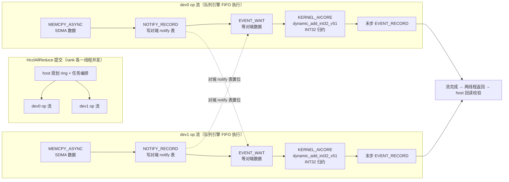

# 310p_hccl_allreduce：卡内双芯 HCCL AllReduce 验证（真机集成测试）

## 场景

Atlas 300I Duo（Ascend310P3）**同卡两芯片**（dev N 与 N+1，同一 PCIe 总线，如
dev0/dev1 同为 0000:18:00.0）上，用官方 `HcclCommInitAll`（单进程多设备通信域，
免 MPI）执行**一次** AllReduce（INT32 SUM，1M 元素/rank），逐元素精确校验：
rank r 输入 `r*1000000+i`，两 rank 之和期望 `1000000+2i`。

## HcclAllReduce() 到底做了什么（本机实测全流程）

用例代码短，是因为一切都在 `libhccl.so + libhcomm.so + runtime + 队列引擎`里。
以下为本机**实测时间线**（取证方法：`stdbuf -o0` 关掉 stdout 缓冲，使测试的阶段
打印与 slog 对齐；详见文末取证表）：

```
07:54:33.6   进程启动 + aclInit
             │
07:54:34.5 ~ 38.64   HcclCommInitAll（约 4.1 秒）              ── [1] 通信域就绪
             │   ├ flat 拓扑检测（本机 lo:60000 socket 交换，nRanks[2]）
             │   ├ 每设备装载 TBE 向量归约模块（TbeVectorReduce Init）
             │   ├ 每设备注册 AICPU kernel 族（ccl_kernel.json 全表：
             │   │   HcclKernelEntrance / RunAicpuKfcResInitV2 /
             │   │   RunAicpuRpcSrvLaunchV2_<op>×每算子 / ChannelInit…）
             │   │   ★ 仅注册（能力就绪），本流程一个都没拉起
             │   └ 流/事件/notify 资源就绪
             │
07:54:38.65  [2] 两 rank 缓冲就绪
             │
07:54:38.65 ~ 38.795   HcclAllReduce × 2 rank（双线程并发，约 150ms） ── [3]
             │   ├ host 规划：ring（HCCL_ALGO 未设，按量/拓扑自动选型）
             │   ├ host 直接把任务排进 op 流（同流混排，队列引擎按序执行）：
             │   │     MEMCPY_ASYNC（SDMA 搬运）
             │   │       → NOTIFY_RECORD（写【对端】设备 notify 表）
             │   │       → EVENT_WAIT / EVENT_RESET（等对端数据到位）
             │   │       → KERNEL_AICORE（INT32 归约核 ×2/侧）
             │   │   任务普查（两变体一致）：MEMCPY_ASYNC 20、NOTIFY_RECORD 24、
             │   │     EVENT_WAIT 24、EVENT_RESET 24、KERNEL_AICORE 4
             │   ├ 跨芯片同步：我方"数据 memcpy 在前、notify record 在后"入队，
             │   │   对端"EVENT_WAIT 在读之前"入队——FIFO 顺序即同步，由队列引擎保证
             │   ├ 提交阻塞至算子完成（近似同步语义→必须双线程并发出）
             │   └ 末步 EVENT_RECORD → 流完成 → 两个调用线程返回
             │
07:54:38.80  [4] D2H 回读，逐元素校验 OK
             │
07:54:38.80 ~ 44.10   HcclCommDestroy + ResetDevice（约 6.3 秒）
07:54:44.11  PASS
```



### 三个问题的直答

**① 什么时候拉起 AICPU？——本流程从头到尾没有拉起 AICPU kernel。**
全日志任务普查 0 个 AICPU 任务。`HCCL_OP_EXPANSION_MODE=AI_CPU` 无效的**根因已定位**
（hcomm 源码，与本机 9.1.0 同代）：env 被正常解析（日志 `aicpuUnfold[1]`，
externalinput.cc），但——
- 决定执行形态的 `OpParam.aicpuUnfoldMode` 在本版 host 侧**唯一赋值点**是 alltoall
  预处理（`alltoall_operator.cc:434`），且带 `deviceType_ == DEV_TYPE_910_93` 门槛；
  **AllReduce 没有赋值点，恒 false**，算法 tag 恒为 `_host`；
- config API 路线（`HcclCommConfig` → `CommConfig::SetConfigOpExpansionMode:345`）按
  设备矩阵硬挡，源码注释原文"**目前只有A3和300I支持Aicpu展开**"，代码仅放行
  `910_93 || 910B`（此处"300I"指 910B 系 A2 推理卡，非 310P3）；
- 即便支持设备，`IsSupportUnifiedMarch`（coll_alg_utils.cc:49）还要求双环拓扑 +
  **图模式** + 单机——单算子 opbase 流式调用连 isGraphMode 都不满足。
即 310P3 **不在 AICPU 展开的设备支持矩阵**（型号能力，非故障）。AICPU kernel 族在
**通信域初始化时注册**（含 `RunAicpuRpcSrvLaunchV2_<op>` 每算子入口）——那是
**设备侧高级接口路径**（融合算子 kernel 内调 `AscendC::Hccl::AllReduce→Commit→
Wait`）的就绪条件：kernel 客户端写邮箱、AicpuKfc 服务上 AICPU 消费（机制与证据见
[docs/310p/hcomm-GM标志消息同步机制.md](../../../docs/310p/hcomm-GM标志消息同步机制.md) 2.2）。
host API 的 host 没法当邮箱客户端（客户端必须是 kernel 的 core 0），所以 host-API
走的是 host 直接编排的路径——本测试即此路径。

**② 什么时候拉起 kernel？——op 调用期间。** host 规划后把 4 个 AICore 归约核
（`dynamic_add_int32_v51__kernel0`，随 TBE 向量归约模块预编译的按数据类型动态核，
`coreDim=8`）与搬运/标志任务**排进同一条 op 流**，无独立的"launch 阶段"。

**③ 两者如何同步、如何一起完成通信？——本流程没有"AICPU 与 kernel 协同"这回事。**
协同全部发生在 host 编排的**同一条流**上：入队顺序（数据在前、notify 在后；
对端 EVENT_WAIT 在读之前）就是同步关系，队列引擎按序执行保证"等到的必是已落地的
数据"；跨芯片经 notify 表（`NOTIFY_RECORD` 的 `notify_dev_id` 指向对端设备）。
AICore 归约核与搬运任务的次序同样由流序约束。AICPU 参与协同的形态（邮箱 + COND
SQE）属于①中设备侧融合算子路径，本测试覆盖不到。

### 本测试覆盖什么、不覆盖什么（与机制文档的关系）

- **覆盖**：310P host 应用的真实路径（HOST 展开）——host 编排 + 队列引擎 FIFO
  （数据先落笔、标志后落笔）+ notify 跨芯片握手 + SDMA 搬运 + AICore 归约核。
  即 [hcomm-GM标志消息同步机制](../../../docs/310p/hcomm-GM标志消息同步机制.md)
  **2.3 节（SQE 类型标志 / 链路握手）在 host 展开形态下的语义验证**，外加
  host-API AllReduce 数据正确性。
- **不覆盖**：机制文档 **2.2 节（KFC 邮箱）**。其客户端是设备侧融合算子
  （`AscendC::Hccl` 高级接口），host API 走不到；且本机无法用户侧驱动该机制
  （三重证据：装机 libhccl 无 AICPU 执行的 AllReduce 算法 / ADV API 实现头缺失
  （`lib/hccl/hccl.h` 不在安装中，华为自带 mc2_templates 源码本机也编不了）/
  全部近期设备日志零 RpcSrv·AicpuKfc 活动——详见机制文档 2.2 实证段）。
- 本机上"kernel 写请求邮箱 + AICPU 消费"这一机制模式的**可运行实例**：
  [310p_sdma_stability](../310p_sdma_stability/README.md)（本项目双环邮箱，
  真机长稳 PASS）。

### 环节取证对照表

| 环节 | 本机证据 |
|---|---|
| 阶段边界与耗时 | 测试打印 `[1]/[2]/[3]/[4]`（`stdbuf -o0` 后与 slog 同流对齐）：init≈4.1s、op≈150ms、销毁≈6.3s |
| 拓扑检测 | slog `topoinfo_detect.cc:207/332`、`op_base.cc:1614 [Init][CommRootInfo][Flat]nRanks[2]`（本机 lo:60000） |
| AICPU kernel 族注册（init 期） | slog `launch_aicpu.cc:264/244` → `launch_device.cc:33 LoadBinaryFromFile(ccl_kernel.json)` → `program.cc:850 RegisterCpuKernel[...]`（20+ 项，含 `RunAicpuRpcSrvLaunchV2_<op>`） |
| op 任务普查 | RUNTIME `TaskLaunchedEx / TaskSubmited / SendTask`：MEMCPY_ASYNC 20、NOTIFY_RECORD 24、EVENT_WAIT/EVENT_RESET 各 24、KERNEL_AICORE 4 |
| AICore 归约核 | slog `tbe_vector_reduce.cc:259 opDescInfo[binFileName dynamic_add_int32_v51.o …]`、RUNTIME `StreamLaunchKernelV2 kernel_name=dynamic_add_int32_v51__kernel0 coreDim=8`（每侧 2 个，与搬运任务同流） |
| 零 AICPU 任务 | 全日志无 AICPU 类型任务；AI_CPU 旋钮两变体任务普查逐项相同 |
| kernel 清单与通道 | 安装 `opp/.../aicpu/config/ccl_kernel.json`（= hcomm 仓 `framework/device/framework/ccl_kernel.ini`：注册项及其 `opKernelLib=KFCKernel`，本流程未拉起） |

取证方法：
`HCCL_SOCKET_IFNAME=eth0,lo ASCEND_GLOBAL_LOG_LEVEL=0 ASCEND_SLOG_PRINT_TO_STDOUT=1 stdbuf -o0 -e0 /tmp/mf_310p_hccl_allreduce 0 2>&1 | tee run.log`
（`stdbuf` 必需：printf 默认块缓冲，否则阶段打印全部堆到日志尾部，无法对齐阶段；
`HCCL_SOCKET_IFNAME` 见纪律 ④。）设备侧 AICPU 日志走 plog（`~/ascend/log/`），
本流程无 AICPU 任务故无可查。

## 必要条件

- Atlas 300I Duo（Ascend310P3）+ CANN ≥ 9.1
- 同卡设备对空闲（默认 dev0/dev1；`TEST_DEVICE_BASE` 可换对）

## 运行

```bash
bash run.sh                       # 编译并运行两个变体
bash run.sh --build-only          # 仅编译（产物 /tmp/mf_310p_hccl_allreduce）
bash run.sh --run-only            # 仅运行
TEST_DEVICE_BASE=4 bash run.sh    # 用 dev4/dev5（避开占用设备）
```

期望输出：两变体均 `== PASS: 卡内 devN+devN+1 一次 AllReduce(INT32 SUM) 结果正确 ==`。

## 实测纪律（踩坑记录，2026-10-29）

1. `HcclCommInitAll` 前必须先 `aclrtSetDevice`——否则 HCCL_E_RUNTIME(15)，
   日志根因 `rtGet device fail, please make sure that device is set`。
2. 集合通信的**提交会阻塞等对端参与**——rank 必须各自线程并发出；单线程顺序
   下发 ~2 分钟后 HCCL_E_TIMEOUT(9)。
3. rank 粒度=芯片：本测试覆盖"同卡双芯"通信；单芯片内部 die0/die1 跨 Die 路径
   由 [310p_sdma_stability](../310p_sdma_stability/README.md)（SDMA mail，SQE 按
   die 分 streamid）覆盖。
4. 通信域初始化可能撞端口（`InitRaNic … listen on ip[192.168.x.x] and port[16666]
   fail`，HCCL_E_UNAVAIL=7，多见于并发多 HCCL 进程时）——设
   `HCCL_SOCKET_IFNAME=eth0,lo` 限定本机网卡即可规避。
