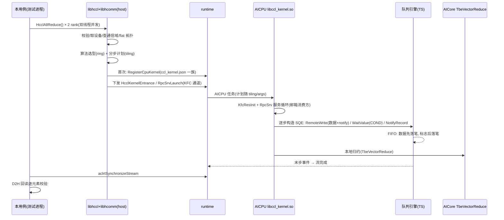

# 310p_hccl_allreduce：卡内双芯 HCCL AllReduce 验证（真机集成测试）

## 场景

Atlas 300I Duo（Ascend310P3）**同卡两芯片**（dev N 与 N+1，同一 PCIe 总线，如
dev0/dev1 同为 0000:18:00.0）上，用官方 `HcclCommInitAll`（单进程多设备通信域，
免 MPI）执行**一次** AllReduce（INT32 SUM，1M 元素/rank），逐元素精确校验：
rank r 输入 `r*1000000+i`，两 rank 之和期望 `1000000+2i`。两个变体：默认展开模式、
`HCCL_OP_EXPANSION_MODE=AI_CPU`（点名 AICPU 展开），均须 PASS。

## HcclAllReduce 内部执行链（为什么用例代码这么短）

用例短，是因为核心全在库里。一次 `HcclAllReduce()` 在本机的真实执行链，
分层展开（**全部环节均有本机取证**，取证方法与证据见文末表格）：

**host 侧（libhccl.so + libhcomm.so，进程内）**

1. **入口**：参数校验、取当前设备/流（`g_hcclDeviceId` 刷新——这就是必须先
   `aclrtSetDevice` 的原因，否则 HCCL_E_RUNTIME(15)）。
2. **通信域与拓扑**：flat 拓扑检测（日志 `[Init][CommRootInfo][Flat]nRanks[2]`；
   拓扑交换经本机 socket，`topoinfo_detect.cc` 起 server 于本机 ip:60000）。
3. **算法规划**：库初始化时已注册算法模板表（日志 `alg_template_register.cc`
   逐个登记模板 type 54/55/79/80/104…），本次按消息量/链路自动选型为 **ring**
   （未设 `HCCL_ALGO`，日志 "HCCL_ALGO is not set"）；分步计划随 tiling 组装
   （tiling 含 sendArgIndex/recvArgIndex 等，见 hcomm `HcclKFCTilingData`）。
4. **首次调用注册设备 kernel**：按 `opp/built-in/op_impl/aicpu/config/ccl_kernel.json`
   注册一族 AICPU kernel（日志 `launch_aicpu.cc → RegisterCpuKernel`，进程内缓存
   仅此一次）：`HcclKernelEntrance`、`HcclUpdateCommKernelEntrance`、
   `RunAicpuKfcResInitV2`、**`RunAicpuRpcSrvLaunchV2`**（按算子类型多入口注册——
   allreduce/reduce/send/receive/allgather/… 全指向同一函数）、
   `RunAicpuChannelInitV2/V3` 等。
5. **下发**：计划作为 kernel 参数，经 KFC/AICPU 通道下发设备；**提交过程含同步
   等待（等对端参与）→ rank 必须各自线程并发出**（单线程顺序下发 ~2 分钟后
   HCCL_E_TIMEOUT(9)）。

**设备侧 AICPU（libccl_kernel.so，装机于 aarch64-linux/devlib/device/）**

6. `RunAicpuKfcResInitV2`：KFC 资源初始化。
7. `RunAicpuRpcSrvLaunchV2`（`opKernelLib=KFCKernel`）：组装 KFCTask 后拉起
   **AicpuKfc RPC 服务循环**——即
   [hcomm-GM标志消息同步机制](../../../docs/310p/hcomm-GM标志消息同步机制.md)
   2.2 节的邮箱消费方（`msgPos` 游标环回 + valid/xor/seq 三重校验）。源码：
   hcomm `framework/device/aicpu_kfc/aicpu_kfc_interface.cc:421`（日志原文
   "Task Assembled. Start to launch RunAicpuRpcSrvLaunch"）。
8. `HcclKernelEntrance`：按 host 计划逐步执行。它调用的原语就是机制文档里的
   各层——**装机二进制导入符号实证**（`nm -D libccl_kernel.so`）：
   - `HcclRemoteWrite / WriteReduce / WriteWithNotify / ReadReduce …`：远端数据
     搬运（SDMA，带随路 notify——"数据 SQE + 标志同 SQE"的官方版）；
   - `HcclDispatcherWaitValue / WriteValue`：**COND SQE 硬件轮询**（turn 等待与
     回写，机制文档 2.2.3）；
   - `HcclLocalNotifyRecord/Wait、HcclRemoteNotifyRecord/Wait、HcclRemoteFence/
     Drain`：链路逐步握手 ready/done（机制文档 2.3）；
   - `CreateDispatcherCtx / FindDispatcherByCommId`：通信域→调度器映射；
   - 同库导出 `CommGetKFCWorkSpace`：KFC 工作区（`HcclMsgArea` 所在）获取接口。
9. **归约计算下放 AICore**：`TbeVectorReduce`（TBE 向量核，日志
   `tbe_vector_reduce.cc:67 TbeVectorReduce Init get device type[1]`）。
10. 队列引擎 FIFO 执行：数据先落笔、标志后落笔；末步事件 → 流完成 →
    `aclrtSynchronizeStream` 返回，host 回读校验。



### 环节取证对照表

| 环节 | 本机证据 |
|---|---|
| 拓扑检测 | slog `topoinfo_detect.cc:207/332`、`op_base.cc:1614 [Init][CommRootInfo][Flat]nRanks[2]` |
| 算法注册/选型 | slog `alg_template_register.cc:40`（模板 type 54/55/79/80/104…）、"HCCL_ALGO is not set"、ring |
| AICPU kernel 注册 | slog `launch_aicpu.cc:264/244`、`launch_device.cc:33 LoadBinaryFromFile`、`program.cc:850 RegisterCpuKernel[…]` |
| kernel 清单与通道 | 安装 `opp/.../aicpu/config/ccl_kernel.json`（= hcomm 仓 `framework/device/framework/ccl_kernel.ini`：HcclKernelEntrance / RunAicpuRpcSrvLaunchV2 等的 `opKernelLib=KFCKernel`） |
| 设备库原语 | `nm -D aarch64-linux/devlib/device/libccl_kernel.so`：导出 `HcclKernelEntrance/RunAicpuRpcSrvLaunchV2/CommGetKFCWorkSpace`；导入 `HcclRemoteWrite*`、`HcclDispatcherWaitValue/WriteValue`、`HcclLocal/RemoteNotifyRecord/Wait`、`HcclRemoteFence/Drain` |
| 邮箱服务循环源码 | hcomm `framework/device/aicpu_kfc/aicpu_kfc_interface.cc:421`（RunAicpuRpcSrvLaunch）；消费循环 `aicpu_kfc_process.cc:1151`（msgPos） |
| AICore 归约 | slog `tbe_vector_reduce.cc:67 TbeVectorReduce Init get device type[1]` |

取证方法：`ASCEND_GLOBAL_LOG_LEVEL=0 ASCEND_SLOG_PRINT_TO_STDOUT=1 ./310p_hccl_allreduce 0 2>&1 | tee run.log`
后按上表 grep。**边界说明**：`HcclKernelEntrance` 本体源码不在开源仓（仅装机二进制
可导出符号），其行为由导入符号 + 日志 + ccl_kernel.ini 推定；设备侧 AICPU 的日志走
plog（`~/ascend/log/`），不在 host slog 里。

## 必要条件

- Atlas 300I Duo（Ascend310P3）+ CANN ≥ 9.1
- 同卡设备对空闲（默认 dev0/dev1；`TEST_DEVICE_BASE` 可换对）

## 运行

```bash
bash run.sh                       # 编译并运行两个变体
bash run.sh --build-only          # 仅编译（产物 /tmp/mf_310p_hccl_allreduce）
bash run.sh --run-only            # 仅运行
TEST_DEVICE_BASE=4 bash run.sh    # 用 dev4/dev5（避开占用设备）
```

期望输出：两变体均 `== PASS: 卡内 devN+devN+1 一次 AllReduce(INT32 SUM) 结果正确 ==`。

## 实测纪律（踩坑记录，2026-10-29）

1. `HcclCommInitAll` 前必须先 `aclrtSetDevice`——否则 HCCL_E_RUNTIME(15)，
   日志根因 `rtGet device fail, please make sure that device is set`。
2. 集合通信的**提交会阻塞等对端参与**——rank 必须各自线程并发出；单线程顺序
   下发 ~2 分钟后 HCCL_E_TIMEOUT(9)。
3. rank 粒度=芯片：本测试覆盖"同卡双芯"通信；单芯片内部 die0/die1 跨 Die 路径
   由 [310p_sdma_stability](../310p_sdma_stability/README.md)（SDMA mail，SQE 按
   die 分 streamid）覆盖。
